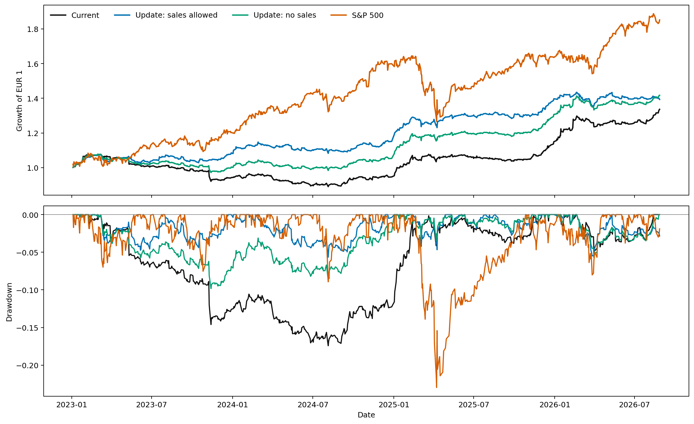

<!doctype html>
<html lang="en">
<head>
<meta charset="utf-8">
<meta name="viewport" content="width=device-width, initial-scale=1">
<title>Baltic investment plan</title>

</head>
<body><main markdown="1">
# Baltic investment plan - updated 2026-10-27 10:50 (Europe/Vilnius); return analysis through 2026-10-23; valuation prices through 2026-10-23

Private Nasdaq Baltic portfolio analysis. Tables, figures and individual-share information are collapsed; select a title to expand it.

---

# Nasdaq Baltic universe: maximum-netSD portfolio

Study period: 2023-01-01 to 2026-10-23 | Portfolio ceiling: EUR 15,000 | Existing positions may be sold

Return statistics use complete common trading dates through 2026-10-23. Valuation, whole-share quantities and EUR trade amounts use each share's latest observed close through 2026-10-23.

<strong>1. Share analytics</strong>

<strong>1.1. Table 1.a. Interactive share profiles</strong>

Select a share to display its allocation, technical indicators, all PerformanceAnalytics measures and portfolio sensitivity. Average annual dividend is the mean of the official annual dividend per share totals for 2022–2026; a year without a distribution contributes zero, and future ex-dividend dates after the report update date are excluded.

<fieldset class="signal-filters"><legend>Current execution decision</legend><label><input type="checkbox" value="BUY" checked> BUY</label><label><input type="checkbox" value="WAIT" checked> WAIT</label><label><input type="checkbox" value="SELL" checked> SELL</label><label><input type="checkbox" value="HOLD" checked> HOLD</label><label><input type="checkbox" value="SKIP" checked> SKIP</label></fieldset><fieldset class="netsd-filters"><legend>netSD after adding this share</legend><label><input type="checkbox" value="INCREASE" checked> Increases</label><label><input type="checkbox" value="DECREASE" checked> Decreases</label><label><input type="checkbox" value="UNCHANGED" checked> Unchanged</label></fieldset><fieldset class="dividend-filters"><legend>Dividends paid at least once in 2022–2026</legend><label><input type="checkbox" value="PAID" checked> Paid dividends</label><label><input type="checkbox" value="NONE" checked> No dividends paid</label></fieldset>

<strong>KNE1L — KN Energies</strong> | current action: WAIT | allocation target 1929 shares | netSD diagnostic rank 1

<table class="stock-summary-table"><thead><tr><th>Current shares</th><th>Target shares</th><th>Change</th><th>Weight</th><th>Last price</th><th>Individual netSD</th><th>OUT / IN</th><th>RSI(14)</th><th>MACD state</th><th>Bollinger state</th><th>Stochastic RSI</th><th>Average annual dividend (2022–2026)</th><th>Technical timing signal</th><th>Portfolio allocation change</th><th>HHI contribution</th><th>Median daily turnover</th><th>Trade / median turnover</th><th>Zero-volume days</th><th>Liquidity risk</th></tr></thead><tbody><tr><td>928</td><td>1929</td><td>+1001</td><td>6.16%</td><td>EUR 0.4790</td><td>0.3983</td><td>47 / 0</td><td>36.14</td><td>Bearish</td><td>Inside bands</td><td>0.422 (Neutral)</td><td>EUR 0.0129 / share</td><td>HOLD</td><td>BUY</td><td>0.003795 (4.213% of portfolio HHI)</td><td>EUR 14,161</td><td>3.4%</td><td>1.6%</td><td>MEDIUM</td></tr></tbody></table>

**Execution rationale:** Allocation target is higher, but technical timing does not support buying now.

Signals combine four indicators: Bollinger bands, RSI, MACD and Stochastic RSI. Vertical lines distinguish 4-of-4, 3-of-4 and 2-of-4 buy/sell agreement.

**Current indicative prices and four-indicator signals**

| Indicator | Current indicator value | BUY price | SELL price | Signal now |
| --- | --- | --- | --- | --- |
| Bollinger price | Close = EUR 0.4790 | ≤ EUR 0.4764 | ≥ EUR 0.4911 | HOLD |
| RSI(14) | RSI = 36.14 | ≤ EUR 0.4772 | ≥ EUR 0.5026 | HOLD |
| Stochastic RSI %K | %K = 0.422 | ≤ EUR 0.4779 | ≥ EUR 0.4812 | HOLD |
| MACD crossover | MACD = -0.0030 Signal = -0.0024 Gap = -0.0005 Bullish crossover close ≈ EUR 0.4875 | — | — | SELL |
| Consensus | BUY 0/4; SELL 1/4; neutral 3/4 | At least 3 BUY votes | At least 3 SELL votes | HOLD |

MACD does not define an acceptable purchase or sale price. Its bullish crossover close is only the hypothetical latest close at which MACD would cross above its signal line if all earlier closes stayed unchanged. A crossover above the current price means that upward momentum still needs confirmation; it does not mean that the investor should wait and buy at that higher price. RSI and Stochastic RSI price thresholds are also indicative because only the latest close is varied. The four-indicator consensus is BUY or SELL only when at least three indicators agree; otherwise it is HOLD.

Complete technical history

Return histogram

Seasonality, drawdowns and upside periods

The analysis covers 962 daily returns from 2023-01-02 to 2026-10-23. Statistically supported calendar effects: **none after multiple-testing correction**. Adjusted p-values control the false-discovery rate across all analysed shares.

| Measure | Value | Measure | Value | Measure | Value |
| --- | --- | --- | --- | --- | --- |
| Maximum drawdown | -26.64% (2023-12-20) | Average gain / average loss | 1.211 | Best 21-day period | 24.84% (ending 2025-12-08) |
| Average underwater drawdown | 10.86% | Upside potential ratio | 1.466 | Worst 21-day period | -9.36% (ending 2024-02-12) |
| Conditional drawdown 95% | 24.99% | Upside capture vs Baltic EW | 100.1% | Best 5-day period | 14.81% (ending 2025-12-05) |
| Ulcer index | 12.88 | Downside capture vs Baltic EW | 43.3% | Best 63-day period | 41.74% (ending 2026-01-09) |
| Longest underwater period | 728 calendar days | Positive trading days | 37.0% | Repeated calendar pattern | Jan: 100% positive across 4 years |
| Daily downside deviation | 0.726% | Best day | 8.61% (2024-01-08) |  |  |
| Daily upside deviation | 0.930% | Worst day | -7.37% (2025-05-14) |  |  |

**Calendar-effect tests and observed averages**

| Effect | Observed result | Raw p | BH-adjusted p | Conclusion |
| --- | --- | --- | --- | --- |
| Weekday | Best: Friday (0.267%); worst: Tuesday (-0.035%) | 0.0315 | 0.1207 | Not detected |
| Calendar month | Best: Jan (0.515% daily); worst: Mar (-0.161% daily) | 0.3813 | 0.5263 | Not detected |
| Turn of month | First/last three days: 0.266%; other days: 0.035% | 0.0269 | 0.1549 | Not detected |

**Five deepest drawdown episodes**

| Rank | Peak | Trough | Recovery | Loss | Underwater days |
| --- | --- | --- | --- | --- | --- |
| 1 | 2023-01-27 | 2023-12-20 | 2025-01-24 | -26.64% | 728 |
| 2 | 2026-01-09 | 2026-03-27 | 2026-05-05 | -10.77% | 116 |
| 3 | 2026-05-08 | 2026-05-20 | 2026-06-02 | -10.23% | 25 |
| 4 | 2025-05-13 | 2025-06-25 | 2025-08-22 | -8.33% | 101 |
| 5 | 2026-08-21 | 2026-10-22 | Not recovered | -5.73% | 63 |

**Five strongest non-overlapping 21-trading-day rises**

| Rank | Start | End | 21-day return |
| --- | --- | --- | --- |
| 1 | 2025-11-07 | 2025-12-08 | 24.84% |
| 2 | 2024-12-19 | 2025-01-24 | 16.10% |
| 3 | 2025-12-10 | 2026-01-15 | 15.32% |
| 4 | 2023-12-11 | 2024-01-12 | 14.63% |
| 5 | 2023-01-02 | 2023-01-31 | 13.33% |

The dated extremes identify where company announcements, dividends, corporate actions or data anomalies should be checked. A repeated calendar average is descriptive until it survives the adjusted test and a later out-of-sample period; it is not by itself a buy or sell signal.

Official company-news calendar and price-direction analysis (24 events)

Announcement times and links come from the official Nasdaq news service. The effective date is the first trading close strictly after publication. Abnormal return means the share return minus the equal-weight Baltic-market return over the same window.

| Event type | N | Abnormal 1d | Abnormal 5d | Abnormal 21d | Positive 5d | Direction reversal | BH p(5d) | BH p(21d) | Interpretation |
| --- | --- | --- | --- | --- | --- | --- | --- | --- | --- |
| Dividend payment | 1 | 0.90% | 1.90% | 4.80% | 100% | 100% | 1.0000 | 1.0000 | No adjusted statistical evidence |
| Earnings | 19 | 0.33% | -0.17% | 1.20% | 47% | 21% | 0.9959 | 1.0000 | No adjusted statistical evidence |
| Ex-dividend | 3 | -5.62% | -4.03% | -1.16% | 0% | 33% | 0.0024 | 0.8810 | Different from ordinary periods; price drop may be mechanical |
| Guidance | 1 | -0.15% | -1.19% | -7.10% | 0% | 100% | 1.0000 | 1.0000 | No adjusted statistical evidence |

A direction reversal requires opposite fitted price slopes during the ten trading days before and after the event and at least a 1% five-day move. This identifies temporal association, not proof that the announcement caused the change.

Complete official event calendar (24 announcements)

| Published | Type | Profit outcome | Official announcement | Headline fundamental cue | Pre 5d | Post 1d | Post 5d | Post 21d | Abnormal 5d | Reversal |
| --- | --- | --- | --- | --- | --- | --- | --- | --- | --- | --- |
| 2026-08-20 09:00 | Earnings | Higher profit | [AB KN Energies unaudited financial information for the six months of 2026](https://view.news.eu.nasdaq.com/view?id=b808ccb80199f6ab729568f52ef695312&lang=en&src=listed) | Open official announcement | 2.06% | 2.22% | 0.00% | -0.20% | 0.52% | No |
| 2026-05-21 09:00 | Earnings | Unclassified earnings release | [AB KN Energies unaudited financial information for the 3 months of 2026](https://view.news.eu.nasdaq.com/view?id=b208494d7a089a24cfb6793b39edf15d5&lang=en&src=listed) | Open official announcement | -3.93% | 0.68% | 0.68% | 8.41% | 1.06% | No |
| 2026-05-14 08:00 | Ex-dividend | — | [Official dividend calendar: Dividend ex-date, EUR 0.0286 per share](https://nasdaqbaltic.com/statistics/en/dividends) | EUR 0.0286  | -0.43% | -6.77% | -3.93% | 3.93% | -3.36% | No |
| 2026-04-02 18:08 | Earnings | Unclassified earnings release | [AB KN Energies audited Annual information for the year 2025](https://view.news.eu.nasdaq.com/view?id=bbcdb8bccf9c49fb1f4f874fe5aa7bb97&lang=en&src=listed) | Open official announcement | 4.39% | -0.23% | 0.93% | 7.48% | -0.71% | No |
| 2026-02-26 16:00 | Earnings | Higher profit | [AB KN Energies unaudited financial information for the twelve months of 2025](https://view.news.eu.nasdaq.com/view?id=b79f70f0f3cc68b7ebee6bb424727d346&lang=en&src=listed) | Open official announcement | -4.44% | 3.49% | -1.40% | -5.58% | -1.19% | No |
| 2025-11-21 16:00 | Earnings | Unclassified earnings release | [AB KN Energies unaudited financial information for the 9 months of 2025](https://view.news.eu.nasdaq.com/view?id=b0d9e53e874fec057dccb705a66870dd7&lang=en&src=listed) | Open official announcement | 3.94% | -0.87% | 2.33% | 18.08% | 2.00% | No |
| 2025-08-22 08:55 | Earnings | Higher profit | [AB KN Energies unaudited financial information for the six months of 2025](https://view.news.eu.nasdaq.com/view?id=b339c7ee327409b2d719dd49da3e7ca8d&lang=en&src=listed) | Open official announcement | 6.12% | -0.64% | 0.32% | 2.56% | 0.68% | No |
| 2025-05-26 09:00 | Earnings | Unclassified earnings release | [AB KN Energies unaudited financial information for the 3 months of 2025](https://view.news.eu.nasdaq.com/view?id=b99746177ca4090b1c2154e59bb1b5024&lang=en&src=listed) | Open official announcement | -0.33% | 0.00% | -0.33% | -4.35% | -1.05% | No |
| 2025-05-14 08:00 | Ex-dividend | — | [Official dividend calendar: Dividend ex-date, EUR 0.0227 per share](https://nasdaqbaltic.com/statistics/en/dividends) | EUR 0.0227  | 2.30% | -7.37% | -3.85% | -5.77% | -4.56% | No |
| 2025-04-07 18:00 | Earnings | Unclassified earnings release | [AB KN Energies audited Annual information for the year 2024](https://view.news.eu.nasdaq.com/view?id=be29e9c68fa04668262744c39fd39bead&lang=en&src=listed) | Open official announcement | -0.72% | 1.82% | 6.91% | 12.00% | 4.75% | Yes |
| 2025-02-28 09:00 | Earnings | Higher profit | [AB KN Energies unaudited financial information for the twelve months of 2024](https://view.news.eu.nasdaq.com/view?id=bd09e474fe52dbe3b6b60dcae282ad341&lang=en&src=listed) | Open official announcement | 6.67% | -0.69% | -5.56% | -3.82% | -5.57% | Yes |
| 2024-11-18 08:30 | Earnings | Unclassified earnings release | [AB KN Energies unaudited financial information for the  nine months of 2024](https://view.news.eu.nasdaq.com/view?id=b6320a20de0897bbb15bbbe2d5e1b03ab&lang=en&src=listed) | Open official announcement | 1.73% | -0.85% | 0.00% | 0.85% | 0.12% | No |
| 2024-08-14 15:27 | Earnings | Higher profit | [Correction: AB KN Energies unaudited financial information for the six months of 2024](https://view.news.eu.nasdaq.com/view?id=bd7ab827c0765692a231279636e21efc2&lang=en&src=listed) | Open official announcement | 0.43% | 0.00% | -0.85% | -3.83% | -0.89% | No |
| 2024-05-22 08:00 | Dividend payment | — | [Official dividend calendar: Dividend payment date, EUR 0.0131 per share](https://nasdaqbaltic.com/statistics/en/dividends) | EUR 0.0131  | -2.27% | 0.93% | 1.86% | 5.12% | 1.90% | Yes |
| 2024-05-21 17:03 | Earnings | Unclassified earnings release | [AB KN Energies unaudited financial information for the 3 months of 2024](https://view.news.eu.nasdaq.com/view?id=b792e290b4a29856b25d2bbc49296e698&lang=en&src=listed) | Open official announcement | -2.27% | 0.93% | 1.86% | 5.12% | 1.90% | Yes |
| 2024-05-14 08:00 | Ex-dividend | — | [Official dividend calendar: Dividend ex-date, EUR 0.0131 per share](https://nasdaqbaltic.com/statistics/en/dividends) | EUR 0.0131  | 0.44% | -3.93% | -5.24% | -1.75% | -4.16% | Yes |
| 2024-04-30 16:00 | Earnings | Unclassified earnings release | [AB KN Energies audited Annual information for the year 2023](https://view.news.eu.nasdaq.com/view?id=b6a445813d007c002336c889cbcb23969&lang=en&src=listed) | Open official announcement | 0.89% | 0.00% | 0.00% | -3.08% | -0.64% | No |
| 2024-02-29 08:55 | Earnings | Unclassified earnings release | [AB KN Energies unaudited financial information for the twelve months of 2023](https://view.news.eu.nasdaq.com/view?id=bb7a677c7fdc94e151be2df07e65bf66e&lang=en&src=listed) | Open official announcement | 3.27% | 0.45% | 3.17% | 0.45% | 3.69% | No |
| 2023-11-21 08:55 | Earnings | Unclassified earnings release | [AB Klaipėdos nafta unaudited financial information for the nine months of 2023](https://view.news.eu.nasdaq.com/view?id=b5f4ac8e873b24ce0db32f3b9fb0404a9&lang=en&src=listed) | Open official announcement | -1.45% | 1.47% | 0.98% | -1.47% | 1.36% | No |
| 2023-08-18 09:00 | Earnings | Unclassified earnings release | [AB Klaipėdos nafta unaudited financial information for the six months of 2023](https://view.news.eu.nasdaq.com/view?id=b7821fa600e159afb0554fcd4e9f28180&lang=en&src=listed) | Open official announcement | 0.92% | -0.45% | -0.91% | -0.91% | -0.36% | No |
| 2023-06-14 08:00 | Guidance | — | [New long-term strategy of AB „Klaipėdos nafta“ (KN) focuses on energy transformation and climate neutrality of operations](https://view.news.eu.nasdaq.com/view?id=b04e36fce7a658b403078c68b717fca4c&lang=en&src=listed) | Open official announcement | -0.43% | 0.00% | -1.29% | -7.30% | -1.19% | Yes |
| 2023-05-22 08:57 | Earnings | Unclassified earnings release | [AB Klaipėdos nafta unaudited financial information for the 3 months of 2023](https://view.news.eu.nasdaq.com/view?id=bc4c49c6029aa4a40b392bc0fdf8b870a&lang=en&src=listed) | Open official announcement | 0.43% | -0.85% | -4.66% | -0.85% | -4.35% | Yes |
| 2023-04-28 16:45 | Earnings | Unclassified earnings release | [Correction: AB Klaipėdos nafta audited Annual financial statements for the year 2022](https://view.news.eu.nasdaq.com/view?id=b128051ca351f7f3a9528c95750607960&lang=en&src=listed) | Open official announcement | -2.02% | 0.82% | -3.70% | -5.76% | -3.56% | No |
| 2023-02-27 08:55 | Earnings | Unclassified earnings release | [AB Klaipėdos nafta unaudited financial information for 2022](https://view.news.eu.nasdaq.com/view?id=b453987a56cea493816a2145d3dc139d1&lang=en&src=listed) | Open official announcement | 0.37% | -0.18% | -0.92% | -6.83% | -1.01% | No |

Profit outcome and subsequent price analysis (5 classified of 19 earnings releases)

Higher/lower profit refers to the issuer's explicit comparison with the earlier comparable period. ‘In line / unchanged’ is used only when the issuer explicitly says that profit met a plan, forecast or expectation, or was unchanged. ‘Loss’ requires an explicit realised net or operating loss. Releases without such wording remain unclassified and are excluded from the conditional estimates.

Variance is reported in squared percentage points. Abnormal return is the share return minus the equal-weight Baltic-market return over the same horizon.

| Profit outcome | Horizon | N | Conditional mean | Variance | Median | Positive share | Mean abnormal | Abnormal variance | Median abnormal |
| --- | --- | --- | --- | --- | --- | --- | --- | --- | --- |
| Higher profit | 1d | 5 | 0.88% | 3.543 | 0.00% | 40% | 0.84% | 2.727 | 0.06% |
| Higher profit | 5d | 5 | -1.50% | 5.611 | -0.85% | 20% | -1.26% | 6.487 | -0.89% |
| Higher profit | 21d | 5 | -2.17% | 10.849 | -3.82% | 20% | -1.28% | 10.803 | -2.88% |

**Kruskal–Wallis test across the available outcome groups**

At least two outcome groups with two observations each are required; this share does not have enough observations for the omnibus test.

**Pairwise result:** No pairwise difference survives BH adjustment.

The test describes historical association. Small groups, overlapping horizons and repeated releases from the same company limit causal interpretation.

All five model frontiers with this share highlighted

The highlighted circle is the selected share and pale circles are the remaining shares. Every curve and point now uses the same 55-share Baltic universe, the same complete return sample and the same displayed risk definition. Markowitz, MAD, Minimax and empirical 95% CVaR curves are solved under long-only full-investment constraints. Consequently, a feasible portfolio point cannot lie above the corresponding curve at the same risk. The netSD criterion is discrete and non-convex, so its dashed line is explicitly an observed nondominated candidate envelope rather than a claimed smooth global frontier. Its horizontal axis is 1 - netSD, where lower is better.

All 72 PerformanceAnalytics measures: full period and last 126 observations

| Measure | Full period | Last 126 | Measure | Full period | Last 126 |
| --- | --- | --- | --- | --- | --- |
| ActiveReturn | 0.000188 | 0.027252 | M2Sortino | 0.229455 | 0.263184 |
| AdjustedSharpe | 0.839065 | 1.254826 | MSquaredExcess | -0.016662 | -0.019518 |
| AnnualizedReturn_Arithmetic | 0.224639 | 0.252929 | Martin | 2.345800 | 6.852320 |
| AnnualizedReturn_Geometric | 0.228878 | 0.264461 | MaximumDrawdown | 0.221272 | 0.087640 |
| Appraisal | 1.124440 | 1.123663 | Modigliani | 0.000811 | 0.000809 |
| ArithmeticReturn | 0.000891 | 0.001004 | NetSelectivity | -0.022504 | -0.029973 |
| AverageDrawdown | 0.039182 | 0.031606 | Omega | 1.271113 | 1.284758 |
| AverageDrawdownLength | 27.000000 | 12.555556 | OmegaExcessReturn | 0.187219 | 0.230724 |
| AverageRecoveryTime | 12.962963 | 4.000000 | PainIndex | 0.074507 | 0.031391 |
| BernardoLedoit | 1.271113 | 1.284758 | PainRatio | 3.071879 | 8.424761 |
| BetaCoKurtosis | -0.057374 | 0.294297 | Prospect | -0.442350 | -0.488452 |
| BetaCoSkewness | -1.083880 | -3.438438 | Rachev | 1.354964 | 1.386871 |
| Burke | 0.935037 | 2.591715 | Selectivity | 0.216639 | 0.211803 |
| CAPMAlpha | 0.000844 | 0.000806 | Sharpe_Annualized | 1.163808 | 1.314961 |
| CAPMBeta | 0.053517 | 0.221990 | Sharpe_Daily | 0.073313 | 0.082835 |
| CDD | 0.089651 | 0.072855 | Sharpe_ES | 0.037023 | 0.045126 |
| Calmar | 1.034372 | 3.017568 | Sharpe_VaR | 0.059372 | 0.069887 |
| CoKurtosis | -0.000000 | 0.000000 | Skewness | 0.987947 | 1.142528 |
| CoSkewness | -0.000000 | -0.000000 | Sortino | 0.122513 | 0.144099 |
| CumulativeReturn | 0.852744 | 0.124483 | SpecificRisk | 0.192664 | 0.188493 |
| DRatio | 0.754046 | 0.723735 | Sterling | 0.712411 | 1.409403 |
| DownCapture | -0.088163 | 0.094241 | SystematicRisk | 0.009397 | 0.034400 |
| DownNumber | 0.355346 | 0.471698 | TotalRisk | 0.192893 | 0.191607 |
| DownPercent | 0.805031 | 0.830189 | TrackingError_Annualized | 0.254540 | 0.224387 |
| DownsideDeviation | 0.007276 | 0.006965 | TrackingError_Daily | 0.016035 | 0.014135 |
| DrawdownDeviation | 0.011540 | 0.011245 | Treynor_Annualized | 4.276716 | 1.191321 |
| ES_Loss | 0.024077 | 0.022242 | Treynor_Daily | 0.015288 | 0.004196 |
| FamaBeta | 1.099226 | 1.241241 | UlcerIndex | 0.097569 | 0.038594 |
| GeometricReturn | 0.000818 | 0.000932 | UpCapture | 0.139592 | 0.309247 |
| Hurst | 0.388823 | 0.396868 | UpNumber | 0.362385 | 0.479452 |
| Information_Annualized | 0.000740 | 0.121451 | UpPercent | 0.222477 | 0.260274 |
| Information_Daily | 0.000038 | 0.006122 | UpsidePotential | 0.574404 | 0.650141 |
| JensenAlpha | 0.216639 | 0.211803 | UpsideRisk | 0.009772 | 0.009907 |
| Kappa | 0.077893 | 0.103500 | VaR_Loss | 0.015014 | 0.014362 |
| Kelly | 6.029454 | 6.836399 | Volatility | 0.012159 | 0.012117 |
| Kurtosis | 11.339894 | 7.110220 | Volatility_Annualized | 0.193020 | 0.192347 |

Portfolio sensitivity

**Removing this share from curent_update_baltic**

<table class="effect-table"><thead><tr><th>Measure</th><th>Full portfolio</th><th>Portfolio without share</th><th>Change</th></tr></thead><tbody><tr><td>netSD</td><td>0.813559</td><td>0.771186</td><td>-0.042373</td></tr><tr><td>OUT</td><td>96</td><td>91</td><td>-5</td></tr><tr><td>IN</td><td>0</td><td>0</td><td>+0</td></tr><tr><td>Rachev ratio</td><td>1.147773</td><td>1.151322</td><td>0.003548</td></tr><tr><td>Sortino ratio</td><td>0.161492</td><td>0.152410</td><td>-0.009082</td></tr></tbody></table>

The removed weight is distributed proportionally across all remaining holdings, so their weights still sum to 1.

**Increasing this existing position in the current portfolio**

<table class="effect-table"><thead><tr><th>Measure</th><th>Current portfolio</th><th>After adding share</th><th>Change</th></tr></thead><tbody><tr><td>KNE1L shares</td><td>928</td><td>1929</td><td>+1001</td></tr><tr><td>Portfolio value, EUR</td><td>8895.553974</td><td>9375.032977</td><td>479.479002</td></tr><tr><td>netSD</td><td>0.618644</td><td>0.635593</td><td>0.016949</td></tr><tr><td>OUT</td><td>73</td><td>75</td><td>+2</td></tr><tr><td>IN</td><td>0</td><td>0</td><td>+0</td></tr><tr><td>Rachev ratio</td><td>1.062407</td><td>1.072230</td><td>0.009823</td></tr><tr><td>Sortino ratio</td><td>0.104500</td><td>0.112869</td><td>0.008370</td></tr></tbody></table>

The starting point is the unmodified current portfolio, which already contains 928 KNE1L shares. The scenario adds 1001 shares from Table 1.a, resulting in 1929 shares; every other holding remains unchanged.

FSD, SSD and TSD components versus Baltic portfolios

The interactive calculation starts from one common empirical FSD grid. SSD is its cumulative integral and TSD is the cumulative integral of that SSD; neither higher-order component is loaded independently. Use the x-position slider or the mouse wheel to move the selected interval. Choose S&P 500, Current or any model portfolio as the benchmark for the difference panels.

Open this section to load the interactive curve explorer.

High-resolution static FSD, SSD and TSD figure

The static figure is collapsed because the interactive plots above provide the detailed comparison. Open it to view or save a high-resolution version.

<strong>VLP1L — Vilkyškių pieninė</strong> | current action: WAIT | allocation target 78 shares | netSD diagnostic rank 2

<table class="stock-summary-table"><thead><tr><th>Current shares</th><th>Target shares</th><th>Change</th><th>Weight</th><th>Last price</th><th>Individual netSD</th><th>OUT / IN</th><th>RSI(14)</th><th>MACD state</th><th>Bollinger state</th><th>Stochastic RSI</th><th>Average annual dividend (2022–2026)</th><th>Technical timing signal</th><th>Portfolio allocation change</th><th>HHI contribution</th><th>Median daily turnover</th><th>Trade / median turnover</th><th>Zero-volume days</th><th>Liquidity risk</th></tr></thead><tbody><tr><td>42</td><td>78</td><td>+36</td><td>8.26%</td><td>EUR 15.7500</td><td>0.3983</td><td>47 / 0</td><td>61.54</td><td>Bullish</td><td>Inside bands</td><td>0.492 (Neutral)</td><td>EUR 0.3090 / share</td><td>HOLD</td><td>BUY</td><td>0.006816 (7.567% of portfolio HHI)</td><td>EUR 21,683</td><td>2.6%</td><td>1.6%</td><td>LOW</td></tr></tbody></table>

**Execution rationale:** Allocation target is higher, but technical timing does not support buying now.

Signals combine four indicators: Bollinger bands, RSI, MACD and Stochastic RSI. Vertical lines distinguish 4-of-4, 3-of-4 and 2-of-4 buy/sell agreement.

**Current indicative prices and four-indicator signals**

| Indicator | Current indicator value | BUY price | SELL price | Signal now |
| --- | --- | --- | --- | --- |
| Bollinger price | Close = EUR 15.7500 | ≤ EUR 15.0987 | ≥ EUR 15.8663 | HOLD |
| RSI(14) | RSI = 61.54 | ≤ EUR 14.5260 | ≥ EUR 16.0117 | HOLD |
| Stochastic RSI %K | %K = 0.492 | ≤ EUR 15.5507 | ≥ EUR 16.0577 | HOLD |
| MACD crossover | MACD = 0.1149 Signal = 0.0686 Gap = +0.0463 Bullish crossover close ≈ EUR 15.0240 | — | — | BUY |
| Consensus | BUY 1/4; SELL 0/4; neutral 3/4 | At least 3 BUY votes | At least 3 SELL votes | HOLD |

MACD does not define an acceptable purchase or sale price. Its bullish crossover close is only the hypothetical latest close at which MACD would cross above its signal line if all earlier closes stayed unchanged. A crossover above the current price means that upward momentum still needs confirmation; it does not mean that the investor should wait and buy at that higher price. RSI and Stochastic RSI price thresholds are also indicative because only the latest close is varied. The four-indicator consensus is BUY or SELL only when at least three indicators agree; otherwise it is HOLD.

Complete technical history

Return histogram

Seasonality, drawdowns and upside periods

The analysis covers 962 daily returns from 2023-01-02 to 2026-10-23. Statistically supported calendar effects: **none after multiple-testing correction**. Adjusted p-values control the false-discovery rate across all analysed shares.

| Measure | Value | Measure | Value | Measure | Value |
| --- | --- | --- | --- | --- | --- |
| Maximum drawdown | -21.29% (2025-09-05) | Average gain / average loss | 1.222 | Best 21-day period | 37.83% (ending 2026-07-01) |
| Average underwater drawdown | 7.01% | Upside potential ratio | 1.434 | Worst 21-day period | -11.06% (ending 2025-07-21) |
| Conditional drawdown 95% | 18.03% | Upside capture vs Baltic EW | 134.6% | Best 5-day period | 17.77% (ending 2025-04-28) |
| Ulcer index | 8.31 | Downside capture vs Baltic EW | 37.4% | Best 63-day period | 41.44% (ending 2026-06-30) |
| Longest underwater period | 326 calendar days | Positive trading days | 41.8% | Repeated calendar pattern | Dec: 100% positive across 3 years |
| Daily downside deviation | 0.765% | Best day | 13.80% (2025-01-23) |  |  |
| Daily upside deviation | 1.073% | Worst day | -8.13% (2026-03-02) |  |  |

**Calendar-effect tests and observed averages**

| Effect | Observed result | Raw p | BH-adjusted p | Conclusion |
| --- | --- | --- | --- | --- |
| Weekday | Best: Friday (0.188%); worst: Wednesday (0.064%) | 0.8316 | 0.8316 | Not detected |
| Calendar month | Best: Dec (0.454% daily); worst: Mar (-0.164% daily) | 0.2737 | 0.5097 | Not detected |
| Turn of month | First/last three days: 0.140%; other days: 0.131% | 0.8460 | 0.9251 | Not detected |

**Five deepest drawdown episodes**

| Rank | Peak | Trough | Recovery | Loss | Underwater days |
| --- | --- | --- | --- | --- | --- |
| 1 | 2025-05-12 | 2025-09-05 | 2026-02-19 | -21.29% | 283 |
| 2 | 2023-01-23 | 2023-08-31 | 2023-12-15 | -16.67% | 326 |
| 3 | 2026-02-19 | 2026-03-25 | 2026-06-05 | -11.24% | 106 |
| 4 | 2024-02-29 | 2024-05-21 | 2024-06-05 | -9.64% | 97 |
| 5 | 2026-07-02 | 2026-07-30 | 2026-10-21 | -7.52% | 111 |

**Five strongest non-overlapping 21-trading-day rises**

| Rank | Start | End | 21-day return |
| --- | --- | --- | --- |
| 1 | 2026-06-01 | 2026-07-01 | 37.83% |
| 2 | 2025-04-08 | 2025-05-12 | 36.81% |
| 3 | 2024-08-05 | 2024-09-03 | 19.21% |
| 4 | 2024-05-10 | 2024-06-10 | 18.68% |
| 5 | 2024-12-18 | 2025-01-23 | 16.05% |

The dated extremes identify where company announcements, dividends, corporate actions or data anomalies should be checked. A repeated calendar average is descriptive until it survives the adjusted test and a later out-of-sample period; it is not by itself a buy or sell signal.

Official company-news calendar and price-direction analysis (21 events)

Announcement times and links come from the official Nasdaq news service. The effective date is the first trading close strictly after publication. Abnormal return means the share return minus the equal-weight Baltic-market return over the same window.

| Event type | N | Abnormal 1d | Abnormal 5d | Abnormal 21d | Positive 5d | Direction reversal | BH p(5d) | BH p(21d) | Interpretation |
| --- | --- | --- | --- | --- | --- | --- | --- | --- | --- |
| Earnings | 16 | -0.45% | 0.56% | 3.71% | 38% | 44% | 0.8359 | 1.0000 | No adjusted statistical evidence |
| Ex-dividend | 4 | -2.25% | -2.19% | 2.54% | 25% | 25% | 0.2205 | 1.0000 | No adjusted statistical evidence; price drop may be mechanical |
| Revenue | 1 | -0.97% | 3.66% | 17.40% | 100% | 0% | 1.0000 | 1.0000 | No adjusted statistical evidence |

A direction reversal requires opposite fitted price slopes during the ten trading days before and after the event and at least a 1% five-day move. This identifies temporal association, not proof that the announcement caused the change.

Complete official event calendar (21 announcements)

| Published | Type | Profit outcome | Official announcement | Headline fundamental cue | Pre 5d | Post 1d | Post 5d | Post 21d | Abnormal 5d | Reversal |
| --- | --- | --- | --- | --- | --- | --- | --- | --- | --- | --- |
| 2026-08-31 18:45 | Earnings | Higher profit | [VILVI Group unaudited consolidated financial results for the six months of 2026](https://view.news.eu.nasdaq.com/view?id=b3af999bf1bb819fe7a925bdaf9adfacc&lang=en&src=listed) | Open official announcement | 0.32% | -2.25% | -1.29% | -0.96% | -0.33% | Yes |
| 2026-06-05 09:51 | Revenue | — | [VILVI Group Expects Revenue Growth of Approximately 50% to EUR 430 Million in 2026](https://view.news.eu.nasdaq.com/view?id=b58538e57a5a9de23352ab2c6ae7b2ada&lang=en&src=listed) | REVENUE; 50%; EUR 430 Million | 11.49% | -1.15% | 3.44% | 16.79% | 3.66% | No |
| 2026-05-29 16:04 | Earnings | Higher profit | [VILVI Group unaudited consolidated financial results for the first three months of 2026 ](https://view.news.eu.nasdaq.com/view?id=b73e15abb9a115ef79400c112c0e2abfc&lang=en&src=listed) | Open official announcement | -0.42% | -2.13% | 11.49% | 33.62% | 11.00% | No |
| 2026-05-11 08:00 | Ex-dividend | — | [Official dividend calendar: Dividend ex-date, EUR 0.23 per share](https://nasdaqbaltic.com/statistics/en/dividends) | EUR 0.23  | 0.43% | 0.00% | 1.29% | 13.36% | 1.87% | No |
| 2026-02-27 16:05 | Earnings | Unclassified earnings release | [Unaudited financial results of VILVI Group for the 12 months of 2025](https://view.news.eu.nasdaq.com/view?id=b89d35c9363227f9267573d12c35b6d63&lang=en&src=listed) | Open official announcement | -0.81% | -8.13% | -5.69% | -8.13% | -4.80% | No |
| 2025-11-28 09:39 | Earnings | Unclassified earnings release | [Unaudited consolidated financial results of VILVI Group for 9 months of 2025](https://view.news.eu.nasdaq.com/view?id=bd30dd181058527539fdc4e68606f60b2&lang=en&src=listed) | Open official announcement | -2.30% | 3.30% | 4.72% | 9.43% | 4.25% | Yes |
| 2025-08-29 09:44 | Earnings | Unclassified earnings release | [VILVI Group unaudited consolidated financial results for the six months of 2025](https://view.news.eu.nasdaq.com/view?id=b173e4dfa80bfab952b1139285ae4239d&lang=en&src=listed) | Open official announcement | -1.96% | -0.20% | -2.00% | 10.50% | -2.47% | Yes |
| 2025-05-30 09:03 | Earnings | Unclassified earnings release | [Unaudited consolidated financial results of VILVI Group for 3 months of 2025](https://view.news.eu.nasdaq.com/view?id=b5987d77bf7d423cfa8d1cf0dbf060cae&lang=en&src=listed) | Open official announcement | -3.35% | 0.87% | -0.43% | -1.73% | -0.23% | No |
| 2025-05-13 08:00 | Ex-dividend | — | [Official dividend calendar: Dividend ex-date, EUR 0.54 per share](https://nasdaqbaltic.com/statistics/en/dividends) | EUR 0.54  | 12.16% | -1.61% | -3.61% | -8.84% | -4.09% | Yes |
| 2025-02-28 09:18 | Earnings | Higher profit | [Unaudited financial results of VILVI Group for the 12 months of 2024](https://view.news.eu.nasdaq.com/view?id=b80043a95d6bfbaf23c3b35d2c54d0628&lang=en&src=listed) | Open official announcement | 1.75% | -1.08% | -2.58% | -0.22% | -2.59% | No |
| 2024-11-29 09:47 | Earnings | Higher profit | [Unaudited financial results of VILVI GROUP for the nine months of 2024](https://view.news.eu.nasdaq.com/view?id=b117a583cc9fb584f6332942b5f650d6e&lang=en&src=listed) | Open official announcement | 4.28% | 3.08% | 3.85% | 6.15% | 1.96% | No |
| 2024-08-30 09:52 | Earnings | Unclassified earnings release | [Unaudited financial results of VILVI GROUP for the first six months of 2024](https://view.news.eu.nasdaq.com/view?id=b28c7660c9a343961920f78323a76e842&lang=en&src=listed) | Open official announcement | 7.83% | 1.96% | -0.56% | -1.68% | -0.60% | No |
| 2024-05-31 09:15 | Earnings | Higher profit | [Unaudited financial results of VILVI GROUP for the first three months of 2024](https://view.news.eu.nasdaq.com/view?id=bdc9fad615b1b400b2d71d0fb24eea209&lang=en&src=listed) | Open official announcement | 7.00% | -0.36% | 8.73% | 9.45% | 8.75% | No |
| 2024-05-10 08:00 | Ex-dividend | — | [Official dividend calendar: Dividend ex-date, EUR 0.31 per share](https://nasdaqbaltic.com/statistics/en/dividends) | EUR 0.31  | -0.74% | -4.10% | -4.85% | 11.57% | -3.21% | No |
| 2024-02-29 09:55 | Earnings | Lower profit | [Unaudited financial results of VILVI GROUP for the 12 months of 2023](https://view.news.eu.nasdaq.com/view?id=b470f79fae07f4b1d6e98116365578bcc&lang=en&src=listed) | Open official announcement | 3.32% | -1.43% | -6.43% | -8.21% | -5.91% | Yes |
| 2023-11-30 16:23 | Earnings | Unclassified earnings release | [Unaudited financial results of “Vilvi Group“ for the first nine months of 2023](https://view.news.eu.nasdaq.com/view?id=be1812e8d1b4bb947b47179a1eb511875&lang=en&src=listed) | Open official announcement | -0.42% | 0.00% | 1.69% | 11.02% | 2.78% | Yes |
| 2023-08-31 09:57 | Earnings | Unclassified earnings release | [Unaudited financial results of “Vilvi Group“ for the first six months of 2023](https://view.news.eu.nasdaq.com/view?id=b5fdaf6ff1bb94e6db906304d6b212e7d&lang=en&src=listed) | Open official announcement | -2.47% | 1.61% | 3.22% | 6.67% | 3.20% | Yes |
| 2023-06-01 08:45 | Earnings | Unclassified earnings release | [Correction: Unaudited financial results of “Vilvi Group“ for the first three months of 2023](https://view.news.eu.nasdaq.com/view?id=b9351d6bc063f7a26847bf61d7c67ef44&lang=en&src=listed) | Open official announcement | -1.47% | -1.28% | -2.13% | -5.32% | -1.25% | No |
| 2023-05-31 16:30 | Earnings | Unclassified earnings release | [Unaudited financial results of “Vilvi Group“ for the first three months of 2023](https://view.news.eu.nasdaq.com/view?id=b28225eaaca9efd36b0669b07794d25cd&lang=en&src=listed) | Open official announcement | 0.21% | -1.47% | -3.56% | -6.71% | -2.58% | No |
| 2023-05-12 08:00 | Ex-dividend | — | [Official dividend calendar: Dividend ex-date, EUR 0.265 per share](https://nasdaqbaltic.com/statistics/en/dividends) | EUR 0.265  | 0.00% | -3.95% | -4.74% | -9.49% | -3.32% | No |
| 2023-02-28 09:15 | Earnings | Higher profit | [Unaudited financial results of “Vilvi Group“ for the 12 months of 2022](https://view.news.eu.nasdaq.com/view?id=bceb5a3a5e69731357e66b3b34c1c56e1&lang=en&src=listed) | Open official announcement | -1.57% | -0.40% | -1.99% | 0.80% | -2.21% | Yes |

Profit outcome and subsequent price analysis (7 classified of 16 earnings releases)

Higher/lower profit refers to the issuer's explicit comparison with the earlier comparable period. ‘In line / unchanged’ is used only when the issuer explicitly says that profit met a plan, forecast or expectation, or was unchanged. ‘Loss’ requires an explicit realised net or operating loss. Releases without such wording remain unclassified and are excluded from the conditional estimates.

Variance is reported in squared percentage points. Abnormal return is the share return minus the equal-weight Baltic-market return over the same horizon.

| Profit outcome | Horizon | N | Conditional mean | Variance | Median | Positive share | Mean abnormal | Abnormal variance | Median abnormal |
| --- | --- | --- | --- | --- | --- | --- | --- | --- | --- |
| Higher profit | 1d | 6 | -0.52% | 3.773 | -0.74% | 17% | -0.65% | 2.561 | -0.91% |
| Higher profit | 5d | 6 | 3.03% | 36.003 | 1.28% | 50% | 2.71% | 33.884 | 0.65% |
| Higher profit | 21d | 6 | 8.14% | 172.275 | 3.48% | 67% | 8.00% | 180.626 | 2.03% |
| Lower profit | 1d | 1 | -1.43% | — | -1.43% | 0% | -1.82% | — | -1.82% |
| Lower profit | 5d | 1 | -6.43% | — | -6.43% | 0% | -5.91% | — | -5.91% |
| Lower profit | 21d | 1 | -8.21% | — | -8.21% | 0% | -6.96% | — | -6.96% |

**Kruskal–Wallis test across the available outcome groups**

At least two outcome groups with two observations each are required; this share does not have enough observations for the omnibus test.

**Pairwise result:** No pairwise difference survives BH adjustment.

The test describes historical association. Small groups, overlapping horizons and repeated releases from the same company limit causal interpretation.

All five model frontiers with this share highlighted

The highlighted circle is the selected share and pale circles are the remaining shares. Every curve and point now uses the same 55-share Baltic universe, the same complete return sample and the same displayed risk definition. Markowitz, MAD, Minimax and empirical 95% CVaR curves are solved under long-only full-investment constraints. Consequently, a feasible portfolio point cannot lie above the corresponding curve at the same risk. The netSD criterion is discrete and non-convex, so its dashed line is explicitly an observed nondominated candidate envelope rather than a claimed smooth global frontier. Its horizontal axis is 1 - netSD, where lower is better.

All 72 PerformanceAnalytics measures: full period and last 126 observations

| Measure | Full period | Last 126 | Measure | Full period | Last 126 |
| --- | --- | --- | --- | --- | --- |
| ActiveReturn | 0.057063 | 0.290239 | M2Sortino | 0.285861 | 0.518388 |
| AdjustedSharpe | -0.224828 | -1.604270 | MSquaredExcess | 0.012458 | 0.100471 |
| AnnualizedReturn_Arithmetic | 0.272267 | 0.449511 | Martin | 4.604790 | 9.153185 |
| AnnualizedReturn_Geometric | 0.285752 | 0.527448 | MaximumDrawdown | 0.146202 | 0.108812 |
| Appraisal | 1.323941 | 2.196795 | Modigliani | 0.000923 | 0.001223 |
| ArithmeticReturn | 0.001080 | 0.001784 | NetSelectivity | 0.017927 | 0.181360 |
| AverageDrawdown | 0.039437 | 0.024755 | Omega | 1.320219 | 1.500056 |
| AverageDrawdownLength | 24.724138 | 11.500000 | OmegaExcessReturn | 0.242665 | 0.481815 |
| AverageRecoveryTime | 13.689655 | 6.700000 | PainIndex | 0.048879 | 0.043124 |
| BernardoLedoit | 1.320219 | 1.500056 | PainRatio | 5.846153 | 12.231096 |
| BetaCoKurtosis | -0.007065 | 0.192804 | Prospect | -0.416852 | -0.283947 |
| BetaCoSkewness | -0.563948 | -7.620053 | Rachev | 1.374761 | 1.337680 |
| Burke | 1.049489 | 4.398274 | Selectivity | 0.271710 | 0.492118 |
| CAPMAlpha | 0.001026 | 0.001651 | Sharpe_Annualized | 1.323954 | 1.988177 |
| CAPMBeta | 0.061403 | 0.148939 | Sharpe_Daily | 0.083401 | 0.125243 |
| CDD | 0.092215 | 0.048963 | Sharpe_ES | 0.043514 | 0.061687 |
| Calmar | 1.954508 | 4.847322 | Sharpe_VaR | 0.071445 | 0.134266 |
| CoKurtosis | -0.000000 | 0.000000 | Skewness | 1.848814 | -0.896485 |
| CoSkewness | -0.000000 | -0.000000 | Sortino | 0.143565 | 0.189333 |
| CumulativeReturn | 1.121317 | 0.235900 | SpecificRisk | 0.205228 | 0.224017 |
| DRatio | 0.699185 | 0.559503 | Sterling | 1.160643 | 2.525944 |
| DownCapture | -0.107972 | -0.038031 | SystematicRisk | 0.010782 | 0.023080 |
| DownNumber | 0.367925 | 0.415094 | TotalRisk | 0.205511 | 0.225202 |
| DownPercent | 0.795597 | 0.811321 | TrackingError_Annualized | 0.263322 | 0.260726 |
| DownsideDeviation | 0.007526 | 0.009421 | TrackingError_Daily | 0.016588 | 0.016424 |
| DrawdownDeviation | 0.010736 | 0.011085 | Treynor_Annualized | 4.653707 | 3.541373 |
| ES_Loss | 0.024829 | 0.028916 | Treynor_Daily | 0.016252 | 0.011296 |
| FamaBeta | 1.171134 | 1.459001 | UlcerIndex | 0.062055 | 0.057625 |
| GeometricReturn | 0.000998 | 0.001682 | UpCapture | 0.168304 | 0.386957 |
| Hurst | 0.427003 | 0.450678 | UpNumber | 0.424312 | 0.493151 |
| Information_Annualized | 0.216705 | 1.113194 | UpPercent | 0.270642 | 0.342466 |
| Information_Daily | 0.010870 | 0.050981 | UpsidePotential | 0.591898 | 0.567957 |
| JensenAlpha | 0.271710 | 0.492118 | UpsideRisk | 0.010589 | 0.010754 |
| Kappa | 0.088160 | 0.105000 | VaR_Loss | 0.015122 | 0.013285 |
| Kelly | 6.437983 | 8.793664 | Volatility | 0.012955 | 0.014242 |
| Kurtosis | 24.602801 | 12.167127 | Volatility_Annualized | 0.205647 | 0.226092 |

Portfolio sensitivity

**Removing this share from curent_update_baltic**

<table class="effect-table"><thead><tr><th>Measure</th><th>Full portfolio</th><th>Portfolio without share</th><th>Change</th></tr></thead><tbody><tr><td>netSD</td><td>0.813559</td><td>0.703390</td><td>-0.110169</td></tr><tr><td>OUT</td><td>96</td><td>83</td><td>-13</td></tr><tr><td>IN</td><td>0</td><td>0</td><td>+0</td></tr><tr><td>Rachev ratio</td><td>1.147773</td><td>1.141760</td><td>-0.006013</td></tr><tr><td>Sortino ratio</td><td>0.161492</td><td>0.132985</td><td>-0.028508</td></tr></tbody></table>

The removed weight is distributed proportionally across all remaining holdings, so their weights still sum to 1.

**Increasing this existing position in the current portfolio**

<table class="effect-table"><thead><tr><th>Measure</th><th>Current portfolio</th><th>After adding share</th><th>Change</th></tr></thead><tbody><tr><td>VLP1L shares</td><td>42</td><td>78</td><td>+36</td></tr><tr><td>Portfolio value, EUR</td><td>8895.553974</td><td>9462.553974</td><td>567.000000</td></tr><tr><td>netSD</td><td>0.618644</td><td>0.669492</td><td>0.050847</td></tr><tr><td>OUT</td><td>73</td><td>79</td><td>+6</td></tr><tr><td>IN</td><td>0</td><td>0</td><td>+0</td></tr><tr><td>Rachev ratio</td><td>1.062407</td><td>1.088515</td><td>0.026107</td></tr><tr><td>Sortino ratio</td><td>0.104500</td><td>0.123997</td><td>0.019497</td></tr></tbody></table>

The starting point is the unmodified current portfolio, which already contains 42 VLP1L shares. The scenario adds 36 shares from Table 1.a, resulting in 78 shares; every other holding remains unchanged.

FSD, SSD and TSD components versus Baltic portfolios

The interactive calculation starts from one common empirical FSD grid. SSD is its cumulative integral and TSD is the cumulative integral of that SSD; neither higher-order component is loaded independently. Use the x-position slider or the mouse wheel to move the selected interval. Choose S&P 500, Current or any model portfolio as the benchmark for the difference panels.

Open this section to load the interactive curve explorer.

High-resolution static FSD, SSD and TSD figure

The static figure is collapsed because the interactive plots above provide the detailed comparison. Open it to view or save a high-resolution version.

<strong>MRK1T — Merko Ehitus</strong> | current action: WAIT | allocation target 46 shares | netSD diagnostic rank 3

<table class="stock-summary-table"><thead><tr><th>Current shares</th><th>Target shares</th><th>Change</th><th>Weight</th><th>Last price</th><th>Individual netSD</th><th>OUT / IN</th><th>RSI(14)</th><th>MACD state</th><th>Bollinger state</th><th>Stochastic RSI</th><th>Average annual dividend (2022–2026)</th><th>Technical timing signal</th><th>Portfolio allocation change</th><th>HHI contribution</th><th>Median daily turnover</th><th>Trade / median turnover</th><th>Zero-volume days</th><th>Liquidity risk</th></tr></thead><tbody><tr><td>20</td><td>46</td><td>+26</td><td>8.36%</td><td>EUR 27.0000</td><td>0.3898</td><td>46 / 0</td><td>44.83</td><td>Bearish</td><td>Inside bands</td><td>0.000 (Oversold)</td><td>EUR 1.2900 / share</td><td>HOLD</td><td>BUY</td><td>0.006984 (7.754% of portfolio HHI)</td><td>EUR 58,779</td><td>1.2%</td><td>1.6%</td><td>LOW</td></tr></tbody></table>

**Execution rationale:** Allocation target is higher, but technical timing does not support buying now.

Signals combine four indicators: Bollinger bands, RSI, MACD and Stochastic RSI. Vertical lines distinguish 4-of-4, 3-of-4 and 2-of-4 buy/sell agreement.

**Current indicative prices and four-indicator signals**

| Indicator | Current indicator value | BUY price | SELL price | Signal now |
| --- | --- | --- | --- | --- |
| Bollinger price | Close = EUR 27.0000 | ≤ EUR 26.9752 | ≥ EUR 27.1698 | HOLD |
| RSI(14) | RSI = 44.83 | ≤ EUR 26.6544 | ≥ EUR 27.5865 | HOLD |
| Stochastic RSI %K | %K = 0.000 | ≤ EUR 27.0227 | ≥ EUR 27.1006 | BUY |
| MACD crossover | MACD = -0.0162 Signal = -0.0059 Gap = -0.0103 Bullish crossover close ≈ EUR 27.1613 | — | — | SELL |
| Consensus | BUY 1/4; SELL 1/4; neutral 2/4 | At least 3 BUY votes | At least 3 SELL votes | HOLD |

MACD does not define an acceptable purchase or sale price. Its bullish crossover close is only the hypothetical latest close at which MACD would cross above its signal line if all earlier closes stayed unchanged. A crossover above the current price means that upward momentum still needs confirmation; it does not mean that the investor should wait and buy at that higher price. RSI and Stochastic RSI price thresholds are also indicative because only the latest close is varied. The four-indicator consensus is BUY or SELL only when at least three indicators agree; otherwise it is HOLD.

Complete technical history

Return histogram

Seasonality, drawdowns and upside periods

The analysis covers 962 daily returns from 2023-01-02 to 2026-10-23. Statistically supported calendar effects: **none after multiple-testing correction**. Adjusted p-values control the false-discovery rate across all analysed shares.

| Measure | Value | Measure | Value | Measure | Value |
| --- | --- | --- | --- | --- | --- |
| Maximum drawdown | -19.70% (2025-09-29) | Average gain / average loss | 1.127 | Best 21-day period | 20.44% (ending 2025-05-19) |
| Average underwater drawdown | 7.77% | Upside potential ratio | 1.104 | Worst 21-day period | -12.35% (ending 2026-03-05) |
| Conditional drawdown 95% | 18.64% | Upside capture vs Baltic EW | 112.5% | Best 5-day period | 12.64% (ending 2025-02-07) |
| Ulcer index | 9.21 | Downside capture vs Baltic EW | 61.4% | Best 63-day period | 45.64% (ending 2025-02-07) |
| Longest underwater period | 500 calendar days | Positive trading days | 43.6% | Repeated calendar pattern | Dec: 100% positive across 3 years |
| Daily downside deviation | 0.698% | Best day | 8.89% (2024-11-07) |  |  |
| Daily upside deviation | 0.823% | Worst day | -7.32% (2024-06-07) |  |  |

**Calendar-effect tests and observed averages**

| Effect | Observed result | Raw p | BH-adjusted p | Conclusion |
| --- | --- | --- | --- | --- |
| Weekday | Best: Wednesday (0.117%); worst: Monday (-0.023%) | 0.3147 | 0.4258 | Not detected |
| Calendar month | Best: Dec (0.384% daily); worst: Jun (-0.200% daily) | 0.0783 | 0.2888 | Not detected |
| Turn of month | First/last three days: 0.064%; other days: 0.074% | 0.3973 | 0.8214 | Not detected |

**Five deepest drawdown episodes**

| Rank | Peak | Trough | Recovery | Loss | Underwater days |
| --- | --- | --- | --- | --- | --- |
| 1 | 2025-06-10 | 2025-09-29 | Not recovered | -19.70% | 500 |
| 2 | 2023-04-14 | 2023-06-08 | 2024-02-07 | -11.43% | 299 |
| 3 | 2024-06-03 | 2024-08-05 | 2024-11-07 | -9.57% | 157 |
| 4 | 2025-05-19 | 2025-05-30 | 2025-06-09 | -6.36% | 21 |
| 5 | 2023-02-17 | 2023-03-24 | 2023-04-12 | -5.12% | 54 |

**Five strongest non-overlapping 21-trading-day rises**

| Rank | Start | End | 21-day return |
| --- | --- | --- | --- |
| 1 | 2025-04-15 | 2025-05-19 | 20.44% |
| 2 | 2024-12-05 | 2025-01-10 | 18.41% |
| 3 | 2025-11-27 | 2026-01-02 | 15.34% |
| 4 | 2025-01-20 | 2025-02-18 | 14.61% |
| 5 | 2023-01-23 | 2023-02-21 | 11.61% |

The dated extremes identify where company announcements, dividends, corporate actions or data anomalies should be checked. A repeated calendar average is descriptive until it survives the adjusted test and a later out-of-sample period; it is not by itself a buy or sell signal.

Official company-news calendar and price-direction analysis (33 events)

Announcement times and links come from the official Nasdaq news service. The effective date is the first trading close strictly after publication. Abnormal return means the share return minus the equal-weight Baltic-market return over the same window.

| Event type | N | Abnormal 1d | Abnormal 5d | Abnormal 21d | Positive 5d | Direction reversal | BH p(5d) | BH p(21d) | Interpretation |
| --- | --- | --- | --- | --- | --- | --- | --- | --- | --- |
| Dividend payment | 4 | 0.87% | 2.69% | 1.87% | 100% | 25% | 0.2205 | 1.0000 | No adjusted statistical evidence |
| Earnings | 21 | -0.13% | 0.59% | 0.46% | 57% | 48% | 0.9592 | 0.8647 | No adjusted statistical evidence |
| Ex-dividend | 8 | -2.77% | -4.96% | -5.52% | 25% | 50% | 0.0027 | 0.0000 | Different from ordinary periods; price drop may be mechanical |

A direction reversal requires opposite fitted price slopes during the ten trading days before and after the event and at least a 1% five-day move. This identifies temporal association, not proof that the announcement caused the change.

Complete official event calendar (33 announcements)

| Published | Type | Profit outcome | Official announcement | Headline fundamental cue | Pre 5d | Post 1d | Post 5d | Post 21d | Abnormal 5d | Reversal |
| --- | --- | --- | --- | --- | --- | --- | --- | --- | --- | --- |
| 2026-08-06 08:00 | Earnings | In line / unchanged | [2026 6 months and II quarter consolidated unaudited interim report](https://view.news.eu.nasdaq.com/view?id=b1156bf2dd62021da6b1674ab4b9f0aca&lang=en&src=listed) | Open official announcement | 0.92% | -0.54% | -1.45% | -2.54% | -1.60% | Yes |
| 2026-05-14 08:00 | Dividend payment | — | [Official dividend calendar: Dividend payment date, EUR 1.25 per share](https://nasdaqbaltic.com/statistics/en/dividends) | EUR 1.25  | -4.39% | 0.88% | -0.53% | -2.83% | 0.04% | No |
| 2026-05-12 08:00 | Ex-dividend | — | [Official dividend calendar: Dividend ex-date, EUR 1.25 per share](https://nasdaqbaltic.com/statistics/en/dividends) | EUR 1.25  | 0.17% | -4.54% | -5.38% | -7.56% | -4.31% | Yes |
| 2026-05-08 08:00 | Ex-dividend | — | [Dividend payment ex-date of AS Merko Ehitus is 12 May 2026](https://view.news.eu.nasdaq.com/view?id=b4031ea8ac2b80694d8471a5223ff83f1&lang=en&src=listed) | Open official announcement | 0.17% | 0.34% | -4.22% | -7.25% | -3.64% | Yes |
| 2026-05-07 08:00 | Earnings | In line / unchanged | [2026 3 months consolidated unaudited interim report](https://view.news.eu.nasdaq.com/view?id=bb4f7185ed055b240bf138a0aa0073a69&lang=en&src=listed) | Open official announcement | 0.00% | 0.34% | -3.38% | -6.94% | -2.32% | Yes |
| 2026-04-06 08:00 | Earnings | In line / unchanged | [Audited annual report 2025](https://view.news.eu.nasdaq.com/view?id=b648f58b76dfee1cc3e0314f54e5b2547&lang=en&src=listed) | Open official announcement | -2.00% | 0.00% | 6.11% | 9.63% | 4.47% | Yes |
| 2026-02-05 08:00 | Earnings | Unclassified earnings release | [2025 12 months and IV quarter consolidated unaudited interim report](https://view.news.eu.nasdaq.com/view?id=b9981c2e1652cd15ff62a89aa3ccb418e&lang=en&src=listed) | Open official announcement | -5.12% | -1.96% | -1.47% | -6.05% | -2.05% | Yes |
| 2025-11-10 08:00 | Earnings | Unclassified earnings release | [Formation of a joint venture for the development of residential buildings in Krulli Quarter in Tallinn](https://view.news.eu.nasdaq.com/view?id=b6a3e223ace85fa30ffd4bc020bceae88&lang=en&src=listed) | Open official announcement | -3.32% | -1.44% | -2.53% | 4.51% | -2.54% | Yes |
| 2025-11-06 08:00 | Earnings | Higher profit | [2025 9 months and III quarter consolidated unaudited interim report](https://view.news.eu.nasdaq.com/view?id=b09e88b51d185a77fe225e925e96e7e12&lang=en&src=listed) | Open official announcement | -2.09% | -0.36% | -3.56% | 5.34% | -4.13% | No |
| 2025-08-07 08:00 | Earnings | Higher profit | [2025 6 months and II quarter consolidated unaudited interim report](https://view.news.eu.nasdaq.com/view?id=bf0e251742f611e13ec2b29632894e5e3&lang=en&src=listed) | Open official announcement | -0.33% | 0.16% | 0.33% | -4.28% | -0.06% | No |
| 2025-06-02 08:00 | Dividend payment | — | [Official dividend calendar: Dividend payment date, EUR 1.9 per share](https://nasdaqbaltic.com/statistics/en/dividends) | EUR 1.9  | -4.33% | 1.13% | 6.47% | 0.16% | 6.68% | No |
| 2025-05-29 08:00 | Ex-dividend | — | [Official dividend calendar: Dividend ex-date, EUR 1.9 per share](https://nasdaqbaltic.com/statistics/en/dividends) | EUR 1.9  | 0.93% | -5.21% | 0.92% | -3.83% | 1.20% | No |
| 2025-05-27 20:00 | Ex-dividend | — | [Dividend payment ex-date of AS Merko Ehitus is 29 May 2025](https://view.news.eu.nasdaq.com/view?id=b68c7e826f8947551619fcbc27a16618f&lang=en&src=listed) | Open official announcement | 0.31% | -0.46% | 0.00% | -4.73% | 0.01% | No |
| 2025-05-16 08:00 | Earnings | Unclassified earnings release | [2025 3 months consolidated unaudited interim report](https://view.news.eu.nasdaq.com/view?id=b0adc5c42fbd0a691e7407e7081aef1b1&lang=en&src=listed) | Open official announcement | 11.52% | 3.29% | 1.41% | -4.07% | 1.08% | Yes |
| 2025-04-10 08:00 | Earnings | Unclassified earnings release | [Audited annual report 2024](https://view.news.eu.nasdaq.com/view?id=b6625587e5963d74260ca61222fb64c2b&lang=en&src=listed) | Open official announcement | -0.19% | 0.75% | 4.85% | 11.01% | 4.09% | No |
| 2025-03-04 08:00 | Earnings | Unclassified earnings release | [Launch of a new residential development project Allveelaeva 2 in Noblessner seafront quarter (Tallinn, Estonia)](https://view.news.eu.nasdaq.com/view?id=b040ebcf4dfe0708e4d75b2e82e51f97d&lang=en&src=listed) | Open official announcement | -2.40% | 0.82% | 4.10% | 10.04% | 2.56% | Yes |
| 2025-02-07 08:00 | Earnings | Unclassified earnings release | [2024 12 months and IV quarter consolidated unaudited interim report](https://view.news.eu.nasdaq.com/view?id=bbd3fa0db5af0326a3c9e01ebbf7c57be&lang=en&src=listed) | Open official announcement | 12.64% | -0.39% | -1.77% | 0.20% | -3.09% | No |
| 2024-11-07 08:00 | Earnings | In line / unchanged | [2024 9 months and III quarter consolidated unaudited interim report](https://view.news.eu.nasdaq.com/view?id=bb667f6d60a4ae9839daa00d89907b26d&lang=en&src=listed) | Open official announcement | 10.02% | -1.57% | -1.57% | 1.26% | 1.43% | No |
| 2024-08-08 08:00 | Earnings | Lower profit | [2024 6 months and II quarter consolidated unaudited interim report](https://view.news.eu.nasdaq.com/view?id=b65604783003c7a2e357550bbbd624344&lang=en&src=listed) | Open official announcement | 0.97% | 0.48% | 0.12% | -0.97% | -0.02% | No |
| 2024-06-21 08:00 | Dividend payment | — | [Official dividend calendar: Dividend payment date, EUR 1.3 per share](https://nasdaqbaltic.com/statistics/en/dividends) | EUR 1.3  | 0.37% | 1.11% | 1.61% | 3.21% | 1.41% | No |
| 2024-06-07 08:00 | Ex-dividend | — | [Official dividend calendar: Dividend ex-date, EUR 1.3 per share](https://nasdaqbaltic.com/statistics/en/dividends) | EUR 1.3  | -1.58% | -7.32% | -7.78% | -4.58% | -7.73% | Yes |
| 2024-05-31 08:00 | Ex-dividend | — | [Dividend payment ex-date of AS Merko Ehitus is 7 June 2024](https://view.news.eu.nasdaq.com/view?id=b822b2db4e743d919780c7c11a1ac0a0e&lang=en&src=listed) | Open official announcement | 1.14% | 0.11% | -8.68% | -7.33% | -8.66% | Yes |
| 2024-05-09 08:37 | Earnings | Unclassified earnings release | [Parandusteade: 2024. aasta 3 kuu konsolideeritud auditeerimata vahearuanne](https://view.news.eu.nasdaq.com/view?id=b99662d5860b4b7d9e7a39ce3d2573cfb&lang=et&src=listed) | Open official announcement | -0.69% | 0.70% | 1.40% | -5.59% | 3.04% | Yes |
| 2024-04-04 08:00 | Earnings | Unclassified earnings release | [Audited annual report 2023](https://view.news.eu.nasdaq.com/view?id=b7de9f3ba6c04effe8ea11e598e51dc12&lang=en&src=listed) | Open official announcement | 0.00% | 0.85% | 4.12% | 4.12% | 3.99% | No |
| 2024-02-08 08:00 | Earnings | Unclassified earnings release | [2023 12 months and IV quarter consolidated unaudited interim report](https://view.news.eu.nasdaq.com/view?id=b4ddb50fdafbf8397fb617e662ab100d9&lang=en&src=listed) | Open official announcement | 1.26% | -0.75% | -0.50% | 0.12% | -0.74% | No |
| 2023-11-02 08:00 | Earnings | Higher profit | [2023 9 months and III quarter consolidated unaudited interim report](https://view.news.eu.nasdaq.com/view?id=ba6acfb56eb829b5006ac549813b8f961&lang=en&src=listed) | Open official announcement | 1.77% | 0.13% | 1.87% | 1.07% | 3.31% | Yes |
| 2023-08-03 08:00 | Earnings | In line / unchanged | [2023 6 months and II quarter consolidated unaudited interim report](https://view.news.eu.nasdaq.com/view?id=b188d998f8dac4fce9a682ba5115b0b16&lang=en&src=listed) | Open official announcement | 1.85% | -1.04% | -1.42% | -4.27% | 0.57% | Yes |
| 2023-06-16 08:00 | Dividend payment | — | [Official dividend calendar: Dividend payment date, EUR 1 per share](https://nasdaqbaltic.com/statistics/en/dividends) | EUR 1  | 0.83% | 0.96% | 2.75% | 4.54% | 2.64% | Yes |
| 2023-06-02 08:00 | Ex-dividend | — | [Official dividend calendar: Dividend ex-date, EUR 1 per share](https://nasdaqbaltic.com/statistics/en/dividends) | EUR 1  | -0.37% | -6.85% | -10.21% | -6.85% | -9.34% | No |
| 2023-05-30 08:00 | Ex-dividend | — | [Dividend payment ex-date of AS Merko Ehitus is 2 June 2023](https://view.news.eu.nasdaq.com/view?id=b51885ca6f7b99c5144d28648b78ccfbf&lang=en&src=listed) | Open official announcement | -0.50% | -0.12% | -8.71% | -7.09% | -7.20% | No |
| 2023-05-05 08:00 | Earnings | Higher profit | [2023 3 months consolidated unaudited interim report](https://view.news.eu.nasdaq.com/view?id=bf6987e0e8ca9af4f7a15a5ec3adb7752&lang=en&src=listed) | Open official announcement | 0.12% | -0.12% | -0.12% | -9.16% | 0.47% | No |
| 2023-04-06 08:00 | Earnings | Higher profit | [Audited annual report 2022](https://view.news.eu.nasdaq.com/view?id=b3d3b09e4a692a75f2d646b884c5fbd77&lang=en&src=listed) | Open official announcement | 1.29% | 1.02% | 2.41% | 2.41% | 2.38% | No |
| 2023-02-09 08:00 | Earnings | Unclassified earnings release | [2022 12 months and IV quarter consolidated unaudited interim report](https://view.news.eu.nasdaq.com/view?id=bd2c3a7f412a5698c8fcbb6834ab559d0&lang=en&src=listed) | Open official announcement | 8.58% | -1.02% | 1.66% | 0.89% | 1.51% | No |

Profit outcome and subsequent price analysis (11 classified of 21 earnings releases)

Higher/lower profit refers to the issuer's explicit comparison with the earlier comparable period. ‘In line / unchanged’ is used only when the issuer explicitly says that profit met a plan, forecast or expectation, or was unchanged. ‘Loss’ requires an explicit realised net or operating loss. Releases without such wording remain unclassified and are excluded from the conditional estimates.

Variance is reported in squared percentage points. Abnormal return is the share return minus the equal-weight Baltic-market return over the same horizon.

| Profit outcome | Horizon | N | Conditional mean | Variance | Median | Positive share | Mean abnormal | Abnormal variance | Median abnormal |
| --- | --- | --- | --- | --- | --- | --- | --- | --- | --- |
| Higher profit | 1d | 5 | 0.17% | 0.270 | 0.13% | 60% | -0.01% | 0.371 | -0.23% |
| Higher profit | 5d | 5 | 0.19% | 5.483 | 0.33% | 60% | 0.40% | 8.360 | 0.47% |
| Higher profit | 21d | 5 | -0.92% | 33.339 | 1.07% | 60% | 0.16% | 22.504 | 2.97% |
| Lower profit | 1d | 1 | 0.48% | — | 0.48% | 100% | 0.34% | — | 0.34% |
| Lower profit | 5d | 1 | 0.12% | — | 0.12% | 100% | -0.02% | — | -0.02% |
| Lower profit | 21d | 1 | -0.97% | — | -0.97% | 0% | -1.05% | — | -1.05% |
| In line / unchanged | 1d | 5 | -0.56% | 0.592 | -0.54% | 20% | -0.30% | 0.918 | -0.66% |
| In line / unchanged | 5d | 5 | -0.34% | 13.703 | -1.45% | 20% | 0.49% | 7.209 | 0.57% |
| In line / unchanged | 21d | 5 | -0.57% | 41.380 | -2.54% | 40% | -0.29% | 24.367 | -2.40% |

**Kruskal–Wallis test across the available outcome groups**

| Horizon | Groups | N | H | Raw p | BH-adjusted p | Conclusion |
| --- | --- | --- | --- | --- | --- | --- |
| 1d | 2 | 10 | 0.535 | 0.4647 | 0.7778 | No adjusted evidence |
| 5d | 2 | 10 | 0.011 | 0.9168 | 0.9707 | No adjusted evidence |
| 21d | 2 | 10 | 0.098 | 0.7540 | 0.9048 | No adjusted evidence |

**Pairwise result:** No pairwise difference survives BH adjustment.

The test describes historical association. Small groups, overlapping horizons and repeated releases from the same company limit causal interpretation.

All five model frontiers with this share highlighted

The highlighted circle is the selected share and pale circles are the remaining shares. Every curve and point now uses the same 55-share Baltic universe, the same complete return sample and the same displayed risk definition. Markowitz, MAD, Minimax and empirical 95% CVaR curves are solved under long-only full-investment constraints. Consequently, a feasible portfolio point cannot lie above the corresponding curve at the same risk. The netSD criterion is discrete and non-convex, so its dashed line is explicitly an observed nondominated candidate envelope rather than a claimed smooth global frontier. Its horizontal axis is 1 - netSD, where lower is better.

All 72 PerformanceAnalytics measures: full period and last 126 observations

| Measure | Full period | Last 126 | Measure | Full period | Last 126 |
| --- | --- | --- | --- | --- | --- |
| ActiveReturn | -0.051741 | -0.595547 | M2Sortino | 0.179059 | -0.350270 |
| AdjustedSharpe | 0.518054 | 5.402377 | MSquaredExcess | -0.034078 | -0.462678 |
| AnnualizedReturn_Arithmetic | 0.176671 | -0.429447 | Martin | 2.183717 | -2.103166 |
| AnnualizedReturn_Geometric | 0.176948 | -0.358338 | MaximumDrawdown | 0.226035 | 0.226035 |
| Appraisal | 0.954408 | -2.487907 | Modigliani | 0.000740 | -0.001594 |
| ArithmeticReturn | 0.000701 | -0.001704 | NetSelectivity | -0.039659 | -0.611905 |
| AverageDrawdown | 0.031701 | 0.058827 | Omega | 1.262093 | 0.549509 |
| AverageDrawdownLength | 24.137931 | 30.750000 | OmegaExcessReturn | 0.140501 | -0.402558 |
| AverageRecoveryTime | 10.965517 | 6.750000 | PainIndex | 0.052578 | 0.154154 |
| BernardoLedoit | 1.262093 | 0.549509 | PainRatio | 3.365464 | -2.324543 |
| BetaCoKurtosis | -0.019441 | 0.217340 | Prospect | -0.415110 | -0.704598 |
| BetaCoSkewness | -0.210231 | 13.036081 | Rachev | 1.283391 | 0.616486 |
| Burke | 0.688254 | -2.500362 | Selectivity | 0.158025 | -0.403825 |
| CAPMAlpha | 0.000628 | -0.001875 | Sharpe_Annualized | 1.062234 | -2.592498 |
| CAPMBeta | 0.082745 | 0.191757 | Sharpe_Daily | 0.066914 | -0.163312 |
| CDD | 0.061640 | 0.148543 | Sharpe_ES | 0.032128 | -0.055819 |
| Calmar | 0.782834 | -1.585318 | Sharpe_VaR | 0.056981 | -0.113143 |
| CoKurtosis | -0.000000 | 0.000000 | Skewness | 1.280757 | -2.204992 |
| CoSkewness | -0.000000 | 0.000000 | Sortino | 0.110129 | -0.186661 |
| CumulativeReturn | 0.628211 | -0.198962 | SpecificRisk | 0.165574 | 0.162315 |
| DRatio | 0.748180 | 2.820699 | Sterling | 0.542727 | -1.099077 |
| DownCapture | 0.041301 | 0.428374 | SystematicRisk | 0.014530 | 0.029715 |
| DownNumber | 0.433962 | 0.509434 | TotalRisk | 0.166211 | 0.165013 |
| DownPercent | 0.811321 | 0.792453 | TrackingError_Annualized | 0.231071 | 0.205534 |
| DownsideDeviation | 0.006366 | 0.009130 | TrackingError_Daily | 0.014556 | 0.012947 |
| DrawdownDeviation | 0.011169 | 0.020143 | Treynor_Annualized | 2.138478 | -1.868708 |
| ES_Loss | 0.021821 | 0.030530 | Treynor_Daily | 0.007816 | -0.009174 |
| FamaBeta | 0.947171 | 1.068961 | UlcerIndex | 0.081031 | 0.170380 |
| GeometricReturn | 0.000647 | -0.001759 | UpCapture | 0.197572 | -0.059431 |
| Hurst | 0.407634 | 0.475631 | UpNumber | 0.465596 | 0.328767 |
| Information_Annualized | -0.223918 | -2.897567 | UpPercent | 0.240826 | 0.164384 |
| Information_Daily | -0.011737 | -0.201135 | UpsidePotential | 0.530321 | 0.227689 |
| JensenAlpha | 0.158025 | -0.403825 | UpsideRisk | 0.008342 | 0.005251 |
| Kappa | 0.066039 | -0.110814 | VaR_Loss | 0.012304 | 0.015062 |
| Kelly | 6.386687 | -15.650454 | Volatility | 0.010477 | 0.010435 |
| Kurtosis | 18.719529 | 17.414150 | Volatility_Annualized | 0.166320 | 0.165650 |

Portfolio sensitivity

**Removing this share from curent_update_baltic**

<table class="effect-table"><thead><tr><th>Measure</th><th>Full portfolio</th><th>Portfolio without share</th><th>Change</th></tr></thead><tbody><tr><td>netSD</td><td>0.813559</td><td>0.779661</td><td>-0.033898</td></tr><tr><td>OUT</td><td>96</td><td>92</td><td>-4</td></tr><tr><td>IN</td><td>0</td><td>0</td><td>+0</td></tr><tr><td>Rachev ratio</td><td>1.147773</td><td>1.128075</td><td>-0.019698</td></tr><tr><td>Sortino ratio</td><td>0.161492</td><td>0.150343</td><td>-0.011150</td></tr></tbody></table>

The removed weight is distributed proportionally across all remaining holdings, so their weights still sum to 1.

**Increasing this existing position in the current portfolio**

<table class="effect-table"><thead><tr><th>Measure</th><th>Current portfolio</th><th>After adding share</th><th>Change</th></tr></thead><tbody><tr><td>MRK1T shares</td><td>20</td><td>46</td><td>+26</td></tr><tr><td>Portfolio value, EUR</td><td>8895.553974</td><td>9597.553974</td><td>702.000000</td></tr><tr><td>netSD</td><td>0.618644</td><td>0.644068</td><td>0.025424</td></tr><tr><td>OUT</td><td>73</td><td>76</td><td>+3</td></tr><tr><td>IN</td><td>0</td><td>0</td><td>+0</td></tr><tr><td>Rachev ratio</td><td>1.062407</td><td>1.092613</td><td>0.030205</td></tr><tr><td>Sortino ratio</td><td>0.104500</td><td>0.116306</td><td>0.011807</td></tr></tbody></table>

The starting point is the unmodified current portfolio, which already contains 20 MRK1T shares. The scenario adds 26 shares from Table 1.a, resulting in 46 shares; every other holding remains unchanged.

FSD, SSD and TSD components versus Baltic portfolios

The interactive calculation starts from one common empirical FSD grid. SSD is its cumulative integral and TSD is the cumulative integral of that SSD; neither higher-order component is loaded independently. Use the x-position slider or the mouse wheel to move the selected interval. Choose S&P 500, Current or any model portfolio as the benchmark for the difference panels.

Open this section to load the interactive curve explorer.

High-resolution static FSD, SSD and TSD figure

The static figure is collapsed because the interactive plots above provide the detailed comparison. Open it to view or save a high-resolution version.

<strong>MOLNR — J. Molner</strong> | current action: WAIT | allocation target 29 shares | netSD diagnostic rank 4

<table class="stock-summary-table"><thead><tr><th>Current shares</th><th>Target shares</th><th>Change</th><th>Weight</th><th>Last price</th><th>Individual netSD</th><th>OUT / IN</th><th>RSI(14)</th><th>MACD state</th><th>Bollinger state</th><th>Stochastic RSI</th><th>Average annual dividend (2022–2026)</th><th>Technical timing signal</th><th>Portfolio allocation change</th><th>HHI contribution</th><th>Median daily turnover</th><th>Trade / median turnover</th><th>Zero-volume days</th><th>Liquidity risk</th></tr></thead><tbody><tr><td>0</td><td>29</td><td>+29</td><td>4.08%</td><td>EUR 20.6000</td><td>0.0424</td><td>5 / 0</td><td>53.51</td><td>Bearish</td><td>Inside bands</td><td>0.000 (Oversold)</td><td>EUR 0.0000 / share</td><td>HOLD</td><td>BUY</td><td>0.001662 (1.845% of portfolio HHI)</td><td>EUR 90</td><td>660.8%</td><td>29.6%</td><td>HIGH</td></tr></tbody></table>

**Execution rationale:** Allocation target is higher, but technical timing does not support buying now.

Signals combine four indicators: Bollinger bands, RSI, MACD and Stochastic RSI. Vertical lines distinguish 4-of-4, 3-of-4 and 2-of-4 buy/sell agreement.

**Current indicative prices and four-indicator signals**

| Indicator | Current indicator value | BUY price | SELL price | Signal now |
| --- | --- | --- | --- | --- |
| Bollinger price | Close = EUR 20.6000 | ≤ EUR 17.8599 | ≥ EUR 23.7501 | HOLD |
| RSI(14) | RSI = 53.51 | ≤ EUR 15.7955 | ≥ EUR 23.1706 | HOLD |
| Stochastic RSI %K | %K = 0.000 | ≤ EUR 20.7905 | ≥ EUR 21.1030 | BUY |
| MACD crossover | MACD = 0.5549 Signal = 0.6204 Gap = -0.0655 Bullish crossover close ≈ EUR 21.6263 | — | — | SELL |
| Consensus | BUY 1/4; SELL 1/4; neutral 2/4 | At least 3 BUY votes | At least 3 SELL votes | HOLD |

MACD does not define an acceptable purchase or sale price. Its bullish crossover close is only the hypothetical latest close at which MACD would cross above its signal line if all earlier closes stayed unchanged. A crossover above the current price means that upward momentum still needs confirmation; it does not mean that the investor should wait and buy at that higher price. RSI and Stochastic RSI price thresholds are also indicative because only the latest close is varied. The four-indicator consensus is BUY or SELL only when at least three indicators agree; otherwise it is HOLD.

Complete technical history

Return histogram

Seasonality, drawdowns and upside periods

The analysis covers 962 daily returns from 2023-01-02 to 2026-10-23. Statistically supported calendar effects: **none after multiple-testing correction**. Adjusted p-values control the false-discovery rate across all analysed shares.

| Measure | Value | Measure | Value | Measure | Value |
| --- | --- | --- | --- | --- | --- |
| Maximum drawdown | -47.85% (2026-09-29) | Average gain / average loss | 1.460 | Best 21-day period | 67.61% (ending 2023-07-19) |
| Average underwater drawdown | 18.70% | Upside potential ratio | 1.811 | Worst 21-day period | -28.57% (ending 2025-03-26) |
| Conditional drawdown 95% | 43.49% | Upside capture vs Baltic EW | 331.0% | Best 5-day period | 60.38% (ending 2023-06-14) |
| Ulcer index | 21.40 | Downside capture vs Baltic EW | 208.5% | Best 63-day period | 124.53% (ending 2023-07-19) |
| Longest underwater period | 617 calendar days | Positive trading days | 29.5% | Repeated calendar pattern | Mar: 0% positive across 4 years |
| Daily downside deviation | 2.080% | Best day | 44.39% (2025-01-02) |  |  |
| Daily upside deviation | 3.266% | Worst day | -12.73% (2023-03-14) |  |  |

**Calendar-effect tests and observed averages**

| Effect | Observed result | Raw p | BH-adjusted p | Conclusion |
| --- | --- | --- | --- | --- |
| Weekday | Best: Wednesday (0.653%); worst: Monday (-0.394%) | 0.0219 | 0.1207 | Not detected |
| Calendar month | Best: Jan (0.854% daily); worst: Mar (-0.809% daily) | 0.3890 | 0.5263 | Not detected |
| Turn of month | First/last three days: 0.754%; other days: 0.041% | 0.1488 | 0.4890 | Not detected |

**Five deepest drawdown episodes**

| Rank | Peak | Trough | Recovery | Loss | Underwater days |
| --- | --- | --- | --- | --- | --- |
| 1 | 2025-02-13 | 2026-09-29 | Not recovered | -47.85% | 617 |
| 2 | 2023-01-13 | 2023-04-05 | 2023-06-12 | -32.71% | 150 |
| 3 | 2024-01-09 | 2024-06-03 | 2024-09-20 | -27.02% | 255 |
| 4 | 2023-07-19 | 2023-08-08 | 2023-10-17 | -22.35% | 90 |
| 5 | 2023-06-14 | 2023-06-22 | 2023-07-06 | -18.12% | 22 |

**Five strongest non-overlapping 21-trading-day rises**

| Rank | Start | End | 21-day return |
| --- | --- | --- | --- |
| 1 | 2023-06-20 | 2023-07-19 | 67.61% |
| 2 | 2024-12-17 | 2025-01-22 | 60.43% |
| 3 | 2023-12-15 | 2024-01-18 | 51.75% |
| 4 | 2023-05-15 | 2023-06-14 | 49.65% |
| 5 | 2024-08-28 | 2024-09-26 | 40.85% |

The dated extremes identify where company announcements, dividends, corporate actions or data anomalies should be checked. A repeated calendar average is descriptive until it survives the adjusted test and a later out-of-sample period; it is not by itself a buy or sell signal.

Official company-news calendar and price-direction analysis (10 events)

Announcement times and links come from the official Nasdaq news service. The effective date is the first trading close strictly after publication. Abnormal return means the share return minus the equal-weight Baltic-market return over the same window.

| Event type | N | Abnormal 1d | Abnormal 5d | Abnormal 21d | Positive 5d | Direction reversal | BH p(5d) | BH p(21d) | Interpretation |
| --- | --- | --- | --- | --- | --- | --- | --- | --- | --- |
| Earnings | 10 | 1.85% | 0.27% | 0.76% | 70% | 20% | 0.6563 | 1.0000 | No adjusted statistical evidence |

A direction reversal requires opposite fitted price slopes during the ten trading days before and after the event and at least a 1% five-day move. This identifies temporal association, not proof that the announcement caused the change.

Complete official event calendar (10 announcements)

| Published | Type | Profit outcome | Official announcement | Headline fundamental cue | Pre 5d | Post 1d | Post 5d | Post 21d | Abnormal 5d | Reversal |
| --- | --- | --- | --- | --- | --- | --- | --- | --- | --- | --- |
| 2026-06-08 16:56 | Earnings | Loss | [J. Molner AS Audited Consolidated Annual Report 2025](https://view.news.eu.nasdaq.com/view?id=b8e796a4ba5f4b11ad62268dc6a200c04&lang=en&src=listed) | Open official announcement | 1.82% | -0.89% | -1.79% | -11.16% | -1.75% | No |
| 2026-03-31 14:00 | Earnings | Higher profit | [J. Molner AS 2025 12 months consolidated unaudited interim report](https://view.news.eu.nasdaq.com/view?id=b63e4b036ee2fa6605e6d7772375af868&lang=en&src=listed) | Open official announcement | 0.95% | 6.60% | 1.89% | 0.94% | 0.45% | No |
| 2025-09-30 09:30 | Earnings | Higher profit | [J. Molner AS 2025 6 months consolidated unaudited interim report](https://view.news.eu.nasdaq.com/view?id=b73f73be316476a63911e0249b7b33c2c&lang=en&src=listed) | Open official announcement | 6.09% | 4.92% | 5.74% | 12.30% | 4.72% | Yes |
| 2025-04-21 17:49 | Earnings | Unclassified earnings release | [J. Molner AS Audited Consolidated Annual Report 2024](https://view.news.eu.nasdaq.com/view?id=b2beb3031f4bf8fd9561decb81036f3ac&lang=en&src=listed) | Open official announcement | 4.46% | -5.13% | 4.27% | 6.84% | 2.40% | No |
| 2025-03-28 09:30 | Earnings | Unclassified earnings release | [J. Molner AS 2024 12 months consolidated unaudited interim report](https://view.news.eu.nasdaq.com/view?id=b6b69f985cbcbb5e7b37a7f97594013fd&lang=en&src=listed) | Open official announcement | 0.00% | 6.96% | 3.48% | 6.96% | 4.15% | No |
| 2024-09-17 09:00 | Earnings | Unclassified earnings release | [J. Molner AS Consolidated interim report for the first 6 months of 2024 (unaudited)](https://view.news.eu.nasdaq.com/view?id=b44e2e0b7fcdad0977558903f52754559&lang=en&src=listed) | Open official announcement | 3.21% | 5.59% | 9.32% | 19.88% | 9.31% | No |
| 2024-04-24 09:30 | Earnings | Unclassified earnings release | [J. Molner AS Audited Consolidated Annual Report 2023](https://view.news.eu.nasdaq.com/view?id=b252beb1a8fcd05b8472972245839bb3b&lang=en&src=listed) | Open official announcement | -5.96% | 4.93% | 3.52% | -5.63% | 3.04% | No |
| 2024-04-01 15:30 | Earnings | Unclassified earnings release | [J. Molner AS Consolidated Unaudited Interim balance sheet for the 2 Months of 2024 and increase of The J. Molner Company OÜ voluntary reserve](https://view.news.eu.nasdaq.com/view?id=be3b8cc3468d2f6a9be9c56ffa24266ca&lang=en&src=listed) | Open official announcement | -5.66% | 0.00% | 2.67% | 0.67% | 2.39% | Yes |
| 2023-09-15 09:00 | Earnings | Unclassified earnings release | [J. Molner AS Consolidated Unaudited Interim Report for the First 6 Months of 2023 and increase of The J. Molner Company OÜ voluntary reserve](https://view.news.eu.nasdaq.com/view?id=bd3b5a1ce01123bda4af386264e796017&lang=en&src=listed) | Open official announcement | -6.28% | -2.39% | -4.50% | 1.91% | -2.63% | No |
| 2023-03-10 16:30 | Earnings | Unclassified earnings release | [J.Molner AS Audited Annual Reports 2022](https://view.news.eu.nasdaq.com/view?id=bb8cec66d1c091cf652aff52287c81fb8&lang=en&src=listed) | Open official announcement | -5.07% | -2.08% | -19.88% | -18.99% | -19.44% | No |

Profit outcome and subsequent price analysis (3 classified of 10 earnings releases)

Higher/lower profit refers to the issuer's explicit comparison with the earlier comparable period. ‘In line / unchanged’ is used only when the issuer explicitly says that profit met a plan, forecast or expectation, or was unchanged. ‘Loss’ requires an explicit realised net or operating loss. Releases without such wording remain unclassified and are excluded from the conditional estimates.

Variance is reported in squared percentage points. Abnormal return is the share return minus the equal-weight Baltic-market return over the same horizon.

| Profit outcome | Horizon | N | Conditional mean | Variance | Median | Positive share | Mean abnormal | Abnormal variance | Median abnormal |
| --- | --- | --- | --- | --- | --- | --- | --- | --- | --- |
| Higher profit | 1d | 2 | 5.76% | 1.421 | 5.76% | 100% | 5.27% | 1.463 | 5.27% |
| Higher profit | 5d | 2 | 3.81% | 7.415 | 3.81% | 100% | 2.59% | 9.418 | 2.59% |
| Higher profit | 21d | 2 | 6.62% | 64.430 | 6.62% | 100% | 5.13% | 96.006 | 5.13% |
| Loss | 1d | 1 | -0.89% | — | -0.89% | 0% | -1.02% | — | -1.02% |
| Loss | 5d | 1 | -1.79% | — | -1.79% | 0% | -1.62% | — | -1.62% |
| Loss | 21d | 1 | -11.16% | — | -11.16% | 0% | -10.71% | — | -10.71% |

**Kruskal–Wallis test across the available outcome groups**

At least two outcome groups with two observations each are required; this share does not have enough observations for the omnibus test.

**Pairwise result:** No pairwise difference survives BH adjustment.

The test describes historical association. Small groups, overlapping horizons and repeated releases from the same company limit causal interpretation.

All five model frontiers with this share highlighted

The highlighted circle is the selected share and pale circles are the remaining shares. Every curve and point now uses the same 55-share Baltic universe, the same complete return sample and the same displayed risk definition. Markowitz, MAD, Minimax and empirical 95% CVaR curves are solved under long-only full-investment constraints. Consequently, a feasible portfolio point cannot lie above the corresponding curve at the same risk. The netSD criterion is discrete and non-convex, so its dashed line is explicitly an observed nondominated candidate envelope rather than a claimed smooth global frontier. Its horizontal axis is 1 - netSD, where lower is better.

All 72 PerformanceAnalytics measures: full period and last 126 observations

| Measure | Full period | Last 126 | Measure | Full period | Last 126 |
| --- | --- | --- | --- | --- | --- |
| ActiveReturn | 0.006627 | -0.741916 | M2Sortino | 0.219717 | -0.479054 |
| AdjustedSharpe | 0.545352 | -0.731998 | MSquaredExcess | -0.131126 | -0.308731 |
| AnnualizedReturn_Arithmetic | 0.386660 | -0.558132 | Martin | 1.454892 | -2.835827 |
| AnnualizedReturn_Geometric | 0.235316 | -0.504707 | MaximumDrawdown | 0.459495 | 0.333270 |
| Appraisal | 0.422361 | -1.034810 | Modigliani | 0.000441 | -0.000635 |
| ArithmeticReturn | 0.001534 | -0.002215 | NetSelectivity | -0.561040 | -1.331763 |
| AverageDrawdown | 0.106795 | 0.333270 | Omega | 1.163702 | 0.795276 |
| AverageDrawdownLength | 38.789474 | 125.000000 | OmegaExcessReturn | 0.114724 | -0.619473 |
| AverageRecoveryTime | 12.157895 | 4.000000 | PainIndex | 0.129269 | 0.149838 |
| BernardoLedoit | 1.163702 | 0.795276 | PainRatio | 1.820358 | -3.368341 |
| BetaCoKurtosis | -0.452562 | -0.258205 | Prospect | -0.483405 | -0.664203 |
| BetaCoSkewness | -7.673611 | -31.391702 | Rachev | 1.368039 | 0.962162 |
| Burke | 0.310805 | -1.529932 | Selectivity | 0.257987 | -0.555818 |
| CAPMAlpha | 0.001621 | -0.002407 | Sharpe_Annualized | 0.632342 | -1.033009 |
| CAPMBeta | -0.099133 | 0.215469 | Sharpe_Daily | 0.039834 | -0.065073 |
| CDD | 0.232180 | 0.316606 | Sharpe_ES | 0.021125 | -0.029038 |
| Calmar | 0.512118 | -1.514409 | Sharpe_VaR | 0.030455 | -0.039827 |
| CoKurtosis | -0.000000 | -0.000000 | Skewness | 3.010241 | 0.655720 |
| CoSkewness | -0.000001 | -0.000000 | Sortino | 0.072848 | -0.093474 |
| CumulativeReturn | 0.881940 | -0.296229 | SpecificRisk | 0.610821 | 0.537121 |
| DRatio | 1.041035 | 1.802310 | Sterling | 0.420586 | -1.164879 |
| DownCapture | -0.311689 | 0.869388 | SystematicRisk | -0.017407 | 0.033390 |
| DownNumber | 0.374214 | 0.377358 | TotalRisk | 0.611069 | 0.538157 |
| DownPercent | 0.701258 | 0.660377 | TrackingError_Annualized | 0.640974 | 0.552799 |
| DownsideDeviation | 0.021063 | 0.023694 | TrackingError_Daily | 0.040378 | 0.034823 |
| DrawdownDeviation | 0.024421 | 0.029690 | Treynor_Annualized | -2.373735 | -2.342367 |
| ES_Loss | 0.072633 | 0.076273 | Treynor_Daily | -0.008463 | -0.012922 |
| FamaBeta | 3.482262 | 3.486611 | UlcerIndex | 0.161741 | 0.177975 |
| GeometricReturn | 0.000839 | -0.002784 | UpCapture | 0.113369 | 0.170188 |
| Hurst | 0.406987 | 0.409279 | UpNumber | 0.293578 | 0.246575 |
| Information_Annualized | 0.010339 | -1.342108 | UpPercent | 0.250000 | 0.232877 |
| Information_Daily | 0.000529 | -0.104220 | UpsidePotential | 0.517850 | 0.363110 |
| JensenAlpha | 0.257987 | -0.555818 | UpsideRisk | 0.032256 | 0.024345 |
| Kappa | 0.049443 | -0.065790 | VaR_Loss | 0.050381 | 0.055611 |
| Kelly | 1.034127 | -1.911926 | Volatility | 0.038519 | 0.034036 |
| Kurtosis | 30.298933 | 7.014549 | Volatility_Annualized | 0.611474 | 0.540298 |

Portfolio sensitivity

**Removing this share from curent_update_baltic**

<table class="effect-table"><thead><tr><th>Measure</th><th>Full portfolio</th><th>Portfolio without share</th><th>Change</th></tr></thead><tbody><tr><td>netSD</td><td>0.813559</td><td>0.694915</td><td>-0.118644</td></tr><tr><td>OUT</td><td>96</td><td>82</td><td>-14</td></tr><tr><td>IN</td><td>0</td><td>0</td><td>+0</td></tr><tr><td>Rachev ratio</td><td>1.147773</td><td>1.065071</td><td>-0.082703</td></tr><tr><td>Sortino ratio</td><td>0.161492</td><td>0.140183</td><td>-0.021309</td></tr></tbody></table>

The removed weight is distributed proportionally across all remaining holdings, so their weights still sum to 1.

**Adding this new share to the current portfolio**

<table class="effect-table"><thead><tr><th>Measure</th><th>Current portfolio</th><th>After adding share</th><th>Change</th></tr></thead><tbody><tr><td>MOLNR shares</td><td>0</td><td>29</td><td>+29</td></tr><tr><td>Portfolio value, EUR</td><td>8895.553974</td><td>9492.953985</td><td>597.400011</td></tr><tr><td>netSD</td><td>0.618644</td><td>0.652542</td><td>0.033898</td></tr><tr><td>OUT</td><td>73</td><td>77</td><td>+4</td></tr><tr><td>IN</td><td>0</td><td>0</td><td>+0</td></tr><tr><td>Rachev ratio</td><td>1.062407</td><td>1.176039</td><td>0.113632</td></tr><tr><td>Sortino ratio</td><td>0.104500</td><td>0.130777</td><td>0.026277</td></tr></tbody></table>

The starting point is the unmodified current portfolio, which already contains 0 MOLNR shares. The scenario adds 29 shares from Table 1.a, resulting in 29 shares; every other holding remains unchanged.

FSD, SSD and TSD components versus Baltic portfolios

The interactive calculation starts from one common empirical FSD grid. SSD is its cumulative integral and TSD is the cumulative integral of that SSD; neither higher-order component is loaded independently. Use the x-position slider or the mouse wheel to move the selected interval. Choose S&P 500, Current or any model portfolio as the benchmark for the difference panels.

Open this section to load the interactive curve explorer.

High-resolution static FSD, SSD and TSD figure

The static figure is collapsed because the interactive plots above provide the detailed comparison. Open it to view or save a high-resolution version.

<strong>APG1L — Apranga</strong> | current action: WAIT | allocation target 327 shares | netSD diagnostic rank 5

<table class="stock-summary-table"><thead><tr><th>Current shares</th><th>Target shares</th><th>Change</th><th>Weight</th><th>Last price</th><th>Individual netSD</th><th>OUT / IN</th><th>RSI(14)</th><th>MACD state</th><th>Bollinger state</th><th>Stochastic RSI</th><th>Average annual dividend (2022–2026)</th><th>Technical timing signal</th><th>Portfolio allocation change</th><th>HHI contribution</th><th>Median daily turnover</th><th>Trade / median turnover</th><th>Zero-volume days</th><th>Liquidity risk</th></tr></thead><tbody><tr><td>200</td><td>327</td><td>+127</td><td>8.33%</td><td>EUR 3.8200</td><td>0.3220</td><td>40 / 2</td><td>39.86</td><td>Bullish</td><td>Inside bands</td><td>1.000 (Overbought)</td><td>EUR 0.3060 / share</td><td>HOLD</td><td>BUY</td><td>0.006942 (7.707% of portfolio HHI)</td><td>EUR 24,133</td><td>2.0%</td><td>1.6%</td><td>LOW</td></tr></tbody></table>

**Execution rationale:** Allocation target is higher, but technical timing does not support buying now.

Signals combine four indicators: Bollinger bands, RSI, MACD and Stochastic RSI. Vertical lines distinguish 4-of-4, 3-of-4 and 2-of-4 buy/sell agreement.

**Current indicative prices and four-indicator signals**

| Indicator | Current indicator value | BUY price | SELL price | Signal now |
| --- | --- | --- | --- | --- |
| Bollinger price | Close = EUR 3.8200 | ≤ EUR 3.7878 | ≥ EUR 3.8642 | HOLD |
| RSI(14) | RSI = 39.86 | ≤ EUR 3.7878 | ≥ EUR 3.9590 | HOLD |
| Stochastic RSI %K | %K = 1.000 | ≤ EUR 3.7906 | ≥ EUR 3.8101 | SELL |
| MACD crossover | MACD = -0.0251 Signal = -0.0283 Gap = +0.0032 Bullish crossover close ≈ EUR 3.7693 | — | — | BUY |
| Consensus | BUY 1/4; SELL 1/4; neutral 2/4 | At least 3 BUY votes | At least 3 SELL votes | HOLD |

MACD does not define an acceptable purchase or sale price. Its bullish crossover close is only the hypothetical latest close at which MACD would cross above its signal line if all earlier closes stayed unchanged. A crossover above the current price means that upward momentum still needs confirmation; it does not mean that the investor should wait and buy at that higher price. RSI and Stochastic RSI price thresholds are also indicative because only the latest close is varied. The four-indicator consensus is BUY or SELL only when at least three indicators agree; otherwise it is HOLD.

Complete technical history

Return histogram

Seasonality, drawdowns and upside periods

The analysis covers 962 daily returns from 2023-01-02 to 2026-10-23. Statistically supported calendar effects: **calendar-month, turn-of-month**. Adjusted p-values control the false-discovery rate across all analysed shares.

| Measure | Value | Measure | Value | Measure | Value |
| --- | --- | --- | --- | --- | --- |
| Maximum drawdown | -14.75% (2023-05-29) | Average gain / average loss | 1.014 | Best 21-day period | 19.43% (ending 2023-04-28) |
| Average underwater drawdown | 5.72% | Upside potential ratio | 1.003 | Worst 21-day period | -13.29% (ending 2023-05-30) |
| Conditional drawdown 95% | 12.19% | Upside capture vs Baltic EW | 69.6% | Best 5-day period | 8.87% (ending 2023-04-05) |
| Ulcer index | 6.53 | Downside capture vs Baltic EW | 22.7% | Best 63-day period | 34.02% (ending 2023-04-27) |
| Longest underwater period | 348 calendar days | Positive trading days | 39.6% | Repeated calendar pattern | May: 0% positive across 4 years |
| Daily downside deviation | 0.629% | Best day | 6.30% (2023-04-05) |  |  |
| Daily upside deviation | 0.558% | Worst day | -10.00% (2023-05-11) |  |  |

**Calendar-effect tests and observed averages**

| Effect | Observed result | Raw p | BH-adjusted p | Conclusion |
| --- | --- | --- | --- | --- |
| Weekday | Best: Friday (0.125%); worst: Monday (0.014%) | 0.1366 | 0.2467 | Not detected |
| Calendar month | Best: Apr (0.343% daily); worst: May (-0.408% daily) | 0.0008 | 0.0097 | Detected |
| Turn of month | First/last three days: 0.244%; other days: 0.022% | 0.0006 | 0.0127 | Detected |

**Five deepest drawdown episodes**

| Rank | Peak | Trough | Recovery | Loss | Underwater days |
| --- | --- | --- | --- | --- | --- |
| 1 | 2023-04-28 | 2023-05-29 | 2024-02-26 | -14.75% | 304 |
| 2 | 2024-02-28 | 2024-08-06 | 2025-02-10 | -11.48% | 348 |
| 3 | 2026-05-11 | 2026-05-27 | Not recovered | -8.76% | 165 |
| 4 | 2025-02-14 | 2025-06-02 | 2025-11-03 | -8.29% | 262 |
| 5 | 2026-02-03 | 2026-03-26 | 2026-04-23 | -7.98% | 79 |

**Five strongest non-overlapping 21-trading-day rises**

| Rank | Start | End | 21-day return |
| --- | --- | --- | --- |
| 1 | 2023-03-28 | 2023-04-28 | 19.43% |
| 2 | 2025-12-11 | 2026-01-16 | 16.56% |
| 3 | 2023-01-20 | 2023-02-20 | 15.21% |
| 4 | 2026-03-31 | 2026-05-04 | 12.75% |
| 5 | 2024-01-29 | 2024-02-27 | 9.22% |

The dated extremes identify where company announcements, dividends, corporate actions or data anomalies should be checked. A repeated calendar average is descriptive until it survives the adjusted test and a later out-of-sample period; it is not by itself a buy or sell signal.

Official company-news calendar and price-direction analysis (69 events)

Announcement times and links come from the official Nasdaq news service. The effective date is the first trading close strictly after publication. Abnormal return means the share return minus the equal-weight Baltic-market return over the same window.

| Event type | N | Abnormal 1d | Abnormal 5d | Abnormal 21d | Positive 5d | Direction reversal | BH p(5d) | BH p(21d) | Interpretation |
| --- | --- | --- | --- | --- | --- | --- | --- | --- | --- |
| Dividend announcement | 2 | -0.17% | 1.85% | -6.07% | 100% | 50% | 1.0000 | 1.0000 | No adjusted statistical evidence |
| Earnings | 13 | 0.33% | 0.56% | -4.46% | 46% | 31% | 1.0000 | 0.0009 | Different from ordinary periods |
| Ex-dividend | 6 | -4.99% | -7.46% | -8.04% | 0% | 83% | 0.0000 | 0.0000 | Different from ordinary periods; price drop may be mechanical |
| Guidance | 1 | -0.57% | -2.46% | -4.11% | 0% | 0% | 1.0000 | 1.0000 | No adjusted statistical evidence |
| Revenue | 47 | 0.07% | 0.47% | 1.24% | 60% | 17% | 1.0000 | 1.0000 | No adjusted statistical evidence |

A direction reversal requires opposite fitted price slopes during the ten trading days before and after the event and at least a 1% five-day move. This identifies temporal association, not proof that the announcement caused the change.

Complete official event calendar (69 announcements)

| Published | Type | Profit outcome | Official announcement | Headline fundamental cue | Pre 5d | Post 1d | Post 5d | Post 21d | Abnormal 5d | Reversal |
| --- | --- | --- | --- | --- | --- | --- | --- | --- | --- | --- |
| 2026-09-01 16:00 | Revenue | — | [Turnover of Apranga Group in August 2026](https://view.news.eu.nasdaq.com/view?id=b23543665a3767e290adacad002588ac0&lang=en&src=listed) | TURNOVER | 0.00% | -0.76% | -0.76% | -4.03% | -0.55% | No |
| 2026-08-03 16:00 | Revenue | — | [Turnover of Apranga Group in July 2026](https://view.news.eu.nasdaq.com/view?id=be0d33bf21100dd9098903722c48d5b88&lang=en&src=listed) | TURNOVER | 1.53% | 0.25% | 1.01% | 0.00% | 0.56% | No |
| 2026-07-29 16:00 | Earnings | Higher profit | [Apranga Group interim report for 6 months of 2026](https://view.news.eu.nasdaq.com/view?id=bfeec2f65e8686f516a3bed7b462f3618&lang=en&src=listed) | Open official announcement | -0.76% | 0.00% | 1.78% | 0.51% | 1.22% | Yes |
| 2026-07-01 16:00 | Revenue | — | [Turnover of Apranga Group in June 2026](https://view.news.eu.nasdaq.com/view?id=b46e7890142725c8fe46563f70cd0ff35&lang=en&src=listed) | TURNOVER | 1.32% | 0.00% | 1.82% | 2.08% | 1.10% | No |
| 2026-06-01 16:00 | Revenue | — | [Turnover of Apranga Group in May 2026](https://view.news.eu.nasdaq.com/view?id=bd5aa274f7589eb77837832cf5ba797cb&lang=en&src=listed) | TURNOVER | -0.26% | 0.00% | -0.53% | 2.12% | -0.67% | No |
| 2026-05-14 08:00 | Ex-dividend | — | [Official dividend calendar: Dividend ex-date, EUR 0.27 per share](https://nasdaqbaltic.com/statistics/en/dividends) | EUR 0.27  | 1.51% | -6.44% | -6.93% | -6.68% | -6.36% | Yes |
| 2026-05-04 16:30 | Dividend announcement | — | [Procedure for the payment of APRANGA APB dividends for the year 2025](https://view.news.eu.nasdaq.com/view?id=be681f6d91790536065e7fe74e38d5a0c&lang=en&src=listed) | Open official announcement | 3.92% | 0.00% | 3.27% | -4.77% | 3.23% | Yes |
| 2026-05-04 16:00 | Revenue | — | [Turnover of Apranga Group in April 2026](https://view.news.eu.nasdaq.com/view?id=bd93d3fabc4d9f7a1d8a8b6b3e5265f1a&lang=en&src=listed) | TURNOVER | 3.92% | 0.00% | 3.27% | -4.77% | 3.23% | Yes |
| 2026-04-30 18:00 | Earnings | Unclassified earnings release | [APRANGA APB annual report 2025](https://view.news.eu.nasdaq.com/view?id=b1c8f738e754378570b8e4c7bfc5567d8&lang=en&src=listed) | Open official announcement | 2.62% | 1.79% | 3.32% | -3.58% | 2.81% | Yes |
| 2026-04-29 16:00 | Earnings | Higher profit | [Apranga Group interim report for 3 months 2026](https://view.news.eu.nasdaq.com/view?id=b07f57952764ad03be7c4a64d5efd1cb5&lang=en&src=listed) | Open official announcement | 3.75% | 1.03% | 4.13% | -2.58% | 4.02% | No |
| 2026-04-01 16:00 | Revenue | — | [Turnover of Apranga Group in March 2026](https://view.news.eu.nasdaq.com/view?id=b8dc41241855b9e5323df944b69cf8435&lang=en&src=listed) | TURNOVER | 3.46% | 0.56% | 3.62% | 10.86% | 2.08% | Yes |
| 2026-03-02 16:00 | Revenue | — | [Turnover of Apranga Group in February 2026](https://view.news.eu.nasdaq.com/view?id=b03f7ad730f7454c7be6f777b0ff4905e&lang=en&src=listed) | TURNOVER | 0.00% | -0.82% | -0.54% | -3.81% | 0.22% | No |
| 2026-02-02 16:00 | Revenue | — | [Turnover of Apranga Group in January 2026](https://view.news.eu.nasdaq.com/view?id=bbc280be2b0ba0d62d95644963d33f186&lang=en&src=listed) | TURNOVER | 1.36% | 0.53% | -0.80% | -2.67% | 1.28% | No |
| 2026-01-05 16:00 | Revenue | — | [Turnover of Apranga Group in December 2025 and total year 2025](https://view.news.eu.nasdaq.com/view?id=ba5f8e84f3670dda3c093d7812c5b07cd&lang=en&src=listed) | TURNOVER | 2.35% | 0.00% | 3.74% | 8.05% | 2.28% | No |
| 2025-12-10 16:00 | Revenue | — | [The turnover and expansion plans of Apranga Group in 2026](https://view.news.eu.nasdaq.com/view?id=bbc38709867d6e999ff1d5883531cf641&lang=en&src=listed) | TURNOVER | 0.63% | 0.95% | 4.10% | 16.40% | 3.30% | No |
| 2025-12-01 16:00 | Revenue | — | [Turnover of Apranga Group in November 2025](https://view.news.eu.nasdaq.com/view?id=b05392686dfff9059414e908887266b42&lang=en&src=listed) | TURNOVER | 0.64% | 0.00% | 0.64% | 10.83% | 0.06% | No |
| 2025-11-03 16:00 | Revenue | — | [Turnover of Apranga Group in October 2025](https://view.news.eu.nasdaq.com/view?id=b1ab191c3fbf999a8684f2f1d8997ea1e&lang=en&src=listed) | TURNOVER | 2.93% | -0.63% | -0.32% | -0.63% | -0.61% | No |
| 2025-10-29 16:00 | Earnings | Higher profit | [Apranga Group interim report for 9 months of 2025](https://view.news.eu.nasdaq.com/view?id=b2b9ec8245a50161f3b46e05773e34b22&lang=en&src=listed) | Open official announcement | 0.66% | 0.00% | 2.28% | 1.95% | 2.55% | No |
| 2025-10-01 16:00 | Revenue | — | [Turnover of Apranga Group in September 2025](https://view.news.eu.nasdaq.com/view?id=bb7094120ce851eb89c262089f6acb1d6&lang=en&src=listed) | TURNOVER | -0.33% | 0.67% | 1.00% | 2.68% | 0.64% | Yes |
| 2025-09-01 16:00 | Revenue | — | [Turnover of Apranga Group in August 2025](https://view.news.eu.nasdaq.com/view?id=bcb9610cd46d2fe0d9eefc344c0cdf2ac&lang=en&src=listed) | TURNOVER | 0.34% | 1.36% | 1.36% | 1.36% | 1.20% | Yes |
| 2025-08-01 16:00 | Revenue | — | [Turnover of Apranga Group in July 2025](https://view.news.eu.nasdaq.com/view?id=bbbc7602af313e21f0509aac86b261ae6&lang=en&src=listed) | TURNOVER | 0.00% | -0.35% | 0.00% | 2.08% | -0.06% | No |
| 2025-07-29 16:00 | Earnings | Higher profit | [Apranga Group interim report for 6 months of 2025](https://view.news.eu.nasdaq.com/view?id=bdbf7808630b383be64302582df2d8714&lang=en&src=listed) | Open official announcement | 0.35% | -0.69% | -0.35% | 1.38% | -0.42% | No |
| 2025-07-01 16:00 | Revenue | — | [Turnover of Apranga Group in June 2025](https://view.news.eu.nasdaq.com/view?id=b8020eb92033600e2588061b5acb89ad0&lang=en&src=listed) | TURNOVER | 0.00% | 0.35% | 0.35% | 0.70% | 0.50% | No |
| 2025-06-02 16:00 | Revenue | — | [Turnover of Apranga Group in May 2025](https://view.news.eu.nasdaq.com/view?id=ba251b26966718949b4da8ad570b43e42&lang=en&src=listed) | TURNOVER | -0.70% | 0.35% | 1.06% | 1.42% | 1.65% | Yes |
| 2025-05-14 08:00 | Ex-dividend | — | [Official dividend calendar: Dividend ex-date, EUR 0.24 per share](https://nasdaqbaltic.com/statistics/en/dividends) | EUR 0.24  | 0.66% | -7.17% | -7.17% | -7.49% | -7.88% | Yes |
| 2025-05-02 16:30 | Dividend announcement | — | [Procedure for the payment of Apranga APB dividends for the year 2024](https://view.news.eu.nasdaq.com/view?id=b1642ff788b2974d57a2e38e7e30d173d&lang=en&src=listed) | Open official announcement | -0.99% | 0.66% | 1.33% | -5.98% | 0.47% | No |
| 2025-05-02 16:00 | Revenue | — | [Turnover of Apranga Group in April 2025](https://view.news.eu.nasdaq.com/view?id=bc250d807e4077b912447e69a896755c2&lang=en&src=listed) | TURNOVER | -0.99% | 0.66% | 1.33% | -5.98% | 0.47% | No |
| 2025-04-30 18:00 | Earnings | Unclassified earnings release | [Apranga APB annual report 2024](https://view.news.eu.nasdaq.com/view?id=b3aad15c4b649556e2e65b24c016ec6a4&lang=en&src=listed) | Open official announcement | -0.33% | -0.66% | 0.33% | -6.93% | -1.17% | No |
| 2025-04-29 08:00 | Earnings | Higher profit | [Apranga Group interim report for 3 months 2025](https://view.news.eu.nasdaq.com/view?id=ba5faf1e501e2edede53ab19a45ce9e65&lang=en&src=listed) | Open official announcement | 0.00% | 0.00% | 0.66% | -6.60% | -0.41% | No |
| 2025-04-01 16:00 | Revenue | — | [Turnover of Apranga Group in March 2025](https://view.news.eu.nasdaq.com/view?id=b3e8029d165f6a7a01efc7bd92a05cded&lang=en&src=listed) | TURNOVER | 1.17% | 0.99% | -0.99% | 0.00% | 1.16% | No |
| 2025-03-03 16:00 | Revenue | — | [Turnover of Apranga Group in February 2025](https://view.news.eu.nasdaq.com/view?id=b17eed2f6592143e6e22b1a4b569427e4&lang=en&src=listed) | TURNOVER | 0.50% | -2.14% | -0.99% | -0.16% | -1.51% | No |
| 2025-02-03 16:00 | Revenue | — | [Turnover of Apranga Group in January 2025](https://view.news.eu.nasdaq.com/view?id=be01db8bb588cd319282e06f9495a7732&lang=en&src=listed) | TURNOVER | 0.50% | -0.17% | 0.99% | -1.66% | -1.03% | No |
| 2025-01-03 09:00 | Revenue | — | [Turnover of Apranga Group in December 2024 and total year 2024](https://view.news.eu.nasdaq.com/view?id=b0c41d48e91d265310b335a9a9a035098&lang=en&src=listed) | TURNOVER | 2.06% | 0.17% | 0.17% | 1.68% | -1.39% | No |
| 2024-12-27 09:00 | Guidance | — | [Apranga Group revised investment forecast for the year 2024](https://view.news.eu.nasdaq.com/view?id=b97be9afa256ae6ec8790ab94b9d6789a&lang=en&src=listed) | Open official announcement | -0.51% | -0.17% | 0.85% | 2.39% | -2.46% | No |
| 2024-12-10 17:00 | Revenue | — | [The turnover and expansion plans of Apranga Group in 2025](https://view.news.eu.nasdaq.com/view?id=ba76676db7b24933653b32ad0ca7c04cb&lang=en&src=listed) | TURNOVER | 2.12% | -0.17% | 1.90% | 4.33% | 1.00% | No |
| 2024-12-02 16:00 | Revenue | — | [Turnover of Apranga Group in November 2024](https://view.news.eu.nasdaq.com/view?id=b82aadf9725de1d0b82a0e9b4c51b53cf&lang=en&src=listed) | TURNOVER | 0.00% | -0.18% | 1.23% | 4.23% | -0.06% | No |
| 2024-11-04 16:00 | Revenue | — | [Turnover of Apranga Group in October 2024](https://view.news.eu.nasdaq.com/view?id=b0ed7566104796d1ce6e99461f7f7947f&lang=en&src=listed) | TURNOVER | 0.00% | -0.35% | -0.88% | -0.53% | -0.28% | No |
| 2024-10-01 16:00 | Revenue | — | [Turnover of Apranga Group in September 2024](https://view.news.eu.nasdaq.com/view?id=b37823bbb3507c72157b215e98cfe9598&lang=en&src=listed) | TURNOVER | 1.80% | -0.35% | -0.18% | 2.30% | -1.19% | No |
| 2024-09-02 16:00 | Revenue | — | [Turnover of Apranga Group in August 2024](https://view.news.eu.nasdaq.com/view?id=bc32416b373c60b9d5c40f44cd2026a60&lang=en&src=listed) | TURNOVER | 0.91% | 0.18% | -0.18% | 2.54% | 0.48% | No |
| 2024-08-01 16:00 | Revenue | — | [Turnover of Apranga Group in July 2024](https://view.news.eu.nasdaq.com/view?id=b6baf2dc1871e21183b947f3aa3881094&lang=en&src=listed) | TURNOVER | -0.18% | -0.36% | -1.09% | 0.00% | 0.15% | Yes |
| 2024-07-26 09:00 | Earnings | Higher profit | [Apranga Group interim report for 6 months of 2024](https://view.news.eu.nasdaq.com/view?id=bf8382f38257b006432df031dbacd592b&lang=en&src=listed) | Open official announcement | 0.00% | -0.18% | -0.54% | -0.91% | -0.76% | No |
| 2024-07-01 16:00 | Revenue | — | [Turnover of Apranga Group in June 2024](https://view.news.eu.nasdaq.com/view?id=bf0ed31a41c9a1d7815a8fdd01bc1085a&lang=en&src=listed) | TURNOVER | 1.28% | 0.36% | 0.18% | -0.72% | -0.19% | No |
| 2024-06-03 16:00 | Revenue | — | [Turnover of Apranga Group in May 2024](https://view.news.eu.nasdaq.com/view?id=b39b165e07b4170c8a035868c0e91444e&lang=en&src=listed) | TURNOVER | -0.73% | 0.37% | 0.73% | 2.01% | 0.58% | No |
| 2024-05-14 08:00 | Ex-dividend | — | [Official dividend calendar: Dividend ex-date, EUR 0.24 per share](https://nasdaqbaltic.com/statistics/en/dividends) | EUR 0.24  | -1.48% | -7.02% | -7.86% | -7.36% | -6.78% | No |
| 2024-05-06 16:00 | Ex-dividend | — | [Ex-dividend date and procedure for the payment of Apranga APB dividends for the year 2023](https://view.news.eu.nasdaq.com/view?id=bcfdd851b2a0702488d528d46a6ce864e&lang=en&src=listed) | Open official announcement | 0.17% | 0.33% | -7.79% | -9.12% | -6.83% | Yes |
| 2024-05-02 16:00 | Revenue | — | [Turnover of Apranga Group in April 2024](https://view.news.eu.nasdaq.com/view?id=bab89e16f57cc220f59729f110cc20acc&lang=en&src=listed) | TURNOVER | 0.50% | 0.50% | -0.33% | -9.60% | -0.41% | No |
| 2024-04-30 12:57 | Earnings | Unclassified earnings release | [Apranga APB annual report 2023](https://view.news.eu.nasdaq.com/view?id=bbc083dbdaf720ff0eb20616c9910b77a&lang=en&src=listed) | Open official announcement | 0.17% | 0.00% | -0.17% | -9.44% | -0.80% | No |
| 2024-04-26 08:00 | Earnings | Higher profit | [Apranga Group interim report for 3 months 2024](https://view.news.eu.nasdaq.com/view?id=b9173b89b16aad47914fdd695f3f4d68b&lang=en&src=listed) | Open official announcement | -0.33% | 0.33% | 0.17% | -9.14% | -0.02% | No |
| 2024-04-02 16:00 | Revenue | — | [Turnover of Apranga Group in March 2024](https://view.news.eu.nasdaq.com/view?id=b97c1ba3e1e470d788eb7092ced8aaa2e&lang=en&src=listed) | TURNOVER | 1.34% | 0.33% | -0.99% | -0.33% | -1.43% | No |
| 2024-03-01 16:00 | Revenue | — | [Turnover of Apranga Group in February 2024](https://view.news.eu.nasdaq.com/view?id=bd66fa0cb77bbdac51df7a94f8163e3af&lang=en&src=listed) | TURNOVER | 1.88% | 0.67% | 0.50% | 2.18% | 1.31% | No |
| 2024-02-01 16:00 | Revenue | — | [Turnover of Apranga Group in January 2024](https://view.news.eu.nasdaq.com/view?id=b8653b759a8e16e8065c73d5d8510c183&lang=en&src=listed) | TURNOVER | 5.33% | 0.17% | 1.40% | 3.84% | 1.66% | No |
| 2024-01-03 09:00 | Revenue | — | [Turnover of Apranga Group in December 2023 and total year 2023](https://view.news.eu.nasdaq.com/view?id=bf6c789300f215392f32638ecbc8f9ad9&lang=en&src=listed) | TURNOVER | 0.75% | 0.00% | 0.00% | 6.51% | -0.27% | No |
| 2023-12-14 16:00 | Revenue | — | [The turnover and expansion plans of Apranga Group in 2024](https://view.news.eu.nasdaq.com/view?id=bca2b3e0d9bb5ec774d2754232c9e9e55&lang=en&src=listed) | TURNOVER | 0.76% | 0.94% | 0.19% | 1.69% | 0.24% | No |
| 2023-12-01 16:00 | Revenue | — | [Turnover of Apranga Group in November 2023](https://view.news.eu.nasdaq.com/view?id=b5b69ec6520aa4399dbc627b258583931&lang=en&src=listed) | TURNOVER | 1.14% | -0.94% | -0.94% | 0.75% | 0.20% | No |
| 2023-11-03 16:00 | Revenue | — | [Turnover of Apranga Group in October 2023](https://view.news.eu.nasdaq.com/view?id=be8397c3fd0d4f5752a16028d22e9c1a0&lang=en&src=listed) | TURNOVER | -0.94% | 0.19% | 0.00% | 0.00% | 1.48% | No |
| 2023-10-02 16:00 | Revenue | — | [Turnover of Apranga Group in September 2023](https://view.news.eu.nasdaq.com/view?id=b1f0a2738d537dd252d556c65c89cf646&lang=en&src=listed) | TURNOVER | 0.95% | -0.94% | -0.57% | 0.75% | 0.33% | No |
| 2023-09-01 16:00 | Revenue | — | [Turnover of Apranga Group in August 2023](https://view.news.eu.nasdaq.com/view?id=b1cc4cbb3ad529128594124933542ddad&lang=en&src=listed) | TURNOVER | 0.38% | -0.37% | -0.75% | -0.75% | -1.66% | No |
| 2023-08-01 16:00 | Revenue | — | [Turnover of Apranga Group in July 2023](https://view.news.eu.nasdaq.com/view?id=b03eabb8c07834a7021b8d4cf15ceef63&lang=en&src=listed) | TURNOVER | -1.10% | -1.11% | -2.41% | -1.48% | -2.29% | Yes |
| 2023-07-27 09:00 | Earnings | Unclassified earnings release | [Apranga Group interim report for 6 months of 2023](https://view.news.eu.nasdaq.com/view?id=bae6798f5f85859e75166f5108cc6563b&lang=en&src=listed) | Open official announcement | 1.68% | -0.18% | -1.10% | -2.21% | -1.38% | Yes |
| 2023-07-03 16:00 | Revenue | — | [Turnover of Apranga Group in June 2023](https://view.news.eu.nasdaq.com/view?id=b055cf2d6c15de293f3ac5c752c1d51f7&lang=en&src=listed) | TURNOVER | 5.06% | -1.85% | -2.22% | 0.00% | -2.13% | No |
| 2023-06-01 16:00 | Revenue | — | [Turnover of Apranga Group in May 2023](https://view.news.eu.nasdaq.com/view?id=b69d13153483feec514f07a2d2f3a64a2&lang=en&src=listed) | TURNOVER | -1.15% | 0.00% | -1.55% | 1.94% | -0.67% | No |
| 2023-05-11 08:00 | Ex-dividend | — | [Official dividend calendar: Dividend ex-date, EUR 0.28 per share](https://nasdaqbaltic.com/statistics/en/dividends) | EUR 0.28  | -1.19% | -10.00% | -9.31% | -12.59% | -7.27% | Yes |
| 2023-05-05 16:30 | Ex-dividend | — | [Ex-dividend date and procedure for the payment of Apranga APB dividends for the year 2022](https://view.news.eu.nasdaq.com/view?id=b010480f658101cb7dd946f0036861608&lang=en&src=listed) | Open official announcement | -0.17% | -1.02% | -10.24% | -12.97% | -9.65% | Yes |
| 2023-05-02 16:00 | Revenue | — | [Turnover of Apranga Group in April 2023](https://view.news.eu.nasdaq.com/view?id=b3d4600636c425ee2c34892e309b1b07d&lang=en&src=listed) | TURNOVER | 1.73% | -0.17% | -1.02% | -12.24% | -1.09% | Yes |
| 2023-04-27 12:48 | Earnings | Unclassified earnings release | [Apranga APB annual report 2022](https://view.news.eu.nasdaq.com/view?id=bd087b0973d0ec096976e7f7d90d27376&lang=en&src=listed) | Open official announcement | 6.73% | 0.51% | -0.17% | -13.29% | 0.12% | No |
| 2023-04-26 16:00 | Earnings | Unclassified earnings release | [Apranga Group interim report for three months of 2023](https://view.news.eu.nasdaq.com/view?id=bc24f305846a91a74d0bb3c46637a64c6&lang=en&src=listed) | Open official announcement | 5.66% | 1.38% | 1.04% | -13.13% | 1.50% | Yes |
| 2023-04-03 16:00 | Revenue | — | [Turnover of Apranga Group in March 2023](https://view.news.eu.nasdaq.com/view?id=b76df735fc4f2589a66e09912f2b3411f&lang=en&src=listed) | TURNOVER | 2.63% | 0.20% | 6.51% | 15.58% | 6.50% | No |
| 2023-03-01 16:00 | Revenue | — | [Turnover of Apranga Group in February 2023](https://view.news.eu.nasdaq.com/view?id=b4a2c81eca74ecaf395da3c71c3d36207&lang=en&src=listed) | TURNOVER | 0.80% | -0.40% | 0.00% | -0.80% | 0.38% | No |
| 2023-02-01 16:00 | Revenue | — | [Turnover of Apranga Group in January 2023](https://view.news.eu.nasdaq.com/view?id=b108ec022c305e136b5a4e1ac94275ae6&lang=en&src=listed) | TURNOVER | 2.29% | 3.14% | 7.17% | 12.11% | 5.69% | No |

Profit outcome and subsequent price analysis (7 classified of 13 earnings releases)

Higher/lower profit refers to the issuer's explicit comparison with the earlier comparable period. ‘In line / unchanged’ is used only when the issuer explicitly says that profit met a plan, forecast or expectation, or was unchanged. ‘Loss’ requires an explicit realised net or operating loss. Releases without such wording remain unclassified and are excluded from the conditional estimates.

Variance is reported in squared percentage points. Abnormal return is the share return minus the equal-weight Baltic-market return over the same horizon.

| Profit outcome | Horizon | N | Conditional mean | Variance | Median | Positive share | Mean abnormal | Abnormal variance | Median abnormal |
| --- | --- | --- | --- | --- | --- | --- | --- | --- | --- |
| Higher profit | 1d | 7 | 0.07% | 0.276 | 0.00% | 29% | 0.33% | 0.722 | 0.13% |
| Higher profit | 5d | 7 | 1.16% | 2.816 | 0.66% | 71% | 0.90% | 3.213 | -0.02% |
| Higher profit | 21d | 7 | -2.20% | 17.790 | -0.91% | 43% | -1.96% | 20.768 | 0.01% |

**Kruskal–Wallis test across the available outcome groups**

At least two outcome groups with two observations each are required; this share does not have enough observations for the omnibus test.

**Pairwise result:** No pairwise difference survives BH adjustment.

The test describes historical association. Small groups, overlapping horizons and repeated releases from the same company limit causal interpretation.

All five model frontiers with this share highlighted

The highlighted circle is the selected share and pale circles are the remaining shares. Every curve and point now uses the same 55-share Baltic universe, the same complete return sample and the same displayed risk definition. Markowitz, MAD, Minimax and empirical 95% CVaR curves are solved under long-only full-investment constraints. Consequently, a feasible portfolio point cannot lie above the corresponding curve at the same risk. The netSD criterion is discrete and non-convex, so its dashed line is explicitly an observed nondominated candidate envelope rather than a claimed smooth global frontier. Its horizontal axis is 1 - netSD, where lower is better.

All 72 PerformanceAnalytics measures: full period and last 126 observations

| Measure | Full period | Last 126 | Measure | Full period | Last 126 |
| --- | --- | --- | --- | --- | --- |
| ActiveReturn | -0.003993 | -0.056157 | M2Sortino | 0.227075 | 0.185717 |
| AdjustedSharpe | -5.574525 | 1.358355 | MSquaredExcess | 0.045927 | 0.010574 |
| AnnualizedReturn_Arithmetic | 0.212503 | 0.172687 | Martin | 4.170968 | 7.057916 |
| AnnualizedReturn_Geometric | 0.224697 | 0.181052 | MaximumDrawdown | 0.120484 | 0.079787 |
| Appraisal | 1.539185 | 1.392730 | Modigliani | 0.001070 | 0.000947 |
| ArithmeticReturn | 0.000843 | 0.000685 | NetSelectivity | 0.044471 | 0.009463 |
| AverageDrawdown | 0.022660 | 0.021918 | Omega | 1.452554 | 1.327382 |
| AverageDrawdownLength | 30.454545 | 16.428571 | OmegaExcessReturn | 0.187878 | 0.159333 |
| AverageRecoveryTime | 21.500000 | 6.285714 | PainIndex | 0.040529 | 0.018627 |
| BernardoLedoit | 1.452554 | 1.327382 | PainRatio | 5.544051 | 9.719824 |
| BetaCoKurtosis | 0.019567 | 0.144713 | Prospect | -0.231063 | -0.430671 |
| BetaCoSkewness | -1.459633 | 1.925688 | Rachev | 1.210928 | 1.213568 |
| Burke | 1.127925 | 2.489419 | Selectivity | 0.212358 | 0.153477 |
| CAPMAlpha | 0.000796 | 0.000582 | Sharpe_Annualized | 1.535604 | 1.540534 |
| CAPMBeta | 0.053952 | 0.116250 | Sharpe_Daily | 0.096734 | 0.097045 |
| CDD | 0.072705 | 0.049098 | Sharpe_ES | 0.044648 | 0.045675 |
| Calmar | 1.864947 | 2.269191 | Sharpe_VaR | 0.104987 | 0.073347 |
| CoKurtosis | 0.000000 | 0.000000 | Skewness | -2.852394 | 0.104957 |
| CoSkewness | -0.000000 | 0.000000 | Sortino | 0.131129 | 0.152819 |
| CumulativeReturn | 0.833948 | 0.086762 | SpecificRisk | 0.137968 | 0.110199 |
| DRatio | 0.496473 | 0.649960 | Sterling | 1.019105 | 1.007037 |
| DownCapture | -0.096854 | 0.003172 | SystematicRisk | 0.009474 | 0.018014 |
| DownNumber | 0.323899 | 0.415094 | TotalRisk | 0.138293 | 0.111661 |
| DownPercent | 0.880503 | 0.867925 | TrackingError_Annualized | 0.216003 | 0.176057 |
| DownsideDeviation | 0.006431 | 0.004484 | TrackingError_Daily | 0.013607 | 0.011091 |
| DrawdownDeviation | 0.007049 | 0.007914 | Treynor_Annualized | 4.164761 | 1.557442 |
| ES_Loss | 0.018887 | 0.015003 | Treynor_Daily | 0.014914 | 0.005682 |
| FamaBeta | 0.788080 | 0.723367 | UlcerIndex | 0.053872 | 0.025652 |
| GeometricReturn | 0.000805 | 0.000661 | UpCapture | 0.121376 | 0.162728 |
| Hurst | 0.441994 | 0.376158 | UpNumber | 0.424312 | 0.452055 |
| Information_Annualized | -0.018484 | -0.318970 | UpPercent | 0.176606 | 0.219178 |
| Information_Daily | -0.000950 | -0.016633 | UpsidePotential | 0.420884 | 0.619612 |
| JensenAlpha | 0.212358 | 0.153477 | UpsideRisk | 0.005937 | 0.005462 |
| Kappa | 0.061770 | 0.105225 | VaR_Loss | 0.008032 | 0.009343 |
| Kelly | 11.096661 | 13.743049 | Volatility | 0.008717 | 0.007061 |
| Kurtosis | 42.694967 | 4.468425 | Volatility_Annualized | 0.138384 | 0.112096 |

Portfolio sensitivity

**Removing this share from curent_update_baltic**

<table class="effect-table"><thead><tr><th>Measure</th><th>Full portfolio</th><th>Portfolio without share</th><th>Change</th></tr></thead><tbody><tr><td>netSD</td><td>0.813559</td><td>0.745763</td><td>-0.067797</td></tr><tr><td>OUT</td><td>96</td><td>88</td><td>-8</td></tr><tr><td>IN</td><td>0</td><td>0</td><td>+0</td></tr><tr><td>Rachev ratio</td><td>1.147773</td><td>1.171927</td><td>0.024153</td></tr><tr><td>Sortino ratio</td><td>0.161492</td><td>0.150793</td><td>-0.010699</td></tr></tbody></table>

The removed weight is distributed proportionally across all remaining holdings, so their weights still sum to 1.

**Increasing this existing position in the current portfolio**

<table class="effect-table"><thead><tr><th>Measure</th><th>Current portfolio</th><th>After adding share</th><th>Change</th></tr></thead><tbody><tr><td>APG1L shares</td><td>200</td><td>327</td><td>+127</td></tr><tr><td>Portfolio value, EUR</td><td>8895.553974</td><td>9380.693966</td><td>485.139992</td></tr><tr><td>netSD</td><td>0.618644</td><td>0.618644</td><td>0.000000</td></tr><tr><td>OUT</td><td>73</td><td>73</td><td>+0</td></tr><tr><td>IN</td><td>0</td><td>0</td><td>+0</td></tr><tr><td>Rachev ratio</td><td>1.062407</td><td>1.051495</td><td>-0.010913</td></tr><tr><td>Sortino ratio</td><td>0.104500</td><td>0.110523</td><td>0.006024</td></tr></tbody></table>

The starting point is the unmodified current portfolio, which already contains 200 APG1L shares. The scenario adds 127 shares from Table 1.a, resulting in 327 shares; every other holding remains unchanged.

FSD, SSD and TSD components versus Baltic portfolios

The interactive calculation starts from one common empirical FSD grid. SSD is its cumulative integral and TSD is the cumulative integral of that SSD; neither higher-order component is loaded independently. Use the x-position slider or the mouse wheel to move the selected interval. Choose S&P 500, Current or any model portfolio as the benchmark for the difference panels.

Open this section to load the interactive curve explorer.

High-resolution static FSD, SSD and TSD figure

The static figure is collapsed because the interactive plots above provide the detailed comparison. Open it to view or save a high-resolution version.

<strong>GRG1L — Grigeo Group</strong> | current action: WAIT | allocation target 1006 shares | netSD diagnostic rank 6

<table class="stock-summary-table"><thead><tr><th>Current shares</th><th>Target shares</th><th>Change</th><th>Weight</th><th>Last price</th><th>Individual netSD</th><th>OUT / IN</th><th>RSI(14)</th><th>MACD state</th><th>Bollinger state</th><th>Stochastic RSI</th><th>Average annual dividend (2022–2026)</th><th>Technical timing signal</th><th>Portfolio allocation change</th><th>HHI contribution</th><th>Median daily turnover</th><th>Trade / median turnover</th><th>Zero-volume days</th><th>Liquidity risk</th></tr></thead><tbody><tr><td>543</td><td>1006</td><td>+463</td><td>6.78%</td><td>EUR 1.0100</td><td>0.4068</td><td>54 / 6</td><td>50.37</td><td>Bullish</td><td>Inside bands</td><td>0.696 (Neutral)</td><td>EUR 0.0560 / share</td><td>HOLD</td><td>BUY</td><td>0.004592 (5.098% of portfolio HHI)</td><td>EUR 11,752</td><td>4.0%</td><td>1.6%</td><td>MEDIUM</td></tr></tbody></table>

**Execution rationale:** Allocation target is higher, but technical timing does not support buying now.

Signals combine four indicators: Bollinger bands, RSI, MACD and Stochastic RSI. Vertical lines distinguish 4-of-4, 3-of-4 and 2-of-4 buy/sell agreement.

**Current indicative prices and four-indicator signals**

| Indicator | Current indicator value | BUY price | SELL price | Signal now |
| --- | --- | --- | --- | --- |
| Bollinger price | Close = EUR 1.0100 | ≤ EUR 0.9963 | ≥ EUR 1.0226 | HOLD |
| RSI(14) | RSI = 50.37 | ≤ EUR 0.9704 | ≥ EUR 1.0482 | HOLD |
| Stochastic RSI %K | %K = 0.696 | ≤ EUR 0.9971 | ≥ EUR 1.0123 | HOLD |
| MACD crossover | MACD = -0.0022 Signal = -0.0027 Gap = +0.0004 Bullish crossover close ≈ EUR 1.0032 | — | — | BUY |
| Consensus | BUY 1/4; SELL 0/4; neutral 3/4 | At least 3 BUY votes | At least 3 SELL votes | HOLD |

MACD does not define an acceptable purchase or sale price. Its bullish crossover close is only the hypothetical latest close at which MACD would cross above its signal line if all earlier closes stayed unchanged. A crossover above the current price means that upward momentum still needs confirmation; it does not mean that the investor should wait and buy at that higher price. RSI and Stochastic RSI price thresholds are also indicative because only the latest close is varied. The four-indicator consensus is BUY or SELL only when at least three indicators agree; otherwise it is HOLD.

Complete technical history

Return histogram

Seasonality, drawdowns and upside periods

The analysis covers 962 daily returns from 2023-01-02 to 2026-10-23. Statistically supported calendar effects: **none after multiple-testing correction**. Adjusted p-values control the false-discovery rate across all analysed shares.

| Measure | Value | Measure | Value | Measure | Value |
| --- | --- | --- | --- | --- | --- |
| Maximum drawdown | -15.59% (2025-11-28) | Average gain / average loss | 1.071 | Best 21-day period | 16.34% (ending 2023-01-31) |
| Average underwater drawdown | 6.36% | Upside potential ratio | 1.445 | Worst 21-day period | -8.89% (ending 2025-10-20) |
| Conditional drawdown 95% | 14.58% | Upside capture vs Baltic EW | 61.1% | Best 5-day period | 11.62% (ending 2023-01-31) |
| Ulcer index | 7.46 | Downside capture vs Baltic EW | 31.7% | Best 63-day period | 23.31% (ending 2023-04-14) |
| Longest underwater period | 491 calendar days | Positive trading days | 36.4% | Repeated calendar pattern | Dec: 100% positive across 3 years |
| Daily downside deviation | 0.628% | Best day | 8.37% (2023-12-19) |  |  |
| Daily upside deviation | 0.730% | Worst day | -4.02% (2026-02-26) |  |  |

**Calendar-effect tests and observed averages**

| Effect | Observed result | Raw p | BH-adjusted p | Conclusion |
| --- | --- | --- | --- | --- |
| Weekday | Best: Tuesday (0.100%); worst: Monday (0.007%) | 0.6325 | 0.6924 | Not detected |
| Calendar month | Best: Dec (0.507% daily); worst: May (-0.187% daily) | 0.2976 | 0.5097 | Not detected |
| Turn of month | First/last three days: 0.037%; other days: 0.042% | 0.8098 | 0.9251 | Not detected |

**Five deepest drawdown episodes**

| Rank | Peak | Trough | Recovery | Loss | Underwater days |
| --- | --- | --- | --- | --- | --- |
| 1 | 2025-08-19 | 2025-11-28 | Not recovered | -15.59% | 430 |
| 2 | 2024-04-10 | 2024-08-07 | 2025-08-14 | -11.50% | 491 |
| 3 | 2023-10-23 | 2023-11-06 | 2023-12-18 | -8.80% | 56 |
| 4 | 2023-05-11 | 2023-05-24 | 2023-06-14 | -6.89% | 34 |
| 5 | 2023-12-20 | 2024-01-12 | 2024-02-13 | -5.88% | 55 |

**Five strongest non-overlapping 21-trading-day rises**

| Rank | Start | End | 21-day return |
| --- | --- | --- | --- |
| 1 | 2023-01-02 | 2023-01-31 | 16.34% |
| 2 | 2025-11-27 | 2026-01-02 | 16.00% |
| 3 | 2023-11-27 | 2023-12-28 | 14.06% |
| 4 | 2025-07-22 | 2025-08-20 | 8.29% |
| 5 | 2023-09-21 | 2023-10-20 | 8.23% |

The dated extremes identify where company announcements, dividends, corporate actions or data anomalies should be checked. A repeated calendar average is descriptive until it survives the adjusted test and a later out-of-sample period; it is not by itself a buy or sell signal.

Official company-news calendar and price-direction analysis (12 events)

Announcement times and links come from the official Nasdaq news service. The effective date is the first trading close strictly after publication. Abnormal return means the share return minus the equal-weight Baltic-market return over the same window.

| Event type | N | Abnormal 1d | Abnormal 5d | Abnormal 21d | Positive 5d | Direction reversal | BH p(5d) | BH p(21d) | Interpretation |
| --- | --- | --- | --- | --- | --- | --- | --- | --- | --- |
| Dividend announcement | 4 | -0.06% | 0.75% | 1.47% | 50% | 0% | 0.8359 | 1.0000 | No adjusted statistical evidence |
| Ex-dividend | 8 | -1.34% | -1.64% | -3.19% | 25% | 25% | 0.2080 | 0.0824 | No adjusted statistical evidence; price drop may be mechanical |

A direction reversal requires opposite fitted price slopes during the ten trading days before and after the event and at least a 1% five-day move. This identifies temporal association, not proof that the announcement caused the change.

Complete official event calendar (12 announcements)

| Published | Type | Profit outcome | Official announcement | Headline fundamental cue | Pre 5d | Post 1d | Post 5d | Post 21d | Abnormal 5d | Reversal |
| --- | --- | --- | --- | --- | --- | --- | --- | --- | --- | --- |
| 2026-05-14 08:00 | Ex-dividend | — | [Official dividend calendar: Dividend ex-date, EUR 0.05 per share](https://nasdaqbaltic.com/statistics/en/dividends) | EUR 0.05  | -1.35% | -2.74% | -5.48% | -6.39% | -4.91% | No |
| 2026-04-30 17:02 | Ex-dividend | — | [Dividend payment ex-date ](https://view.news.eu.nasdaq.com/view?id=b0041bba7ec4a184b55e0bd6d7226ec1e&lang=en&src=listed) | Open official announcement | 0.00% | -0.45% | -0.45% | -8.07% | -0.96% | No |
| 2026-04-08 18:00 | Dividend announcement | — | [Information and documents for the Annual General Meeting of Shareholders of Grigeo Group AB to be held on 30th April 2026 - the Board of the Company proposes to pay EUR 0.05 dividend per share for the year 2025](https://view.news.eu.nasdaq.com/view?id=bad84030af0ed96c96d67a7424c46734c&lang=en&src=listed) | EUR 0.05  | 2.87% | -0.47% | 2.79% | 3.26% | 1.88% | No |
| 2025-05-12 08:00 | Ex-dividend | — | [Official dividend calendar: Dividend ex-date, EUR 0.06 per share](https://nasdaqbaltic.com/statistics/en/dividends) | EUR 0.06  | 1.83% | -2.69% | -2.69% | -3.59% | -3.29% | No |
| 2025-04-29 18:00 | Ex-dividend | — | [Dividend payment ex-date](https://view.news.eu.nasdaq.com/view?id=b4ad39e0594d6ebcc5422f30572770df1&lang=en&src=listed) | Open official announcement | 2.33% | -0.45% | 0.91% | -4.55% | -0.16% | No |
| 2025-04-04 18:02 | Dividend announcement | — | [Information and documents for the Annual General Meeting of Shareholders of Grigeo Group AB to be held on 28th April 2025 - the Board of the Company proposes to pay EUR 0.06 dividend per share for the year 2024](https://view.news.eu.nasdaq.com/view?id=b697113742fadc4e36f0d588121309fe6&lang=en&src=listed) | EUR 0.06  | -0.46% | -2.33% | -0.93% | 3.26% | -0.02% | No |
| 2024-05-10 08:00 | Ex-dividend | — | [Official dividend calendar: Dividend ex-date, EUR 0.07 per share](https://nasdaqbaltic.com/statistics/en/dividends) | EUR 0.07  | 0.45% | -2.68% | -4.02% | -5.80% | -2.37% | Yes |
| 2024-04-26 14:17 | Ex-dividend | — | [Dividend payment ex-date](https://view.news.eu.nasdaq.com/view?id=b9788d836a176223a528f549203832167&lang=en&src=listed) | Open official announcement | 0.93% | 0.92% | 2.75% | 0.92% | 2.57% | No |
| 2024-04-03 13:22 | Dividend announcement | — | [Information and documents for the Annual General Meeting of Shareholders of Grigeo AB to be held on 26 April 2024 - the Board of the Company proposes to pay EUR 0.07 dividend per share for the year 2023](https://view.news.eu.nasdaq.com/view?id=bf81709422799b4987b2ca32a2a89bf7a&lang=en&src=listed) | EUR 0.07  | -0.44% | 0.00% | 0.44% | -0.44% | -0.66% | No |
| 2023-05-12 08:00 | Ex-dividend | — | [Official dividend calendar: Dividend ex-date, EUR 0.05 per share](https://nasdaqbaltic.com/statistics/en/dividends) | EUR 0.05  | 0.45% | -3.33% | -6.00% | -0.89% | -4.58% | Yes |
| 2023-04-28 16:03 | Ex-dividend | — | [Dividend payment ex-date](https://view.news.eu.nasdaq.com/view?id=b09b3105c072c3c991662b5373f769e7f&lang=en&src=listed) | Open official announcement | 0.23% | 0.68% | 0.45% | -2.26% | 0.59% | No |
| 2023-04-06 17:05 | Dividend announcement | — | [Information and documents for the Annual General Meeting of Shareholders of Grigeo AB to be held on 28 April 2023 - the Board of the Company proposes to pay EUR 0.05 dividend per share for the year 2022](https://view.news.eu.nasdaq.com/view?id=bed7213f418269c9cec4ab25ea1e0bbc6&lang=en&src=listed) | EUR 0.05  | 0.23% | 0.70% | 1.86% | 3.94% | 1.83% | No |

All five model frontiers with this share highlighted

The highlighted circle is the selected share and pale circles are the remaining shares. Every curve and point now uses the same 55-share Baltic universe, the same complete return sample and the same displayed risk definition. Markowitz, MAD, Minimax and empirical 95% CVaR curves are solved under long-only full-investment constraints. Consequently, a feasible portfolio point cannot lie above the corresponding curve at the same risk. The netSD criterion is discrete and non-convex, so its dashed line is explicitly an observed nondominated candidate envelope rather than a claimed smooth global frontier. Its horizontal axis is 1 - netSD, where lower is better.

All 72 PerformanceAnalytics measures: full period and last 126 observations

| Measure | Full period | Last 126 | Measure | Full period | Last 126 |
| --- | --- | --- | --- | --- | --- |
| ActiveReturn | -0.128173 | -0.416202 | M2Sortino | 0.101988 | -0.179054 |
| AdjustedSharpe | 0.643419 | -1.250252 | MSquaredExcess | -0.093327 | -0.370809 |
| AnnualizedReturn_Arithmetic | 0.107677 | -0.189323 | Martin | 1.541351 | -2.646044 |
| AnnualizedReturn_Geometric | 0.100516 | -0.178992 | MaximumDrawdown | 0.159743 | 0.101784 |
| Appraisal | 0.628080 | -1.384553 | Modigliani | 0.000485 | -0.000930 |
| ArithmeticReturn | 0.000427 | -0.000751 | NetSelectivity | -0.101090 | -0.370628 |
| AverageDrawdown | 0.029442 | 0.055278 | Omega | 1.146445 | 0.747347 |
| AverageDrawdownLength | 24.689655 | 61.500000 | OmegaExcessReturn | 0.064887 | -0.209866 |
| AverageRecoveryTime | 16.206897 | 1.000000 | PainIndex | 0.047765 | 0.060922 |
| BernardoLedoit | 1.146445 | 0.747347 | PainRatio | 2.104391 | -2.938047 |
| BetaCoKurtosis | 0.012890 | 0.027016 | Prospect | -0.517417 | -0.701000 |
| BetaCoSkewness | -1.815960 | 9.125327 | Rachev | 1.083686 | 0.734388 |
| Burke | 0.460209 | -1.989280 | Selectivity | 0.097149 | -0.172547 |
| CAPMAlpha | 0.000414 | -0.000727 | Sharpe_Annualized | 0.695584 | -1.512272 |
| CAPMBeta | 0.014721 | -0.027171 | Sharpe_Daily | 0.043818 | -0.095264 |
| CDD | 0.062936 | 0.087833 | Sharpe_ES | 0.020129 | -0.037002 |
| Calmar | 0.629234 | -1.758545 | Sharpe_VaR | 0.029575 | -0.052958 |
| CoKurtosis | 0.000000 | 0.000000 | Skewness | 1.130741 | -0.992045 |
| CoSkewness | -0.000000 | 0.000000 | Sortino | 0.068663 | -0.117865 |
| CumulativeReturn | 0.331861 | -0.093905 | SpecificRisk | 0.154677 | 0.124623 |
| DRatio | 0.825027 | 1.591214 | Sterling | 0.386982 | -0.887048 |
| DownCapture | -0.110180 | 0.013087 | SystematicRisk | 0.002585 | -0.004210 |
| DownNumber | 0.349057 | 0.283019 | TotalRisk | 0.154698 | 0.124694 |
| DownPercent | 0.827044 | 0.867925 | TrackingError_Annualized | 0.232142 | 0.202464 |
| DownsideDeviation | 0.006223 | 0.006374 | TrackingError_Daily | 0.014624 | 0.012754 |
| DrawdownDeviation | 0.008820 | 0.009101 | Treynor_Annualized | 6.828026 | 6.587734 |
| ES_Loss | 0.021228 | 0.020304 | Treynor_Daily | 0.025823 | 0.028793 |
| FamaBeta | 0.881571 | 0.807877 | UlcerIndex | 0.065213 | 0.067645 |
| GeometricReturn | 0.000380 | -0.000782 | UpCapture | 0.013019 | -0.165297 |
| Hurst | 0.383710 | 0.416582 | UpNumber | 0.341743 | 0.232877 |
| Information_Annualized | -0.552134 | -2.055686 | UpPercent | 0.199541 | 0.136986 |
| Information_Daily | -0.029913 | -0.127596 | UpsidePotential | 0.537526 | 0.348643 |
| JensenAlpha | 0.097149 | -0.172547 | UpsideRisk | 0.007512 | 0.004651 |
| Kappa | 0.047202 | -0.078308 | VaR_Loss | 0.014447 | 0.014186 |
| Kelly | 4.493408 | -12.079679 | Volatility | 0.009752 | 0.007886 |
| Kurtosis | 13.222393 | 7.442245 | Volatility_Annualized | 0.154801 | 0.125191 |

Portfolio sensitivity

**Removing this share from curent_update_baltic**

<table class="effect-table"><thead><tr><th>Measure</th><th>Full portfolio</th><th>Portfolio without share</th><th>Change</th></tr></thead><tbody><tr><td>netSD</td><td>0.813559</td><td>0.788136</td><td>-0.025424</td></tr><tr><td>OUT</td><td>96</td><td>93</td><td>-3</td></tr><tr><td>IN</td><td>0</td><td>0</td><td>+0</td></tr><tr><td>Rachev ratio</td><td>1.147773</td><td>1.148627</td><td>0.000853</td></tr><tr><td>Sortino ratio</td><td>0.161492</td><td>0.157428</td><td>-0.004064</td></tr></tbody></table>

The removed weight is distributed proportionally across all remaining holdings, so their weights still sum to 1.

**Increasing this existing position in the current portfolio**

<table class="effect-table"><thead><tr><th>Measure</th><th>Current portfolio</th><th>After adding share</th><th>Change</th></tr></thead><tbody><tr><td>GRG1L shares</td><td>543</td><td>1006</td><td>+463</td></tr><tr><td>Portfolio value, EUR</td><td>8895.553974</td><td>9363.183970</td><td>467.629996</td></tr><tr><td>netSD</td><td>0.618644</td><td>0.635593</td><td>0.016949</td></tr><tr><td>OUT</td><td>73</td><td>75</td><td>+2</td></tr><tr><td>IN</td><td>0</td><td>0</td><td>+0</td></tr><tr><td>Rachev ratio</td><td>1.062407</td><td>1.066323</td><td>0.003916</td></tr><tr><td>Sortino ratio</td><td>0.104500</td><td>0.108294</td><td>0.003794</td></tr></tbody></table>

The starting point is the unmodified current portfolio, which already contains 543 GRG1L shares. The scenario adds 463 shares from Table 1.a, resulting in 1006 shares; every other holding remains unchanged.

FSD, SSD and TSD components versus Baltic portfolios

The interactive calculation starts from one common empirical FSD grid. SSD is its cumulative integral and TSD is the cumulative integral of that SSD; neither higher-order component is loaded independently. Use the x-position slider or the mouse wheel to move the selected interval. Choose S&P 500, Current or any model portfolio as the benchmark for the difference panels.

Open this section to load the interactive curve explorer.

High-resolution static FSD, SSD and TSD figure

The static figure is collapsed because the interactive plots above provide the detailed comparison. Open it to view or save a high-resolution version.

<strong>RSU1L — Rokiškio sūris</strong> | current action: WAIT | allocation target 105 shares | netSD diagnostic rank 7

<table class="stock-summary-table"><thead><tr><th>Current shares</th><th>Target shares</th><th>Change</th><th>Weight</th><th>Last price</th><th>Individual netSD</th><th>OUT / IN</th><th>RSI(14)</th><th>MACD state</th><th>Bollinger state</th><th>Stochastic RSI</th><th>Average annual dividend (2022–2026)</th><th>Technical timing signal</th><th>Portfolio allocation change</th><th>HHI contribution</th><th>Median daily turnover</th><th>Trade / median turnover</th><th>Zero-volume days</th><th>Liquidity risk</th></tr></thead><tbody><tr><td>0</td><td>105</td><td>+105</td><td>3.08%</td><td>EUR 4.4000</td><td>0.2458</td><td>37 / 8</td><td>33.46</td><td>Bearish</td><td>Below lower band</td><td>0.000 (Oversold)</td><td>EUR 0.1600 / share</td><td>HOLD</td><td>BUY</td><td>0.000951 (1.056% of portfolio HHI)</td><td>EUR 1,122</td><td>41.2%</td><td>5.1%</td><td>HIGH</td></tr></tbody></table>

**Execution rationale:** Allocation target is higher, but technical timing does not support buying now.

Signals combine four indicators: Bollinger bands, RSI, MACD and Stochastic RSI. Vertical lines distinguish 4-of-4, 3-of-4 and 2-of-4 buy/sell agreement.

**Current indicative prices and four-indicator signals**

| Indicator | Current indicator value | BUY price | SELL price | Signal now |
| --- | --- | --- | --- | --- |
| Bollinger price | Close = EUR 4.4000 | ≤ EUR 4.4100 | ≥ EUR 4.5460 | BUY |
| RSI(14) | RSI = 33.46 | ≤ EUR 4.3728 | ≥ EUR 4.6344 | HOLD |
| Stochastic RSI %K | %K = 0.000 | ≤ EUR 4.4404 | ≥ EUR 4.4591 | BUY |
| MACD crossover | MACD = -0.0172 Signal = -0.0100 Gap = -0.0072 Bullish crossover close ≈ EUR 4.5127 | — | — | SELL |
| Consensus | BUY 2/4; SELL 1/4; neutral 1/4 | At least 3 BUY votes | At least 3 SELL votes | HOLD |

MACD does not define an acceptable purchase or sale price. Its bullish crossover close is only the hypothetical latest close at which MACD would cross above its signal line if all earlier closes stayed unchanged. A crossover above the current price means that upward momentum still needs confirmation; it does not mean that the investor should wait and buy at that higher price. RSI and Stochastic RSI price thresholds are also indicative because only the latest close is varied. The four-indicator consensus is BUY or SELL only when at least three indicators agree; otherwise it is HOLD.

Complete technical history

Return histogram

Seasonality, drawdowns and upside periods

The analysis covers 962 daily returns from 2023-01-02 to 2026-10-23. Statistically supported calendar effects: **none after multiple-testing correction**. Adjusted p-values control the false-discovery rate across all analysed shares.

| Measure | Value | Measure | Value | Measure | Value |
| --- | --- | --- | --- | --- | --- |
| Maximum drawdown | -10.23% (2025-06-05) | Average gain / average loss | 1.067 | Best 21-day period | 22.09% (ending 2025-01-20) |
| Average underwater drawdown | 4.62% | Upside potential ratio | 1.528 | Worst 21-day period | -9.05% (ending 2025-02-18) |
| Conditional drawdown 95% | 9.45% | Upside capture vs Baltic EW | 83.1% | Best 5-day period | 15.38% (ending 2025-01-20) |
| Ulcer index | 4.83 | Downside capture vs Baltic EW | 46.2% | Best 63-day period | 28.05% (ending 2025-01-20) |
| Longest underwater period | 405 calendar days | Positive trading days | 29.5% | Repeated calendar pattern | Dec: 100% positive across 3 years |
| Daily downside deviation | 1.032% | Best day | 14.10% (2024-08-21) |  |  |
| Daily upside deviation | 1.192% | Worst day | -7.14% (2024-08-20) |  |  |

**Calendar-effect tests and observed averages**

| Effect | Observed result | Raw p | BH-adjusted p | Conclusion |
| --- | --- | --- | --- | --- |
| Weekday | Best: Wednesday (0.235%); worst: Thursday (-0.075%) | 0.0574 | 0.1651 | Not detected |
| Calendar month | Best: Dec (0.278% daily); worst: Nov (-0.077% daily) | 0.9482 | 0.9697 | Not detected |
| Turn of month | First/last three days: 0.124%; other days: 0.035% | 0.4408 | 0.8214 | Not detected |

**Five deepest drawdown episodes**

| Rank | Peak | Trough | Recovery | Loss | Underwater days |
| --- | --- | --- | --- | --- | --- |
| 1 | 2025-03-25 | 2025-06-05 | 2025-09-12 | -10.23% | 171 |
| 2 | 2024-08-21 | 2024-08-26 | 2024-12-03 | -9.55% | 104 |
| 3 | 2026-03-23 | 2026-06-26 | Not recovered | -9.32% | 214 |
| 4 | 2024-12-04 | 2024-12-10 | 2025-01-02 | -9.19% | 29 |
| 5 | 2025-01-20 | 2025-02-13 | 2025-03-25 | -9.05% | 64 |

**Five strongest non-overlapping 21-trading-day rises**

| Rank | Start | End | 21-day return |
| --- | --- | --- | --- |
| 1 | 2024-12-13 | 2025-01-20 | 22.09% |
| 2 | 2024-05-06 | 2024-06-05 | 12.14% |
| 3 | 2024-11-05 | 2024-12-04 | 12.12% |
| 4 | 2024-07-23 | 2024-08-21 | 11.95% |
| 5 | 2025-08-20 | 2025-09-18 | 10.95% |

The dated extremes identify where company announcements, dividends, corporate actions or data anomalies should be checked. A repeated calendar average is descriptive until it survives the adjusted test and a later out-of-sample period; it is not by itself a buy or sell signal.

Official company-news calendar and price-direction analysis (15 events)

Announcement times and links come from the official Nasdaq news service. The effective date is the first trading close strictly after publication. Abnormal return means the share return minus the equal-weight Baltic-market return over the same window.

| Event type | N | Abnormal 1d | Abnormal 5d | Abnormal 21d | Positive 5d | Direction reversal | BH p(5d) | BH p(21d) | Interpretation |
| --- | --- | --- | --- | --- | --- | --- | --- | --- | --- |
| Dividend announcement | 7 | 0.57% | 1.27% | 1.00% | 57% | 14% | 0.4932 | 1.0000 | No adjusted statistical evidence |
| Earnings | 4 | 0.02% | 0.84% | -1.08% | 75% | 25% | 0.8359 | 0.6526 | No adjusted statistical evidence |
| Ex-dividend | 4 | -2.71% | -1.59% | -1.29% | 25% | 50% | 0.4932 | 0.6236 | No adjusted statistical evidence; price drop may be mechanical |

A direction reversal requires opposite fitted price slopes during the ten trading days before and after the event and at least a 1% five-day move. This identifies temporal association, not proof that the announcement caused the change.

Complete official event calendar (15 announcements)

| Published | Type | Profit outcome | Official announcement | Headline fundamental cue | Pre 5d | Post 1d | Post 5d | Post 21d | Abnormal 5d | Reversal |
| --- | --- | --- | --- | --- | --- | --- | --- | --- | --- | --- |
| 2026-05-14 08:00 | Ex-dividend | — | [Official dividend calendar: Dividend ex-date, EUR 0.2 per share](https://nasdaqbaltic.com/statistics/en/dividends) | EUR 0.2  | 0.44% | -3.93% | -3.93% | -3.06% | -3.36% | Yes |
| 2026-05-05 16:25 | Dividend announcement | — | [AB "Rokiškio sūris" dividend payment procedure for the year 2025](https://view.news.eu.nasdaq.com/view?id=b45a30d6dcea4064459e8dfe8f22371b7&lang=en&src=listed) | Open official announcement | 0.00% | 0.44% | 0.88% | -3.08% | 1.50% | No |
| 2026-04-30 16:37 | Earnings | Unclassified earnings release | [The audited annual information of Rokiskio suris AB for the year 2025](https://view.news.eu.nasdaq.com/view?id=b72ded3397654dfbf6168a3805ccc2a20&lang=en&src=listed) | Open official announcement | 3.18% | -0.44% | 1.76% | -4.41% | 1.25% | No |
| 2025-05-14 08:00 | Ex-dividend | — | [Official dividend calendar: Dividend ex-date, EUR 0.2 per share](https://nasdaqbaltic.com/statistics/en/dividends) | EUR 0.2  | 0.50% | -2.97% | -3.47% | -3.96% | -4.18% | Yes |
| 2025-05-05 16:32 | Dividend announcement | — | [AB "Rokiškio sūris" dividend payment procedure for the year 2024](https://view.news.eu.nasdaq.com/view?id=bbb7b83d1cd51c16493f5cf3b70caff3a&lang=en&src=listed) | Open official announcement | -0.50% | 0.00% | 0.50% | -2.99% | -0.00% | No |
| 2025-04-30 16:54 | Earnings | Unclassified earnings release | [The audited annual information of Rokiskio suris AB for the year 2024 ](https://view.news.eu.nasdaq.com/view?id=bc4e66d4472a6609fa46e07216dfd7f9e&lang=en&src=listed) | Open official announcement | 0.50% | 0.00% | 0.00% | -2.99% | -1.50% | No |
| 2024-05-23 16:18 | Dividend announcement | — | [AB "Rokiškio sūris" dividend payment procedure for the year 2023](https://view.news.eu.nasdaq.com/view?id=b82ed63bc0d6997bbd84fb8dd9b47e4e7&lang=en&src=listed) | Open official announcement | 3.50% | 0.68% | 3.38% | 7.43% | 3.71% | Yes |
| 2024-05-14 08:00 | Ex-dividend | — | [Official dividend calendar: Dividend ex-date, EUR 0.15 per share](https://nasdaqbaltic.com/statistics/en/dividends) | EUR 0.15  | 1.33% | -1.32% | -1.97% | 1.97% | -0.90% | No |
| 2024-05-02 17:11 | Dividend announcement | — | [Ex-day dividend payment of AB Rokiškio sūris](https://view.news.eu.nasdaq.com/view?id=bddae4c52866be99d74cbe585e79e305a&lang=en&src=listed) | Open official announcement | 0.00% | 2.04% | 2.72% | 5.44% | 2.64% | No |
| 2024-04-30 16:45 | Earnings | Unclassified earnings release | [The audited annual information of Rokiskio suris AB for the year 2023](https://view.news.eu.nasdaq.com/view?id=bfdf39c4520d5b56a5c6d303381087548&lang=en&src=listed) | Open official announcement | -0.68% | 0.68% | 3.42% | 6.16% | 2.79% | Yes |
| 2023-05-19 16:36 | Dividend announcement | — | [AB "Rokiškio sūris" dividend payment procedure for the year 2022](https://view.news.eu.nasdaq.com/view?id=b08778c24d801ff03fff3b762be37ee6a&lang=en&src=listed) | Open official announcement | 0.68% | 0.00% | -1.34% | -1.34% | -0.70% | No |
| 2023-05-12 08:00 | Ex-dividend | — | [Official dividend calendar: Dividend ex-date, EUR 0.15 per share](https://nasdaqbaltic.com/statistics/en/dividends) | EUR 0.15  | -1.99% | -4.05% | 0.68% | -2.70% | 2.10% | No |
| 2023-05-03 16:49 | Dividend announcement | — | [Ex-day dividend payment of AB Rokiškio sūris](https://view.news.eu.nasdaq.com/view?id=bbea8925aaecc539a89c6c2c6f7a2c10e&lang=en&src=listed) | Open official announcement | 0.00% | 0.00% | 0.00% | -5.30% | -0.27% | No |
| 2023-04-28 17:05 | Earnings | Unclassified earnings release | [The audited annual information of Rokiskio suris AB for the year 2022](https://view.news.eu.nasdaq.com/view?id=b200c00b8cbf121459bf6149298b956c2&lang=en&src=listed) | Open official announcement | 0.00% | 0.67% | 0.67% | -4.00% | 0.81% | No |
| 2023-04-07 16:19 | Dividend announcement | — | [The Board of Rokiškio sūris AB approves the 2022 audited financial statements and proposes to pay a dividend of EUR 0.15 per share ](https://view.news.eu.nasdaq.com/view?id=b59d0e045c14b6d2a6302632ab4973da4&lang=en&src=listed) | EUR 0.15  | 0.00% | 1.35% | 2.03% | 2.03% | 2.00% | No |

Profit outcome and subsequent price analysis (0 classified of 4 earnings releases)

Higher/lower profit refers to the issuer's explicit comparison with the earlier comparable period. ‘In line / unchanged’ is used only when the issuer explicitly says that profit met a plan, forecast or expectation, or was unchanged. ‘Loss’ requires an explicit realised net or operating loss. Releases without such wording remain unclassified and are excluded from the conditional estimates.

Variance is reported in squared percentage points. Abnormal return is the share return minus the equal-weight Baltic-market return over the same horizon.

No explicitly classified profit outcomes are available for this share.

**Kruskal–Wallis test across the available outcome groups**

At least two outcome groups with two observations each are required; this share does not have enough observations for the omnibus test.

**Pairwise result:** No pairwise difference survives BH adjustment.

The test describes historical association. Small groups, overlapping horizons and repeated releases from the same company limit causal interpretation.

All five model frontiers with this share highlighted

The highlighted circle is the selected share and pale circles are the remaining shares. Every curve and point now uses the same 55-share Baltic universe, the same complete return sample and the same displayed risk definition. Markowitz, MAD, Minimax and empirical 95% CVaR curves are solved under long-only full-investment constraints. Consequently, a feasible portfolio point cannot lie above the corresponding curve at the same risk. The netSD criterion is discrete and non-convex, so its dashed line is explicitly an observed nondominated candidate envelope rather than a claimed smooth global frontier. Its horizontal axis is 1 - netSD, where lower is better.

All 72 PerformanceAnalytics measures: full period and last 126 observations

| Measure | Full period | Last 126 | Measure | Full period | Last 126 |
| --- | --- | --- | --- | --- | --- |
| ActiveReturn | -0.155951 | -0.289326 | M2Sortino | 0.071002 | -0.051474 |
| AdjustedSharpe | 0.403089 | -0.143796 | MSquaredExcess | -0.145885 | -0.222235 |
| AnnualizedReturn_Arithmetic | 0.103130 | -0.030780 | Martin | 1.117808 | -1.005326 |
| AnnualizedReturn_Geometric | 0.072738 | -0.052116 | MaximumDrawdown | 0.159089 | 0.088272 |
| Appraisal | 0.178721 | -0.274697 | Modigliani | 0.000278 | -0.000088 |
| ArithmeticReturn | 0.000409 | -0.000122 | NetSelectivity | -0.263707 | -0.379669 |
| AverageDrawdown | 0.061893 | 0.030364 | Omega | 1.092271 | 0.973225 |
| AverageDrawdownLength | 52.785714 | 14.375000 | OmegaExcessReturn | 0.013562 | -0.098523 |
| AverageRecoveryTime | 36.285714 | 4.000000 | PainIndex | 0.053265 | 0.042717 |
| BernardoLedoit | 1.092271 | 0.973225 | PainRatio | 1.365584 | -1.220044 |
| BetaCoKurtosis | 0.125902 | 0.092931 | Prospect | -0.496799 | -0.607915 |
| BetaCoSkewness | -3.262241 | 4.621026 | Rachev | 1.132401 | 0.965198 |
| Burke | 0.232917 | -0.404653 | Selectivity | 0.045993 | -0.058535 |
| CAPMAlpha | 0.000306 | -0.000146 | Sharpe_Annualized | 0.399208 | -0.143844 |
| CAPMBeta | 0.116947 | 0.027060 | Sharpe_Daily | 0.025148 | -0.009061 |
| CDD | 0.118516 | 0.060529 | Sharpe_ES | 0.011412 | -0.003953 |
| Calmar | 0.457215 | -0.590407 | Sharpe_VaR | 0.016134 | -0.004882 |
| CoKurtosis | 0.000000 | 0.000000 | Skewness | 1.280361 | -0.063089 |
| CoSkewness | -0.000000 | 0.000000 | Sortino | 0.039595 | -0.012748 |
| CumulativeReturn | 0.233783 | -0.026407 | SpecificRisk | 0.257347 | 0.213091 |
| DRatio | 0.940379 | 1.050864 | Sterling | 0.280745 | -0.276814 |
| DownCapture | 0.086324 | 0.090454 | SystematicRisk | 0.020535 | 0.004193 |
| DownNumber | 0.333333 | 0.377358 | TotalRisk | 0.258165 | 0.213132 |
| DownPercent | 0.764151 | 0.735849 | TrackingError_Annualized | 0.300598 | 0.261730 |
| DownsideDeviation | 0.010336 | 0.009581 | TrackingError_Daily | 0.018936 | 0.016487 |
| DrawdownDeviation | 0.010636 | 0.010047 | Treynor_Annualized | 0.621973 | -1.925933 |
| ES_Loss | 0.035860 | 0.030899 | Treynor_Daily | 0.002383 | -0.007848 |
| FamaBeta | 1.471186 | 1.380858 | UlcerIndex | 0.065072 | 0.051840 |
| GeometricReturn | 0.000279 | -0.000212 | UpCapture | 0.164696 | 0.043026 |
| Hurst | 0.381975 | 0.406628 | UpNumber | 0.309633 | 0.342466 |
| Information_Annualized | -0.518803 | -1.105435 | UpPercent | 0.236239 | 0.205479 |
| Information_Daily | -0.028460 | -0.064134 | UpsidePotential | 0.468710 | 0.463385 |
| JensenAlpha | 0.045993 | -0.058535 | UpsideRisk | 0.012563 | 0.009406 |
| Kappa | 0.026593 | -0.008899 | VaR_Loss | 0.025365 | 0.025021 |
| Kelly | 1.545309 | -0.672223 | Volatility | 0.016274 | 0.013480 |
| Kurtosis | 14.364795 | 5.139345 | Volatility_Annualized | 0.258335 | 0.213983 |

Portfolio sensitivity

**Removing this share from curent_update_baltic**

<table class="effect-table"><thead><tr><th>Measure</th><th>Full portfolio</th><th>Portfolio without share</th><th>Change</th></tr></thead><tbody><tr><td>netSD</td><td>0.813559</td><td>0.796610</td><td>-0.016949</td></tr><tr><td>OUT</td><td>96</td><td>94</td><td>-2</td></tr><tr><td>IN</td><td>0</td><td>0</td><td>+0</td></tr><tr><td>Rachev ratio</td><td>1.147773</td><td>1.162612</td><td>0.014839</td></tr><tr><td>Sortino ratio</td><td>0.161492</td><td>0.158856</td><td>-0.002636</td></tr></tbody></table>

The removed weight is distributed proportionally across all remaining holdings, so their weights still sum to 1.

**Adding this new share to the current portfolio**

<table class="effect-table"><thead><tr><th>Measure</th><th>Current portfolio</th><th>After adding share</th><th>Change</th></tr></thead><tbody><tr><td>RSU1L shares</td><td>0</td><td>105</td><td>+105</td></tr><tr><td>Portfolio value, EUR</td><td>8895.553974</td><td>9357.553984</td><td>462.000010</td></tr><tr><td>netSD</td><td>0.618644</td><td>0.635593</td><td>0.016949</td></tr><tr><td>OUT</td><td>73</td><td>75</td><td>+2</td></tr><tr><td>IN</td><td>0</td><td>0</td><td>+0</td></tr><tr><td>Rachev ratio</td><td>1.062407</td><td>1.059303</td><td>-0.003104</td></tr><tr><td>Sortino ratio</td><td>0.104500</td><td>0.109701</td><td>0.005202</td></tr></tbody></table>

The starting point is the unmodified current portfolio, which already contains 0 RSU1L shares. The scenario adds 105 shares from Table 1.a, resulting in 105 shares; every other holding remains unchanged.

FSD, SSD and TSD components versus Baltic portfolios

The interactive calculation starts from one common empirical FSD grid. SSD is its cumulative integral and TSD is the cumulative integral of that SSD; neither higher-order component is loaded independently. Use the x-position slider or the mouse wheel to move the selected interval. Choose S&P 500, Current or any model portfolio as the benchmark for the difference panels.

Open this section to load the interactive curve explorer.

High-resolution static FSD, SSD and TSD figure

The static figure is collapsed because the interactive plots above provide the detailed comparison. Open it to view or save a high-resolution version.

<strong>AKO1L — Akola Group</strong> | current action: WAIT | allocation target 272 shares | netSD diagnostic rank 8

<table class="stock-summary-table"><thead><tr><th>Current shares</th><th>Target shares</th><th>Change</th><th>Weight</th><th>Last price</th><th>Individual netSD</th><th>OUT / IN</th><th>RSI(14)</th><th>MACD state</th><th>Bollinger state</th><th>Stochastic RSI</th><th>Average annual dividend (2022–2026)</th><th>Technical timing signal</th><th>Portfolio allocation change</th><th>HHI contribution</th><th>Median daily turnover</th><th>Trade / median turnover</th><th>Zero-volume days</th><th>Liquidity risk</th></tr></thead><tbody><tr><td>0</td><td>272</td><td>+272</td><td>3.36%</td><td>EUR 1.8500</td><td>0.2203</td><td>36 / 10</td><td>78.10</td><td>Bullish</td><td>Inside bands</td><td>0.855 (Overbought)</td><td>EUR 0.0355 / share</td><td>HOLD</td><td>BUY</td><td>0.001127 (1.251% of portfolio HHI)</td><td>EUR 22,122</td><td>2.3%</td><td>1.6%</td><td>LOW</td></tr></tbody></table>

**Execution rationale:** Allocation target is higher, but technical timing does not support buying now.

Signals combine four indicators: Bollinger bands, RSI, MACD and Stochastic RSI. Vertical lines distinguish 4-of-4, 3-of-4 and 2-of-4 buy/sell agreement.

**Current indicative prices and four-indicator signals**

| Indicator | Current indicator value | BUY price | SELL price | Signal now |
| --- | --- | --- | --- | --- |
| Bollinger price | Close = EUR 1.8500 | ≤ EUR 1.7524 | ≥ EUR 1.8706 | HOLD |
| RSI(14) | RSI = 78.10 | ≤ EUR 1.7210 | ≥ EUR 1.8407 | SELL |
| Stochastic RSI %K | %K = 0.855 | ≤ EUR 1.8395 | ≥ EUR 1.8492 | SELL |
| MACD crossover | MACD = 0.0219 Signal = 0.0184 Gap = +0.0035 Bullish crossover close ≈ EUR 1.7959 | — | — | BUY |
| Consensus | BUY 1/4; SELL 2/4; neutral 1/4 | At least 3 BUY votes | At least 3 SELL votes | HOLD |

MACD does not define an acceptable purchase or sale price. Its bullish crossover close is only the hypothetical latest close at which MACD would cross above its signal line if all earlier closes stayed unchanged. A crossover above the current price means that upward momentum still needs confirmation; it does not mean that the investor should wait and buy at that higher price. RSI and Stochastic RSI price thresholds are also indicative because only the latest close is varied. The four-indicator consensus is BUY or SELL only when at least three indicators agree; otherwise it is HOLD.

Complete technical history

Return histogram

Seasonality, drawdowns and upside periods

The analysis covers 962 daily returns from 2023-01-02 to 2026-10-23. Statistically supported calendar effects: **none after multiple-testing correction**. Adjusted p-values control the false-discovery rate across all analysed shares.

| Measure | Value | Measure | Value | Measure | Value |
| --- | --- | --- | --- | --- | --- |
| Maximum drawdown | -45.90% (2024-04-18) | Average gain / average loss | 1.096 | Best 21-day period | 20.14% (ending 2023-02-23) |
| Average underwater drawdown | 20.42% | Upside potential ratio | 1.306 | Worst 21-day period | -13.79% (ending 2023-06-09) |
| Conditional drawdown 95% | 42.64% | Upside capture vs Baltic EW | 93.8% | Best 5-day period | 11.42% (ending 2024-06-06) |
| Ulcer index | 23.54 | Downside capture vs Baltic EW | 66.8% | Best 63-day period | 26.07% (ending 2024-07-19) |
| Longest underwater period | 957 calendar days | Positive trading days | 37.1% | Repeated calendar pattern | Mar: 0% positive across 4 years |
| Daily downside deviation | 0.762% | Best day | 8.66% (2025-05-22) |  |  |
| Daily upside deviation | 0.837% | Worst day | -8.74% (2023-06-01) |  |  |

**Calendar-effect tests and observed averages**

| Effect | Observed result | Raw p | BH-adjusted p | Conclusion |
| --- | --- | --- | --- | --- |
| Weekday | Best: Tuesday (0.132%); worst: Monday (-0.078%) | 0.0815 | 0.1890 | Not detected |
| Calendar month | Best: May (0.274% daily); worst: Mar (-0.382% daily) | 0.0350 | 0.2013 | Not detected |
| Turn of month | First/last three days: 0.043%; other days: 0.039% | 0.4425 | 0.8214 | Not detected |

**Five deepest drawdown episodes**

| Rank | Peak | Trough | Recovery | Loss | Underwater days |
| --- | --- | --- | --- | --- | --- |
| 1 | 2023-02-23 | 2024-04-18 | 2025-10-07 | -45.90% | 957 |
| 2 | 2026-01-16 | 2026-03-30 | Not recovered | -16.98% | 280 |
| 3 | 2025-11-12 | 2025-11-14 | 2025-12-12 | -3.86% | 30 |
| 4 | 2023-02-03 | 2023-02-06 | 2023-02-08 | -1.58% | 5 |
| 5 | 2023-01-10 | 2023-01-11 | 2023-01-12 | -1.39% | 2 |

**Five strongest non-overlapping 21-trading-day rises**

| Rank | Start | End | 21-day return |
| --- | --- | --- | --- |
| 1 | 2023-01-25 | 2023-02-23 | 20.14% |
| 2 | 2025-05-09 | 2025-06-10 | 19.92% |
| 3 | 2024-04-19 | 2024-05-22 | 19.68% |
| 4 | 2025-09-11 | 2025-10-10 | 14.42% |
| 5 | 2026-03-30 | 2026-04-30 | 10.39% |

The dated extremes identify where company announcements, dividends, corporate actions or data anomalies should be checked. A repeated calendar average is descriptive until it survives the adjusted test and a later out-of-sample period; it is not by itself a buy or sell signal.

Official company-news calendar and price-direction analysis (19 events)

Announcement times and links come from the official Nasdaq news service. The effective date is the first trading close strictly after publication. Abnormal return means the share return minus the equal-weight Baltic-market return over the same window.

| Event type | N | Abnormal 1d | Abnormal 5d | Abnormal 21d | Positive 5d | Direction reversal | BH p(5d) | BH p(21d) | Interpretation |
| --- | --- | --- | --- | --- | --- | --- | --- | --- | --- |
| Dividend announcement | 4 | 0.59% | -0.69% | -1.81% | 25% | 25% | 0.6563 | 0.6768 | No adjusted statistical evidence |
| Earnings | 8 | 0.33% | -0.64% | -1.01% | 50% | 25% | 1.0000 | 0.6327 | No adjusted statistical evidence |
| Ex-dividend | 3 | -1.94% | -1.87% | -2.43% | 0% | 0% | 0.2205 | 0.5899 | No adjusted statistical evidence; price drop may be mechanical |
| Guidance | 1 | -0.51% | 0.43% | 6.37% | 100% | 0% | 1.0000 | 1.0000 | No adjusted statistical evidence |
| Revenue | 3 | 1.78% | 0.37% | 0.42% | 67% | 33% | 1.0000 | 1.0000 | No adjusted statistical evidence |

A direction reversal requires opposite fitted price slopes during the ten trading days before and after the event and at least a 1% five-day move. This identifies temporal association, not proof that the announcement caused the change.

Complete official event calendar (19 announcements)

| Published | Type | Profit outcome | Official announcement | Headline fundamental cue | Pre 5d | Post 1d | Post 5d | Post 21d | Abnormal 5d | Reversal |
| --- | --- | --- | --- | --- | --- | --- | --- | --- | --- | --- |
| 2026-08-19 16:10 | Revenue | — | [AB Akola Group generated EUR 1.5 billion in revenue and EUR 96 million EBITDA in FY 2025/2026](https://view.news.eu.nasdaq.com/view?id=b4bd26234b2f067f076c2099289a4bb5f&lang=en&src=listed) | REVENUE; EBITDA; EUR 1.5 billion; EUR 96 million | 0.00% | -0.56% | -1.67% | -2.78% | -1.86% | No |
| 2026-08-04 09:45 | Earnings | Unclassified earnings release | [AB Akola Group's financial results calendar for 2026/2027](https://view.news.eu.nasdaq.com/view?id=b014cd1b72e88045a5a1ac682bf5ea72e&lang=en&src=listed) | Open official announcement | -0.56% | 0.28% | 0.28% | -1.12% | 0.19% | No |
| 2026-06-30 09:45 | Guidance | — | [AB Akola Group raises it's normalised EBITDA guidance for the financial year 2025/2026 to EUR 80-100 million](https://view.news.eu.nasdaq.com/view?id=b1c03ef68bd1ba17d4bf34aa7740a9856&lang=en&src=listed) | EBITDA; EUR 80 | 0.00% | -0.60% | 1.20% | 8.43% | 0.43% | No |
| 2026-02-18 09:00 | Earnings | Higher profit | [Six months of AB Akola Group: gross profit increased by 12% to EUR 92 million](https://view.news.eu.nasdaq.com/view?id=b16e7fa7e2c4446b4243e4349b0febcba&lang=en&src=listed) | PROFIT; 12%; EUR 92 million | -2.17% | -0.55% | -1.94% | -3.60% | -0.94% | No |
| 2025-11-19 16:15 | Revenue | — | [Three months of AB Akola Group - EUR 394 million in revenue](https://view.news.eu.nasdaq.com/view?id=b89ec2a11554984e31f9b6c2be6e0ebff&lang=en&src=listed) | REVENUE; EUR 394 million | -3.31% | 1.42% | 1.14% | 3.99% | 1.66% | Yes |
| 2025-11-13 07:00 | Ex-dividend | — | [Official dividend calendar: Dividend ex-date, EUR 0.09 per share](https://nasdaqbaltic.com/statistics/en/dividends) | EUR 0.09  | 0.28% | -3.03% | -3.31% | -0.83% | -3.58% | No |
| 2025-10-31 15:05 | Earnings | Higher profit | [AB Akola Group's notification on the Annual information for the Audited Financial Year 2024/2025](https://view.news.eu.nasdaq.com/view?id=b53785ae12618c86ae8b93365dc327f3f&lang=en&src=listed) | Open official announcement | 0.00% | 0.00% | 0.28% | -0.83% | 0.60% | No |
| 2025-10-31 14:35 | Dividend announcement | — | [Dividend Payment Procedure for Shareholders of AB Akola Group](https://view.news.eu.nasdaq.com/view?id=b7409ec1e5019069f9ae84353dce86502&lang=en&src=listed) | Open official announcement | 0.00% | 0.00% | 0.28% | -0.83% | 0.60% | No |
| 2025-05-21 17:00 | Earnings | Higher profit | [AB Akola group 9-month results: net profit increases by more than 100%](https://view.news.eu.nasdaq.com/view?id=bf9e1af36854c889fe06aa1aac9c1e24f&lang=en&src=listed) | NET PROFIT; PROFIT; 100% | 3.25% | 8.66% | 7.87% | 15.75% | 7.24% | No |
| 2025-04-09 17:32 | Earnings | Higher profit | [Correction: Half a year of AB Akola Group: net profit grew by more than a third](https://view.news.eu.nasdaq.com/view?id=b78847e8ee0d2cb6accf4b367909e6f51&lang=en&src=listed) | NET PROFIT; PROFIT | -2.86% | 0.42% | 1.26% | 4.20% | -0.73% | No |
| 2025-02-19 16:30 | Earnings | Higher profit | [Half a year of AB Akola Group: net profit grew by more than a third](https://view.news.eu.nasdaq.com/view?id=b4ea2d19f4971378c060870649525a900&lang=en&src=listed) | NET PROFIT; PROFIT | 4.07% | 2.34% | 0.78% | -4.69% | 1.18% | No |
| 2024-11-14 07:00 | Ex-dividend | — | [Official dividend calendar: Dividend ex-date, EUR 0.03 per share](https://nasdaqbaltic.com/statistics/en/dividends) | EUR 0.03  | -4.37% | -2.07% | -1.24% | -1.66% | -0.63% | No |
| 2024-10-31 15:27 | Dividend announcement | — | [Dividend Payment Procedure for shareholders of AB Akola Group](https://view.news.eu.nasdaq.com/view?id=b9b135b883298717b18991d37c0b7a509&lang=en&src=listed) | Open official announcement | -0.80% | 0.00% | -0.40% | -6.02% | -0.46% | No |
| 2024-08-21 16:48 | Revenue | — | [Twelve months of AB Akola Group: profits grow while revenue decline](https://view.news.eu.nasdaq.com/view?id=bfcc63df818287f45c443ef1901d81609&lang=en&src=listed) | REVENUE; PROFIT | -0.44% | 4.41% | 0.00% | 0.88% | 1.31% | No |
| 2023-11-13 07:00 | Ex-dividend | — | [Official dividend calendar: Dividend ex-date, EUR 0.026 per share](https://nasdaqbaltic.com/statistics/en/dividends) | EUR 0.026  | 0.41% | -1.24% | -1.65% | -5.79% | -1.40% | No |
| 2023-10-27 14:02 | Dividend announcement | — | [Dividend Payment Procedure for shareholders of AB Linas Agro Group](https://view.news.eu.nasdaq.com/view?id=b7be46b66d16fb88d8439b5418317c59a&lang=en&src=listed) | Open official announcement | -2.00% | 0.00% | -1.63% | -3.67% | -1.71% | No |
| 2023-06-15 16:52 | Dividend announcement | — | [The Board of Directors of AB Linas Agro Group approved the Dividend Policy](https://view.news.eu.nasdaq.com/view?id=b4b7d4ef343512a9b314a160739c3e3ac&lang=en&src=listed) | Open official announcement | 0.73% | 1.82% | -1.09% | -2.18% | -1.21% | Yes |
| 2023-05-31 16:30 | Earnings | Lower profit | [9 months of the 2022/2023 financial year of AB Linas Agro Group: revenue up, profit down](https://view.news.eu.nasdaq.com/view?id=bf717a60564566824c81ace77cf616295&lang=en&src=listed) | REVENUE; PROFIT | 0.00% | -8.74% | -11.97% | -11.33% | -10.99% | Yes |
| 2023-02-28 18:22 | Earnings | Higher profit | [Six months of the 2022/23 financial year of AB Linas Agro Group: sales, revenue, and profit growth](https://view.news.eu.nasdaq.com/view?id=bcc68b2c6d91e41ef566d225f3811fc67&lang=en&src=listed) | REVENUE; PROFIT; SALES | 3.00% | 0.58% | -1.46% | -7.58% | -1.67% | Yes |

Profit outcome and subsequent price analysis (7 classified of 8 earnings releases)

Higher/lower profit refers to the issuer's explicit comparison with the earlier comparable period. ‘In line / unchanged’ is used only when the issuer explicitly says that profit met a plan, forecast or expectation, or was unchanged. ‘Loss’ requires an explicit realised net or operating loss. Releases without such wording remain unclassified and are excluded from the conditional estimates.

Variance is reported in squared percentage points. Abnormal return is the share return minus the equal-weight Baltic-market return over the same horizon.

| Profit outcome | Horizon | N | Conditional mean | Variance | Median | Positive share | Mean abnormal | Abnormal variance | Median abnormal |
| --- | --- | --- | --- | --- | --- | --- | --- | --- | --- |
| Higher profit | 1d | 6 | 1.91% | 11.894 | 0.50% | 67% | 1.74% | 12.923 | 0.16% |
| Higher profit | 5d | 6 | 1.13% | 12.493 | 0.53% | 67% | 0.94% | 10.473 | -0.06% |
| Higher profit | 21d | 6 | 0.54% | 71.397 | -2.22% | 33% | 0.52% | 65.064 | -1.26% |
| Lower profit | 1d | 1 | -8.74% | — | -8.74% | 0% | -8.49% | — | -8.49% |
| Lower profit | 5d | 1 | -11.97% | — | -11.97% | 0% | -10.99% | — | -10.99% |
| Lower profit | 21d | 1 | -11.33% | — | -11.33% | 0% | -10.87% | — | -10.87% |

**Kruskal–Wallis test across the available outcome groups**

At least two outcome groups with two observations each are required; this share does not have enough observations for the omnibus test.

**Pairwise result:** No pairwise difference survives BH adjustment.

The test describes historical association. Small groups, overlapping horizons and repeated releases from the same company limit causal interpretation.

All five model frontiers with this share highlighted

The highlighted circle is the selected share and pale circles are the remaining shares. Every curve and point now uses the same 55-share Baltic universe, the same complete return sample and the same displayed risk definition. Markowitz, MAD, Minimax and empirical 95% CVaR curves are solved under long-only full-investment constraints. Consequently, a feasible portfolio point cannot lie above the corresponding curve at the same risk. The netSD criterion is discrete and non-convex, so its dashed line is explicitly an observed nondominated candidate envelope rather than a claimed smooth global frontier. Its horizontal axis is 1 - netSD, where lower is better.

All 72 PerformanceAnalytics measures: full period and last 126 observations

| Measure | Full period | Last 126 | Measure | Full period | Last 126 |
| --- | --- | --- | --- | --- | --- |
| ActiveReturn | -0.206677 | -0.444747 | M2Sortino | 0.021948 | -0.204837 |
| AdjustedSharpe | 0.208484 | -1.030790 | MSquaredExcess | -0.168940 | -0.350882 |
| AnnualizedReturn_Arithmetic | 0.038473 | -0.219209 | Martin | 0.085910 | -1.995421 |
| AnnualizedReturn_Geometric | 0.022012 | -0.207538 | MaximumDrawdown | 0.406144 | 0.167568 |
| Appraisal | 0.045876 | -1.426933 | Modigliani | 0.000146 | -0.000825 |
| ArithmeticReturn | 0.000153 | -0.000870 | NetSelectivity | -0.216399 | -0.457556 |
| AverageDrawdown | 0.053370 | 0.167568 | Omega | 1.043091 | 0.767208 |
| AverageDrawdownLength | 82.333333 | 126.000000 | OmegaExcessReturn | -0.022524 | -0.246114 |
| AverageRecoveryTime | 54.666667 | 79.000000 | PainIndex | 0.214327 | 0.090640 |
| BernardoLedoit | 1.043091 | 0.767208 | PainRatio | 0.102705 | -2.289685 |
| BetaCoKurtosis | -0.085487 | 0.102469 | Prospect | -0.549704 | -0.695687 |
| BetaCoSkewness | -4.510284 | -4.920630 | Rachev | 1.092861 | 0.809991 |
| Burke | 0.073184 | -1.354027 | Selectivity | 0.008379 | -0.231103 |
| CAPMAlpha | 0.000100 | -0.000959 | Sharpe_Annualized | 0.210162 | -1.342109 |
| CAPMBeta | 0.059616 | 0.099345 | Sharpe_Daily | 0.013239 | -0.084545 |
| CDD | 0.074329 | 0.159189 | Sharpe_ES | 0.006015 | -0.031834 |
| Calmar | 0.054198 | -1.238530 | Sharpe_VaR | 0.009259 | -0.052159 |
| CoKurtosis | -0.000000 | 0.000000 | Skewness | 0.376632 | -0.494677 |
| CoSkewness | -0.000001 | -0.000000 | Sortino | 0.019627 | -0.109220 |
| CumulativeReturn | 0.067317 | -0.109796 | SpecificRisk | 0.182641 | 0.161958 |
| DRatio | 0.989614 | 1.501775 | Sterling | 0.043490 | -0.775645 |
| DownCapture | 0.066974 | 0.238398 | SystematicRisk | 0.010468 | 0.015395 |
| DownNumber | 0.424528 | 0.415094 | TotalRisk | 0.182941 | 0.162688 |
| DownPercent | 0.779874 | 0.773585 | TrackingError_Annualized | 0.246312 | 0.214289 |
| DownsideDeviation | 0.007779 | 0.007964 | TrackingError_Daily | 0.015516 | 0.013499 |
| DrawdownDeviation | 0.014830 | 0.014928 | Treynor_Annualized | 0.369236 | -2.089060 |
| ES_Loss | 0.025383 | 0.027326 | Treynor_Daily | 0.001449 | -0.009287 |
| FamaBeta | 1.042512 | 1.054000 | UlcerIndex | 0.256227 | 0.104007 |
| GeometricReturn | 0.000086 | -0.000923 | UpCapture | 0.089029 | -0.014717 |
| Hurst | 0.409622 | 0.430610 | UpNumber | 0.387615 | 0.397260 |
| Information_Annualized | -0.839087 | -2.075456 | UpPercent | 0.238532 | 0.205479 |
| Information_Daily | -0.047124 | -0.130948 | UpsidePotential | 0.475091 | 0.359954 |
| JensenAlpha | 0.008379 | -0.231103 | UpsideRisk | 0.008504 | 0.006507 |
| Kappa | 0.012130 | -0.072424 | VaR_Loss | 0.016489 | 0.016677 |
| Kelly | 1.148041 | -8.217084 | Volatility | 0.011532 | 0.010289 |
| Kurtosis | 14.508424 | 7.565006 | Volatility_Annualized | 0.183062 | 0.163332 |

Portfolio sensitivity

**Removing this share from curent_update_baltic**

<table class="effect-table"><thead><tr><th>Measure</th><th>Full portfolio</th><th>Portfolio without share</th><th>Change</th></tr></thead><tbody><tr><td>netSD</td><td>0.813559</td><td>0.813559</td><td>0.000000</td></tr><tr><td>OUT</td><td>96</td><td>96</td><td>+0</td></tr><tr><td>IN</td><td>0</td><td>0</td><td>+0</td></tr><tr><td>Rachev ratio</td><td>1.147773</td><td>1.154683</td><td>0.006910</td></tr><tr><td>Sortino ratio</td><td>0.161492</td><td>0.160163</td><td>-0.001329</td></tr></tbody></table>

The removed weight is distributed proportionally across all remaining holdings, so their weights still sum to 1.

**Adding this new share to the current portfolio**

<table class="effect-table"><thead><tr><th>Measure</th><th>Current portfolio</th><th>After adding share</th><th>Change</th></tr></thead><tbody><tr><td>AKO1L shares</td><td>0</td><td>272</td><td>+272</td></tr><tr><td>Portfolio value, EUR</td><td>8895.553974</td><td>9398.753981</td><td>503.200006</td></tr><tr><td>netSD</td><td>0.618644</td><td>0.635593</td><td>0.016949</td></tr><tr><td>OUT</td><td>73</td><td>75</td><td>+2</td></tr><tr><td>IN</td><td>0</td><td>0</td><td>+0</td></tr><tr><td>Rachev ratio</td><td>1.062407</td><td>1.047568</td><td>-0.014839</td></tr><tr><td>Sortino ratio</td><td>0.104500</td><td>0.108423</td><td>0.003923</td></tr></tbody></table>

The starting point is the unmodified current portfolio, which already contains 0 AKO1L shares. The scenario adds 272 shares from Table 1.a, resulting in 272 shares; every other holding remains unchanged.

FSD, SSD and TSD components versus Baltic portfolios

The interactive calculation starts from one common empirical FSD grid. SSD is its cumulative integral and TSD is the cumulative integral of that SSD; neither higher-order component is loaded independently. Use the x-position slider or the mouse wheel to move the selected interval. Choose S&P 500, Current or any model portfolio as the benchmark for the difference panels.

Open this section to load the interactive curve explorer.

High-resolution static FSD, SSD and TSD figure

The static figure is collapsed because the interactive plots above provide the detailed comparison. Open it to view or save a high-resolution version.

<strong>TAL1T — Tallink Grupp</strong> | current action: WAIT | allocation target 1172 shares | netSD diagnostic rank 9

<table class="stock-summary-table"><thead><tr><th>Current shares</th><th>Target shares</th><th>Change</th><th>Weight</th><th>Last price</th><th>Individual netSD</th><th>OUT / IN</th><th>RSI(14)</th><th>MACD state</th><th>Bollinger state</th><th>Stochastic RSI</th><th>Average annual dividend (2022–2026)</th><th>Technical timing signal</th><th>Portfolio allocation change</th><th>HHI contribution</th><th>Median daily turnover</th><th>Trade / median turnover</th><th>Zero-volume days</th><th>Liquidity risk</th></tr></thead><tbody><tr><td>700</td><td>1172</td><td>+472</td><td>5.08%</td><td>EUR 0.6500</td><td>0.0932</td><td>30 / 19</td><td>66.63</td><td>Bearish</td><td>Above upper band</td><td>0.599 (Neutral)</td><td>EUR 0.0300 / share</td><td>HOLD</td><td>BUY</td><td>0.002580 (2.864% of portfolio HHI)</td><td>EUR 77,165</td><td>0.4%</td><td>1.6%</td><td>LOW</td></tr></tbody></table>

**Execution rationale:** Allocation target is higher, but technical timing does not support buying now.

Signals combine four indicators: Bollinger bands, RSI, MACD and Stochastic RSI. Vertical lines distinguish 4-of-4, 3-of-4 and 2-of-4 buy/sell agreement.

**Current indicative prices and four-indicator signals**

| Indicator | Current indicator value | BUY price | SELL price | Signal now |
| --- | --- | --- | --- | --- |
| Bollinger price | Close = EUR 0.6500 | ≤ EUR 0.6419 | ≥ EUR 0.6498 | SELL |
| RSI(14) | RSI = 66.63 | ≤ EUR 0.6248 | ≥ EUR 0.6527 | HOLD |
| Stochastic RSI %K | %K = 0.599 | ≤ EUR 0.6461 | ≥ EUR 0.6530 | HOLD |
| MACD crossover | MACD = 0.0032 Signal = 0.0037 Gap = -0.0005 Bullish crossover close ≈ EUR 0.6580 | — | — | SELL |
| Consensus | BUY 0/4; SELL 2/4; neutral 2/4 | At least 3 BUY votes | At least 3 SELL votes | HOLD |

MACD does not define an acceptable purchase or sale price. Its bullish crossover close is only the hypothetical latest close at which MACD would cross above its signal line if all earlier closes stayed unchanged. A crossover above the current price means that upward momentum still needs confirmation; it does not mean that the investor should wait and buy at that higher price. RSI and Stochastic RSI price thresholds are also indicative because only the latest close is varied. The four-indicator consensus is BUY or SELL only when at least three indicators agree; otherwise it is HOLD.

Complete technical history

Return histogram

Seasonality, drawdowns and upside periods

The analysis covers 962 daily returns from 2023-01-02 to 2026-10-23. Statistically supported calendar effects: **none after multiple-testing correction**. Adjusted p-values control the false-discovery rate across all analysed shares.

| Measure | Value | Measure | Value | Measure | Value |
| --- | --- | --- | --- | --- | --- |
| Maximum drawdown | -24.80% (2025-11-24) | Average gain / average loss | 1.214 | Best 21-day period | 16.31% (ending 2023-08-18) |
| Average underwater drawdown | 13.02% | Upside potential ratio | 1.137 | Worst 21-day period | -17.67% (ending 2024-07-02) |
| Conditional drawdown 95% | 23.76% | Upside capture vs Baltic EW | 68.3% | Best 5-day period | 8.16% (ending 2023-07-27) |
| Ulcer index | 14.78 | Downside capture vs Baltic EW | 51.1% | Best 63-day period | 27.30% (ending 2023-08-22) |
| Longest underwater period | 868 calendar days | Positive trading days | 39.0% | Repeated calendar pattern | Feb: 100% positive across 4 years |
| Daily downside deviation | 0.674% | Best day | 5.37% (2024-02-22) |  |  |
| Daily upside deviation | 0.677% | Worst day | -8.83% (2024-06-19) |  |  |

**Calendar-effect tests and observed averages**

| Effect | Observed result | Raw p | BH-adjusted p | Conclusion |
| --- | --- | --- | --- | --- |
| Weekday | Best: Friday (0.101%); worst: Monday (-0.098%) | 0.1714 | 0.2467 | Not detected |
| Calendar month | Best: Feb (0.195% daily); worst: Jun (-0.256% daily) | 0.6688 | 0.7692 | Not detected |
| Turn of month | First/last three days: 0.107%; other days: 0.007% | 0.3026 | 0.8214 | Not detected |

**Five deepest drawdown episodes**

| Rank | Peak | Trough | Recovery | Loss | Underwater days |
| --- | --- | --- | --- | --- | --- |
| 1 | 2024-06-07 | 2025-11-24 | Not recovered | -24.80% | 868 |
| 2 | 2023-09-07 | 2023-10-17 | 2024-04-09 | -11.81% | 215 |
| 3 | 2023-03-07 | 2023-03-13 | 2023-06-20 | -4.81% | 105 |
| 4 | 2023-08-21 | 2023-08-24 | 2023-09-07 | -3.48% | 17 |
| 5 | 2024-04-11 | 2024-05-20 | 2024-05-31 | -3.37% | 50 |

**Five strongest non-overlapping 21-trading-day rises**

| Rank | Start | End | 21-day return |
| --- | --- | --- | --- |
| 1 | 2023-07-20 | 2023-08-18 | 16.31% |
| 2 | 2024-12-27 | 2025-01-29 | 11.65% |
| 3 | 2024-09-23 | 2024-10-22 | 9.17% |
| 4 | 2023-02-06 | 2023-03-07 | 8.18% |
| 5 | 2026-01-21 | 2026-02-19 | 7.61% |

The dated extremes identify where company announcements, dividends, corporate actions or data anomalies should be checked. A repeated calendar average is descriptive until it survives the adjusted test and a later out-of-sample period; it is not by itself a buy or sell signal.

Official company-news calendar and price-direction analysis (38 events)

Announcement times and links come from the official Nasdaq news service. The effective date is the first trading close strictly after publication. Abnormal return means the share return minus the equal-weight Baltic-market return over the same window.

| Event type | N | Abnormal 1d | Abnormal 5d | Abnormal 21d | Positive 5d | Direction reversal | BH p(5d) | BH p(21d) | Interpretation |
| --- | --- | --- | --- | --- | --- | --- | --- | --- | --- |
| Dividend payment | 4 | 0.40% | 0.60% | -1.05% | 25% | 0% | 1.0000 | 0.7981 | No adjusted statistical evidence |
| Earnings | 27 | -0.00% | -0.23% | 1.02% | 41% | 33% | 0.3905 | 1.0000 | No adjusted statistical evidence |
| Ex-dividend | 7 | -3.04% | -6.86% | -8.24% | 0% | 86% | 0.0000 | 0.0000 | Different from ordinary periods; price drop may be mechanical |

A direction reversal requires opposite fitted price slopes during the ten trading days before and after the event and at least a 1% five-day move. This identifies temporal association, not proof that the announcement caused the change.

Complete official event calendar (38 announcements)

| Published | Type | Profit outcome | Official announcement | Headline fundamental cue | Pre 5d | Post 1d | Post 5d | Post 21d | Abnormal 5d | Reversal |
| --- | --- | --- | --- | --- | --- | --- | --- | --- | --- | --- |
| 2026-07-23 09:00 | Earnings | Loss | [AS Tallink Grupp Unaudited Consolidated Interim Report for the Q2 2026](https://view.news.eu.nasdaq.com/view?id=b810aadb2a6fa5c308db2c732663f163d&lang=en&src=listed) | Open official announcement | -0.16% | -0.16% | -0.16% | 1.47% | -0.26% | No |
| 2026-07-03 09:00 | Earnings | Unclassified earnings release | [AS Tallink Grupp Statistics for June and the Second Quarter of 2026](https://view.news.eu.nasdaq.com/view?id=bd34c3946e1d448133fa85e5cc70b7720&lang=en&src=listed) | Open official announcement | 0.16% | 0.00% | -0.32% | -0.32% | -1.26% | No |
| 2026-07-01 08:00 | Dividend payment | — | [Official dividend calendar: Dividend payment date, EUR 0.03 per share](https://nasdaqbaltic.com/statistics/en/dividends) | EUR 0.03  | 0.33% | 0.33% | 0.16% | -0.49% | -0.61% | No |
| 2026-06-17 08:00 | Ex-dividend | — | [Official dividend calendar: Dividend ex-date, EUR 0.03 per share](https://nasdaqbaltic.com/statistics/en/dividends) | EUR 0.03  | 0.00% | -5.50% | -6.56% | -6.56% | -5.80% | Yes |
| 2026-06-12 09:00 | Ex-dividend | — | [Dividend payment ex-date of AS Tallink Grupp ](https://view.news.eu.nasdaq.com/view?id=bbd5fd5003b998bb0ce4da7a2c5c5f4ec&lang=en&src=listed) | Open official announcement | 0.77% | 0.15% | -5.96% | -6.42% | -4.91% | Yes |
| 2026-04-23 09:00 | Earnings | Higher profit | [AS-i Tallink Grupp 2026. majandusaasta auditeerimata konsolideeritud I kv tulemuste vahearuanne](https://view.news.eu.nasdaq.com/view?id=bbfa8c39196898346b9433e088d58bc59&lang=en&src=listed) | Open official announcement | -0.63% | 0.48% | 3.02% | 2.54% | 3.86% | No |
| 2026-04-14 09:00 | Earnings | Lower profit | [AS Tallink Grupp Audited Annual Report for the Financial Year 2025](https://view.news.eu.nasdaq.com/view?id=b95719f5e702602be3809d7b9a43b6d1a&lang=en&src=listed) | Open official announcement | 1.96% | 0.64% | 0.48% | 4.33% | 0.57% | No |
| 2026-04-06 09:00 | Earnings | Unclassified earnings release | [AS Tallink Grupp Statistics for March and the First Quarter of 2026](https://view.news.eu.nasdaq.com/view?id=bdc9367ae37cb63180e904e380783b03e&lang=en&src=listed) | Open official announcement | -0.49% | 0.33% | 2.13% | 6.57% | 0.49% | Yes |
| 2026-02-19 09:00 | Earnings | Lower profit | [AS Tallink Grupp Unaudited Consolidated Interim Report for the Q4 and 12 months of 2025](https://view.news.eu.nasdaq.com/view?id=b7f20e74fd862485e23b933e9a05263fb&lang=en&src=listed) | Open official announcement | 5.65% | -0.79% | -3.93% | -2.36% | -2.55% | Yes |
| 2026-01-05 09:00 | Earnings | Unclassified earnings release | [AS Tallink Grupp Statistics for December and the Fourth Quarter of 2025](https://view.news.eu.nasdaq.com/view?id=bbc67dbc633b570c22325435f47cf72f4&lang=en&src=listed) | Open official announcement | 0.86% | 0.17% | 1.88% | 2.74% | 0.43% | No |
| 2025-11-25 07:00 | Dividend payment | — | [Official dividend calendar: Dividend payment date, EUR 0.03 per share](https://nasdaqbaltic.com/statistics/en/dividends) | EUR 0.03  | -0.70% | 0.53% | 0.53% | 2.65% | -0.09% | No |
| 2025-11-13 07:00 | Ex-dividend | — | [Official dividend calendar: Dividend ex-date, EUR 0.03 per share](https://nasdaqbaltic.com/statistics/en/dividends) | EUR 0.03  | -0.33% | -3.17% | -5.17% | -3.67% | -5.44% | Yes |
| 2025-11-10 09:00 | Ex-dividend | — | [Dividend payment ex-date of AS Tallink Grupp ](https://view.news.eu.nasdaq.com/view?id=b98b50c5921af80ef8ad9e0d84cc37db2&lang=en&src=listed) | Open official announcement | -1.15% | 0.17% | -4.83% | -4.17% | -4.84% | Yes |
| 2025-10-23 16:30 | Earnings | Unclassified earnings release | [Correction: AS Tallink Grupp Unaudited Consolidated Interim Report for the Q3 2025](https://view.news.eu.nasdaq.com/view?id=b0b44d930e03f99fc4038db808bca56de&lang=en&src=listed) | Open official announcement | 0.17% | -0.17% | -1.84% | -5.18% | -1.66% | Yes |
| 2025-10-03 09:00 | Earnings | Unclassified earnings release | [AS Tallink Grupp Statistics for September and the Third Quarter of 2025](https://view.news.eu.nasdaq.com/view?id=b7e9c8045dd261bdecb9bce6461c16162&lang=en&src=listed) | Open official announcement | -0.17% | 0.00% | 0.67% | 1.17% | 0.28% | No |
| 2025-07-24 09:00 | Earnings | Lower profit | [AS Tallink Grupp Unaudited Consolidated Interim Report for the Q2 2025](https://view.news.eu.nasdaq.com/view?id=b7800d40a00468096638dfac917bf6186&lang=en&src=listed) | Open official announcement | -1.13% | 0.00% | -1.46% | 0.00% | -1.56% | No |
| 2025-07-03 09:00 | Earnings | Unclassified earnings release | [AS Tallink Grupp Statistics for June and the Second Quarter of 2025](https://view.news.eu.nasdaq.com/view?id=b5f2d839432486cba1d713b19f7f84935&lang=en&src=listed) | Open official announcement | -0.16% | 0.00% | -0.32% | -1.13% | -0.88% | No |
| 2025-07-02 08:00 | Dividend payment | — | [Official dividend calendar: Dividend payment date, EUR 0.03 per share](https://nasdaqbaltic.com/statistics/en/dividends) | EUR 0.03  | 0.32% | 0.48% | -0.16% | -1.45% | -0.02% | No |
| 2025-06-18 08:00 | Ex-dividend | — | [Official dividend calendar: Dividend ex-date, EUR 0.03 per share](https://nasdaqbaltic.com/statistics/en/dividends) | EUR 0.03  | -0.76% | -4.87% | -5.63% | -5.33% | -5.87% | Yes |
| 2025-04-24 09:00 | Earnings | Unclassified earnings release | [AS Tallink Grupp Unaudited Consolidated Interim Report for the Q1 2025](https://view.news.eu.nasdaq.com/view?id=be2094245113083aff4883b80f45ef684&lang=en&src=listed) | Open official announcement | -3.92% | -0.33% | 0.49% | 6.53% | -0.61% | No |
| 2025-04-16 16:30 | Earnings | Unclassified earnings release | [AS Tallink Grupp Audited Annual Report for the Financial Year 2024](https://view.news.eu.nasdaq.com/view?id=bc2f19b7dc4b9743de1b697269b5c1b4b&lang=en&src=listed) | Open official announcement | 4.78% | -0.31% | -3.93% | 1.57% | -5.27% | Yes |
| 2025-04-03 09:00 | Earnings | Unclassified earnings release | [AS Tallink Grupp Statistics for March and the First Quarter of 2025](https://view.news.eu.nasdaq.com/view?id=b3804420d07f31491a6435605987479c3&lang=en&src=listed) | Open official announcement | 0.31% | -1.09% | -2.97% | -2.03% | -1.19% | No |
| 2025-02-20 09:00 | Earnings | Lower profit | [AS Tallink Grupp Unaudited Consolidated Interim Report for the Q4 and 12 months of 2024](https://view.news.eu.nasdaq.com/view?id=bf2e57d6894634da8edadc4bfdd454bdc&lang=en&src=listed) | Open official announcement | 6.19% | 0.00% | -2.39% | -4.78% | -2.07% | Yes |
| 2025-01-03 09:00 | Earnings | Unclassified earnings release | [AS Tallink Grupp Statistics for December and the Fourth Quarter of 2024](https://view.news.eu.nasdaq.com/view?id=bf0ca12b705bf7ed63bcc923ff5ba3398&lang=en&src=listed) | Open official announcement | 2.78% | 1.86% | 2.36% | 7.77% | 0.80% | No |
| 2024-10-24 09:00 | Earnings | Lower profit | [AS Tallink Grupp Unaudited Consolidated Interim Report Q3 2024](https://view.news.eu.nasdaq.com/view?id=b76b7368699b4240251aa0a4e7789d7f0&lang=en&src=listed) | Open official announcement | -1.76% | -0.16% | -2.12% | -5.22% | -1.99% | Yes |
| 2024-07-25 09:00 | Earnings | Lower profit | [AS Tallink Grupp Unaudited Consolidated Interim Report Q2 2024](https://view.news.eu.nasdaq.com/view?id=b4e690d5d91c719bad60092852357f019&lang=en&src=listed) | Open official announcement | -2.65% | -0.51% | 4.08% | 3.06% | 4.16% | Yes |
| 2024-07-03 08:00 | Dividend payment | — | [Official dividend calendar: Dividend payment date, EUR 0.06 per share](https://nasdaqbaltic.com/statistics/en/dividends) | EUR 0.06  | -5.38% | 0.98% | 3.25% | -1.79% | 3.13% | No |
| 2024-06-19 08:00 | Ex-dividend | — | [Official dividend calendar: Dividend ex-date, EUR 0.06 per share](https://nasdaqbaltic.com/statistics/en/dividends) | EUR 0.06  | -6.65% | -8.83% | -7.41% | -13.96% | -6.94% | No |
| 2024-06-12 09:00 | Ex-dividend | — | [Dividend payment ex-date of AS Tallink Grupp ](https://view.news.eu.nasdaq.com/view?id=b57d95610e8103e9b1b006511cd7925f3&lang=en&src=listed) | Open official announcement | 0.13% | -0.13% | -14.78% | -16.64% | -14.24% | Yes |
| 2024-04-25 09:00 | Earnings | Loss | [AS Tallink Grupp Unaudited Consolidated Interim Report Q1 2024](https://view.news.eu.nasdaq.com/view?id=bd6e24c67ce2e6f0f2b4b03fa0f300cd7&lang=en&src=listed) | Open official announcement | 0.69% | -1.37% | -1.37% | 1.23% | -1.64% | Yes |
| 2024-04-04 14:00 | Earnings | Higher profit | [AS Tallink Grupp Audited Annual Report for the Financial Year 2023](https://view.news.eu.nasdaq.com/view?id=bbcf084af2e6f9d10dc1e6bd92c495c43&lang=en&src=listed) | Open official announcement | 0.00% | 2.14% | 6.00% | 3.29% | 5.87% | Yes |
| 2024-02-22 09:00 | Earnings | Higher profit | [AS Tallink Grupp unaudited consolidated Interim Report for the fourth quarter and 12 months of 2023](https://view.news.eu.nasdaq.com/view?id=b167c1880926388070032ab7eebca7d94&lang=en&src=listed) | Open official announcement | 6.16% | 1.13% | -0.99% | -1.13% | -2.03% | No |
| 2023-10-26 09:00 | Earnings | Higher profit | [AS Tallink Grupp Unaudited Consolidated Interim Report Q3 2023](https://view.news.eu.nasdaq.com/view?id=b6f84f9b4b0043fa3f5333b70474f6037&lang=en&src=listed) | Open official announcement | 1.24% | -0.15% | 1.07% | 4.75% | 0.98% | No |
| 2023-07-27 09:00 | Earnings | Loss | [AS Tallink Grupp Unaudited Consolidated Interim Report Q2 2023](https://view.news.eu.nasdaq.com/view?id=b2ba9fddc03237b5fc83ad55a33195b4d&lang=en&src=listed) | Open official announcement | 8.16% | -0.45% | -0.15% | 5.43% | -0.43% | No |
| 2023-04-27 09:00 | Earnings | Loss | [AS Tallink Grupp Unaudited Consolidated Interim Report Q1 2023](https://view.news.eu.nasdaq.com/view?id=b4188886b41d24f27a29997d4c60ed5de&lang=en&src=listed) | Open official announcement | -0.87% | -0.35% | -0.53% | -0.35% | -0.24% | No |
| 2023-04-17 18:00 | Earnings | Loss | [Correction: AS Tallink Grupp Audited Annual Report of the 2022 Financial Year](https://view.news.eu.nasdaq.com/view?id=bebc216ee317e886485b8718a2b6b207d&lang=en&src=listed) | Open official announcement | 0.52% | -0.17% | -0.35% | -1.04% | 0.28% | No |
| 2023-04-03 09:00 | Earnings | Loss | [AS Tallink Grupp Audited Annual Report of the 2022 Financial Year](https://view.news.eu.nasdaq.com/view?id=bfc82fa1835156bd44da1382ba91479ed&lang=en&src=listed) | Open official announcement | 0.17% | 0.52% | -0.70% | -1.22% | -0.70% | No |
| 2023-02-22 09:00 | Earnings | Loss | [AS Tallink Grupp Unaudited Consolidated Interim Report Q4 2022](https://view.news.eu.nasdaq.com/view?id=b6ec8e8b2c07fe9e6a83994224d099fd6&lang=en&src=listed) | Open official announcement | 3.49% | 0.00% | 0.53% | 0.89% | 0.46% | No |

Profit outcome and subsequent price analysis (17 classified of 27 earnings releases)

Higher/lower profit refers to the issuer's explicit comparison with the earlier comparable period. ‘In line / unchanged’ is used only when the issuer explicitly says that profit met a plan, forecast or expectation, or was unchanged. ‘Loss’ requires an explicit realised net or operating loss. Releases without such wording remain unclassified and are excluded from the conditional estimates.

Variance is reported in squared percentage points. Abnormal return is the share return minus the equal-weight Baltic-market return over the same horizon.

| Profit outcome | Horizon | N | Conditional mean | Variance | Median | Positive share | Mean abnormal | Abnormal variance | Median abnormal |
| --- | --- | --- | --- | --- | --- | --- | --- | --- | --- |
| Higher profit | 1d | 4 | 0.90% | 0.962 | 0.80% | 75% | 0.62% | 0.817 | 0.72% |
| Higher profit | 5d | 4 | 2.28% | 8.847 | 2.05% | 75% | 2.16% | 11.860 | 2.40% |
| Higher profit | 21d | 4 | 2.36% | 6.260 | 2.91% | 75% | 2.86% | 10.302 | 3.10% |
| Lower profit | 1d | 6 | -0.14% | 0.241 | -0.08% | 17% | -0.08% | 0.266 | -0.22% |
| Lower profit | 5d | 6 | -0.89% | 7.989 | -1.79% | 33% | -0.61% | 6.465 | -1.77% |
| Lower profit | 21d | 6 | -0.83% | 15.947 | -1.18% | 33% | 0.38% | 12.008 | -0.40% |
| Loss | 1d | 7 | -0.28% | 0.327 | -0.17% | 14% | -0.23% | 0.273 | -0.09% |
| Loss | 5d | 7 | -0.39% | 0.338 | -0.35% | 14% | -0.35% | 0.483 | -0.24% |
| Loss | 21d | 7 | 0.92% | 5.130 | 0.89% | 57% | 2.20% | 4.335 | 2.27% |

**Kruskal–Wallis test across the available outcome groups**

| Horizon | Groups | N | H | Raw p | BH-adjusted p | Conclusion |
| --- | --- | --- | --- | --- | --- | --- |
| 1d | 3 | 17 | 1.850 | 0.3966 | 0.7778 | No adjusted evidence |
| 5d | 3 | 17 | 2.761 | 0.2514 | 0.7542 | No adjusted evidence |
| 21d | 3 | 17 | 1.786 | 0.4095 | 0.7778 | No adjusted evidence |

**Pairwise result:** No pairwise difference survives BH adjustment.

The test describes historical association. Small groups, overlapping horizons and repeated releases from the same company limit causal interpretation.

All five model frontiers with this share highlighted

The highlighted circle is the selected share and pale circles are the remaining shares. Every curve and point now uses the same 55-share Baltic universe, the same complete return sample and the same displayed risk definition. Markowitz, MAD, Minimax and empirical 95% CVaR curves are solved under long-only full-investment constraints. Consequently, a feasible portfolio point cannot lie above the corresponding curve at the same risk. The netSD criterion is discrete and non-convex, so its dashed line is explicitly an observed nondominated candidate envelope rather than a claimed smooth global frontier. Its horizontal axis is 1 - netSD, where lower is better.

All 72 PerformanceAnalytics measures: full period and last 126 observations

| Measure | Full period | Last 126 | Measure | Full period | Last 126 |
| --- | --- | --- | --- | --- | --- |
| ActiveReturn | -0.197670 | -0.183548 | M2Sortino | 0.031431 | 0.053917 |
| AdjustedSharpe | 0.271995 | 0.314804 | MSquaredExcess | -0.156828 | -0.138950 |
| AnnualizedReturn_Arithmetic | 0.041977 | 0.060392 | Martin | 0.329382 | 1.495957 |
| AnnualizedReturn_Geometric | 0.031019 | 0.053661 | MaximumDrawdown | 0.175944 | 0.063721 |
| Appraisal | 0.160896 | 0.337234 | Modigliani | 0.000193 | 0.000292 |
| ArithmeticReturn | 0.000167 | 0.000240 | NetSelectivity | -0.166044 | -0.141273 |
| AverageDrawdown | 0.025928 | 0.022571 | Omega | 1.058900 | 1.123630 |
| AverageDrawdownLength | 33.590909 | 19.500000 | OmegaExcessReturn | -0.006498 | 0.024587 |
| AverageRecoveryTime | 17.090909 | 10.666667 | PainIndex | 0.079540 | 0.029274 |
| BernardoLedoit | 1.058900 | 1.123630 | PainRatio | 0.389979 | 1.833065 |
| BetaCoKurtosis | -0.069578 | 0.055675 | Prospect | -0.514081 | -0.363752 |
| BetaCoSkewness | -3.852091 | -4.067840 | Rachev | 1.055850 | 0.986435 |
| Burke | 0.129772 | 0.703625 | Selectivity | 0.024315 | 0.042707 |
| CAPMAlpha | 0.000141 | 0.000198 | Sharpe_Annualized | 0.277422 | 0.474239 |
| CAPMBeta | 0.029312 | 0.046178 | Sharpe_Daily | 0.017476 | 0.029874 |
| CDD | 0.046842 | 0.057087 | Sharpe_ES | 0.007079 | 0.013255 |
| Calmar | 0.176299 | 0.842128 | Sharpe_VaR | 0.012543 | 0.032511 |
| CoKurtosis | -0.000000 | 0.000000 | Skewness | 0.107627 | -1.573812 |
| CoSkewness | -0.000001 | -0.000000 | Sortino | 0.025421 | 0.039925 |
| CumulativeReturn | 0.095707 | 0.026480 | SpecificRisk | 0.151125 | 0.126639 |
| DRatio | 1.039768 | 0.853647 | Sterling | 0.112409 | 0.327759 |
| DownCapture | 0.007492 | 0.053809 | SystematicRisk | 0.005147 | 0.007156 |
| DownNumber | 0.415094 | 0.339623 | TotalRisk | 0.151212 | 0.126841 |
| DownPercent | 0.827044 | 0.905660 | TrackingError_Annualized | 0.227864 | 0.194969 |
| DownsideDeviation | 0.006553 | 0.006002 | TrackingError_Daily | 0.014354 | 0.012282 |
| DrawdownDeviation | 0.008712 | 0.007365 | Treynor_Annualized | 1.058222 | 1.162041 |
| ES_Loss | 0.023531 | 0.018080 | Treynor_Daily | 0.004136 | 0.004492 |
| FamaBeta | 0.861705 | 0.821779 | UlcerIndex | 0.094173 | 0.035871 |
| GeometricReturn | 0.000121 | 0.000207 | UpCapture | 0.045102 | 0.098616 |
| Hurst | 0.367248 | 0.516622 | UpNumber | 0.376147 | 0.342466 |
| Information_Annualized | -0.867493 | -0.941423 | UpPercent | 0.174312 | 0.136986 |
| Information_Daily | -0.048513 | -0.051913 | UpsidePotential | 0.457023 | 0.362867 |
| JensenAlpha | 0.024315 | 0.042707 | UpsideRisk | 0.006916 | 0.005279 |
| Kappa | 0.015929 | 0.020954 | VaR_Loss | 0.013280 | 0.007371 |
| Kelly | 1.833434 | 3.724025 | Volatility | 0.009532 | 0.008022 |
| Kurtosis | 10.651832 | 25.601587 | Volatility_Annualized | 0.151313 | 0.127346 |

Portfolio sensitivity

**Removing this share from curent_update_baltic**

<table class="effect-table"><thead><tr><th>Measure</th><th>Full portfolio</th><th>Portfolio without share</th><th>Change</th></tr></thead><tbody><tr><td>netSD</td><td>0.813559</td><td>0.805085</td><td>-0.008475</td></tr><tr><td>OUT</td><td>96</td><td>95</td><td>-1</td></tr><tr><td>IN</td><td>0</td><td>0</td><td>+0</td></tr><tr><td>Rachev ratio</td><td>1.147773</td><td>1.157178</td><td>0.009405</td></tr><tr><td>Sortino ratio</td><td>0.161492</td><td>0.161875</td><td>0.000383</td></tr></tbody></table>

The removed weight is distributed proportionally across all remaining holdings, so their weights still sum to 1.

**Increasing this existing position in the current portfolio**

<table class="effect-table"><thead><tr><th>Measure</th><th>Current portfolio</th><th>After adding share</th><th>Change</th></tr></thead><tbody><tr><td>TAL1T shares</td><td>700</td><td>1172</td><td>+472</td></tr><tr><td>Portfolio value, EUR</td><td>8895.553974</td><td>9202.353963</td><td>306.799989</td></tr><tr><td>netSD</td><td>0.618644</td><td>0.601695</td><td>-0.016949</td></tr><tr><td>OUT</td><td>73</td><td>71</td><td>-2</td></tr><tr><td>IN</td><td>0</td><td>0</td><td>+0</td></tr><tr><td>Rachev ratio</td><td>1.062407</td><td>1.056305</td><td>-0.006103</td></tr><tr><td>Sortino ratio</td><td>0.104500</td><td>0.104942</td><td>0.000442</td></tr></tbody></table>

The starting point is the unmodified current portfolio, which already contains 700 TAL1T shares. The scenario adds 472 shares from Table 1.a, resulting in 1172 shares; every other holding remains unchanged.

FSD, SSD and TSD components versus Baltic portfolios

The interactive calculation starts from one common empirical FSD grid. SSD is its cumulative integral and TSD is the cumulative integral of that SSD; neither higher-order component is loaded independently. Use the x-position slider or the mouse wheel to move the selected interval. Choose S&P 500, Current or any model portfolio as the benchmark for the difference panels.

Open this section to load the interactive curve explorer.

High-resolution static FSD, SSD and TSD figure

The static figure is collapsed because the interactive plots above provide the detailed comparison. Open it to view or save a high-resolution version.

<strong>TKM1T — TKM Grupp</strong> | current action: WAIT | allocation target 330 shares | netSD diagnostic rank 10

<table class="stock-summary-table"><thead><tr><th>Current shares</th><th>Target shares</th><th>Change</th><th>Weight</th><th>Last price</th><th>Individual netSD</th><th>OUT / IN</th><th>RSI(14)</th><th>MACD state</th><th>Bollinger state</th><th>Stochastic RSI</th><th>Average annual dividend (2022–2026)</th><th>Technical timing signal</th><th>Portfolio allocation change</th><th>HHI contribution</th><th>Median daily turnover</th><th>Trade / median turnover</th><th>Zero-volume days</th><th>Liquidity risk</th></tr></thead><tbody><tr><td>288</td><td>330</td><td>+42</td><td>19.59%</td><td>EUR 8.9000</td><td>0.0763</td><td>31 / 22</td><td>28.20</td><td>Bearish</td><td>Inside bands</td><td>0.254 (Neutral)</td><td>EUR 0.6660 / share</td><td>HOLD</td><td>BUY</td><td>0.038382 (42.612% of portfolio HHI)</td><td>EUR 39,910</td><td>0.9%</td><td>1.6%</td><td>LOW</td></tr></tbody></table>

**Execution rationale:** Allocation target is higher, but technical timing does not support buying now.

Signals combine four indicators: Bollinger bands, RSI, MACD and Stochastic RSI. Vertical lines distinguish 4-of-4, 3-of-4 and 2-of-4 buy/sell agreement.

**Current indicative prices and four-indicator signals**

| Indicator | Current indicator value | BUY price | SELL price | Signal now |
| --- | --- | --- | --- | --- |
| Bollinger price | Close = EUR 8.9000 | ≤ EUR 8.8594 | ≥ EUR 9.0886 | HOLD |
| RSI(14) | RSI = 28.20 | ≤ EUR 8.9050 | ≥ EUR 9.1737 | BUY |
| Stochastic RSI %K | %K = 0.254 | ≤ EUR 8.8938 | ≥ EUR 8.9272 | HOLD |
| MACD crossover | MACD = -0.0432 Signal = -0.0374 Gap = -0.0058 Bullish crossover close ≈ EUR 8.9906 | — | — | SELL |
| Consensus | BUY 1/4; SELL 1/4; neutral 2/4 | At least 3 BUY votes | At least 3 SELL votes | HOLD |

MACD does not define an acceptable purchase or sale price. Its bullish crossover close is only the hypothetical latest close at which MACD would cross above its signal line if all earlier closes stayed unchanged. A crossover above the current price means that upward momentum still needs confirmation; it does not mean that the investor should wait and buy at that higher price. RSI and Stochastic RSI price thresholds are also indicative because only the latest close is varied. The four-indicator consensus is BUY or SELL only when at least three indicators agree; otherwise it is HOLD.

Complete technical history

Return histogram

Seasonality, drawdowns and upside periods

The analysis covers 962 daily returns from 2023-01-02 to 2026-10-23. Statistically supported calendar effects: **none after multiple-testing correction**. Adjusted p-values control the false-discovery rate across all analysed shares.

| Measure | Value | Measure | Value | Measure | Value |
| --- | --- | --- | --- | --- | --- |
| Maximum drawdown | -16.67% (2026-10-15) | Average gain / average loss | 0.937 | Best 21-day period | 6.68% (ending 2025-01-16) |
| Average underwater drawdown | 9.57% | Upside potential ratio | 0.799 | Worst 21-day period | -9.08% (ending 2024-04-29) |
| Conditional drawdown 95% | 15.40% | Upside capture vs Baltic EW | 17.7% | Best 5-day period | 4.55% (ending 2025-01-07) |
| Ulcer index | 10.20 | Downside capture vs Baltic EW | 22.6% | Best 63-day period | 11.52% (ending 2025-02-10) |
| Longest underwater period | 939 calendar days | Positive trading days | 39.2% | Repeated calendar pattern | Feb: 100% positive across 4 years |
| Daily downside deviation | 0.477% | Best day | 3.06% (2025-01-03) |  |  |
| Daily upside deviation | 0.335% | Worst day | -6.77% (2026-03-31) |  |  |

**Calendar-effect tests and observed averages**

| Effect | Observed result | Raw p | BH-adjusted p | Conclusion |
| --- | --- | --- | --- | --- |
| Weekday | Best: Wednesday (0.046%); worst: Tuesday (-0.059%) | 0.0438 | 0.1440 | Not detected |
| Calendar month | Best: Jan (0.138% daily); worst: Apr (-0.154% daily) | 0.2077 | 0.4343 | Not detected |
| Turn of month | First/last three days: -0.082%; other days: 0.012% | 0.6703 | 0.8214 | Not detected |

**Five deepest drawdown episodes**

| Rank | Peak | Trough | Recovery | Loss | Underwater days |
| --- | --- | --- | --- | --- | --- |
| 1 | 2024-03-28 | 2026-10-15 | Not recovered | -16.67% | 939 |
| 2 | 2023-03-27 | 2023-09-22 | 2024-02-21 | -9.33% | 331 |
| 3 | 2023-02-09 | 2023-02-14 | 2023-03-01 | -1.36% | 20 |
| 4 | 2024-02-21 | 2024-02-29 | 2024-03-15 | -1.33% | 23 |
| 5 | 2023-03-01 | 2023-03-02 | 2023-03-03 | -1.17% | 2 |

**Five strongest non-overlapping 21-trading-day rises**

| Rank | Start | End | 21-day return |
| --- | --- | --- | --- |
| 1 | 2024-12-11 | 2025-01-16 | 6.68% |
| 2 | 2023-01-02 | 2023-01-31 | 6.61% |
| 3 | 2025-12-09 | 2026-01-14 | 6.39% |
| 4 | 2024-01-09 | 2024-02-07 | 4.65% |
| 5 | 2023-09-22 | 2023-10-23 | 4.31% |

The dated extremes identify where company announcements, dividends, corporate actions or data anomalies should be checked. A repeated calendar average is descriptive until it survives the adjusted test and a later out-of-sample period; it is not by itself a buy or sell signal.

Official company-news calendar and price-direction analysis (31 events)

Announcement times and links come from the official Nasdaq news service. The effective date is the first trading close strictly after publication. Abnormal return means the share return minus the equal-weight Baltic-market return over the same window.

| Event type | N | Abnormal 1d | Abnormal 5d | Abnormal 21d | Positive 5d | Direction reversal | BH p(5d) | BH p(21d) | Interpretation |
| --- | --- | --- | --- | --- | --- | --- | --- | --- | --- |
| Dividend payment | 4 | 0.75% | 0.50% | -1.29% | 25% | 0% | 1.0000 | 0.6236 | No adjusted statistical evidence |
| Earnings | 19 | -0.49% | -0.24% | 0.34% | 53% | 11% | 0.9592 | 0.7493 | No adjusted statistical evidence |
| Ex-dividend | 8 | -1.86% | -6.04% | -7.49% | 0% | 88% | 0.0000 | 0.0000 | Different from ordinary periods; price drop may be mechanical |

A direction reversal requires opposite fitted price slopes during the ten trading days before and after the event and at least a 1% five-day move. This identifies temporal association, not proof that the announcement caused the change.

Complete official event calendar (31 announcements)

| Published | Type | Profit outcome | Official announcement | Headline fundamental cue | Pre 5d | Post 1d | Post 5d | Post 21d | Abnormal 5d | Reversal |
| --- | --- | --- | --- | --- | --- | --- | --- | --- | --- | --- |
| 2026-07-10 16:30 | Earnings | Lower profit | [Unaudited consolidated interim accounts for the second quarter and first six months of 2026](https://view.news.eu.nasdaq.com/view?id=bc94e61ae93435ef732b90cb75dafb9e3&lang=en&src=listed) | Open official announcement | -0.22% | -0.44% | 0.22% | -0.11% | -0.63% | No |
| 2026-04-10 16:30 | Earnings | Loss | [Unaudited consolidated interim accounts for the first quarter of 2026](https://view.news.eu.nasdaq.com/view?id=ba566a451cdc6edd9cf00d93b39abda9d&lang=en&src=listed) | Open official announcement | 0.87% | 0.00% | -0.11% | -0.86% | -0.30% | No |
| 2026-04-07 08:00 | Dividend payment | — | [Official dividend calendar: Dividend payment date, EUR 0.6 per share](https://nasdaqbaltic.com/statistics/en/dividends) | EUR 0.6  | -6.59% | 0.98% | 0.98% | 0.11% | -0.67% | No |
| 2026-03-30 08:00 | Ex-dividend | — | [Official dividend calendar: Dividend ex-date, EUR 0.6 per share](https://nasdaqbaltic.com/statistics/en/dividends) | EUR 0.6  | 0.41% | 0.00% | -6.06% | -6.67% | -5.99% | Yes |
| 2026-03-25 16:30 | Ex-dividend | — | [Dividend payment ex-date of TKM Grupp AS](https://view.news.eu.nasdaq.com/view?id=b69e5ffb656e8ca2593ae9b5f7d224119&lang=en&src=listed) | Open official announcement | 0.20% | 0.00% | -6.49% | -6.09% | -5.46% | Yes |
| 2026-02-19 16:30 | Earnings | Unclassified earnings release | [Audited annual report 2025](https://view.news.eu.nasdaq.com/view?id=b6ad8814c26e0bf4cedd01f2a21c90f10&lang=en&src=listed) | Open official announcement | -0.31% | 1.77% | 1.36% | 2.82% | 2.74% | No |
| 2026-01-16 16:30 | Earnings | Lower profit | [Unaudited consolidated interim accounts for the fourth quarter and twelve months of 2025](https://view.news.eu.nasdaq.com/view?id=bdb594d68cdc426e73ee5b759a1019358&lang=en&src=listed) | Open official announcement | -1.33% | -2.60% | -1.77% | -0.31% | -2.04% | No |
| 2025-10-09 16:30 | Earnings | Lower profit | [Unaudited consolidated interim accounts for the third quarter and first nine months of 2025](https://view.news.eu.nasdaq.com/view?id=b7f84bf1933a01e0dbcc2c57c37261dd4&lang=en&src=listed) | Open official announcement | -0.11% | -0.11% | 0.11% | -0.22% | 0.34% | No |
| 2025-07-09 16:30 | Earnings | Lower profit | [Unaudited consolidated interim accounts for the second quarter and first six months of 2025](https://view.news.eu.nasdaq.com/view?id=b0e9b59515a30f24019b036c6848e2d9a&lang=en&src=listed) | Open official announcement | 0.53% | -1.06% | -1.17% | -1.17% | -1.85% | No |
| 2025-04-09 16:30 | Earnings | Lower profit | [Unaudited consolidated interim accounts for the first quarter of 2025](https://view.news.eu.nasdaq.com/view?id=b196cedf60b04cbc56aaa52950cddbcb3&lang=en&src=listed) | Open official announcement | -0.53% | -1.39% | -1.18% | 0.21% | -3.16% | Yes |
| 2025-04-03 08:00 | Dividend payment | — | [Official dividend calendar: Dividend payment date, EUR 0.65 per share](https://nasdaqbaltic.com/statistics/en/dividends) | EUR 0.65  | -5.05% | 0.11% | -0.53% | -0.74% | 2.91% | No |
| 2025-03-28 07:00 | Ex-dividend | — | [Official dividend calendar: Dividend ex-date, EUR 0.65 per share](https://nasdaqbaltic.com/statistics/en/dividends) | EUR 0.65  | -0.60% | -3.42% | -5.23% | -6.44% | -5.51% | No |
| 2025-03-25 09:00 | Ex-dividend | — | [Dividend payment ex-date of TKM Grupp AS](https://view.news.eu.nasdaq.com/view?id=bbbedb7de4849789c6e21914ac4d518e7&lang=en&src=listed) | Open official announcement | -0.20% | -0.40% | -4.52% | -6.43% | -4.92% | Yes |
| 2025-02-20 16:30 | Earnings | Unclassified earnings release | [Audited annual report 2024](https://view.news.eu.nasdaq.com/view?id=b68e6e54cfea7c627a3ea83f736c7f7d8&lang=en&src=listed) | Open official announcement | 0.00% | 0.00% | 0.10% | 0.81% | 0.42% | No |
| 2025-01-16 16:30 | Earnings | Higher profit | [Unaudited consolidated interim accounts for the fourth quarter and twelve months of 2024](https://view.news.eu.nasdaq.com/view?id=bf8954469635fd3d51ed94439160b8ab2&lang=en&src=listed) | Open official announcement | 0.30% | -1.62% | -1.01% | 0.20% | -2.08% | No |
| 2024-10-10 16:30 | Earnings | Lower profit | [Unaudited consolidated interim accounts for the third quarter and first nine months of 2024](https://view.news.eu.nasdaq.com/view?id=bb6e49742b476dde8dc28f2c00488ea8c&lang=en&src=listed) | Open official announcement | -0.42% | -0.74% | 0.74% | -2.63% | 0.05% | No |
| 2024-07-10 16:30 | Earnings | Lower profit | [Unaudited consolidated interim accounts for the second quarter and first six months of 2024](https://view.news.eu.nasdaq.com/view?id=b661d26e2a9d8c9fbf93d926ec1570a6c&lang=en&src=listed) | Open official announcement | 2.11% | -1.34% | -0.21% | -1.44% | 0.52% | No |
| 2024-04-10 16:30 | Earnings | Lower profit | [Unaudited consolidated interim accounts for the first quarter of 2024](https://view.news.eu.nasdaq.com/view?id=b3c0810db4b364f06ae7e966c4cda6d5e&lang=en&src=listed) | Open official announcement | 0.10% | -1.11% | -0.81% | -1.82% | 0.26% | No |
| 2024-04-08 08:00 | Dividend payment | — | [Official dividend calendar: Dividend payment date, EUR 0.72 per share](https://nasdaqbaltic.com/statistics/en/dividends) | EUR 0.72  | -7.68% | 0.20% | -0.41% | -1.52% | -0.22% | No |
| 2024-04-02 08:00 | Ex-dividend | — | [Official dividend calendar: Dividend ex-date, EUR 0.72 per share](https://nasdaqbaltic.com/statistics/en/dividends) | EUR 0.72  | 0.00% | -6.55% | -7.49% | -8.90% | -7.76% | Yes |
| 2024-03-26 09:35 | Ex-dividend | — | [Dividend payment ex-date of Tallinna Kaubamaja Grupp AS](https://view.news.eu.nasdaq.com/view?id=b9c6e1e0b4a2d4ac37f829075b1ff419f&lang=en&src=listed) | Open official announcement | 0.19% | 0.19% | -7.60% | -8.82% | -7.51% | Yes |
| 2024-02-21 16:30 | Earnings | Unclassified earnings release | [Audited annual report 2023](https://view.news.eu.nasdaq.com/view?id=bf0619fbd95f5185f235f8d6bfe671702&lang=en&src=listed) | Open official announcement | 2.74% | -0.95% | -0.95% | 1.71% | -1.99% | No |
| 2024-01-18 16:30 | Earnings | Higher profit | [Unaudited consolidated interim accounts for the fourth quarter and twelve months of 2023](https://view.news.eu.nasdaq.com/view?id=b3022f8ae832f1399b0dde16e33aa4209&lang=en&src=listed) | Open official announcement | 3.03% | -0.78% | -1.57% | 1.37% | -0.52% | Yes |
| 2023-10-11 16:30 | Earnings | Higher profit | [Unaudited consolidated interim accounts for the third quarter and first nine months of 2023](https://view.news.eu.nasdaq.com/view?id=b718d45e41deba535cb9d6c27d0b2b480&lang=en&src=listed) | Open official announcement | 0.82% | -0.20% | 0.10% | 0.20% | -0.16% | No |
| 2023-07-12 16:30 | Earnings | Higher profit | [Unaudited consolidated interim accounts for the second quarter and first six months of 2023](https://view.news.eu.nasdaq.com/view?id=b205cc4450fb96adffd3a1ca00370fbbe&lang=en&src=listed) | Open official announcement | 0.81% | 0.60% | 0.60% | 0.60% | 0.41% | No |
| 2023-04-12 16:30 | Earnings | Higher profit | [Unaudited consolidated interim accounts for the first quarter of 2023](https://view.news.eu.nasdaq.com/view?id=baccba5617cf059530047886bf21fb7d5&lang=en&src=listed) | Open official announcement | 0.00% | 0.20% | 0.10% | -0.10% | 0.22% | No |
| 2023-04-05 08:00 | Dividend payment | — | [Official dividend calendar: Dividend payment date, EUR 0.68 per share](https://nasdaqbaltic.com/statistics/en/dividends) | EUR 0.68  | -5.82% | 0.30% | 0.00% | -0.30% | -0.02% | No |
| 2023-03-30 08:00 | Ex-dividend | — | [Official dividend calendar: Dividend ex-date, EUR 0.68 per share](https://nasdaqbaltic.com/statistics/en/dividends) | EUR 0.68  | 0.19% | -5.53% | -5.53% | -6.30% | -5.26% | Yes |
| 2023-03-27 09:30 | Ex-dividend | — | [Dividend payment ex-date of Tallinna Kaubamaja Grupp AS](https://view.news.eu.nasdaq.com/view?id=b2cb85346da34ac7e9532ce6a0cd7aa87&lang=en&src=listed) | Open official announcement | 0.19% | -0.19% | -6.19% | -6.38% | -5.87% | Yes |
| 2023-02-21 16:30 | Earnings | Unclassified earnings release | [Audited annual report 2022](https://view.news.eu.nasdaq.com/view?id=bd66c155ba40261254f10f6a8ef347428&lang=en&src=listed) | Open official announcement | 0.00% | 0.39% | 0.20% | 2.95% | 0.65% | No |
| 2023-01-19 16:30 | Earnings | Lower profit | [Unaudited consolidated interim accounts for the fourth quarter and twelve months of 2022](https://view.news.eu.nasdaq.com/view?id=b6dcd5e262fb119a6ff1c63157465af7e&lang=en&src=listed) | Open official announcement | -0.10% | 0.10% | 3.38% | 4.40% | 2.52% | No |

Profit outcome and subsequent price analysis (15 classified of 19 earnings releases)

Higher/lower profit refers to the issuer's explicit comparison with the earlier comparable period. ‘In line / unchanged’ is used only when the issuer explicitly says that profit met a plan, forecast or expectation, or was unchanged. ‘Loss’ requires an explicit realised net or operating loss. Releases without such wording remain unclassified and are excluded from the conditional estimates.

Variance is reported in squared percentage points. Abnormal return is the share return minus the equal-weight Baltic-market return over the same horizon.

| Profit outcome | Horizon | N | Conditional mean | Variance | Median | Positive share | Mean abnormal | Abnormal variance | Median abnormal |
| --- | --- | --- | --- | --- | --- | --- | --- | --- | --- |
| Higher profit | 1d | 5 | -0.36% | 0.757 | -0.20% | 40% | -0.36% | 0.963 | -0.44% |
| Higher profit | 5d | 5 | -0.35% | 0.809 | 0.10% | 60% | -0.43% | 0.983 | -0.16% |
| Higher profit | 21d | 5 | 0.46% | 0.325 | 0.20% | 80% | 0.71% | 6.991 | 1.57% |
| Lower profit | 1d | 9 | -0.96% | 0.652 | -1.06% | 11% | -0.97% | 0.727 | -0.85% |
| Lower profit | 5d | 9 | -0.08% | 2.315 | -0.21% | 44% | -0.41% | 2.835 | 0.05% |
| Lower profit | 21d | 9 | -0.34% | 4.022 | -0.31% | 22% | -0.85% | 4.628 | -0.82% |
| Loss | 1d | 1 | 0.00% | — | 0.00% | 0% | -0.26% | — | -0.26% |
| Loss | 5d | 1 | -0.11% | — | -0.11% | 0% | -0.66% | — | -0.66% |
| Loss | 21d | 1 | -0.86% | — | -0.86% | 0% | -1.28% | — | -1.28% |

**Kruskal–Wallis test across the available outcome groups**

| Horizon | Groups | N | H | Raw p | BH-adjusted p | Conclusion |
| --- | --- | --- | --- | --- | --- | --- |
| 1d | 2 | 14 | 1.604 | 0.2053 | 0.6718 | No adjusted evidence |
| 5d | 2 | 14 | 0.111 | 0.7389 | 0.9048 | No adjusted evidence |
| 21d | 2 | 14 | 2.351 | 0.1252 | 0.5008 | No adjusted evidence |

**Pairwise result:** No pairwise difference survives BH adjustment.

The test describes historical association. Small groups, overlapping horizons and repeated releases from the same company limit causal interpretation.

All five model frontiers with this share highlighted

The highlighted circle is the selected share and pale circles are the remaining shares. Every curve and point now uses the same 55-share Baltic universe, the same complete return sample and the same displayed risk definition. Markowitz, MAD, Minimax and empirical 95% CVaR curves are solved under long-only full-investment constraints. Consequently, a feasible portfolio point cannot lie above the corresponding curve at the same risk. The netSD criterion is discrete and non-convex, so its dashed line is explicitly an observed nondominated candidate envelope rather than a claimed smooth global frontier. Its horizontal axis is 1 - netSD, where lower is better.

All 72 PerformanceAnalytics measures: full period and last 126 observations

| Measure | Full period | Last 126 | Measure | Full period | Last 126 |
| --- | --- | --- | --- | --- | --- |
| ActiveReturn | -0.245834 | -0.310996 | M2Sortino | -0.017525 | -0.073722 |
| AdjustedSharpe | -0.134226 | -0.432526 | MSquaredExcess | -0.211143 | -0.273358 |
| AnnualizedReturn_Arithmetic | -0.012415 | -0.070065 | Martin | -0.155489 | -1.561295 |
| AnnualizedReturn_Geometric | -0.017144 | -0.073786 | MaximumDrawdown | 0.166757 | 0.073093 |
| Appraisal | -0.262838 | -0.433794 | Modigliani | -0.000088 | -0.000381 |
| ArithmeticReturn | -0.000049 | -0.000278 | NetSelectivity | -0.144689 | -0.247095 |
| AverageDrawdown | 0.023401 | 0.013726 | Omega | 0.969178 | 0.815509 |
| AverageDrawdownLength | 82.555556 | 14.250000 | OmegaExcessReturn | -0.046307 | -0.105275 |
| AverageRecoveryTime | 44.555556 | 3.750000 | PainIndex | 0.101675 | 0.038140 |
| BernardoLedoit | 0.969178 | 0.815509 | PainRatio | -0.168618 | -1.934643 |
| BetaCoKurtosis | 0.039924 | -0.085886 | Prospect | -0.401935 | -0.332539 |
| BetaCoSkewness | -1.540809 | -4.864661 | Rachev | 0.880477 | 0.702365 |
| Burke | -0.105762 | -1.008522 | Selectivity | -0.025666 | -0.048390 |
| CAPMAlpha | -0.000082 | -0.000183 | Sharpe_Annualized | -0.126771 | -0.618848 |
| CAPMBeta | 0.037264 | -0.107062 | Sharpe_Daily | -0.007986 | -0.038984 |
| CDD | 0.039836 | 0.036170 | Sharpe_ES | -0.003171 | -0.016895 |
| Calmar | -0.102810 | -1.009492 | Sharpe_VaR | -0.007722 | -0.063843 |
| CoKurtosis | 0.000000 | -0.000000 | Skewness | -4.229134 | -6.723593 |
| CoSkewness | -0.000000 | -0.000000 | Sortino | -0.009672 | -0.042768 |
| CumulativeReturn | -0.050426 | -0.037600 | SpecificRisk | 0.097650 | 0.111551 |
| DRatio | 0.990667 | 1.251775 | Sterling | -0.064269 | -0.426283 |
| DownCapture | 0.041769 | -0.056174 | SystematicRisk | 0.006543 | -0.016591 |
| DownNumber | 0.405660 | 0.339623 | TotalRisk | 0.097869 | 0.112778 |
| DownPercent | 0.874214 | 0.981132 | TrackingError_Annualized | 0.195262 | 0.204876 |
| DownsideDeviation | 0.005094 | 0.006501 | TrackingError_Daily | 0.012300 | 0.012906 |
| DrawdownDeviation | 0.006125 | 0.006796 | Treynor_Annualized | -0.460079 | 0.689191 |
| ES_Loss | 0.015537 | 0.016457 | Treynor_Daily | -0.001841 | 0.002841 |
| FamaBeta | 0.557720 | 0.730614 | UlcerIndex | 0.110261 | 0.047260 |
| GeometricReturn | -0.000069 | -0.000304 | UpCapture | 0.021561 | -0.109462 |
| Hurst | 0.417854 | 0.513366 | UpNumber | 0.396789 | 0.328767 |
| Information_Annualized | -1.258994 | -1.517972 | UpPercent | 0.135321 | 0.136986 |
| Information_Daily | -0.072047 | -0.089041 | UpsidePotential | 0.304138 | 0.189048 |
| JensenAlpha | -0.025666 | -0.048390 | UpsideRisk | 0.003474 | 0.002877 |
| Kappa | -0.004701 | -0.020380 | VaR_Loss | 0.006380 | 0.004355 |
| Kelly | -1.294455 | -5.465959 | Volatility | 0.006169 | 0.007132 |
| Kurtosis | 48.615014 | 65.326639 | Volatility_Annualized | 0.097934 | 0.113219 |

Portfolio sensitivity

**Removing this share from curent_update_baltic**

<table class="effect-table"><thead><tr><th>Measure</th><th>Full portfolio</th><th>Portfolio without share</th><th>Change</th></tr></thead><tbody><tr><td>netSD</td><td>0.813559</td><td>0.762712</td><td>-0.050847</td></tr><tr><td>OUT</td><td>96</td><td>90</td><td>-6</td></tr><tr><td>IN</td><td>0</td><td>0</td><td>+0</td></tr><tr><td>Rachev ratio</td><td>1.147773</td><td>1.207303</td><td>0.059529</td></tr><tr><td>Sortino ratio</td><td>0.161492</td><td>0.181595</td><td>0.020102</td></tr></tbody></table>

The removed weight is distributed proportionally across all remaining holdings, so their weights still sum to 1.

**Increasing this existing position in the current portfolio**

<table class="effect-table"><thead><tr><th>Measure</th><th>Current portfolio</th><th>After adding share</th><th>Change</th></tr></thead><tbody><tr><td>TKM1T shares</td><td>288</td><td>330</td><td>+42</td></tr><tr><td>Portfolio value, EUR</td><td>8895.553974</td><td>9269.353958</td><td>373.799984</td></tr><tr><td>netSD</td><td>0.618644</td><td>0.601695</td><td>-0.016949</td></tr><tr><td>OUT</td><td>73</td><td>71</td><td>-2</td></tr><tr><td>IN</td><td>0</td><td>0</td><td>+0</td></tr><tr><td>Rachev ratio</td><td>1.062407</td><td>1.055137</td><td>-0.007271</td></tr><tr><td>Sortino ratio</td><td>0.104500</td><td>0.101101</td><td>-0.003399</td></tr></tbody></table>

The starting point is the unmodified current portfolio, which already contains 288 TKM1T shares. The scenario adds 42 shares from Table 1.a, resulting in 330 shares; every other holding remains unchanged.

FSD, SSD and TSD components versus Baltic portfolios

The interactive calculation starts from one common empirical FSD grid. SSD is its cumulative integral and TSD is the cumulative integral of that SSD; neither higher-order component is loaded independently. Use the x-position slider or the mouse wheel to move the selected interval. Choose S&P 500, Current or any model portfolio as the benchmark for the difference panels.

Open this section to load the interactive curve explorer.

High-resolution static FSD, SSD and TSD figure

The static figure is collapsed because the interactive plots above provide the detailed comparison. Open it to view or save a high-resolution version.

<strong>DGR1R — DelfinGroup</strong> | current action: WAIT | allocation target 181 shares | netSD diagnostic rank 11

<table class="stock-summary-table"><thead><tr><th>Current shares</th><th>Target shares</th><th>Change</th><th>Weight</th><th>Last price</th><th>Individual netSD</th><th>OUT / IN</th><th>RSI(14)</th><th>MACD state</th><th>Bollinger state</th><th>Stochastic RSI</th><th>Average annual dividend (2022–2026)</th><th>Technical timing signal</th><th>Portfolio allocation change</th><th>HHI contribution</th><th>Median daily turnover</th><th>Trade / median turnover</th><th>Zero-volume days</th><th>Liquidity risk</th></tr></thead><tbody><tr><td>0</td><td>181</td><td>+181</td><td>2.06%</td><td>EUR 1.7000</td><td>0.0678</td><td>30 / 22</td><td>60.14</td><td>Bearish</td><td>Inside bands</td><td>0.000 (Oversold)</td><td>EUR 0.0957 / share</td><td>HOLD</td><td>BUY</td><td>0.000424 (0.471% of portfolio HHI)</td><td>EUR 12,376</td><td>2.5%</td><td>2.8%</td><td>MEDIUM</td></tr></tbody></table>

**Execution rationale:** Allocation target is higher, but technical timing does not support buying now.

Signals combine four indicators: Bollinger bands, RSI, MACD and Stochastic RSI. Vertical lines distinguish 4-of-4, 3-of-4 and 2-of-4 buy/sell agreement.

**Current indicative prices and four-indicator signals**

| Indicator | Current indicator value | BUY price | SELL price | Signal now |
| --- | --- | --- | --- | --- |
| Bollinger price | Close = EUR 1.7000 | ≤ EUR 1.5696 | ≥ EUR 1.7844 | HOLD |
| RSI(14) | RSI = 60.14 | ≤ EUR 1.5087 | ≥ EUR 1.7559 | HOLD |
| Stochastic RSI %K | %K = 0.000 | ≤ EUR 1.7266 | ≥ EUR 1.8383 | BUY |
| MACD crossover | MACD = 0.0336 Signal = 0.0370 Gap = -0.0034 Bullish crossover close ≈ EUR 1.7528 | — | — | SELL |
| Consensus | BUY 1/4; SELL 1/4; neutral 2/4 | At least 3 BUY votes | At least 3 SELL votes | HOLD |

MACD does not define an acceptable purchase or sale price. Its bullish crossover close is only the hypothetical latest close at which MACD would cross above its signal line if all earlier closes stayed unchanged. A crossover above the current price means that upward momentum still needs confirmation; it does not mean that the investor should wait and buy at that higher price. RSI and Stochastic RSI price thresholds are also indicative because only the latest close is varied. The four-indicator consensus is BUY or SELL only when at least three indicators agree; otherwise it is HOLD.

Complete technical history

Return histogram

Seasonality, drawdowns and upside periods

The analysis covers 962 daily returns from 2023-01-02 to 2026-10-23. Statistically supported calendar effects: **none after multiple-testing correction**. Adjusted p-values control the false-discovery rate across all analysed shares.

| Measure | Value | Measure | Value | Measure | Value |
| --- | --- | --- | --- | --- | --- |
| Maximum drawdown | -35.19% (2024-09-04) | Average gain / average loss | 1.074 | Best 21-day period | 12.70% (ending 2026-10-09) |
| Average underwater drawdown | 16.94% | Upside potential ratio | 1.160 | Worst 21-day period | -15.86% (ending 2024-05-17) |
| Conditional drawdown 95% | 33.02% | Upside capture vs Baltic EW | 26.4% | Best 5-day period | 8.18% (ending 2026-10-07) |
| Ulcer index | 19.14 | Downside capture vs Baltic EW | 14.3% | Best 63-day period | 15.44% (ending 2026-05-13) |
| Longest underwater period | 1288 calendar days | Positive trading days | 35.3% | Repeated calendar pattern | Nov: 100% positive across 3 years |
| Daily downside deviation | 0.539% | Best day | 5.23% (2026-05-13) |  |  |
| Daily upside deviation | 0.545% | Worst day | -7.59% (2023-05-19) |  |  |

**Calendar-effect tests and observed averages**

| Effect | Observed result | Raw p | BH-adjusted p | Conclusion |
| --- | --- | --- | --- | --- |
| Weekday | Best: Wednesday (0.146%); worst: Friday (-0.053%) | 0.4993 | 0.6044 | Not detected |
| Calendar month | Best: Feb (0.110% daily); worst: May (-0.143% daily) | 0.9697 | 0.9697 | Not detected |
| Turn of month | First/last three days: 0.098%; other days: -0.002% | 0.0268 | 0.1549 | Not detected |

**Five deepest drawdown episodes**

| Rank | Peak | Trough | Recovery | Loss | Underwater days |
| --- | --- | --- | --- | --- | --- |
| 1 | 2023-03-03 | 2024-09-04 | 2026-09-11 | -35.19% | 1288 |
| 2 | 2026-09-24 | 2026-09-28 | 2026-10-05 | -3.09% | 11 |
| 3 | 2026-10-12 | 2026-10-15 | 2026-10-19 | -2.02% | 7 |
| 4 | 2026-10-07 | 2026-10-08 | 2026-10-09 | -1.74% | 2 |
| 5 | 2026-10-19 | 2026-10-23 | Not recovered | -1.73% | 4 |

**Five strongest non-overlapping 21-trading-day rises**

| Rank | Start | End | 21-day return |
| --- | --- | --- | --- |
| 1 | 2026-09-10 | 2026-10-09 | 12.70% |
| 2 | 2024-09-10 | 2024-10-09 | 9.56% |
| 3 | 2025-07-11 | 2025-08-11 | 9.27% |
| 4 | 2026-02-10 | 2026-03-11 | 7.80% |
| 5 | 2025-02-05 | 2025-03-06 | 7.55% |

The dated extremes identify where company announcements, dividends, corporate actions or data anomalies should be checked. A repeated calendar average is descriptive until it survives the adjusted test and a later out-of-sample period; it is not by itself a buy or sell signal.

Official company-news calendar and price-direction analysis (68 events)

Announcement times and links come from the official Nasdaq news service. The effective date is the first trading close strictly after publication. Abnormal return means the share return minus the equal-weight Baltic-market return over the same window.

| Event type | N | Abnormal 1d | Abnormal 5d | Abnormal 21d | Positive 5d | Direction reversal | BH p(5d) | BH p(21d) | Interpretation |
| --- | --- | --- | --- | --- | --- | --- | --- | --- | --- |
| Dividend announcement | 1 | 0.49% | 0.27% | -1.46% | 100% | 0% | 1.0000 | 1.0000 | No adjusted statistical evidence |
| Dividend payment | 16 | -0.02% | -0.27% | -0.98% | 31% | 19% | 0.5781 | 0.6643 | No adjusted statistical evidence |
| Earnings | 16 | 0.01% | -1.54% | -2.44% | 25% | 31% | 0.2012 | 0.0824 | No adjusted statistical evidence |
| Ex-dividend | 29 | -0.42% | -1.29% | -1.63% | 10% | 31% | 0.0000 | 0.0388 | Different from ordinary periods; price drop may be mechanical |
| Guidance | 2 | 0.14% | -0.29% | 0.37% | 0% | 0% | 1.0000 | 1.0000 | No adjusted statistical evidence |
| Revenue | 4 | 0.11% | 0.04% | -0.07% | 50% | 0% | 1.0000 | 1.0000 | No adjusted statistical evidence |

A direction reversal requires opposite fitted price slopes during the ten trading days before and after the event and at least a 1% five-day move. This identifies temporal association, not proof that the announcement caused the change.

Complete official event calendar (68 announcements)

| Published | Type | Profit outcome | Official announcement | Headline fundamental cue | Pre 5d | Post 1d | Post 5d | Post 21d | Abnormal 5d | Reversal |
| --- | --- | --- | --- | --- | --- | --- | --- | --- | --- | --- |
| 2026-08-12 08:40 | Earnings | Higher profit | [DelfinGroup continues to deliver stable profit growth in the first half of the year](https://view.news.eu.nasdaq.com/view?id=bf5bba56b6bb15f09eba9b60c76dc5f84&lang=en&src=listed) | PROFIT | 1.33% | 0.00% | 0.33% | 0.99% | 0.24% | No |
| 2026-06-29 08:00 | Dividend payment | — | [Official dividend calendar: Dividend payment date, EUR 0.0308 per share](https://nasdaqbaltic.com/statistics/en/dividends) | EUR 0.0308  | -2.61% | 2.01% | 3.02% | 0.67% | 2.53% | Yes |
| 2026-06-25 08:00 | Ex-dividend | — | [Official dividend calendar: Dividend ex-date, EUR 0.0308 per share](https://nasdaqbaltic.com/statistics/en/dividends) | EUR 0.0308  | 0.00% | -1.62% | -0.32% | -1.62% | -0.23% | No |
| 2026-05-13 08:48 | Earnings | Higher profit | [DelfinGroup continues to show stable growth in the first quarter](https://view.news.eu.nasdaq.com/view?id=b01a6d27e6828367019f1989b6e4cc640&lang=en&src=listed) | Open official announcement | 5.23% | -1.32% | -2.98% | 0.66% | -2.41% | No |
| 2026-04-17 08:00 | Dividend payment | — | [Official dividend calendar: Dividend payment date, EUR 0.0391 per share](https://nasdaqbaltic.com/statistics/en/dividends) | EUR 0.0391  | -2.04% | -0.35% | 0.00% | 2.43% | -0.55% | No |
| 2026-04-15 08:00 | Ex-dividend | — | [Official dividend calendar: Dividend ex-date, EUR 0.0391 per share](https://nasdaqbaltic.com/statistics/en/dividends) | EUR 0.0391  | 2.83% | -0.69% | -1.37% | 2.41% | -1.29% | Yes |
| 2026-04-13 08:58 | Ex-dividend | — | [Dividend payment ex-date of AS DelfinGroup](https://view.news.eu.nasdaq.com/view?id=b8b2d7a24b4e172e81aacfa652a4278e2&lang=en&src=listed) | Open official announcement | 4.20% | -0.68% | -2.39% | 3.07% | -2.75% | Yes |
| 2025-12-30 07:00 | Dividend payment | — | [Official dividend calendar: Dividend payment date, EUR 0.0256 per share](https://nasdaqbaltic.com/statistics/en/dividends) | EUR 0.0256  | -1.08% | 0.16% | 0.78% | 1.09% | -1.72% | No |
| 2025-12-24 07:00 | Ex-dividend | — | [Official dividend calendar: Dividend ex-date, EUR 0.0256 per share](https://nasdaqbaltic.com/statistics/en/dividends) | EUR 0.0256  | 0.62% | -1.68% | -1.07% | -0.92% | -3.51% | No |
| 2025-12-22 08:49 | Ex-dividend | — | [Dividend payment ex-date of AS DelfinGroup](https://view.news.eu.nasdaq.com/view?id=b215789d8758489c20b384357d6fe3c93&lang=en&src=listed) | Open official announcement | -0.31% | 0.77% | -0.62% | 0.15% | -3.01% | No |
| 2025-11-05 16:00 | Earnings | Higher profit | [DelfinGroup profit rises 23% in the third quarter](https://view.news.eu.nasdaq.com/view?id=b4cd4970680ea79bd90afeaa3a3dc92c7&lang=en&src=listed) | PROFIT; 23% | 0.78% | 0.31% | -0.31% | 0.15% | -0.50% | No |
| 2025-09-29 08:00 | Dividend payment | — | [Official dividend calendar: Dividend payment date, EUR 0.0216 per share](https://nasdaqbaltic.com/statistics/en/dividends) | EUR 0.0216  | -0.47% | 0.00% | 0.31% | 0.31% | -0.48% | No |
| 2025-09-25 08:00 | Ex-dividend | — | [Official dividend calendar: Dividend ex-date, EUR 0.0216 per share](https://nasdaqbaltic.com/statistics/en/dividends) | EUR 0.0216  | 0.00% | -0.31% | 0.00% | -0.16% | -0.23% | No |
| 2025-08-28 16:04 | Guidance | — | [DelfinGroup updates forecast for 2025 and sets new financial targets until 2028](https://view.news.eu.nasdaq.com/view?id=b2de16e3a1fc07b35c3767485ff12a649&lang=en&src=listed) | Open official announcement | 0.16% | 0.00% | -0.16% | -0.93% | -0.36% | No |
| 2025-08-06 16:00 | Revenue | — | [DelfinGroup increases revenue by 27% in the first half of the year](https://view.news.eu.nasdaq.com/view?id=b05ad653d98a3ee724a66d8942426f155&lang=en&src=listed) | REVENUE; 27% | 2.70% | 0.15% | -0.62% | -0.46% | -0.64% | No |
| 2025-07-11 08:00 | Dividend payment | — | [Official dividend calendar: Dividend payment date, EUR 0.0092 per share](https://nasdaqbaltic.com/statistics/en/dividends) | EUR 0.0092  | 2.04% | -1.00% | 0.50% | 8.18% | 0.01% | No |
| 2025-07-09 08:00 | Ex-dividend | — | [Official dividend calendar: Dividend ex-date, EUR 0.0092 per share](https://nasdaqbaltic.com/statistics/en/dividends) | EUR 0.0092  | 1.70% | 0.00% | 0.34% | 8.38% | -0.33% | No |
| 2025-07-07 08:57 | Ex-dividend | — | [Dividend payment ex-date of AS DelfinGroup](https://view.news.eu.nasdaq.com/view?id=b49a3561e14a9d9f1f92a40b56655aca6&lang=en&src=listed) | Open official announcement | 2.38% | -1.00% | -1.00% | 5.97% | -1.47% | No |
| 2025-06-30 08:00 | Dividend payment | — | [Official dividend calendar: Dividend payment date, EUR 0.0194 per share](https://nasdaqbaltic.com/statistics/en/dividends) | EUR 0.0194  | -0.85% | 0.68% | 0.68% | 5.47% | 0.48% | No |
| 2025-06-26 08:00 | Ex-dividend | — | [Official dividend calendar: Dividend ex-date, EUR 0.0194 per share](https://nasdaqbaltic.com/statistics/en/dividends) | EUR 0.0194  | 0.17% | -0.85% | -0.51% | 3.56% | -0.70% | No |
| 2025-06-20 09:51 | Ex-dividend | — | [Dividend payment ex-date of AS DelfinGroup](https://view.news.eu.nasdaq.com/view?id=b516318639aa8355523b142b8de14d450&lang=en&src=listed) | Open official announcement | 0.17% | 0.00% | -0.34% | 2.20% | -0.87% | No |
| 2025-05-07 16:01 | Revenue | — | [DelfinGroup reports Q1 revenue growth and lending expansion in Lithuania](https://view.news.eu.nasdaq.com/view?id=bc0e3bc31dc7acfa617da9fc83e969d6b&lang=en&src=listed) | REVENUE | 0.00% | 0.00% | -0.17% | 1.91% | 0.39% | No |
| 2025-04-28 16:19 | Earnings | Unclassified earnings release | [Audited DelfinGroup annual report for 2024](https://view.news.eu.nasdaq.com/view?id=b3b89c7715abbaeb04ab36ec712988020&lang=en&src=listed) | Open official announcement | 1.23% | 0.00% | 0.00% | 2.26% | -1.23% | No |
| 2025-04-07 08:00 | Dividend payment | — | [Official dividend calendar: Dividend payment date, EUR 0.0223 per share](https://nasdaqbaltic.com/statistics/en/dividends) | EUR 0.0223  | -3.23% | 0.00% | -0.18% | 0.88% | 0.74% | No |
| 2025-04-03 08:00 | Ex-dividend | — | [Official dividend calendar: Dividend ex-date, EUR 0.0223 per share](https://nasdaqbaltic.com/statistics/en/dividends) | EUR 0.0223  | -0.51% | -0.52% | -1.72% | -0.86% | 1.72% | Yes |
| 2024-12-30 07:00 | Dividend payment | — | [Official dividend calendar: Dividend payment date, EUR 0.021 per share](https://nasdaqbaltic.com/statistics/en/dividends) | EUR 0.021  | -0.92% | 0.00% | 3.16% | 1.12% | -0.15% | Yes |
| 2024-12-24 07:00 | Ex-dividend | — | [Official dividend calendar: Dividend ex-date, EUR 0.021 per share](https://nasdaqbaltic.com/statistics/en/dividends) | EUR 0.021  | -0.18% | -0.92% | 0.74% | 0.37% | -2.24% | No |
| 2024-12-19 09:12 | Ex-dividend | — | [Dividend payment ex-date of AS DelfinGroup](https://view.news.eu.nasdaq.com/view?id=bfb6b606f4020a934a4e99f76b374ab99&lang=en&src=listed) | Open official announcement | -0.18% | 0.00% | 0.00% | 0.92% | -1.74% | No |
| 2024-11-06 18:44 | Earnings | Higher profit | [In the third quarter, the revenue of DelfinGroup increased by 25%](https://view.news.eu.nasdaq.com/view?id=bfddccd6a471b4236eb94b0b7bd1127ef&lang=en&src=listed) | REVENUE; 25% | 1.48% | -0.18% | -2.37% | -0.73% | -0.76% | Yes |
| 2024-10-07 16:30 | Earnings | Unclassified earnings release | [DelfinGroup increases retail volumes and opens new Banknote branches in the 3rd quarter ](https://view.news.eu.nasdaq.com/view?id=b8cc6da359b6f3eb08976adb7044ec941&lang=en&src=listed) | Open official announcement | 0.58% | 2.89% | 5.97% | 4.82% | 3.91% | Yes |
| 2024-10-01 08:00 | Dividend payment | — | [Official dividend calendar: Dividend payment date, EUR 0.0202 per share](https://nasdaqbaltic.com/statistics/en/dividends) | EUR 0.0202  | 0.39% | -0.19% | 0.58% | 4.26% | 0.13% | No |
| 2024-09-27 08:00 | Ex-dividend | — | [Official dividend calendar: Dividend ex-date, EUR 0.0202 per share](https://nasdaqbaltic.com/statistics/en/dividends) | EUR 0.0202  | 2.16% | -1.54% | 0.38% | 2.88% | 0.08% | No |
| 2024-09-24 16:42 | Ex-dividend | — | [Dividend payment ex-date of AS DelfinGroup](https://view.news.eu.nasdaq.com/view?id=b874cc20ce7f67c6fa650de64794f245e&lang=en&src=listed) | Open official announcement | 1.97% | 0.19% | -0.39% | 2.71% | -0.69% | No |
| 2024-08-07 16:34 | Earnings | Higher profit | [DelfinGroup revenue grew by 24% in the second quarter](https://view.news.eu.nasdaq.com/view?id=b9c09e286355908a2dbfbbf243cf17a5c&lang=en&src=listed) | REVENUE; 24% | -2.05% | 0.76% | 0.00% | -4.56% | -0.30% | No |
| 2024-07-12 08:00 | Dividend payment | — | [Official dividend calendar: Dividend payment date, EUR 0.0088 per share](https://nasdaqbaltic.com/statistics/en/dividends) | EUR 0.0088  | -0.18% | -0.18% | -1.47% | -2.94% | -1.14% | Yes |
| 2024-07-10 08:00 | Ex-dividend | — | [Official dividend calendar: Dividend ex-date, EUR 0.0088 per share](https://nasdaqbaltic.com/statistics/en/dividends) | EUR 0.0088  | 0.37% | -0.18% | -0.92% | -3.66% | -0.34% | No |
| 2024-07-08 09:05 | Ex-dividend | — | [Dividend payment ex-date of AS DelfinGroup](https://view.news.eu.nasdaq.com/view?id=b738919197674feaf6877a9add4a5d181&lang=en&src=listed) | Open official announcement | 0.18% | -0.18% | -0.91% | -4.94% | 0.02% | No |
| 2024-06-14 08:00 | Dividend payment | — | [Official dividend calendar: Dividend payment date, EUR 0.0178 per share](https://nasdaqbaltic.com/statistics/en/dividends) | EUR 0.0178  | -0.36% | 0.36% | -0.91% | -1.09% | -0.47% | No |
| 2024-06-12 08:00 | Ex-dividend | — | [Official dividend calendar: Dividend ex-date, EUR 0.0178 per share](https://nasdaqbaltic.com/statistics/en/dividends) | EUR 0.0178  | 1.64% | -1.25% | -2.68% | -2.50% | -2.79% | Yes |
| 2024-06-10 10:02 | Ex-dividend | — | [CORRECTION: Dividend payment ex-date of AS DelfinGroup](https://view.news.eu.nasdaq.com/view?id=bd61aebdbac2f33ee0943020cce55ca6d&lang=en&src=listed) | Open official announcement | -0.18% | 1.27% | -1.09% | -1.27% | -1.62% | Yes |
| 2024-05-10 16:01 | Earnings | Higher profit | [CORRECTION: DelfinGroup increases revenue by 26% in the first quarter](https://view.news.eu.nasdaq.com/view?id=bdc17d07400d53675fccca830b0e9dfad&lang=en&src=listed) | REVENUE; 26% | -2.12% | -2.84% | -13.19% | -7.85% | -12.35% | No |
| 2024-05-08 20:37 | Earnings | Higher profit | [DelfinGroup increases revenue by 26% in the first quarter](https://view.news.eu.nasdaq.com/view?id=b995899ed65d77c3ae2ac09ab57a8d101&lang=en&src=listed) | REVENUE; 26% | -1.63% | -0.83% | -9.77% | -8.44% | -8.12% | No |
| 2024-04-30 20:30 | Earnings | Unclassified earnings release | [Audited DelfinGroup annual report for 2023 ](https://view.news.eu.nasdaq.com/view?id=b95240e6c4e7551b2d8e0a30a7efb7e08&lang=en&src=listed) | Open official announcement | -0.16% | -0.33% | -1.63% | -10.59% | -2.27% | No |
| 2024-04-16 08:00 | Dividend payment | — | [Official dividend calendar: Dividend payment date, EUR 0.0143 per share](https://nasdaqbaltic.com/statistics/en/dividends) | EUR 0.0143  | 0.00% | -0.32% | -0.81% | -12.10% | -0.44% | No |
| 2024-04-12 08:00 | Ex-dividend | — | [Official dividend calendar: Dividend ex-date, EUR 0.0143 per share](https://nasdaqbaltic.com/statistics/en/dividends) | EUR 0.0143  | 1.63% | -0.32% | -0.96% | -6.57% | -0.61% | No |
| 2024-04-10 08:55 | Ex-dividend | — | [Dividend payment ex-date of AS DelfinGroup](https://view.news.eu.nasdaq.com/view?id=bbca79491c39bf2ccddcd7d02a67b1bc0&lang=en&src=listed) | Open official announcement | 1.62% | -0.32% | -1.28% | -7.03% | -0.21% | Yes |
| 2024-02-28 20:25 | Revenue | — | [DelfinGroup revenue increased by 41% in 2023](https://view.news.eu.nasdaq.com/view?id=bbc3c78a0a746d5e53834e8caa64a0715&lang=en&src=listed) | REVENUE; 41% | 1.61% | 0.79% | -0.79% | -1.98% | -0.48% | No |
| 2024-01-30 09:10 | Dividend announcement | — | [DelfinGroup explains the procedure for paying out annual dividends](https://view.news.eu.nasdaq.com/view?id=b3069cdf20303f779ef35de17f22e7d03&lang=en&src=listed) | Open official announcement | -0.39% | 0.39% | 0.00% | -1.18% | 0.27% | No |
| 2023-12-28 07:00 | Dividend payment | — | [Official dividend calendar: Dividend payment date, EUR 0.0214 per share](https://nasdaqbaltic.com/statistics/en/dividends) | EUR 0.0214  | -2.26% | 0.00% | 0.39% | -1.93% | -1.39% | No |
| 2023-12-22 07:00 | Ex-dividend | — | [Official dividend calendar: Dividend ex-date, EUR 0.0214 per share](https://nasdaqbaltic.com/statistics/en/dividends) | EUR 0.0214  | -0.38% | -1.89% | -1.89% | -3.77% | -3.10% | No |
| 2023-12-20 09:00 | Ex-dividend | — | [Dividend payment ex-date of AS DelfinGroup](https://view.news.eu.nasdaq.com/view?id=b09376f2a6c06ece383a7d954074fc0d2&lang=en&src=listed) | Open official announcement | -0.75% | 0.00% | -1.51% | -3.40% | -2.88% | Yes |
| 2023-11-08 09:00 | Revenue | — | [Revenue of DelfinGroup increased by 46% in the first nine months of the year](https://view.news.eu.nasdaq.com/view?id=b22b4074a7e30a239abf82c050a9bcb04&lang=en&src=listed) | REVENUE; 46% | 7.29% | -1.51% | 0.00% | -2.64% | 0.89% | No |
| 2023-09-29 08:00 | Dividend payment | — | [Official dividend calendar: Dividend payment date, EUR 0.0195 per share](https://nasdaqbaltic.com/statistics/en/dividends) | EUR 0.0195  | -1.49% | -0.38% | -0.75% | -5.66% | -0.62% | No |
| 2023-09-27 08:00 | Ex-dividend | — | [Official dividend calendar: Dividend ex-date, EUR 0.0195 per share](https://nasdaqbaltic.com/statistics/en/dividends) | EUR 0.0195  | 0.37% | -0.75% | -0.75% | -5.97% | -1.75% | No |
| 2023-09-25 09:00 | Ex-dividend | — | [Dividend payment ex-date of AS DelfinGroup](https://view.news.eu.nasdaq.com/view?id=b340e52e26e4433b8bd7017734a51f8b8&lang=en&src=listed) | Open official announcement | -0.37% | 0.00% | -1.12% | -6.72% | -2.44% | No |
| 2023-08-09 08:56 | Earnings | Higher profit | [Revenue of DelfinGroup grew by 52% in the second quarter](https://view.news.eu.nasdaq.com/view?id=b619c721ac56c0cb246bdb38aac764811&lang=en&src=listed) | REVENUE; 52% | 0.37% | 0.00% | -0.37% | -0.37% | -0.25% | No |
| 2023-06-30 08:00 | Dividend payment | — | [Official dividend calendar: Dividend payment date, EUR 0.0177 per share](https://nasdaqbaltic.com/statistics/en/dividends) | EUR 0.0177  | -0.73% | 0.37% | 0.00% | -0.74% | -0.56% | No |
| 2023-06-28 08:00 | Ex-dividend | — | [Official dividend calendar: Dividend ex-date, EUR 0.0177 per share](https://nasdaqbaltic.com/statistics/en/dividends) | EUR 0.0177  | 0.00% | -0.73% | -0.36% | -1.09% | -0.88% | No |
| 2023-06-26 09:00 | Ex-dividend | — | [Dividend payment ex-date of AS DelfinGroup](https://view.news.eu.nasdaq.com/view?id=b3404115380920c79ff2e07449b9d61b8&lang=en&src=listed) | Open official announcement | -0.36% | 0.00% | -0.36% | -0.73% | -0.90% | No |
| 2023-06-02 09:35 | Earnings | Higher profit | [DelfinGroup shareholders have approved the annual report for 2022](https://view.news.eu.nasdaq.com/view?id=bfecff8cac878e978b9c8a146aa195a27&lang=en&src=listed) | Open official announcement | 2.55% | 0.35% | -2.13% | -3.19% | -2.91% | Yes |
| 2023-05-10 23:03 | Earnings | Higher profit | [DelfinGroup increases revenues by 46% in the first quarter](https://view.news.eu.nasdaq.com/view?id=b15b104b1b48e2b0f5d7e936260804641&lang=en&src=listed) | REVENUE; 46% | 1.01% | 0.67% | 1.00% | -8.00% | 3.05% | No |
| 2023-04-30 22:59 | Earnings | Higher profit | [DelfinGroup audited annual report for 2022](https://view.news.eu.nasdaq.com/view?id=b74d27223b2eefd52328818c98a86d7bf&lang=en&src=listed) | Open official announcement | 0.00% | -0.33% | -0.33% | -7.69% | -0.19% | No |
| 2023-04-17 08:00 | Dividend payment | — | [Official dividend calendar: Dividend payment date, EUR 0.0185 per share](https://nasdaqbaltic.com/statistics/en/dividends) | EUR 0.0185  | 0.67% | -0.66% | -0.99% | 0.33% | -0.70% | No |
| 2023-04-13 08:00 | Ex-dividend | — | [Official dividend calendar: Dividend ex-date, EUR 0.0185 per share](https://nasdaqbaltic.com/statistics/en/dividends) | EUR 0.0185  | 1.00% | 0.00% | -1.32% | -0.33% | -1.20% | Yes |
| 2023-04-11 10:40 | Ex-dividend | — | [Dividend payment ex-date of AS DelfinGroup](https://view.news.eu.nasdaq.com/view?id=bb7465bc2f30363175acd0feb5bff8d0f&lang=en&src=listed) | Open official announcement | 1.67% | -0.33% | -1.64% | -0.98% | -1.53% | Yes |
| 2023-04-06 09:00 | Earnings | Higher profit | [DelfinGroup increases the sales amount of goods in the first quarter by 43%](https://view.news.eu.nasdaq.com/view?id=b837c1e1d3cc40aea4e6d3a6751a4cc24&lang=en&src=listed) | SALES; 43% | 1.46% | -0.33% | -1.96% | -1.96% | -1.99% | Yes |
| 2023-02-28 18:29 | Guidance | — | [DelfinGroup renews the set financial goals until 2024 and sets forecasts for 2025](https://view.news.eu.nasdaq.com/view?id=b6b6be0196be07aea2f546c8c0dd02645&lang=en&src=listed) | Open official announcement | 0.93% | 0.66% | 0.00% | -1.05% | -0.22% | No |
| 2023-02-27 16:08 | Earnings | Higher profit | [Last year, the profit of DelfinGroup increased by 40% ](https://view.news.eu.nasdaq.com/view?id=b3d0d1e5a1d23212ea884ec6eb39d0efb&lang=en&src=listed) | PROFIT; 40% | 0.80% | 0.00% | 1.58% | -0.66% | 1.49% | Yes |

Profit outcome and subsequent price analysis (13 classified of 16 earnings releases)

Higher/lower profit refers to the issuer's explicit comparison with the earlier comparable period. ‘In line / unchanged’ is used only when the issuer explicitly says that profit met a plan, forecast or expectation, or was unchanged. ‘Loss’ requires an explicit realised net or operating loss. Releases without such wording remain unclassified and are excluded from the conditional estimates.

Variance is reported in squared percentage points. Abnormal return is the share return minus the equal-weight Baltic-market return over the same horizon.

| Profit outcome | Horizon | N | Conditional mean | Variance | Median | Positive share | Mean abnormal | Abnormal variance | Median abnormal |
| --- | --- | --- | --- | --- | --- | --- | --- | --- | --- |
| Higher profit | 1d | 13 | -0.29% | 0.909 | 0.00% | 31% | -0.09% | 1.209 | 0.06% |
| Higher profit | 5d | 13 | -2.35% | 18.718 | -0.37% | 23% | -1.92% | 16.785 | -0.50% |
| Higher profit | 21d | 13 | -3.20% | 13.332 | -1.96% | 23% | -2.41% | 10.186 | -1.28% |

**Kruskal–Wallis test across the available outcome groups**

At least two outcome groups with two observations each are required; this share does not have enough observations for the omnibus test.

**Pairwise result:** No pairwise difference survives BH adjustment.

The test describes historical association. Small groups, overlapping horizons and repeated releases from the same company limit causal interpretation.

All five model frontiers with this share highlighted

The highlighted circle is the selected share and pale circles are the remaining shares. Every curve and point now uses the same 55-share Baltic universe, the same complete return sample and the same displayed risk definition. Markowitz, MAD, Minimax and empirical 95% CVaR curves are solved under long-only full-investment constraints. Consequently, a feasible portfolio point cannot lie above the corresponding curve at the same risk. The netSD criterion is discrete and non-convex, so its dashed line is explicitly an observed nondominated candidate envelope rather than a claimed smooth global frontier. Its horizontal axis is 1 - netSD, where lower is better.

All 72 PerformanceAnalytics measures: full period and last 126 observations

| Measure | Full period | Last 126 | Measure | Full period | Last 126 |
| --- | --- | --- | --- | --- | --- |
| ActiveReturn | -0.147502 | 0.145229 | M2Sortino | 0.084542 | 0.398063 |
| AdjustedSharpe | 0.513775 | -2.063050 | MSquaredExcess | -0.085543 | 0.168585 |
| AnnualizedReturn_Arithmetic | 0.084699 | 0.332701 | Martin | 0.969570 | 33.295968 |
| AnnualizedReturn_Geometric | 0.081187 | 0.382438 | MaximumDrawdown | 0.219417 | 0.029771 |
| Appraisal | 0.612374 | 2.717355 | Modigliani | 0.000512 | 0.001539 |
| ArithmeticReturn | 0.000336 | 0.001320 | NetSelectivity | -0.069047 | 0.178937 |
| AverageDrawdown | 0.025228 | 0.016158 | Omega | 1.175833 | 1.710604 |
| AverageDrawdownLength | 42.647059 | 12.888889 | OmegaExcessReturn | 0.054567 | 0.364660 |
| AverageRecoveryTime | 18.117647 | 4.666667 | PainIndex | 0.059109 | 0.008884 |
| BernardoLedoit | 1.175833 | 1.710604 | PainRatio | 1.373504 | 43.047524 |
| BetaCoKurtosis | 0.001967 | 0.193033 | Prospect | -0.441620 | -0.273030 |
| BetaCoSkewness | -1.378546 | 9.767383 | Rachev | 1.217830 | 2.065739 |
| Burke | 0.526896 | 7.106236 | Selectivity | 0.070412 | 0.356994 |
| CAPMAlpha | 0.000295 | 0.001225 | Sharpe_Annualized | 0.734241 | 2.502576 |
| CAPMBeta | 0.047115 | 0.107267 | Sharpe_Daily | 0.046253 | 0.157648 |
| CDD | 0.028419 | 0.027742 | Sharpe_ES | 0.021934 | 0.117039 |
| Calmar | 0.370012 | 12.846112 | Sharpe_VaR | 0.036948 | 0.192423 |
| CoKurtosis | 0.000000 | 0.000000 | Skewness | 0.567524 | 2.378674 |
| CoSkewness | -0.000000 | 0.000000 | Sortino | 0.072290 | 0.359692 |
| CumulativeReturn | 0.263087 | 0.175771 | SpecificRisk | 0.114983 | 0.131375 |
| DRatio | 0.816319 | 0.549514 | Sterling | 0.254172 | 2.947030 |
| DownCapture | 0.058388 | -0.083878 | SystematicRisk | 0.008273 | 0.016622 |
| DownNumber | 0.396226 | 0.396226 | TotalRisk | 0.115280 | 0.132423 |
| DownPercent | 0.852201 | 0.849057 | TrackingError_Annualized | 0.203066 | 0.191144 |
| DownsideDeviation | 0.004649 | 0.003670 | TrackingError_Daily | 0.012792 | 0.012041 |
| DrawdownDeviation | 0.008340 | 0.004974 | Treynor_Annualized | 1.723183 | 3.565308 |
| ES_Loss | 0.015324 | 0.011280 | Treynor_Daily | 0.006576 | 0.011988 |
| FamaBeta | 0.656937 | 0.857900 | UlcerIndex | 0.083735 | 0.011486 |
| GeometricReturn | 0.000310 | 0.001286 | UpCapture | 0.125337 | 0.242298 |
| Hurst | 0.415806 | 0.434550 | UpNumber | 0.376147 | 0.383562 |
| Information_Annualized | -0.726377 | 0.759791 | UpPercent | 0.174312 | 0.205479 |
| Information_Daily | -0.039695 | 0.036618 | UpsidePotential | 0.483417 | 0.865870 |
| JensenAlpha | 0.070412 | 0.356994 | UpsideRisk | 0.005588 | 0.007606 |
| Kappa | 0.041062 | 0.258714 | VaR_Loss | 0.009097 | 0.006861 |
| Kelly | 6.365002 | 18.824405 | Volatility | 0.007267 | 0.008375 |
| Kurtosis | 19.458838 | 13.793126 | Volatility_Annualized | 0.115356 | 0.132943 |

Portfolio sensitivity

**Removing this share from curent_update_baltic**

<table class="effect-table"><thead><tr><th>Measure</th><th>Full portfolio</th><th>Portfolio without share</th><th>Change</th></tr></thead><tbody><tr><td>netSD</td><td>0.813559</td><td>0.813559</td><td>0.000000</td></tr><tr><td>OUT</td><td>96</td><td>96</td><td>+0</td></tr><tr><td>IN</td><td>0</td><td>0</td><td>+0</td></tr><tr><td>Rachev ratio</td><td>1.147773</td><td>1.148472</td><td>0.000698</td></tr><tr><td>Sortino ratio</td><td>0.161492</td><td>0.161309</td><td>-0.000183</td></tr></tbody></table>

The removed weight is distributed proportionally across all remaining holdings, so their weights still sum to 1.

**Adding this new share to the current portfolio**

<table class="effect-table"><thead><tr><th>Measure</th><th>Current portfolio</th><th>After adding share</th><th>Change</th></tr></thead><tbody><tr><td>DGR1R shares</td><td>0</td><td>181</td><td>+181</td></tr><tr><td>Portfolio value, EUR</td><td>8895.553974</td><td>9203.253983</td><td>307.700009</td></tr><tr><td>netSD</td><td>0.618644</td><td>0.601695</td><td>-0.016949</td></tr><tr><td>OUT</td><td>73</td><td>71</td><td>-2</td></tr><tr><td>IN</td><td>0</td><td>0</td><td>+0</td></tr><tr><td>Rachev ratio</td><td>1.062407</td><td>1.057824</td><td>-0.004583</td></tr><tr><td>Sortino ratio</td><td>0.104500</td><td>0.105253</td><td>0.000754</td></tr></tbody></table>

The starting point is the unmodified current portfolio, which already contains 0 DGR1R shares. The scenario adds 181 shares from Table 1.a, resulting in 181 shares; every other holding remains unchanged.

FSD, SSD and TSD components versus Baltic portfolios

The interactive calculation starts from one common empirical FSD grid. SSD is its cumulative integral and TSD is the cumulative integral of that SSD; neither higher-order component is loaded independently. Use the x-position slider or the mouse wheel to move the selected interval. Choose S&P 500, Current or any model portfolio as the benchmark for the difference panels.

Open this section to load the interactive curve explorer.

High-resolution static FSD, SSD and TSD figure

The static figure is collapsed because the interactive plots above provide the detailed comparison. Open it to view or save a high-resolution version.

<strong>EFT1T — EfTEN Real Estate Fund</strong> | current action: WAIT | allocation target 11 shares | netSD diagnostic rank 12

<table class="stock-summary-table"><thead><tr><th>Current shares</th><th>Target shares</th><th>Change</th><th>Weight</th><th>Last price</th><th>Individual netSD</th><th>OUT / IN</th><th>RSI(14)</th><th>MACD state</th><th>Bollinger state</th><th>Stochastic RSI</th><th>Average annual dividend (2022–2026)</th><th>Technical timing signal</th><th>Portfolio allocation change</th><th>HHI contribution</th><th>Median daily turnover</th><th>Trade / median turnover</th><th>Zero-volume days</th><th>Liquidity risk</th></tr></thead><tbody><tr><td>0</td><td>11</td><td>+11</td><td>1.44%</td><td>EUR 19.3500</td><td>0.1102</td><td>36 / 23</td><td>41.29</td><td>Bearish</td><td>Below lower band</td><td>0.000 (Oversold)</td><td>EUR 1.0525 / share</td><td>HOLD</td><td>BUY</td><td>0.000209 (0.231% of portfolio HHI)</td><td>EUR 20,342</td><td>1.0%</td><td>1.6%</td><td>LOW</td></tr></tbody></table>

**Execution rationale:** Allocation target is higher, but technical timing does not support buying now.

Signals combine four indicators: Bollinger bands, RSI, MACD and Stochastic RSI. Vertical lines distinguish 4-of-4, 3-of-4 and 2-of-4 buy/sell agreement.

**Current indicative prices and four-indicator signals**

| Indicator | Current indicator value | BUY price | SELL price | Signal now |
| --- | --- | --- | --- | --- |
| Bollinger price | Close = EUR 19.3500 | ≤ EUR 19.3537 | ≥ EUR 19.6563 | BUY |
| RSI(14) | RSI = 41.29 | ≤ EUR 18.9854 | ≥ EUR 20.0771 | HOLD |
| Stochastic RSI %K | %K = 0.000 | ≤ EUR 19.4424 | ≥ EUR 19.5943 | BUY |
| MACD crossover | MACD = -0.0241 Signal = -0.0098 Gap = -0.0143 Bullish crossover close ≈ EUR 19.5736 | — | — | SELL |
| Consensus | BUY 2/4; SELL 1/4; neutral 1/4 | At least 3 BUY votes | At least 3 SELL votes | HOLD |

MACD does not define an acceptable purchase or sale price. Its bullish crossover close is only the hypothetical latest close at which MACD would cross above its signal line if all earlier closes stayed unchanged. A crossover above the current price means that upward momentum still needs confirmation; it does not mean that the investor should wait and buy at that higher price. RSI and Stochastic RSI price thresholds are also indicative because only the latest close is varied. The four-indicator consensus is BUY or SELL only when at least three indicators agree; otherwise it is HOLD.

Complete technical history

Return histogram

Seasonality, drawdowns and upside periods

The analysis covers 962 daily returns from 2023-01-02 to 2026-10-23. Statistically supported calendar effects: **none after multiple-testing correction**. Adjusted p-values control the false-discovery rate across all analysed shares.

| Measure | Value | Measure | Value | Measure | Value |
| --- | --- | --- | --- | --- | --- |
| Maximum drawdown | -19.00% (2023-08-29) | Average gain / average loss | 0.944 | Best 21-day period | 11.62% (ending 2023-02-14) |
| Average underwater drawdown | 12.28% | Upside potential ratio | 1.198 | Worst 21-day period | -9.30% (ending 2023-08-22) |
| Conditional drawdown 95% | 16.64% | Upside capture vs Baltic EW | 33.3% | Best 5-day period | 9.75% (ending 2023-09-06) |
| Ulcer index | 12.55 | Downside capture vs Baltic EW | 33.8% | Best 63-day period | 8.72% (ending 2023-04-03) |
| Longest underwater period | 1347 calendar days | Positive trading days | 31.7% | Repeated calendar pattern | Jan: 100% positive across 4 years |
| Daily downside deviation | 0.458% | Best day | 4.99% (2023-09-04) |  |  |
| Daily upside deviation | 0.412% | Worst day | -4.73% (2025-04-17) |  |  |

**Calendar-effect tests and observed averages**

| Effect | Observed result | Raw p | BH-adjusted p | Conclusion |
| --- | --- | --- | --- | --- |
| Weekday | Best: Friday (0.065%); worst: Tuesday (-0.050%) | 0.0822 | 0.1890 | Not detected |
| Calendar month | Best: Jan (0.185% daily); worst: Aug (-0.125% daily) | 0.1933 | 0.4343 | Not detected |
| Turn of month | First/last three days: 0.054%; other days: -0.011% | 0.0944 | 0.4297 | Not detected |

**Five deepest drawdown episodes**

| Rank | Peak | Trough | Recovery | Loss | Underwater days |
| --- | --- | --- | --- | --- | --- |
| 1 | 2023-02-14 | 2023-08-29 | Not recovered | -19.00% | 1347 |
| 2 | 2023-01-17 | 2023-01-18 | 2023-01-26 | -0.99% | 9 |
| 3 | 2023-01-13 | 2023-01-16 | 2023-01-17 | -0.50% | 4 |
| 4 | 2023-02-08 | 2023-02-09 | 2023-02-10 | -0.47% | 2 |
| 5 | 2023-01-09 | 2023-01-10 | 2023-01-11 | -0.26% | 2 |

**Five strongest non-overlapping 21-trading-day rises**

| Rank | Start | End | 21-day return |
| --- | --- | --- | --- |
| 1 | 2023-01-16 | 2023-02-14 | 11.62% |
| 2 | 2024-12-17 | 2025-01-22 | 6.60% |
| 3 | 2023-08-29 | 2023-09-27 | 5.59% |
| 4 | 2024-09-26 | 2024-10-25 | 4.61% |
| 5 | 2026-07-13 | 2026-08-11 | 4.47% |

The dated extremes identify where company announcements, dividends, corporate actions or data anomalies should be checked. A repeated calendar average is descriptive until it survives the adjusted test and a later out-of-sample period; it is not by itself a buy or sell signal.

Official company-news calendar and price-direction analysis (37 events)

Announcement times and links come from the official Nasdaq news service. The effective date is the first trading close strictly after publication. Abnormal return means the share return minus the equal-weight Baltic-market return over the same window.

| Event type | N | Abnormal 1d | Abnormal 5d | Abnormal 21d | Positive 5d | Direction reversal | BH p(5d) | BH p(21d) | Interpretation |
| --- | --- | --- | --- | --- | --- | --- | --- | --- | --- |
| Dividend payment | 4 | 0.67% | -0.01% | 0.22% | 50% | 0% | 1.0000 | 1.0000 | No adjusted statistical evidence |
| Earnings | 27 | -0.00% | -0.15% | -0.66% | 52% | 19% | 1.0000 | 1.0000 | No adjusted statistical evidence |
| Ex-dividend | 6 | -2.54% | -4.72% | -4.99% | 0% | 83% | 0.0000 | 0.0001 | Different from ordinary periods; price drop may be mechanical |

A direction reversal requires opposite fitted price slopes during the ten trading days before and after the event and at least a 1% five-day move. This identifies temporal association, not proof that the announcement caused the change.

Complete official event calendar (37 announcements)

| Published | Type | Profit outcome | Official announcement | Headline fundamental cue | Pre 5d | Post 1d | Post 5d | Post 21d | Abnormal 5d | Reversal |
| --- | --- | --- | --- | --- | --- | --- | --- | --- | --- | --- |
| 2026-07-30 08:00 | Earnings | Higher profit | [EfTEN Real Estate Fund AS unaudited results for 2nd quarter and 1st half-year 2026](https://view.news.eu.nasdaq.com/view?id=b0e6ff24064ab0253174ca381662214c6&lang=en&src=listed) | Open official announcement | 1.02% | 0.51% | 0.76% | -1.77% | 0.31% | No |
| 2026-06-09 08:00 | Earnings | Unclassified earnings release | [EfTEN Real Estate Fund AS - Five-Month financial results 2026 and net asset value as of 31 May 2026](https://view.news.eu.nasdaq.com/view?id=b078adf4bf8f7cee92665267be6788f41&lang=en&src=listed) | Open official announcement | 0.26% | 0.00% | 0.00% | 0.00% | 0.55% | No |
| 2026-05-12 08:00 | Earnings | Unclassified earnings release | [EfTEN Real Estate Fund AS - Four-Month financial results 2026 and net asset value as of 30 April 2026](https://view.news.eu.nasdaq.com/view?id=b48b1b610839e8f6b4d50266ccc8cc1f0&lang=en&src=listed) | Open official announcement | 0.52% | 0.00% | 0.00% | -0.26% | 0.67% | No |
| 2026-04-30 08:00 | Earnings | Lower profit | [EfTEN Real Estate Fund AS unaudited results for 1st quarter 2026](https://view.news.eu.nasdaq.com/view?id=b30bf80442906cf5f574af74d493614e5&lang=en&src=listed) | Open official announcement | -0.26% | 0.26% | 0.00% | -0.26% | -0.51% | No |
| 2026-04-29 08:00 | Dividend payment | — | [Official dividend calendar: Dividend payment date, EUR 1.2 per share](https://nasdaqbaltic.com/statistics/en/dividends) | EUR 1.2  | -0.26% | 0.00% | -0.26% | 0.00% | -0.27% | No |
| 2026-04-21 08:00 | Ex-dividend | — | [Official dividend calendar: Dividend ex-date, EUR 1.2 per share](https://nasdaqbaltic.com/statistics/en/dividends) | EUR 1.2  | 1.01% | -4.48% | -4.73% | -4.73% | -4.95% | Yes |
| 2026-04-10 08:00 | Earnings | Unclassified earnings release | [EfTEN Real Estate Fund AS's financial results for Q1 2026 and net asset value as of 31 March 2026](https://view.news.eu.nasdaq.com/view?id=b12e6fed2284ab1ca3155c1d72cdcb327&lang=en&src=listed) | Open official announcement | 1.27% | 0.00% | 1.01% | -3.77% | 0.82% | Yes |
| 2026-02-27 08:00 | Earnings | Higher profit | [EfTEN Real Estate Fund AS 2025 Audited Annual Report](https://view.news.eu.nasdaq.com/view?id=be58bd3bdf64f055c5a881fd6b2cc28cc&lang=en&src=listed) | Open official announcement | 0.25% | 0.25% | -0.50% | -0.76% | 0.39% | No |
| 2026-01-29 08:00 | Earnings | Higher profit | [EfTEN Real Estate Fund AS unaudited results for 4th quarter and 12 months 2025](https://view.news.eu.nasdaq.com/view?id=b86281c9d295455b1caf739ccf1d9939c&lang=en&src=listed) | Open official announcement | 0.25% | 0.25% | 0.25% | 0.76% | 1.69% | No |
| 2026-01-12 08:46 | Earnings | Unclassified earnings release | [Net Asset Value of EfTEN Real Estate Fund AS share as of December 31, 2024, and Preliminary Financial Results for 2025](https://view.news.eu.nasdaq.com/view?id=b4c653b6d229de2cde0b16ff0c6347f2f&lang=en&src=listed) | Open official announcement | 0.26% | 1.30% | 1.55% | 2.59% | 1.35% | No |
| 2025-10-30 08:00 | Earnings | Higher profit | [EfTEN Real Estate Fund AS Unaudited Results for the Third Quarter and Nine Months of 2025](https://view.news.eu.nasdaq.com/view?id=bb9f30eb9f2e8db5d7e6b35ef01b96ea3&lang=en&src=listed) | Open official announcement | 0.52% | 0.00% | 0.00% | 0.00% | 0.16% | No |
| 2025-07-31 08:00 | Earnings | Higher profit | [EfTEN Real Estate Fund AS unaudited results for 2nd quarter and 1st half-year 2025](https://view.news.eu.nasdaq.com/view?id=b627d7617c2a4333caad9badec96feef2&lang=en&src=listed) | Open official announcement | 0.79% | -0.52% | -0.78% | 0.52% | -0.50% | No |
| 2025-04-30 08:00 | Earnings | Lower profit | [EfTEN Real Estate Fund AS unaudited results for 1st quarter 2025](https://view.news.eu.nasdaq.com/view?id=b2d16353c2cf3636516a23358681ca1d6&lang=en&src=listed) | Open official announcement | -0.26% | 0.00% | 0.26% | 0.00% | -1.23% | No |
| 2025-04-30 08:00 | Dividend payment | Lower profit | [Official dividend calendar: Dividend payment date, EUR 1.11 per share](https://nasdaqbaltic.com/statistics/en/dividends) | EUR 1.11  | -1.04% | 0.79% | 0.00% | 1.05% | -1.07% | No |
| 2025-04-17 08:00 | Ex-dividend | — | [Official dividend calendar: Dividend ex-date, EUR 1.11 per share](https://nasdaqbaltic.com/statistics/en/dividends) | EUR 1.11  | 2.55% | -4.73% | -4.98% | -4.48% | -6.32% | Yes |
| 2025-04-15 10:19 | Ex-dividend | — | [Dividend payment ex-date of EfTEN Real Estate Fund AS](https://view.news.eu.nasdaq.com/view?id=b60e9b89ac2d69f55b0d5d7307af0832d&lang=en&src=listed) | Open official announcement | 1.01% | 0.75% | -4.76% | -3.76% | -5.63% | Yes |
| 2025-04-11 08:00 | Earnings | Unclassified earnings release | [EfTEN Real Estate Fund AS's financial results for Q1 2025 and net asset value as of 31 March 2025](https://view.news.eu.nasdaq.com/view?id=b9ace0985bbcc40fdc087fff4302ca633&lang=en&src=listed) | Open official announcement | 1.02% | 0.25% | -3.27% | -3.78% | -4.00% | No |
| 2025-02-28 08:00 | Earnings | Higher profit | [EfTEN Real Estate Fund AS 2024 Audited Annual Report](https://view.news.eu.nasdaq.com/view?id=b5e9d46f42fe3f350dffdfa6a6430a9ab&lang=en&src=listed) | Open official announcement | 0.25% | -0.75% | -1.25% | -0.50% | -1.27% | Yes |
| 2025-02-03 08:00 | Earnings | Unclassified earnings release | [EfTEN Real Estate Fund AS unaudited results for 4th quarter and 12 months 2024](https://view.news.eu.nasdaq.com/view?id=ba43adde2ceee707eafbb937dd3918007&lang=en&src=listed) | Open official announcement | 0.25% | 0.00% | 0.00% | -1.50% | -2.02% | No |
| 2025-01-15 08:00 | Earnings | Unclassified earnings release | [Net Asset Value of EfTEN Real Estate Fund AS share as of December 31, 2024, and Preliminary Financial Results for 2024](https://view.news.eu.nasdaq.com/view?id=b837932403c0491b5eec1a7ba47e1511b&lang=en&src=listed) | Open official announcement | 1.05% | 0.00% | 4.66% | 3.37% | 4.06% | No |
| 2024-10-24 08:00 | Earnings | Higher profit | [EfTEN Real Estate Fund AS unaudited results for 3rd quarter and nine months of 2024](https://view.news.eu.nasdaq.com/view?id=b4da8ff9b5c045883ec59e93451e79253&lang=en&src=listed) | Open official announcement | 0.52% | 0.52% | -0.78% | -0.52% | -0.65% | No |
| 2024-07-31 08:00 | Earnings | Higher profit | [EfTEN Real Estate Fund AS unaudited results for 2nd quarter ja 1st half-year 2024](https://view.news.eu.nasdaq.com/view?id=b42ff0996536ee47f04f27dec82ea4573&lang=en&src=listed) | Open official announcement | 0.53% | -0.53% | -0.27% | -1.33% | 1.16% | No |
| 2024-04-25 08:00 | Earnings | Lower profit | [EfTEN Real Estate Fund AS unaudited results for 1st quarter 2024](https://view.news.eu.nasdaq.com/view?id=bab555616907cdbe4ea8a1dfbcca41687&lang=en&src=listed) | Open official announcement | 2.40% | -1.04% | -1.04% | -1.82% | -1.32% | No |
| 2024-04-24 08:00 | Dividend payment | — | [Official dividend calendar: Dividend payment date, EUR 1 per share](https://nasdaqbaltic.com/statistics/en/dividends) | EUR 1  | 0.53% | 0.80% | 1.06% | 0.27% | 0.85% | No |
| 2024-04-15 09:12 | Ex-dividend | — | [Dividend payment ex-date of EfTEN Real Estate Fund AS](https://view.news.eu.nasdaq.com/view?id=b686af1c034e817e564e6d42d778c1b81&lang=en&src=listed) | Open official announcement | 0.77% | -4.58% | -4.07% | -3.31% | -3.70% | No |
| 2024-02-29 08:30 | Earnings | Lower profit | [EfTEN Real Estate Fund AS 2023 audited annual report](https://view.news.eu.nasdaq.com/view?id=b424baf7302e3e5c8ad6507e3011b5971&lang=en&src=listed) | Open official announcement | -0.52% | 0.00% | 0.00% | 1.04% | 0.52% | No |
| 2024-02-01 08:00 | Earnings | Lower profit | [EfTEN Real Estate Fund AS unaudited results for 4th quarter and 12 months 2023](https://view.news.eu.nasdaq.com/view?id=bda607194898eb42ea52e5ed6085106e7&lang=en&src=listed) | Open official announcement | 0.00% | 0.78% | 1.04% | 0.78% | 1.31% | Yes |
| 2024-01-11 08:00 | Earnings | Lower profit | [EfTEN Real Estate Fund net asset value per share and the preliminary financial results for ](https://view.news.eu.nasdaq.com/view?id=bf3c89a84016fd9cbd325b73425baac41&lang=en&src=listed) | Open official announcement | 2.92% | 0.52% | -0.26% | 0.26% | -0.21% | No |
| 2023-10-26 08:00 | Earnings | Unclassified earnings release | [EfTEN Real Estate Fund AS unaudited results for 3nd quarter and 9 months 2023](https://view.news.eu.nasdaq.com/view?id=b76ee6a74fecb5914ba30b73a128ad410&lang=en&src=listed) | Open official announcement | 1.08% | 0.53% | 0.53% | 0.53% | 0.44% | No |
| 2023-07-27 08:00 | Earnings | Unclassified earnings release | [EfTEN Real Estate Fund AS unaudited results for 2nd quarter and 6 months 2023](https://view.news.eu.nasdaq.com/view?id=b85226497727f83162b2f52afa9b76b01&lang=en&src=listed) | Open official announcement | -1.50% | -0.25% | 0.00% | -8.14% | -0.28% | No |
| 2023-05-12 08:00 | Dividend payment | — | [Official dividend calendar: Dividend payment date, EUR 1.1526 per share](https://nasdaqbaltic.com/statistics/en/dividends) | EUR 1.1526  | -1.44% | 0.49% | -0.97% | -3.16% | 0.45% | No |
| 2023-05-04 08:00 | Ex-dividend | — | [Official dividend calendar: Dividend ex-date, EUR 1.1526 per share](https://nasdaqbaltic.com/statistics/en/dividends) | EUR 1.1526  | 2.83% | -4.13% | -4.13% | -8.26% | -4.39% | Yes |
| 2023-05-02 16:05 | Earnings | Unclassified earnings release | [Annual report 2002 of the EfTEN Real Estate Fund AS management company](https://view.news.eu.nasdaq.com/view?id=bf882e7564205597ca03b8e3351ed7235&lang=en&src=listed) | Open official announcement | 1.42% | 1.40% | -3.26% | -6.98% | -3.33% | Yes |
| 2023-05-02 08:00 | Ex-dividend | — | [Dividend payment ex-date of EfTEN Real Estate Fund AS](https://view.news.eu.nasdaq.com/view?id=b79dda31efa963dd7d248051ea63b7f11&lang=en&src=listed) | Open official announcement | 1.42% | 1.40% | -3.26% | -6.98% | -3.33% | Yes |
| 2023-04-27 08:00 | Earnings | Unclassified earnings release | [EfTEN Real Estate Fund AS unaudited results for 1st quarter 2023](https://view.news.eu.nasdaq.com/view?id=b5686ab2788d2cf6016ae32835b28090d&lang=en&src=listed) | Open official announcement | 0.47% | 0.47% | -1.88% | -6.10% | -1.59% | Yes |
| 2023-02-28 16:05 | Earnings | Higher profit | [EfTEN Real Estate Fund III AS 2022 audited annual report](https://view.news.eu.nasdaq.com/view?id=bb43368f61c9d3b9b725a6bd301e9cce3&lang=en&src=listed) | Open official announcement | 1.38% | 0.00% | -1.82% | -3.64% | -2.03% | No |
| 2023-02-01 08:00 | Earnings | Higher profit | [EfTEN Real Estate Fund III AS unaudited results for 4th quarter and 12 months 2022](https://view.news.eu.nasdaq.com/view?id=b0e6fd9f9386907e0b446a193ee633df1&lang=en&src=listed) | Open official announcement | 4.50% | 0.48% | 2.87% | 3.83% | 1.39% | No |

Profit outcome and subsequent price analysis (16 classified of 27 earnings releases)

Higher/lower profit refers to the issuer's explicit comparison with the earlier comparable period. ‘In line / unchanged’ is used only when the issuer explicitly says that profit met a plan, forecast or expectation, or was unchanged. ‘Loss’ requires an explicit realised net or operating loss. Releases without such wording remain unclassified and are excluded from the conditional estimates.

Variance is reported in squared percentage points. Abnormal return is the share return minus the equal-weight Baltic-market return over the same horizon.

| Profit outcome | Horizon | N | Conditional mean | Variance | Median | Positive share | Mean abnormal | Abnormal variance | Median abnormal |
| --- | --- | --- | --- | --- | --- | --- | --- | --- | --- |
| Higher profit | 1d | 10 | 0.02% | 0.222 | 0.13% | 50% | -0.05% | 0.232 | -0.05% |
| Higher profit | 5d | 10 | -0.15% | 1.675 | -0.38% | 30% | 0.07% | 1.425 | 0.27% |
| Higher profit | 21d | 10 | -0.34% | 3.730 | -0.51% | 30% | 0.68% | 4.228 | 0.55% |
| Lower profit | 1d | 6 | 0.09% | 0.398 | 0.13% | 50% | -0.13% | 0.373 | -0.32% |
| Lower profit | 5d | 6 | 0.00% | 0.462 | 0.00% | 33% | -0.23% | 1.030 | -0.35% |
| Lower profit | 21d | 6 | -0.00% | 1.029 | 0.13% | 50% | -0.20% | 2.565 | -0.22% |

**Kruskal–Wallis test across the available outcome groups**

| Horizon | Groups | N | H | Raw p | BH-adjusted p | Conclusion |
| --- | --- | --- | --- | --- | --- | --- |
| 1d | 2 | 16 | 0.000 | 1.0000 | 1.0000 | No adjusted evidence |
| 5d | 2 | 16 | 0.294 | 0.5876 | 0.8451 | No adjusted evidence |
| 21d | 2 | 16 | 0.953 | 0.3290 | 0.7778 | No adjusted evidence |

**Pairwise result:** No pairwise difference survives BH adjustment.

The test describes historical association. Small groups, overlapping horizons and repeated releases from the same company limit causal interpretation.

All five model frontiers with this share highlighted

The highlighted circle is the selected share and pale circles are the remaining shares. Every curve and point now uses the same 55-share Baltic universe, the same complete return sample and the same displayed risk definition. Markowitz, MAD, Minimax and empirical 95% CVaR curves are solved under long-only full-investment constraints. Consequently, a feasible portfolio point cannot lie above the corresponding curve at the same risk. The netSD criterion is discrete and non-convex, so its dashed line is explicitly an observed nondominated candidate envelope rather than a claimed smooth global frontier. Its horizontal axis is 1 - netSD, where lower is better.

All 72 PerformanceAnalytics measures: full period and last 126 observations

| Measure | Full period | Last 126 | Measure | Full period | Last 126 |
| --- | --- | --- | --- | --- | --- |
| ActiveReturn | -0.242146 | -0.325250 | M2Sortino | -0.013866 | -0.089875 |
| AdjustedSharpe | -0.098555 | -0.367308 | MSquaredExcess | -0.206621 | -0.316779 |
| AnnualizedReturn_Arithmetic | -0.009132 | -0.088226 | Martin | -0.099899 | -2.386503 |
| AnnualizedReturn_Geometric | -0.013457 | -0.088041 | MaximumDrawdown | 0.176246 | 0.064579 |
| Appraisal | -0.179275 | -1.147370 | Modigliani | -0.000068 | -0.000615 |
| ArithmeticReturn | -0.000036 | -0.000350 | NetSelectivity | -0.135654 | -0.223027 |
| AverageDrawdown | 0.040489 | 0.021809 | Omega | 0.979436 | 0.777073 |
| AverageDrawdownLength | 147.000000 | 25.000000 | OmegaExcessReturn | -0.038788 | -0.111373 |
| AverageRecoveryTime | 80.800000 | 9.000000 | PainIndex | 0.126731 | 0.027650 |
| BernardoLedoit | 0.979436 | 0.777073 | PainRatio | -0.106185 | -3.184133 |
| BetaCoKurtosis | -0.030167 | 0.057656 | Prospect | -0.506020 | -0.480195 |
| BetaCoSkewness | -1.078679 | 7.267971 | Rachev | 0.941566 | 0.694540 |
| Burke | -0.088529 | -1.390769 | Selectivity | -0.016804 | -0.100357 |
| CAPMAlpha | -0.000049 | -0.000396 | Sharpe_Annualized | -0.097322 | -1.000477 |
| CAPMBeta | 0.014634 | 0.051921 | Sharpe_Daily | -0.006131 | -0.063024 |
| CDD | 0.101391 | 0.047251 | Sharpe_ES | -0.002480 | -0.024982 |
| Calmar | -0.076353 | -1.363301 | Sharpe_VaR | -0.003865 | -0.046359 |
| CoKurtosis | -0.000000 | 0.000000 | Skewness | -1.097153 | -3.971661 |
| CoSkewness | -0.000000 | 0.000000 | Sortino | -0.008190 | -0.072677 |
| CumulativeReturn | -0.039727 | -0.045034 | SpecificRisk | 0.093731 | 0.087467 |
| DRatio | 0.999086 | 1.249031 | Sterling | -0.048713 | -0.534945 |
| DownCapture | 0.016918 | 0.103263 | SystematicRisk | 0.002570 | 0.008046 |
| DownNumber | 0.301887 | 0.283019 | TotalRisk | 0.093766 | 0.087836 |
| DownPercent | 0.877358 | 0.905660 | TrackingError_Annualized | 0.196813 | 0.171162 |
| DownsideDeviation | 0.004424 | 0.004817 | TrackingError_Daily | 0.012398 | 0.010782 |
| DrawdownDeviation | 0.006440 | 0.005929 | Treynor_Annualized | -0.919546 | -1.695681 |
| ES_Loss | 0.014610 | 0.014014 | Treynor_Daily | -0.003674 | -0.007042 |
| FamaBeta | 0.534339 | 0.569062 | UlcerIndex | 0.134705 | 0.036891 |
| GeometricReturn | -0.000054 | -0.000366 | UpCapture | 0.004906 | -0.000135 |
| Hurst | 0.393419 | 0.483585 | UpNumber | 0.330275 | 0.273973 |
| Information_Annualized | -1.230335 | -1.900245 | UpPercent | 0.137615 | 0.095890 |
| Information_Daily | -0.070281 | -0.112285 | UpsidePotential | 0.390073 | 0.253337 |
| JensenAlpha | -0.016804 | -0.100357 | UpsideRisk | 0.003913 | 0.002744 |
| Kappa | -0.004754 | -0.038285 | VaR_Loss | 0.009377 | 0.007552 |
| Kelly | -1.037233 | -11.345354 | Volatility | 0.005911 | 0.005555 |
| Kurtosis | 15.980660 | 34.053412 | Volatility_Annualized | 0.093828 | 0.088184 |

Portfolio sensitivity

**Removing this share from curent_update_baltic**

<table class="effect-table"><thead><tr><th>Measure</th><th>Full portfolio</th><th>Portfolio without share</th><th>Change</th></tr></thead><tbody><tr><td>netSD</td><td>0.813559</td><td>0.805085</td><td>-0.008475</td></tr><tr><td>OUT</td><td>96</td><td>95</td><td>-1</td></tr><tr><td>IN</td><td>0</td><td>0</td><td>+0</td></tr><tr><td>Rachev ratio</td><td>1.147773</td><td>1.149893</td><td>0.002119</td></tr><tr><td>Sortino ratio</td><td>0.161492</td><td>0.161921</td><td>0.000428</td></tr></tbody></table>

The removed weight is distributed proportionally across all remaining holdings, so their weights still sum to 1.

**Adding this new share to the current portfolio**

<table class="effect-table"><thead><tr><th>Measure</th><th>Current portfolio</th><th>After adding share</th><th>Change</th></tr></thead><tbody><tr><td>EFT1T shares</td><td>0</td><td>11</td><td>+11</td></tr><tr><td>Portfolio value, EUR</td><td>8895.553974</td><td>9108.403979</td><td>212.850004</td></tr><tr><td>netSD</td><td>0.618644</td><td>0.601695</td><td>-0.016949</td></tr><tr><td>OUT</td><td>73</td><td>71</td><td>-2</td></tr><tr><td>IN</td><td>0</td><td>0</td><td>+0</td></tr><tr><td>Rachev ratio</td><td>1.062407</td><td>1.061137</td><td>-0.001271</td></tr><tr><td>Sortino ratio</td><td>0.104500</td><td>0.104354</td><td>-0.000146</td></tr></tbody></table>

The starting point is the unmodified current portfolio, which already contains 0 EFT1T shares. The scenario adds 11 shares from Table 1.a, resulting in 11 shares; every other holding remains unchanged.

FSD, SSD and TSD components versus Baltic portfolios

The interactive calculation starts from one common empirical FSD grid. SSD is its cumulative integral and TSD is the cumulative integral of that SSD; neither higher-order component is loaded independently. Use the x-position slider or the mouse wheel to move the selected interval. Choose S&P 500, Current or any model portfolio as the benchmark for the difference panels.

Open this section to load the interactive curve explorer.

High-resolution static FSD, SSD and TSD figure

The static figure is collapsed because the interactive plots above provide the detailed comparison. Open it to view or save a high-resolution version.

<strong>HAE1T — Harju Elekter Group</strong> | current action: WAIT | allocation target 133 shares | netSD diagnostic rank 13

<table class="stock-summary-table"><thead><tr><th>Current shares</th><th>Target shares</th><th>Change</th><th>Weight</th><th>Last price</th><th>Individual netSD</th><th>OUT / IN</th><th>RSI(14)</th><th>MACD state</th><th>Bollinger state</th><th>Stochastic RSI</th><th>Average annual dividend (2022–2026)</th><th>Technical timing signal</th><th>Portfolio allocation change</th><th>HHI contribution</th><th>Median daily turnover</th><th>Trade / median turnover</th><th>Zero-volume days</th><th>Liquidity risk</th></tr></thead><tbody><tr><td>100</td><td>133</td><td>+33</td><td>4.77%</td><td>EUR 5.3600</td><td>0.1186</td><td>38 / 24</td><td>54.56</td><td>Bullish</td><td>Inside bands</td><td>0.296 (Neutral)</td><td>EUR 0.1440 / share</td><td>HOLD</td><td>BUY</td><td>0.002272 (2.522% of portfolio HHI)</td><td>EUR 17,456</td><td>1.0%</td><td>1.6%</td><td>MEDIUM</td></tr></tbody></table>

**Execution rationale:** Allocation target is higher, but technical timing does not support buying now.

Signals combine four indicators: Bollinger bands, RSI, MACD and Stochastic RSI. Vertical lines distinguish 4-of-4, 3-of-4 and 2-of-4 buy/sell agreement.

**Current indicative prices and four-indicator signals**

| Indicator | Current indicator value | BUY price | SELL price | Signal now |
| --- | --- | --- | --- | --- |
| Bollinger price | Close = EUR 5.3600 | ≤ EUR 5.0664 | ≥ EUR 5.4716 | HOLD |
| RSI(14) | RSI = 54.56 | ≤ EUR 4.6391 | ≥ EUR 5.8969 | HOLD |
| Stochastic RSI %K | %K = 0.296 | ≤ EUR 5.3000 | ≥ EUR 5.8561 | HOLD |
| MACD crossover | MACD = 0.0430 Signal = 0.0367 Gap = +0.0063 Bullish crossover close ≈ EUR 5.2620 | — | — | BUY |
| Consensus | BUY 1/4; SELL 0/4; neutral 3/4 | At least 3 BUY votes | At least 3 SELL votes | HOLD |

MACD does not define an acceptable purchase or sale price. Its bullish crossover close is only the hypothetical latest close at which MACD would cross above its signal line if all earlier closes stayed unchanged. A crossover above the current price means that upward momentum still needs confirmation; it does not mean that the investor should wait and buy at that higher price. RSI and Stochastic RSI price thresholds are also indicative because only the latest close is varied. The four-indicator consensus is BUY or SELL only when at least three indicators agree; otherwise it is HOLD.

Complete technical history

Return histogram

Seasonality, drawdowns and upside periods

The analysis covers 962 daily returns from 2023-01-02 to 2026-10-23. Statistically supported calendar effects: **none after multiple-testing correction**. Adjusted p-values control the false-discovery rate across all analysed shares.

| Measure | Value | Measure | Value | Measure | Value |
| --- | --- | --- | --- | --- | --- |
| Maximum drawdown | -14.80% (2025-03-07) | Average gain / average loss | 1.115 | Best 21-day period | 15.88% (ending 2026-01-14) |
| Average underwater drawdown | 8.03% | Upside potential ratio | 1.200 | Worst 21-day period | -8.63% (ending 2025-03-12) |
| Conditional drawdown 95% | 14.17% | Upside capture vs Baltic EW | 51.6% | Best 5-day period | 10.20% (ending 2026-01-14) |
| Ulcer index | 8.80 | Downside capture vs Baltic EW | 45.2% | Best 63-day period | 25.75% (ending 2026-03-13) |
| Longest underwater period | 608 calendar days | Positive trading days | 38.5% | Repeated calendar pattern | Jan: 75% positive across 4 years |
| Daily downside deviation | 0.584% | Best day | 6.25% (2024-05-15) |  |  |
| Daily upside deviation | 0.633% | Worst day | -5.15% (2025-02-20) |  |  |

**Calendar-effect tests and observed averages**

| Effect | Observed result | Raw p | BH-adjusted p | Conclusion |
| --- | --- | --- | --- | --- |
| Weekday | Best: Friday (0.130%); worst: Thursday (-0.121%) | 0.0182 | 0.1207 | Not detected |
| Calendar month | Best: Jan (0.206% daily); worst: Jun (-0.097% daily) | 0.5407 | 0.6545 | Not detected |
| Turn of month | First/last three days: -0.038%; other days: 0.022% | 0.6164 | 0.8214 | Not detected |

**Five deepest drawdown episodes**

| Rank | Peak | Trough | Recovery | Loss | Underwater days |
| --- | --- | --- | --- | --- | --- |
| 1 | 2024-05-15 | 2025-03-07 | 2026-01-13 | -14.80% | 608 |
| 2 | 2026-04-16 | 2026-08-14 | Not recovered | -14.72% | 190 |
| 3 | 2023-01-27 | 2024-04-10 | 2024-05-15 | -11.52% | 474 |
| 4 | 2026-03-13 | 2026-03-31 | 2026-04-08 | -4.44% | 26 |
| 5 | 2026-02-19 | 2026-03-04 | 2026-03-13 | -3.48% | 22 |

**Five strongest non-overlapping 21-trading-day rises**

| Rank | Start | End | 21-day return |
| --- | --- | --- | --- |
| 1 | 2025-12-09 | 2026-01-14 | 15.88% |
| 2 | 2024-04-12 | 2024-05-15 | 12.01% |
| 3 | 2026-01-21 | 2026-02-19 | 9.13% |
| 4 | 2024-12-18 | 2025-01-23 | 7.58% |
| 5 | 2026-03-11 | 2026-04-13 | 7.55% |

The dated extremes identify where company announcements, dividends, corporate actions or data anomalies should be checked. A repeated calendar average is descriptive until it survives the adjusted test and a later out-of-sample period; it is not by itself a buy or sell signal.

Official company-news calendar and price-direction analysis (31 events)

Announcement times and links come from the official Nasdaq news service. The effective date is the first trading close strictly after publication. Abnormal return means the share return minus the equal-weight Baltic-market return over the same window.

| Event type | N | Abnormal 1d | Abnormal 5d | Abnormal 21d | Positive 5d | Direction reversal | BH p(5d) | BH p(21d) | Interpretation |
| --- | --- | --- | --- | --- | --- | --- | --- | --- | --- |
| Dividend payment | 4 | 0.49% | -0.65% | -0.59% | 25% | 25% | 0.6563 | 1.0000 | No adjusted statistical evidence |
| Earnings | 19 | -0.10% | -0.16% | 0.54% | 53% | 26% | 1.0000 | 1.0000 | No adjusted statistical evidence |
| Ex-dividend | 8 | -1.17% | -2.51% | -3.85% | 25% | 62% | 0.0340 | 0.0589 | Different from ordinary periods; price drop may be mechanical |

A direction reversal requires opposite fitted price slopes during the ten trading days before and after the event and at least a 1% five-day move. This identifies temporal association, not proof that the announcement caused the change.

Complete official event calendar (31 announcements)

| Published | Type | Profit outcome | Official announcement | Headline fundamental cue | Pre 5d | Post 1d | Post 5d | Post 21d | Abnormal 5d | Reversal |
| --- | --- | --- | --- | --- | --- | --- | --- | --- | --- | --- |
| 2026-07-23 07:00 | Earnings | Lower profit | [Harju Elekter Group financial results, 1-6/2026](https://view.news.eu.nasdaq.com/view?id=bb831cad24851c6144aded6ae2f08ef94&lang=en&src=listed) | Open official announcement | -4.07% | -0.77% | -0.77% | -0.77% | -0.87% | No |
| 2026-05-28 08:00 | Dividend payment | — | [Official dividend calendar: Dividend payment date, EUR 0.25 per share](https://nasdaqbaltic.com/statistics/en/dividends) | EUR 0.25  | -4.48% | 1.08% | -0.72% | -2.17% | -0.86% | No |
| 2026-05-20 08:00 | Ex-dividend | — | [Official dividend calendar: Dividend ex-date, EUR 0.25 per share](https://nasdaqbaltic.com/statistics/en/dividends) | EUR 0.25  | -1.02% | 0.00% | -4.14% | -6.90% | -4.49% | Yes |
| 2026-05-15 07:00 | Ex-dividend | — | [Dividend payment ex-date of AS Harju Elekter Group](https://view.news.eu.nasdaq.com/view?id=bae459a0eaad19cfe634ddb1038133fa0&lang=en&src=listed) | Open official announcement | -0.68% | -0.34% | -4.76% | -7.82% | -4.24% | Yes |
| 2026-04-23 07:00 | Earnings | Lower profit | [Harju Elekter Group financial results, 1-3/2026](https://view.news.eu.nasdaq.com/view?id=b716fc47c9b03923cb049b0354763075b&lang=en&src=listed) | Open official announcement | -5.35% | 0.35% | -0.35% | -1.77% | 0.49% | No |
| 2026-03-30 10:19 | Earnings | Unclassified earnings release | [ Harju Elekter Group's audited Annual Report 2025](https://view.news.eu.nasdaq.com/view?id=b16e68f9d00f673d1a748f0c16ad936ed&lang=en&src=listed) | Open official announcement | -1.39% | -1.41% | 3.87% | -0.70% | 2.94% | Yes |
| 2026-02-19 07:00 | Earnings | Higher profit | [Harju Elekter Group financial results, 1-12/2025](https://view.news.eu.nasdaq.com/view?id=ba5b76fe3d4d742b568831b069e0e7219&lang=en&src=listed) | Open official announcement | 5.51% | -0.70% | -2.44% | 1.74% | -1.06% | Yes |
| 2025-10-30 07:00 | Earnings | Higher profit | [Harju Elekter Group financial results, 1-9/2025](https://view.news.eu.nasdaq.com/view?id=bc1c7abe1bc0e479751af81366937d865&lang=en&src=listed) | Open official announcement | 1.74% | 0.43% | -0.21% | -0.64% | -0.05% | No |
| 2025-07-24 07:00 | Earnings | Lower profit | [Harju Elekter Group financial results, 1-6/2025](https://view.news.eu.nasdaq.com/view?id=b5cda42db997f0911f76183be52252a1a&lang=en&src=listed) | Open official announcement | -0.83% | 0.00% | -0.63% | -1.47% | -0.73% | No |
| 2025-05-28 08:00 | Dividend payment | — | [Official dividend calendar: Dividend payment date, EUR 0.15 per share](https://nasdaqbaltic.com/statistics/en/dividends) | EUR 0.15  | 0.42% | 0.00% | -1.26% | 0.84% | -1.25% | No |
| 2025-05-20 08:00 | Ex-dividend | — | [Official dividend calendar: Dividend ex-date, EUR 0.15 per share](https://nasdaqbaltic.com/statistics/en/dividends) | EUR 0.15  | 0.82% | -3.27% | -3.47% | -4.29% | -3.41% | No |
| 2025-05-15 07:00 | Ex-dividend | — | [Dividend payment ex-date of AS Harju Elekter Group](https://view.news.eu.nasdaq.com/view?id=bdf92446b47cf58bee5ef2ab263b20805&lang=en&src=listed) | Open official announcement | 0.41% | 1.23% | -2.47% | -2.88% | -3.38% | Yes |
| 2025-04-24 07:00 | Earnings | Higher profit | [Harju Elekter Group financial results, 1-3/2025](https://view.news.eu.nasdaq.com/view?id=bc6c53a85512ab746dde5bfb050e38c70&lang=en&src=listed) | Open official announcement | -0.43% | 0.00% | 0.21% | 1.50% | -0.88% | No |
| 2025-03-27 07:42 | Earnings | Unclassified earnings release | [CORRECTION: Harju Elekter Group's audited Annual Report 2024](https://view.news.eu.nasdaq.com/view?id=b11e03c6b7e0673dd5d7aa8beae40fac3&lang=en&src=listed) | Open official announcement | -0.33% | 0.65% | 2.39% | 0.87% | 2.11% | No |
| 2025-02-20 07:00 | Earnings | Lower profit | [Harju Elekter Group financial results, 1-12/2024](https://view.news.eu.nasdaq.com/view?id=b84af3d8acaab4dd1af8ea0b3b48d7351&lang=en&src=listed) | Open official announcement | -4.67% | 0.00% | -3.40% | -1.91% | -3.08% | No |
| 2024-10-23 07:00 | Earnings | In line / unchanged | [Harju Elekter Group financial results, 1-9/2024](https://view.news.eu.nasdaq.com/view?id=bb119455ebab635b6f2e32dc644dc80c8&lang=en&src=listed) | Open official announcement | -2.64% | 0.54% | 0.00% | -0.54% | 0.14% | No |
| 2024-07-24 09:39 | Earnings | Higher profit | [Correction: Harju Elekter Group financial results, 1-6/2024](https://view.news.eu.nasdaq.com/view?id=b307d54534f45fe12d6e22747c131674d&lang=en&src=listed) | Open official announcement | 2.00% | -0.93% | -0.10% | -1.75% | 0.49% | No |
| 2024-05-28 08:00 | Dividend payment | — | [Official dividend calendar: Dividend payment date, EUR 0.13 per share](https://nasdaqbaltic.com/statistics/en/dividends) | EUR 0.13  | 0.31% | 0.61% | -1.32% | -2.85% | -1.87% | No |
| 2024-05-20 08:00 | Ex-dividend | — | [Official dividend calendar: Dividend ex-date, EUR 0.13 per share](https://nasdaqbaltic.com/statistics/en/dividends) | EUR 0.13  | 5.13% | -4.30% | -3.52% | -7.03% | -3.21% | Yes |
| 2024-05-15 08:00 | Ex-dividend | — | [Dividend payment ex-date of AS Harju Elekter Group](https://view.news.eu.nasdaq.com/view?id=b2fd0fc481cfc3c6944a0336a882a6ed9&lang=en&src=listed) | Open official announcement | 9.11% | -2.85% | -4.93% | -7.31% | -4.44% | Yes |
| 2024-04-24 07:00 | Earnings | Higher profit | [Harju Elekter Group financial results, 1-3/2024](https://view.news.eu.nasdaq.com/view?id=bef401f55bedf01e88b6f0157cb805c90&lang=en&src=listed) | Open official announcement | 0.64% | 0.85% | 2.13% | 4.57% | 1.64% | No |
| 2024-03-27 08:00 | Earnings | Unclassified earnings release | [Harju Elekter Group's audited Annual Report 2023](https://view.news.eu.nasdaq.com/view?id=b5153c176e45f6bac6a736aa4db092119&lang=en&src=listed) | Open official announcement | -0.10% | -1.03% | -2.79% | -0.21% | -3.36% | No |
| 2024-02-21 08:00 | Earnings | Higher profit | [Harju Elekter Group financial results, 1-12/2023](https://view.news.eu.nasdaq.com/view?id=b4991a9e6923ac426c1cbf6093fc3ff96&lang=en&src=listed) | Open official announcement | 0.92% | -0.41% | -1.02% | -1.93% | -2.05% | Yes |
| 2023-10-25 08:00 | Earnings | Higher profit | [Harju Elekter Group financial results, 1-9/2023](https://view.news.eu.nasdaq.com/view?id=b9ddb78545746cb52528d3eddc3a542b5&lang=en&src=listed) | Open official announcement | 1.00% | -0.20% | -1.19% | -1.58% | -0.90% | Yes |
| 2023-07-26 07:30 | Earnings | Higher profit | [Harju Elekter Group financial results, 1-6/2023](https://view.news.eu.nasdaq.com/view?id=b297fd4ab03daef223ea413c03b21db6c&lang=en&src=listed) | Open official announcement | 1.00% | 0.40% | 0.40% | 1.19% | 0.30% | No |
| 2023-05-24 08:00 | Dividend payment | — | [Official dividend calendar: Dividend payment date, EUR 0.05 per share](https://nasdaqbaltic.com/statistics/en/dividends) | EUR 0.05  | 0.80% | -0.20% | 1.39% | -0.99% | 1.39% | Yes |
| 2023-05-16 08:00 | Ex-dividend | — | [Official dividend calendar: Dividend ex-date, EUR 0.05 per share](https://nasdaqbaltic.com/statistics/en/dividends) | EUR 0.05  | -0.99% | -0.40% | 0.80% | 0.00% | 2.24% | No |
| 2023-05-11 08:00 | Ex-dividend | — | [Dividend payment ex-date of AS Harju Elekter](https://view.news.eu.nasdaq.com/view?id=b3df289f433e301fecf444e9bba4caa69&lang=en&src=listed) | Open official announcement | 1.00% | -0.20% | -0.60% | 0.00% | 0.82% | No |
| 2023-04-26 08:00 | Earnings | Higher profit | [Harju Elekter Group financial results, 1-3/2023](https://view.news.eu.nasdaq.com/view?id=b6dfcac1dcf1cc683434ff289ddcc7829&lang=en&src=listed) | Open official announcement | 0.60% | 0.00% | -0.40% | 2.40% | 0.07% | No |
| 2023-03-29 10:43 | Earnings | Loss | [Harju Elekter Group's audited Annual Report 2022](https://view.news.eu.nasdaq.com/view?id=bb2a0fe1affe265877851169e13b0686d&lang=en&src=listed) | Open official announcement | -0.20% | 0.00% | 0.20% | 0.20% | 0.47% | No |
| 2023-02-22 08:00 | Earnings | Higher profit | [Harju Elekter Group financial results, 1-12/2022](https://view.news.eu.nasdaq.com/view?id=bfd02efb5df051589dc2a76f464b5d956&lang=en&src=listed) | Open official announcement | -1.38% | 0.60% | 1.40% | 0.20% | 1.33% | Yes |

Profit outcome and subsequent price analysis (16 classified of 19 earnings releases)

Higher/lower profit refers to the issuer's explicit comparison with the earlier comparable period. ‘In line / unchanged’ is used only when the issuer explicitly says that profit met a plan, forecast or expectation, or was unchanged. ‘Loss’ requires an explicit realised net or operating loss. Releases without such wording remain unclassified and are excluded from the conditional estimates.

Variance is reported in squared percentage points. Abnormal return is the share return minus the equal-weight Baltic-market return over the same horizon.

| Profit outcome | Horizon | N | Conditional mean | Variance | Median | Positive share | Mean abnormal | Abnormal variance | Median abnormal |
| --- | --- | --- | --- | --- | --- | --- | --- | --- | --- |
| Higher profit | 1d | 10 | 0.00% | 0.331 | 0.00% | 40% | 0.04% | 0.220 | 0.18% |
| Higher profit | 5d | 10 | -0.12% | 1.683 | -0.16% | 40% | -0.11% | 1.292 | 0.02% |
| Higher profit | 21d | 10 | 0.57% | 4.433 | 0.69% | 60% | 1.52% | 7.010 | 1.51% |
| Lower profit | 1d | 4 | -0.10% | 0.226 | 0.00% | 25% | -0.19% | 0.183 | -0.15% |
| Lower profit | 5d | 4 | -1.29% | 2.017 | -0.70% | 0% | -1.03% | 2.210 | -0.75% |
| Lower profit | 21d | 4 | -1.48% | 0.257 | -1.62% | 0% | -1.46% | 0.171 | -1.36% |
| In line / unchanged | 1d | 1 | 0.54% | — | 0.54% | 100% | 0.60% | — | 0.60% |
| In line / unchanged | 5d | 1 | 0.00% | — | 0.00% | 0% | 0.14% | — | 0.14% |
| In line / unchanged | 21d | 1 | -0.54% | — | -0.54% | 0% | 2.70% | — | 2.70% |
| Loss | 1d | 1 | 0.00% | — | 0.00% | 0% | -0.12% | — | -0.12% |
| Loss | 5d | 1 | 0.20% | — | 0.20% | 100% | 0.47% | — | 0.47% |
| Loss | 21d | 1 | 0.20% | — | 0.20% | 100% | 1.19% | — | 1.19% |

**Kruskal–Wallis test across the available outcome groups**

| Horizon | Groups | N | H | Raw p | BH-adjusted p | Conclusion |
| --- | --- | --- | --- | --- | --- | --- |
| 1d | 2 | 14 | 0.720 | 0.3961 | 0.7778 | No adjusted evidence |
| 5d | 2 | 14 | 0.500 | 0.4795 | 0.7778 | No adjusted evidence |
| 21d | 2 | 14 | 3.920 | 0.0477 | 0.4294 | No adjusted evidence |

**Pairwise result:** No pairwise difference survives BH adjustment.

The test describes historical association. Small groups, overlapping horizons and repeated releases from the same company limit causal interpretation.

All five model frontiers with this share highlighted

The highlighted circle is the selected share and pale circles are the remaining shares. Every curve and point now uses the same 55-share Baltic universe, the same complete return sample and the same displayed risk definition. Markowitz, MAD, Minimax and empirical 95% CVaR curves are solved under long-only full-investment constraints. Consequently, a feasible portfolio point cannot lie above the corresponding curve at the same risk. The netSD criterion is discrete and non-convex, so its dashed line is explicitly an observed nondominated candidate envelope rather than a claimed smooth global frontier. Its horizontal axis is 1 - netSD, where lower is better.

All 72 PerformanceAnalytics measures: full period and last 126 observations

| Measure | Full period | Last 126 | Measure | Full period | Last 126 |
| --- | --- | --- | --- | --- | --- |
| ActiveReturn | -0.271981 | -0.368207 | M2Sortino | -0.043863 | -0.129639 |
| AdjustedSharpe | -0.237818 | -0.595147 | MSquaredExcess | -0.230819 | -0.283717 |
| AnnualizedReturn_Arithmetic | -0.034705 | -0.124603 | Martin | -0.325956 | -1.552950 |
| AnnualizedReturn_Geometric | -0.043292 | -0.130998 | MaximumDrawdown | 0.239053 | 0.165867 |
| Appraisal | -0.355160 | -0.564139 | Modigliani | -0.000175 | -0.000430 |
| ArithmeticReturn | -0.000138 | -0.000494 | NetSelectivity | -0.223577 | -0.404035 |
| AverageDrawdown | 0.091972 | 0.036085 | Omega | 0.949601 | 0.871080 |
| AverageDrawdownLength | 250.333333 | 15.125000 | OmegaExcessReturn | -0.077670 | -0.168524 |
| AverageRecoveryTime | 68.000000 | 4.000000 | PainIndex | 0.116189 | 0.061007 |
| BernardoLedoit | 0.949601 | 0.871080 | PainRatio | -0.372602 | -2.147247 |
| BetaCoKurtosis | 0.055132 | 0.014910 | Prospect | -0.591806 | -0.682609 |
| BetaCoSkewness | 0.228568 | 16.302226 | Rachev | 1.046118 | 1.099754 |
| Burke | -0.214775 | -1.304418 | Selectivity | -0.049106 | -0.099558 |
| CAPMAlpha | -0.000160 | -0.000376 | Sharpe_Annualized | -0.250707 | -0.698565 |
| CAPMBeta | 0.025425 | -0.132539 | Sharpe_Daily | -0.015793 | -0.044005 |
| CDD | 0.184568 | 0.080818 | Sharpe_ES | -0.006789 | -0.021558 |
| Calmar | -0.181098 | -0.789778 | Sharpe_VaR | -0.012103 | -0.034890 |
| CoKurtosis | 0.000000 | 0.000000 | Skewness | 0.486899 | 0.251997 |
| CoSkewness | 0.000000 | 0.000000 | Sortino | -0.022937 | -0.063819 |
| CumulativeReturn | -0.124027 | -0.067797 | SpecificRisk | 0.138266 | 0.176478 |
| DRatio | 1.229840 | 1.693300 | Sterling | -0.127685 | -0.492720 |
| DownCapture | 0.018664 | -0.103920 | SystematicRisk | 0.004464 | -0.020539 |
| DownNumber | 0.433962 | 0.377358 | TotalRisk | 0.138338 | 0.177669 |
| DownPercent | 0.827044 | 0.792453 | TrackingError_Annualized | 0.220066 | 0.249389 |
| DownsideDeviation | 0.006004 | 0.007748 | TrackingError_Daily | 0.013863 | 0.015710 |
| DrawdownDeviation | 0.008758 | 0.015739 | Treynor_Annualized | -1.702774 | 0.988372 |
| ES_Loss | 0.020284 | 0.022936 | Treynor_Daily | -0.006907 | 0.004203 |
| FamaBeta | 0.788339 | 1.151040 | UlcerIndex | 0.132816 | 0.084354 |
| GeometricReturn | -0.000176 | -0.000557 | UpCapture | -0.017564 | -0.197846 |
| Hurst | 0.387936 | 0.447366 | UpNumber | 0.369266 | 0.246575 |
| Information_Annualized | -1.235908 | -1.476437 | UpPercent | 0.174312 | 0.191781 |
| Information_Daily | -0.071644 | -0.089246 | UpsidePotential | 0.432159 | 0.431213 |
| JensenAlpha | -0.049106 | -0.099558 | UpsideRisk | 0.006317 | 0.008091 |
| Kappa | -0.014219 | -0.041069 | VaR_Loss | 0.011379 | 0.014172 |
| Kelly | -1.811075 | -3.916398 | Volatility | 0.008720 | 0.011236 |
| Kurtosis | 14.861502 | 8.837958 | Volatility_Annualized | 0.138430 | 0.178369 |

Portfolio sensitivity

**Removing this share from curent_update_baltic**

<table class="effect-table"><thead><tr><th>Measure</th><th>Full portfolio</th><th>Portfolio without share</th><th>Change</th></tr></thead><tbody><tr><td>netSD</td><td>0.813559</td><td>0.813559</td><td>0.000000</td></tr><tr><td>OUT</td><td>96</td><td>96</td><td>+0</td></tr><tr><td>IN</td><td>0</td><td>0</td><td>+0</td></tr><tr><td>Rachev ratio</td><td>1.147773</td><td>1.141945</td><td>-0.005829</td></tr><tr><td>Sortino ratio</td><td>0.161492</td><td>0.161638</td><td>0.000145</td></tr></tbody></table>

The removed weight is distributed proportionally across all remaining holdings, so their weights still sum to 1.

**Increasing this existing position in the current portfolio**

<table class="effect-table"><thead><tr><th>Measure</th><th>Current portfolio</th><th>After adding share</th><th>Change</th></tr></thead><tbody><tr><td>HAE1T shares</td><td>100</td><td>133</td><td>+33</td></tr><tr><td>Portfolio value, EUR</td><td>8895.553974</td><td>9072.433979</td><td>176.880004</td></tr><tr><td>netSD</td><td>0.618644</td><td>0.601695</td><td>-0.016949</td></tr><tr><td>OUT</td><td>73</td><td>71</td><td>-2</td></tr><tr><td>IN</td><td>0</td><td>0</td><td>+0</td></tr><tr><td>Rachev ratio</td><td>1.062407</td><td>1.063761</td><td>0.001354</td></tr><tr><td>Sortino ratio</td><td>0.104500</td><td>0.104262</td><td>-0.000237</td></tr></tbody></table>

The starting point is the unmodified current portfolio, which already contains 100 HAE1T shares. The scenario adds 33 shares from Table 1.a, resulting in 133 shares; every other holding remains unchanged.

FSD, SSD and TSD components versus Baltic portfolios

The interactive calculation starts from one common empirical FSD grid. SSD is its cumulative integral and TSD is the cumulative integral of that SSD; neither higher-order component is loaded independently. Use the x-position slider or the mouse wheel to move the selected interval. Choose S&P 500, Current or any model portfolio as the benchmark for the difference panels.

Open this section to load the interactive curve explorer.

High-resolution static FSD, SSD and TSD figure

The static figure is collapsed because the interactive plots above provide the detailed comparison. Open it to view or save a high-resolution version.

<strong>CPA1T — Coop Pank</strong> | current action: WAIT | allocation target 64 shares | netSD diagnostic rank 14

<table class="stock-summary-table"><thead><tr><th>Current shares</th><th>Target shares</th><th>Change</th><th>Weight</th><th>Last price</th><th>Individual netSD</th><th>OUT / IN</th><th>RSI(14)</th><th>MACD state</th><th>Bollinger state</th><th>Stochastic RSI</th><th>Average annual dividend (2022–2026)</th><th>Technical timing signal</th><th>Portfolio allocation change</th><th>HHI contribution</th><th>Median daily turnover</th><th>Trade / median turnover</th><th>Zero-volume days</th><th>Liquidity risk</th></tr></thead><tbody><tr><td>0</td><td>64</td><td>+64</td><td>1.02%</td><td>EUR 2.3850</td><td>0.0678</td><td>32 / 24</td><td>62.27</td><td>Bullish</td><td>Inside bands</td><td>0.669 (Neutral)</td><td>EUR 0.0594 / share</td><td>HOLD</td><td>BUY</td><td>0.000104 (0.115% of portfolio HHI)</td><td>EUR 81,460</td><td>0.2%</td><td>1.6%</td><td>LOW</td></tr></tbody></table>

**Execution rationale:** Allocation target is higher, but technical timing does not support buying now.

Signals combine four indicators: Bollinger bands, RSI, MACD and Stochastic RSI. Vertical lines distinguish 4-of-4, 3-of-4 and 2-of-4 buy/sell agreement.

**Current indicative prices and four-indicator signals**

| Indicator | Current indicator value | BUY price | SELL price | Signal now |
| --- | --- | --- | --- | --- |
| Bollinger price | Close = EUR 2.3850 | ≤ EUR 2.2932 | ≥ EUR 2.3948 | HOLD |
| RSI(14) | RSI = 62.27 | ≤ EUR 2.2308 | ≥ EUR 2.4251 | HOLD |
| Stochastic RSI %K | %K = 0.669 | ≤ EUR 2.3584 | ≥ EUR 2.3957 | HOLD |
| MACD crossover | MACD = 0.0115 Signal = 0.0067 Gap = +0.0049 Bullish crossover close ≈ EUR 2.3088 | — | — | BUY |
| Consensus | BUY 1/4; SELL 0/4; neutral 3/4 | At least 3 BUY votes | At least 3 SELL votes | HOLD |

MACD does not define an acceptable purchase or sale price. Its bullish crossover close is only the hypothetical latest close at which MACD would cross above its signal line if all earlier closes stayed unchanged. A crossover above the current price means that upward momentum still needs confirmation; it does not mean that the investor should wait and buy at that higher price. RSI and Stochastic RSI price thresholds are also indicative because only the latest close is varied. The four-indicator consensus is BUY or SELL only when at least three indicators agree; otherwise it is HOLD.

Complete technical history

Return histogram

Seasonality, drawdowns and upside periods

The analysis covers 962 daily returns from 2023-01-02 to 2026-10-23. Statistically supported calendar effects: **none after multiple-testing correction**. Adjusted p-values control the false-discovery rate across all analysed shares.

| Measure | Value | Measure | Value | Measure | Value |
| --- | --- | --- | --- | --- | --- |
| Maximum drawdown | -37.66% (2025-10-27) | Average gain / average loss | 1.205 | Best 21-day period | 23.44% (ending 2023-02-02) |
| Average underwater drawdown | 25.39% | Upside potential ratio | 1.354 | Worst 21-day period | -12.48% (ending 2023-05-25) |
| Conditional drawdown 95% | 37.17% | Upside capture vs Baltic EW | 79.8% | Best 5-day period | 8.80% (ending 2023-01-16) |
| Ulcer index | 26.73 | Downside capture vs Baltic EW | 82.5% | Best 63-day period | 21.09% (ending 2026-02-20) |
| Longest underwater period | 1359 calendar days | Positive trading days | 38.0% | Repeated calendar pattern | Jan: 100% positive across 4 years |
| Daily downside deviation | 0.617% | Best day | 4.84% (2026-01-22) |  |  |
| Daily upside deviation | 0.705% | Worst day | -3.82% (2023-03-13) |  |  |

**Calendar-effect tests and observed averages**

| Effect | Observed result | Raw p | BH-adjusted p | Conclusion |
| --- | --- | --- | --- | --- |
| Weekday | Best: Friday (0.169%); worst: Monday (-0.177%) | 0.0032 | 0.0728 | Not detected |
| Calendar month | Best: Jan (0.349% daily); worst: May (-0.192% daily) | 0.1371 | 0.3503 | Not detected |
| Turn of month | First/last three days: 0.026%; other days: -0.005% | 0.5610 | 0.8214 | Not detected |

**Five deepest drawdown episodes**

| Rank | Peak | Trough | Recovery | Loss | Underwater days |
| --- | --- | --- | --- | --- | --- |
| 1 | 2023-02-02 | 2025-10-27 | Not recovered | -37.66% | 1359 |
| 2 | 2023-01-16 | 2023-01-24 | 2023-01-26 | -1.82% | 10 |
| 3 | 2023-01-03 | 2023-01-06 | 2023-01-09 | -1.52% | 6 |
| 4 | 2023-01-30 | 2023-01-31 | 2023-02-01 | -0.68% | 2 |

**Five strongest non-overlapping 21-trading-day rises**

| Rank | Start | End | 21-day return |
| --- | --- | --- | --- |
| 1 | 2023-01-04 | 2023-02-02 | 23.44% |
| 2 | 2025-01-14 | 2025-02-12 | 17.48% |
| 3 | 2025-11-27 | 2026-01-02 | 12.12% |
| 4 | 2024-09-26 | 2024-10-25 | 11.86% |
| 5 | 2026-01-21 | 2026-02-19 | 9.93% |

The dated extremes identify where company announcements, dividends, corporate actions or data anomalies should be checked. A repeated calendar average is descriptive until it survives the adjusted test and a later out-of-sample period; it is not by itself a buy or sell signal.

Official company-news calendar and price-direction analysis (41 events)

Announcement times and links come from the official Nasdaq news service. The effective date is the first trading close strictly after publication. Abnormal return means the share return minus the equal-weight Baltic-market return over the same window.

| Event type | N | Abnormal 1d | Abnormal 5d | Abnormal 21d | Positive 5d | Direction reversal | BH p(5d) | BH p(21d) | Interpretation |
| --- | --- | --- | --- | --- | --- | --- | --- | --- | --- |
| Dividend payment | 4 | -0.62% | -0.37% | -2.77% | 0% | 0% | 1.0000 | 0.5177 | No adjusted statistical evidence |
| Earnings | 23 | -0.03% | -0.81% | -1.10% | 30% | 48% | 0.3324 | 1.0000 | No adjusted statistical evidence |
| Ex-dividend | 8 | -0.84% | -3.91% | -5.88% | 0% | 50% | 0.0000 | 0.0005 | Different from ordinary periods; price drop may be mechanical |
| Guidance | 6 | -0.07% | 0.01% | -1.05% | 67% | 50% | 1.0000 | 0.7631 | No adjusted statistical evidence |

A direction reversal requires opposite fitted price slopes during the ten trading days before and after the event and at least a 1% five-day move. This identifies temporal association, not proof that the announcement caused the change.

Complete official event calendar (41 announcements)

| Published | Type | Profit outcome | Official announcement | Headline fundamental cue | Pre 5d | Post 1d | Post 5d | Post 21d | Abnormal 5d | Reversal |
| --- | --- | --- | --- | --- | --- | --- | --- | --- | --- | --- |
| 2026-09-10 08:00 | Earnings | Higher profit | [Coop Pank AS consolidated results for August 2026](https://view.news.eu.nasdaq.com/view?id=bcaab71b41648bc75d5453ed61d270d50&lang=en&src=listed) | Open official announcement | 1.50% | 0.42% | -0.42% | -0.63% | -0.81% | No |
| 2026-08-12 08:00 | Earnings | Higher profit | [Coop Pank AS consolidated results in July 2026](https://view.news.eu.nasdaq.com/view?id=b7ad600adc64dbaa93b25ce50856ce008&lang=en&src=listed) | Open official announcement | 0.87% | 0.86% | -0.22% | 1.72% | -0.30% | No |
| 2026-07-21 08:00 | Earnings | Higher profit | [Coop Pank AS unaudited financial results for Q2 2026](https://view.news.eu.nasdaq.com/view?id=bb85eab45575f1e03da45e8e198bd85d9&lang=en&src=listed) | Open official announcement | 0.22% | 0.43% | -0.65% | 0.87% | -0.30% | No |
| 2026-06-10 08:00 | Earnings | Higher profit | [Coop Pank AS consolidated results for May 2026](https://view.news.eu.nasdaq.com/view?id=b5ff7e4e0a4adbd32b2798024fda63a43&lang=en&src=listed) | Open official announcement | -0.88% | -0.22% | 0.44% | 2.44% | 1.31% | No |
| 2026-05-13 08:00 | Earnings | Higher profit | [Coop Pank AS consolidated results for April 2026](https://view.news.eu.nasdaq.com/view?id=b5c9a93ba80cca2ebe3d731aa0f86f2f3&lang=en&src=listed) | Open official announcement | 0.65% | -0.43% | -1.07% | -2.36% | -0.50% | Yes |
| 2026-05-12 22:30 | Guidance | — | [Moody's upgraded Coop Pank's long-term deposit rating to Baa1 and changed the outlook to stable](https://view.news.eu.nasdaq.com/view?id=b9a655283761156c2d85b8a4d33df76d4&lang=en&src=listed) | Open official announcement | 0.00% | 1.08% | 0.00% | -2.60% | 0.67% | No |
| 2026-04-27 08:00 | Dividend payment | — | [Official dividend calendar: Dividend payment date, EUR 0.065 per share](https://nasdaqbaltic.com/statistics/en/dividends) | EUR 0.065  | -2.92% | -0.65% | -0.86% | -1.08% | -0.61% | No |
| 2026-04-22 08:00 | Earnings | Higher profit | [Coop Pank unaudited financial results for Q1 2026](https://view.news.eu.nasdaq.com/view?id=b0563883e9925312e6610957485b88f46&lang=en&src=listed) | Open official announcement | -5.26% | -1.28% | -1.50% | -0.85% | -1.34% | Yes |
| 2026-04-21 08:00 | Ex-dividend | — | [Official dividend calendar: Dividend ex-date, EUR 0.065 per share](https://nasdaqbaltic.com/statistics/en/dividends) | EUR 0.065  | 2.33% | -1.65% | -4.55% | -4.55% | -4.77% | Yes |
| 2026-04-17 08:00 | Ex-dividend | — | [Dividend Payments ex-date of Coop Pank AS ](https://view.news.eu.nasdaq.com/view?id=b12312b13db6d5ac54ee1951367a6cc8f&lang=en&src=listed) | Open official announcement | 1.27% | 1.04% | -2.92% | -3.55% | -3.50% | Yes |
| 2026-03-11 14:00 | Earnings | Higher profit | [Coop Pank 2025 audited Annual Report](https://view.news.eu.nasdaq.com/view?id=b471d9d4a56852a40d28dd62d0b28292e&lang=en&src=listed) | Open official announcement | 0.22% | -0.22% | 1.57% | 5.82% | 1.44% | No |
| 2026-02-12 08:00 | Earnings | Lower profit | [Unaudited financial results of Coop Pank for Q4 and 12 months of 2025](https://view.news.eu.nasdaq.com/view?id=b98c897d9b507b2bc2c8e12e70024935d&lang=en&src=listed) | Open official announcement | 3.51% | 0.68% | 2.71% | 1.81% | 2.62% | No |
| 2025-11-27 08:00 | Guidance | — | [Moody's affirms Coop Pank's ratings and positive outlook](https://view.news.eu.nasdaq.com/view?id=b6eef44f3f269f47f17446704c328a3df&lang=en&src=listed) | Open official announcement | 0.00% | -0.31% | 1.56% | 12.12% | 1.30% | Yes |
| 2025-10-22 08:00 | Earnings | Higher profit | [Coop Pank unaudited financial results for Q3 2025](https://view.news.eu.nasdaq.com/view?id=b717ff075ed5449408bd2c48bce9c4d22&lang=en&src=listed) | Open official announcement | -0.31% | 0.00% | -0.21% | 0.31% | -0.09% | No |
| 2025-07-18 08:00 | Earnings | Unclassified earnings release | [Coop Pank unaudited financial results for Q2 2025](https://view.news.eu.nasdaq.com/view?id=b89fc07d4c5dcbcf33f84fb2f33d33916&lang=en&src=listed) | Open official announcement | 0.00% | -0.40% | -2.30% | -3.10% | -2.76% | Yes |
| 2025-05-06 08:00 | Dividend payment | — | [Official dividend calendar: Dividend payment date, EUR 0.07 per share](https://nasdaqbaltic.com/statistics/en/dividends) | EUR 0.07  | -2.49% | -0.47% | 0.23% | 0.00% | -0.27% | No |
| 2025-04-30 08:00 | Ex-dividend | — | [Official dividend calendar: Dividend ex-date, EUR 0.07 per share](https://nasdaqbaltic.com/statistics/en/dividends) | EUR 0.07  | 3.07% | -2.97% | -2.52% | -1.37% | -3.58% | No |
| 2025-04-28 16:30 | Ex-dividend | — | [Dividend Payments ex-date of Coop Pank AS](https://view.news.eu.nasdaq.com/view?id=b70262fb6d918b6ba8bab6bf261378bd6&lang=en&src=listed) | Open official announcement | 1.17% | 1.16% | -0.93% | 0.69% | -2.16% | No |
| 2025-04-23 08:00 | Earnings | Higher profit | [Coop Pank unaudited financial results for Q1 2025](https://view.news.eu.nasdaq.com/view?id=bbb5642fa5392e27df29e013b9455d65a&lang=en&src=listed) | Open official announcement | 0.70% | 1.40% | -1.17% | 2.33% | -1.88% | Yes |
| 2025-03-19 15:00 | Earnings | Higher profit | [Update: Coop Pank 2024 audited Annual Report ](https://view.news.eu.nasdaq.com/view?id=b3976e0e3d2e887f5f5f519e78c08043c&lang=en&src=listed) | Open official announcement | 0.49% | -0.24% | -1.94% | 3.39% | -1.89% | No |
| 2025-02-13 08:00 | Earnings | Lower profit | [Unaudited financial results of Coop Pank for Q4 and 12 months of 2024](https://view.news.eu.nasdaq.com/view?id=b21777ecde3493d0af1f630f86d2ac1f7&lang=en&src=listed) | Open official announcement | 5.76% | 0.00% | -6.75% | -9.15% | -6.69% | Yes |
| 2024-12-13 08:00 | Guidance | — | [Moody's affirms Coop Pank's ratings and changes outlook to positive ](https://view.news.eu.nasdaq.com/view?id=b053c986c811c4d63b4a8012d4fdd94b9&lang=en&src=listed) | Open official announcement | 1.75% | -1.23% | -2.41% | 0.74% | -1.18% | Yes |
| 2024-12-04 16:15 | Guidance | — | [Finantsinspektsioon confirmed the capital requirements and guidance of Coop Pank AS at the current level](https://view.news.eu.nasdaq.com/view?id=b26f835080e27f41d7cd1378ea4c75376&lang=en&src=listed) | Open official announcement | 0.81% | 0.50% | 0.30% | 1.26% | 0.33% | No |
| 2024-10-18 08:00 | Earnings | Higher profit | [Coop Pank unaudited financial results for Q3 2024](https://view.news.eu.nasdaq.com/view?id=b7ef39da9a44d08908473da7ebb7c38c0&lang=en&src=listed) | Open official announcement | 3.83% | 0.97% | 5.34% | -4.66% | 4.60% | No |
| 2024-07-18 08:00 | Earnings | Higher profit | [Coop Pank unaudited financial results for Q2 2024](https://view.news.eu.nasdaq.com/view?id=b07ae08886778ccbfc589a5fceb802376&lang=en&src=listed) | Open official announcement | 0.96% | -0.24% | -1.66% | -5.31% | -0.51% | Yes |
| 2024-05-07 08:00 | Dividend payment | — | [Official dividend calendar: Dividend payment date, EUR 0.087 per share](https://nasdaqbaltic.com/statistics/en/dividends) | EUR 0.087  | -3.97% | 0.22% | -1.30% | -6.30% | -0.34% | No |
| 2024-05-03 08:15 | Guidance | — | [The rating agency Moody's affirmed Coop Pank's Credit rating. Bank deposit rating remained on the level of Baa2 with stable outlook.](https://view.news.eu.nasdaq.com/view?id=b7a776e5c235ee822512ad884629ce5d2&lang=en&src=listed) | Open official announcement | -3.55% | -0.43% | -1.52% | -6.28% | -1.14% | No |
| 2024-05-02 08:00 | Ex-dividend | — | [Official dividend calendar: Dividend ex-date, EUR 0.087 per share](https://nasdaqbaltic.com/statistics/en/dividends) | EUR 0.087  | 1.05% | -2.28% | -4.15% | -9.96% | -4.79% | No |
| 2024-04-29 08:00 | Ex-dividend | — | [Dividend Payments Ex-date of Coop Pank AS](https://view.news.eu.nasdaq.com/view?id=b2aa5cc2d885864014caf1b3e0aed1e3f&lang=en&src=listed) | Open official announcement | -0.62% | 0.42% | -3.96% | -9.79% | -4.38% | No |
| 2024-04-18 08:00 | Earnings | Higher profit | [Coop Pank unaudited financial results for Q1 2024](https://view.news.eu.nasdaq.com/view?id=b17493f0df15058c704f5cbe73ec295b3&lang=en&src=listed) | Open official announcement | 2.29% | -1.22% | -2.64% | -11.38% | -3.06% | Yes |
| 2024-03-20 12:59 | Earnings | Higher profit | [Coop Pank 2023 audited Annual Report](https://view.news.eu.nasdaq.com/view?id=bc735c49b05823bac01b7794965f8dcde&lang=en&src=listed) | Open official announcement | 0.43% | 2.54% | 0.00% | 2.33% | 1.01% | No |
| 2024-02-09 08:00 | Earnings | Higher profit | [Unaudited financial results of Coop Pank for Q4 and 12 months of 2023](https://view.news.eu.nasdaq.com/view?id=b53d1d7e14c98e9a09bdcec5c84c6d137&lang=en&src=listed) | Open official announcement | 0.82% | -0.81% | -3.04% | -4.25% | -3.09% | Yes |
| 2023-10-20 08:00 | Earnings | Higher profit | [Coop Pank unaudited financial results for Q3 2023](https://view.news.eu.nasdaq.com/view?id=b49bb136d73e42764b382c2528433dfbc&lang=en&src=listed) | Open official announcement | -0.20% | 0.00% | 0.40% | -5.39% | 0.98% | No |
| 2023-07-20 08:00 | Earnings | Higher profit | [Coop Pank unaudited financial results for Q2 2023](https://view.news.eu.nasdaq.com/view?id=bada171a7f982e5a472705651263e8566&lang=en&src=listed) | Open official announcement | -0.19% | -0.95% | -1.71% | -2.09% | -1.69% | Yes |
| 2023-06-08 08:00 | Guidance | — | [The rating agency Moody's affirmed Coop Pank's Credit rating. Bank deposit rating remained on the level of Baa2 with stable outlook.](https://view.news.eu.nasdaq.com/view?id=b754d7cbe907a0e32ecb382cbd34cafc8&lang=en&src=listed) | Open official announcement | -0.58% | 0.39% | 1.16% | -0.39% | 0.10% | Yes |
| 2023-05-03 08:00 | Dividend payment | — | [Official dividend calendar: Dividend payment date, EUR 0.045 per share](https://nasdaqbaltic.com/statistics/en/dividends) | EUR 0.045  | -4.10% | -0.89% | -0.18% | -7.31% | -0.25% | No |
| 2023-04-26 08:00 | Ex-dividend | — | [Official dividend calendar: Dividend ex-date, EUR 0.045 per share](https://nasdaqbaltic.com/statistics/en/dividends) | EUR 0.045  | -1.52% | -1.89% | -4.63% | -10.81% | -4.31% | Yes |
| 2023-04-24 08:00 | Ex-dividend | — | [Dividend Payments Ex-date of Coop Pank AS](https://view.news.eu.nasdaq.com/view?id=b9dc8315a6a84e79fa5ad668cf591387a&lang=en&src=listed) | Open official announcement | 0.52% | -0.34% | -4.10% | -12.48% | -3.75% | Yes |
| 2023-04-20 08:00 | Earnings | Higher profit | [Coop Pank unaudited financial results for Q1 2023](https://view.news.eu.nasdaq.com/view?id=b6f8c9439bc0b41cb8380b497b3a9c0ba&lang=en&src=listed) | Open official announcement | 3.51% | -0.68% | -3.90% | -11.71% | -3.34% | Yes |
| 2023-03-15 14:01 | Earnings | Higher profit | [Coop Pank 2022 audited Annual Report](https://view.news.eu.nasdaq.com/view?id=b16dc8a32ddcf7341cbab6b0d062a7566&lang=en&src=listed) | Open official announcement | -3.18% | -0.14% | 0.86% | 3.78% | 0.70% | No |
| 2023-02-09 08:00 | Earnings | Higher profit | [Unaudited financial results of Coop Pank for Q4 and 12 months of 2022](https://view.news.eu.nasdaq.com/view?id=bf1adb352326725d8ab53662af863536e&lang=en&src=listed) | Open official announcement | -0.13% | -1.31% | -2.82% | -5.57% | -2.97% | Yes |

Profit outcome and subsequent price analysis (22 classified of 23 earnings releases)

Higher/lower profit refers to the issuer's explicit comparison with the earlier comparable period. ‘In line / unchanged’ is used only when the issuer explicitly says that profit met a plan, forecast or expectation, or was unchanged. ‘Loss’ requires an explicit realised net or operating loss. Releases without such wording remain unclassified and are excluded from the conditional estimates.

Variance is reported in squared percentage points. Abnormal return is the share return minus the equal-weight Baltic-market return over the same horizon.

| Profit outcome | Horizon | N | Conditional mean | Variance | Median | Positive share | Mean abnormal | Abnormal variance | Median abnormal |
| --- | --- | --- | --- | --- | --- | --- | --- | --- | --- |
| Higher profit | 1d | 20 | -0.06% | 0.931 | -0.22% | 30% | -0.04% | 1.016 | -0.18% |
| Higher profit | 5d | 20 | -0.72% | 4.002 | -0.86% | 25% | -0.59% | 3.830 | -0.50% |
| Higher profit | 21d | 20 | -1.56% | 23.021 | -0.74% | 45% | -0.74% | 17.607 | -0.25% |
| Lower profit | 1d | 2 | 0.34% | 0.230 | 0.34% | 50% | 0.33% | 0.580 | 0.33% |
| Lower profit | 5d | 2 | -2.02% | 44.829 | -2.02% | 50% | -2.05% | 43.205 | -2.05% |
| Lower profit | 21d | 2 | -3.67% | 60.064 | -3.67% | 50% | -3.41% | 71.938 | -3.41% |

**Kruskal–Wallis test across the available outcome groups**

| Horizon | Groups | N | H | Raw p | BH-adjusted p | Conclusion |
| --- | --- | --- | --- | --- | --- | --- |
| 1d | 2 | 22 | 0.639 | 0.4240 | 0.7778 | No adjusted evidence |
| 5d | 2 | 22 | 0.013 | 0.9091 | 0.9707 | No adjusted evidence |
| 21d | 2 | 22 | 0.117 | 0.7319 | 0.9048 | No adjusted evidence |

**Pairwise result:** No pairwise difference survives BH adjustment.

The test describes historical association. Small groups, overlapping horizons and repeated releases from the same company limit causal interpretation.

All five model frontiers with this share highlighted

The highlighted circle is the selected share and pale circles are the remaining shares. Every curve and point now uses the same 55-share Baltic universe, the same complete return sample and the same displayed risk definition. Markowitz, MAD, Minimax and empirical 95% CVaR curves are solved under long-only full-investment constraints. Consequently, a feasible portfolio point cannot lie above the corresponding curve at the same risk. The netSD criterion is discrete and non-convex, so its dashed line is explicitly an observed nondominated candidate envelope rather than a claimed smooth global frontier. Its horizontal axis is 1 - netSD, where lower is better.

All 72 PerformanceAnalytics measures: full period and last 126 observations

| Measure | Full period | Last 126 | Measure | Full period | Last 126 |
| --- | --- | --- | --- | --- | --- |
| ActiveReturn | -0.288166 | -0.119601 | M2Sortino | -0.059949 | 0.118315 |
| AdjustedSharpe | -0.300632 | 0.821195 | MSquaredExcess | -0.240421 | -0.098079 |
| AnnualizedReturn_Arithmetic | -0.049115 | 0.123391 | Martin | -0.189923 | 1.770961 |
| AnnualizedReturn_Geometric | -0.059477 | 0.117609 | MaximumDrawdown | 0.389630 | 0.113459 |
| Appraisal | -0.461612 | 0.597234 | Modigliani | -0.000219 | 0.000482 |
| ArithmeticReturn | -0.000195 | 0.000490 | NetSelectivity | -0.263359 | -0.123171 |
| AverageDrawdown | 0.107471 | 0.034469 | Omega | 0.942949 | 1.156920 |
| AverageDrawdownLength | 187.000000 | 19.833333 | OmegaExcessReturn | -0.097098 | 0.089163 |
| AverageRecoveryTime | 45.000000 | 7.833333 | PainIndex | 0.290499 | 0.053282 |
| BernardoLedoit | 0.942949 | 1.156920 | PainRatio | -0.204741 | 2.207298 |
| BetaCoKurtosis | 0.015481 | 0.044412 | Prospect | -0.679547 | -0.580785 |
| BetaCoSkewness | -2.297709 | -2.758574 | Rachev | 1.165550 | 1.304471 |
| Burke | -0.216143 | 1.282584 | Selectivity | -0.072079 | 0.093082 |
| CAPMAlpha | -0.000243 | 0.000397 | Sharpe_Annualized | -0.313735 | 0.784451 |
| CAPMBeta | 0.055104 | 0.103395 | Sharpe_Daily | -0.019763 | 0.049416 |
| CDD | 0.278204 | 0.081876 | Sharpe_ES | -0.009027 | 0.027832 |
| Calmar | -0.152650 | 1.036570 | Sharpe_VaR | -0.012328 | 0.033366 |
| CoKurtosis | 0.000000 | 0.000000 | Skewness | 0.572125 | 1.184063 |
| CoSkewness | -0.000000 | -0.000000 | Sortino | -0.029662 | 0.083376 |
| CumulativeReturn | -0.167624 | 0.057170 | SpecificRisk | 0.156146 | 0.155856 |
| DRatio | 1.389491 | 0.880987 | Sterling | -0.121474 | 0.550965 |
| DownCapture | 0.080023 | 0.127425 | SystematicRisk | 0.009676 | 0.016022 |
| DownNumber | 0.471698 | 0.509434 | TotalRisk | 0.156445 | 0.156677 |
| DownPercent | 0.764151 | 0.773585 | TrackingError_Annualized | 0.227911 | 0.209260 |
| DownsideDeviation | 0.006571 | 0.005873 | TrackingError_Daily | 0.014357 | 0.013182 |
| DrawdownDeviation | 0.014218 | 0.011433 | Treynor_Annualized | -1.079372 | 1.137465 |
| ES_Loss | 0.021591 | 0.017593 | Treynor_Daily | -0.004415 | 0.004268 |
| FamaBeta | 0.891525 | 1.015051 | UlcerIndex | 0.313164 | 0.066409 |
| GeometricReturn | -0.000243 | 0.000441 | UpCapture | 0.017680 | 0.215324 |
| Hurst | 0.327963 | 0.404880 | UpNumber | 0.364679 | 0.452055 |
| Information_Annualized | -1.264379 | -0.571540 | UpPercent | 0.204128 | 0.232877 |
| Information_Daily | -0.073893 | -0.030625 | UpsidePotential | 0.490247 | 0.614704 |
| JensenAlpha | -0.072079 | 0.093082 | UpsideRisk | 0.007347 | 0.007947 |
| Kappa | -0.021052 | 0.062561 | VaR_Loss | 0.015810 | 0.014675 |
| Kelly | -2.004069 | 4.987104 | Volatility | 0.009862 | 0.009909 |
| Kurtosis | 5.888978 | 7.210802 | Volatility_Annualized | 0.156549 | 0.157296 |

Portfolio sensitivity

**Removing this share from curent_update_baltic**

<table class="effect-table"><thead><tr><th>Measure</th><th>Full portfolio</th><th>Portfolio without share</th><th>Change</th></tr></thead><tbody><tr><td>netSD</td><td>0.813559</td><td>0.813559</td><td>0.000000</td></tr><tr><td>OUT</td><td>96</td><td>96</td><td>+0</td></tr><tr><td>IN</td><td>0</td><td>0</td><td>+0</td></tr><tr><td>Rachev ratio</td><td>1.147773</td><td>1.148909</td><td>0.001135</td></tr><tr><td>Sortino ratio</td><td>0.161492</td><td>0.162574</td><td>0.001082</td></tr></tbody></table>

The removed weight is distributed proportionally across all remaining holdings, so their weights still sum to 1.

**Adding this new share to the current portfolio**

<table class="effect-table"><thead><tr><th>Measure</th><th>Current portfolio</th><th>After adding share</th><th>Change</th></tr></thead><tbody><tr><td>CPA1T shares</td><td>0</td><td>64</td><td>+64</td></tr><tr><td>Portfolio value, EUR</td><td>8895.553974</td><td>9048.193974</td><td>152.639999</td></tr><tr><td>netSD</td><td>0.618644</td><td>0.601695</td><td>-0.016949</td></tr><tr><td>OUT</td><td>73</td><td>71</td><td>-2</td></tr><tr><td>IN</td><td>0</td><td>0</td><td>+0</td></tr><tr><td>Rachev ratio</td><td>1.062407</td><td>1.062540</td><td>0.000133</td></tr><tr><td>Sortino ratio</td><td>0.104500</td><td>0.103696</td><td>-0.000804</td></tr></tbody></table>

The starting point is the unmodified current portfolio, which already contains 0 CPA1T shares. The scenario adds 64 shares from Table 1.a, resulting in 64 shares; every other holding remains unchanged.

FSD, SSD and TSD components versus Baltic portfolios

The interactive calculation starts from one common empirical FSD grid. SSD is its cumulative integral and TSD is the cumulative integral of that SSD; neither higher-order component is loaded independently. Use the x-position slider or the mouse wheel to move the selected interval. Choose S&P 500, Current or any model portfolio as the benchmark for the difference panels.

Open this section to load the interactive curve explorer.

High-resolution static FSD, SSD and TSD figure

The static figure is collapsed because the interactive plots above provide the detailed comparison. Open it to view or save a high-resolution version.

<strong>SAF1R — SAF Tehnika</strong> | current action: HOLD | allocation target 100 shares | netSD diagnostic rank 15

<table class="stock-summary-table"><thead><tr><th>Current shares</th><th>Target shares</th><th>Change</th><th>Weight</th><th>Last price</th><th>Individual netSD</th><th>OUT / IN</th><th>RSI(14)</th><th>MACD state</th><th>Bollinger state</th><th>Stochastic RSI</th><th>Average annual dividend (2022–2026)</th><th>Technical timing signal</th><th>Portfolio allocation change</th><th>HHI contribution</th><th>Median daily turnover</th><th>Trade / median turnover</th><th>Zero-volume days</th><th>Liquidity risk</th></tr></thead><tbody><tr><td>100</td><td>100</td><td>+0</td><td>10.80%</td><td>EUR 16.2000</td><td>-0.1356</td><td>10 / 26</td><td>42.00</td><td>Bearish</td><td>Inside bands</td><td>0.000 (Oversold)</td><td>EUR 0.1360 / share</td><td>HOLD</td><td>HOLD</td><td>0.011664 (12.950% of portfolio HHI)</td><td>EUR 8,096</td><td>0.0%</td><td>2.8%</td><td>MEDIUM</td></tr></tbody></table>

**Execution rationale:** The optimiser does not require a position change.

Signals combine four indicators: Bollinger bands, RSI, MACD and Stochastic RSI. Vertical lines distinguish 4-of-4, 3-of-4 and 2-of-4 buy/sell agreement.

**Current indicative prices and four-indicator signals**

| Indicator | Current indicator value | BUY price | SELL price | Signal now |
| --- | --- | --- | --- | --- |
| Bollinger price | Close = EUR 16.2000 | ≤ EUR 16.0037 | ≥ EUR 17.1263 | HOLD |
| RSI(14) | RSI = 42.00 | ≤ EUR 15.4157 | ≥ EUR 17.8304 | HOLD |
| Stochastic RSI %K | %K = 0.000 | ≤ EUR 16.4001 | ≥ EUR 16.5834 | BUY |
| MACD crossover | MACD = -0.0618 Signal = 0.0102 Gap = -0.0719 Bullish crossover close ≈ EUR 17.3273 | — | — | SELL |
| Consensus | BUY 1/4; SELL 1/4; neutral 2/4 | At least 3 BUY votes | At least 3 SELL votes | HOLD |

MACD does not define an acceptable purchase or sale price. Its bullish crossover close is only the hypothetical latest close at which MACD would cross above its signal line if all earlier closes stayed unchanged. A crossover above the current price means that upward momentum still needs confirmation; it does not mean that the investor should wait and buy at that higher price. RSI and Stochastic RSI price thresholds are also indicative because only the latest close is varied. The four-indicator consensus is BUY or SELL only when at least three indicators agree; otherwise it is HOLD.

Complete technical history

Return histogram

Seasonality, drawdowns and upside periods

The analysis covers 962 daily returns from 2023-01-02 to 2026-10-23. Statistically supported calendar effects: **none after multiple-testing correction**. Adjusted p-values control the false-discovery rate across all analysed shares.

| Measure | Value | Measure | Value | Measure | Value |
| --- | --- | --- | --- | --- | --- |
| Maximum drawdown | -68.54% (2024-09-02) | Average gain / average loss | 1.166 | Best 21-day period | 37.91% (ending 2026-02-12) |
| Average underwater drawdown | 42.53% | Upside potential ratio | 1.172 | Worst 21-day period | -33.33% (ending 2023-11-13) |
| Conditional drawdown 95% | 65.81% | Upside capture vs Baltic EW | 93.5% | Best 5-day period | 25.62% (ending 2026-02-12) |
| Ulcer index | 46.43 | Downside capture vs Baltic EW | 61.2% | Best 63-day period | 64.24% (ending 2026-02-12) |
| Longest underwater period | 1288 calendar days | Positive trading days | 36.8% | Repeated calendar pattern | Jan: 75% positive across 4 years |
| Daily downside deviation | 1.370% | Best day | 20.83% (2026-02-12) |  |  |
| Daily upside deviation | 1.561% | Worst day | -18.64% (2023-11-09) |  |  |

**Calendar-effect tests and observed averages**

| Effect | Observed result | Raw p | BH-adjusted p | Conclusion |
| --- | --- | --- | --- | --- |
| Weekday | Best: Wednesday (0.174%); worst: Thursday (-0.173%) | 0.6453 | 0.6924 | Not detected |
| Calendar month | Best: Jan (0.453% daily); worst: Nov (-0.364% daily) | 0.3172 | 0.5097 | Not detected |
| Turn of month | First/last three days: -0.003%; other days: 0.058% | 0.9054 | 0.9251 | Not detected |

**Five deepest drawdown episodes**

| Rank | Peak | Trough | Recovery | Loss | Underwater days |
| --- | --- | --- | --- | --- | --- |
| 1 | 2023-02-08 | 2024-09-02 | 2026-08-19 | -68.54% | 1288 |
| 2 | 2026-09-08 | 2026-09-28 | Not recovered | -10.36% | 45 |
| 3 | 2026-08-20 | 2026-08-24 | 2026-08-25 | -2.23% | 5 |
| 4 | 2023-02-01 | 2023-02-02 | 2023-02-06 | -1.75% | 5 |
| 5 | 2023-01-27 | 2023-01-30 | 2023-01-31 | -1.06% | 4 |

**Five strongest non-overlapping 21-trading-day rises**

| Rank | Start | End | 21-day return |
| --- | --- | --- | --- |
| 1 | 2026-01-14 | 2026-02-12 | 37.91% |
| 2 | 2026-08-04 | 2026-09-02 | 36.47% |
| 3 | 2024-09-02 | 2024-10-01 | 25.39% |
| 4 | 2026-04-15 | 2026-05-18 | 24.44% |
| 5 | 2025-12-01 | 2026-01-06 | 20.97% |

The dated extremes identify where company announcements, dividends, corporate actions or data anomalies should be checked. A repeated calendar average is descriptive until it survives the adjusted test and a later out-of-sample period; it is not by itself a buy or sell signal.

Official company-news calendar and price-direction analysis (20 events)

Announcement times and links come from the official Nasdaq news service. The effective date is the first trading close strictly after publication. Abnormal return means the share return minus the equal-weight Baltic-market return over the same window.

| Event type | N | Abnormal 1d | Abnormal 5d | Abnormal 21d | Positive 5d | Direction reversal | BH p(5d) | BH p(21d) | Interpretation |
| --- | --- | --- | --- | --- | --- | --- | --- | --- | --- |
| Earnings | 20 | -0.67% | -1.01% | -0.57% | 35% | 50% | 0.6563 | 1.0000 | No adjusted statistical evidence |

A direction reversal requires opposite fitted price slopes during the ten trading days before and after the event and at least a 1% five-day move. This identifies temporal association, not proof that the announcement caused the change.

Complete official event calendar (20 announcements)

| Published | Type | Profit outcome | Official announcement | Headline fundamental cue | Pre 5d | Post 1d | Post 5d | Post 21d | Abnormal 5d | Reversal |
| --- | --- | --- | --- | --- | --- | --- | --- | --- | --- | --- |
| 2026-08-12 19:40 | Earnings | In line / unchanged | [SAF Tehnika Consolidated Interim Report for Q4 and 12 months of financial year 2025/26](https://view.news.eu.nasdaq.com/view?id=b6dbfb705adc56a5a2d8212074bd9a9c4&lang=en&src=listed) | Open official announcement | 2.33% | 6.44% | 11.74% | 32.95% | 11.66% | No |
| 2026-05-13 17:12 | Earnings | In line / unchanged | [SAF Tehnika Consolidated Interim Report for Q3 and 9 months of financial year 2025/2026](https://view.news.eu.nasdaq.com/view?id=bf23fdbdcd9a33ae254b37b9dab7f3fa5&lang=en&src=listed) | Open official announcement | 8.37% | 10.40% | 3.96% | 8.91% | 4.53% | Yes |
| 2026-02-11 16:52 | Earnings | In line / unchanged | [SAF Tehnika Consolidated Interim Report for Q2 and 6 months of financial year 2025/26](https://view.news.eu.nasdaq.com/view?id=b02ed5558ff45d9e37e3a2570ce3084c4&lang=en&src=listed) | Open official announcement | 5.26% | 20.83% | 18.33% | 18.81% | 17.54% | Yes |
| 2025-11-13 13:55 | Earnings | In line / unchanged | [CORRECTION: SAF Tehnika Consolidated Interim Report for Q1 of financial year 2025/2026](https://view.news.eu.nasdaq.com/view?id=b35a4318c79efa3a19972b4f3129552fb&lang=en&src=listed) | Open official announcement | 7.67% | 4.33% | -0.62% | 2.17% | -0.31% | No |
| 2025-11-12 16:33 | Earnings | In line / unchanged | [SAF Tehnika Consolidated Interim Report for Q1 of financial year 2025/2026](https://view.news.eu.nasdaq.com/view?id=b540077f1991eacad050b6e33e4250b95&lang=en&src=listed) | Open official announcement | 7.38% | 0.94% | 3.12% | 3.12% | 2.85% | Yes |
| 2025-10-31 16:24 | Earnings | Loss | [Audited statements and Corporate Governance report of „SAF Tehnika” for financial year 2024/2025](https://view.news.eu.nasdaq.com/view?id=b98de5f8c40da1022d780a90eb945a16c&lang=en&src=listed) | Open official announcement | 0.00% | -0.34% | 1.02% | 5.08% | 1.34% | No |
| 2025-08-13 17:24 | Earnings | Loss | [SAF Tehnika Consolidated Interim Report for Q4 and 12 months of financial year 2024/2025](https://view.news.eu.nasdaq.com/view?id=bb1bdf4aecccec00ce5e71431676f8dab&lang=en&src=listed) | Open official announcement | -0.34% | -2.69% | -3.03% | -4.04% | -3.23% | No |
| 2025-05-14 16:32 | Earnings | Loss | [SAF Tehnika Consolidated Interim Report for Q3 and 9 months of financial year 2024/2025](https://view.news.eu.nasdaq.com/view?id=bef9af568b7d0e6b2e4eab137fd651d80&lang=en&src=listed) | Open official announcement | 2.65% | -0.97% | -1.29% | -3.55% | -2.59% | Yes |
| 2025-02-12 20:31 | Earnings | Unclassified earnings release | [SAF Tehnika Consolidated Interim Report for Q2 and 6 months of financial year 2024/2025](https://view.news.eu.nasdaq.com/view?id=b878f717c62e3ac66ead34aa7f7405e49&lang=en&src=listed) | Open official announcement | 14.38% | -11.70% | -9.36% | -4.68% | -9.29% | Yes |
| 2024-11-13 16:12 | Earnings | In line / unchanged | [SAF Tehnika Consolidated Interim Report for Q1 of financial year 2024/2025](https://view.news.eu.nasdaq.com/view?id=b26ad79c70b2d7497662066f4c625dcd2&lang=en&src=listed) | Open official announcement | -2.60% | 9.16% | 8.40% | 3.05% | 9.02% | Yes |
| 2024-10-31 17:07 | Earnings | Lower profit | [SAF Tehnika Annual report/ annual accounts](https://view.news.eu.nasdaq.com/view?id=b44739b9bbbc6603729654ab15873e65f&lang=en&src=listed) | Open official announcement | -3.65% | -2.65% | 2.27% | 6.06% | 2.21% | Yes |
| 2024-08-15 08:17 | Earnings | Unclassified earnings release | [CORRECTION: SAF Tehnika Consolidated Interim Report for Q4 and 12 months of financial year 2023/24](https://view.news.eu.nasdaq.com/view?id=b9ab59f7e88006865d1f036d745bdfe49&lang=en&src=listed) | Open official announcement | -2.83% | 1.87% | -0.42% | 1.67% | -0.43% | No |
| 2024-08-14 18:13 | Earnings | Unclassified earnings release | [SAF Tehnika Consolidated Interim Report for Q4 and 12 months of financial year 2023/24](https://view.news.eu.nasdaq.com/view?id=b832fb26e029dffebb49fcae36dcfef8d&lang=en&src=listed) | Open official announcement | 4.08% | -5.88% | -4.90% | -3.92% | -4.94% | Yes |
| 2024-05-15 18:39 | Earnings | Unclassified earnings release | [SAF Tehnika Consolidated Interim Report for Q3 and 9 months of financial year 2023/24](https://view.news.eu.nasdaq.com/view?id=bccb21f99dda64f7127d52fdefd06fffb&lang=en&src=listed) | Open official announcement | -5.32% | -5.26% | -4.56% | -1.75% | -4.07% | Yes |
| 2024-02-07 16:10 | Earnings | Unclassified earnings release | [SAF Tehnika Consolidated Interim Report for Q2 and 6 months of financial year 2023/2024](https://view.news.eu.nasdaq.com/view?id=b933e6fc3d29593875f2b783771aec234&lang=en&src=listed) | Open official announcement | 2.98% | 0.87% | -2.31% | -4.62% | -2.84% | Yes |
| 2023-11-08 17:54 | Earnings | Unclassified earnings release | [SAF Tehnika Consolidated Interim Report for Q1 of financial year 2023/2024](https://view.news.eu.nasdaq.com/view?id=bd38500cc9d337eec761580c66addb075&lang=en&src=listed) | Open official announcement | 0.49% | -18.64% | -28.54% | -32.04% | -27.66% | No |
| 2023-10-31 17:09 | Earnings | Unclassified earnings release | [SAF Tehnika Annual report/ annual accounts](https://view.news.eu.nasdaq.com/view?id=b879ddaf736be7655aab019ff280cc43e&lang=en&src=listed) | Open official announcement | -0.48% | -0.97% | -0.48% | -31.98% | -0.05% | No |
| 2023-08-09 16:52 | Earnings | Unclassified earnings release | [SAF Tehnika Consolidated Interim Report for Q4 and 12 months of financial year 2022/23](https://view.news.eu.nasdaq.com/view?id=b8f1ba98f95dd8dc572a11bbfc92e0297&lang=en&src=listed) | Open official announcement | 3.85% | -5.09% | -2.31% | 1.85% | -2.20% | No |
| 2023-05-10 17:28 | Earnings | Unclassified earnings release | [SAF Tehnika Consolidated Interim Report for Q3 and 9 months of financial year 2022/23](https://view.news.eu.nasdaq.com/view?id=b051cba22c4aa74b8913b2aded5d5490a&lang=en&src=listed) | Open official announcement | 1.12% | -12.59% | -9.63% | -12.22% | -7.58% | No |
| 2023-02-08 17:58 | Earnings | Unclassified earnings release | [SAF Tehnika Consolidated Interim Report for Q2 and 6 months of financial year 2022/23](https://view.news.eu.nasdaq.com/view?id=b0b3584534020b3c13c60d9807bba6185&lang=en&src=listed) | Open official announcement | 0.70% | -5.90% | -4.51% | -6.25% | -4.19% | No |

Profit outcome and subsequent price analysis (10 classified of 20 earnings releases)

Higher/lower profit refers to the issuer's explicit comparison with the earlier comparable period. ‘In line / unchanged’ is used only when the issuer explicitly says that profit met a plan, forecast or expectation, or was unchanged. ‘Loss’ requires an explicit realised net or operating loss. Releases without such wording remain unclassified and are excluded from the conditional estimates.

Variance is reported in squared percentage points. Abnormal return is the share return minus the equal-weight Baltic-market return over the same horizon.

| Profit outcome | Horizon | N | Conditional mean | Variance | Median | Positive share | Mean abnormal | Abnormal variance | Median abnormal |
| --- | --- | --- | --- | --- | --- | --- | --- | --- | --- |
| Lower profit | 1d | 1 | -2.65% | — | -2.65% | 0% | -2.22% | — | -2.22% |
| Lower profit | 5d | 1 | 2.27% | — | 2.27% | 100% | 2.21% | — | 2.21% |
| Lower profit | 21d | 1 | 6.06% | — | 6.06% | 100% | 8.91% | — | 8.91% |
| In line / unchanged | 1d | 6 | 8.68% | 46.946 | 7.80% | 100% | 8.63% | 45.242 | 8.27% |
| In line / unchanged | 5d | 6 | 7.49% | 46.751 | 6.18% | 83% | 7.55% | 42.335 | 6.78% |
| In line / unchanged | 21d | 6 | 11.50% | 149.803 | 6.02% | 100% | 11.30% | 169.355 | 6.06% |
| Loss | 1d | 3 | -1.33% | 1.486 | -0.97% | 0% | -1.40% | 1.549 | -1.30% |
| Loss | 5d | 3 | -1.10% | 4.122 | -1.29% | 33% | -1.46% | 6.146 | -2.52% |
| Loss | 21d | 3 | -0.83% | 26.340 | -3.55% | 33% | -0.95% | 29.543 | -3.55% |

**Kruskal–Wallis test across the available outcome groups**

| Horizon | Groups | N | H | Raw p | BH-adjusted p | Conclusion |
| --- | --- | --- | --- | --- | --- | --- |
| 1d | 2 | 9 | 5.400 | 0.0201 | 0.3681 | No adjusted evidence |
| 5d | 2 | 9 | 4.267 | 0.0389 | 0.4294 | No adjusted evidence |
| 21d | 2 | 9 | 2.400 | 0.1213 | 0.5008 | No adjusted evidence |

**Pairwise result:** No pairwise difference survives BH adjustment.

The test describes historical association. Small groups, overlapping horizons and repeated releases from the same company limit causal interpretation.

All five model frontiers with this share highlighted

The highlighted circle is the selected share and pale circles are the remaining shares. Every curve and point now uses the same 55-share Baltic universe, the same complete return sample and the same displayed risk definition. Markowitz, MAD, Minimax and empirical 95% CVaR curves are solved under long-only full-investment constraints. Consequently, a feasible portfolio point cannot lie above the corresponding curve at the same risk. The netSD criterion is discrete and non-convex, so its dashed line is explicitly an observed nondominated candidate envelope rather than a claimed smooth global frontier. Its horizontal axis is 1 - netSD, where lower is better.

All 72 PerformanceAnalytics measures: full period and last 126 observations

| Measure | Full period | Last 126 | Measure | Full period | Last 126 |
| --- | --- | --- | --- | --- | --- |
| ActiveReturn | -0.082425 | 1.446929 | M2Sortino | 0.140441 | 1.657674 |
| AdjustedSharpe | 0.386054 | -15.001570 | MSquaredExcess | -0.125601 | 0.324086 |
| AnnualizedReturn_Arithmetic | 0.195831 | 1.066940 | Martin | 0.287115 | 34.088637 |
| AnnualizedReturn_Geometric | 0.146264 | 1.684138 | MaximumDrawdown | 0.627796 | 0.115414 |
| Appraisal | 0.341643 | 4.321455 | Modigliani | 0.000395 | 0.001604 |
| ArithmeticReturn | 0.000777 | 0.004234 | NetSelectivity | -0.303530 | 1.058141 |
| AverageDrawdown | 0.076798 | 0.044057 | Omega | 1.142415 | 1.890778 |
| AverageDrawdownLength | 73.400000 | 19.333333 | OmegaExcessReturn | 0.064136 | 1.632952 |
| AverageRecoveryTime | 42.700000 | 9.500000 | PainIndex | 0.419813 | 0.038057 |
| BernardoLedoit | 1.142415 | 1.890778 | PainRatio | 0.348404 | 44.252719 |
| BetaCoKurtosis | 0.371595 | -0.330253 | Prospect | -0.421323 | -0.161563 |
| BetaCoSkewness | 0.994947 | -22.410485 | Rachev | 1.168506 | 1.812138 |
| Burke | 0.278086 | 11.360339 | Selectivity | 0.117677 | 1.750357 |
| CAPMAlpha | 0.000667 | 0.004483 | Sharpe_Annualized | 0.567017 | 2.608973 |
| CAPMBeta | 0.125006 | -0.279156 | Sharpe_Daily | 0.035719 | 0.164350 |
| CDD | 0.082432 | 0.097274 | Sharpe_ES | 0.016820 | 0.118580 |
| Calmar | 0.232981 | 14.592157 | Sharpe_VaR | 0.030238 | 0.161472 |
| CoKurtosis | 0.000000 | -0.000000 | Skewness | 0.769450 | 4.067258 |
| CoSkewness | 0.000000 | -0.000000 | Sortino | 0.054174 | 0.400634 |
| CumulativeReturn | 0.504471 | 0.638334 | SpecificRisk | 0.344443 | 0.405039 |
| DRatio | 0.878368 | 0.424995 | Sterling | 0.200969 | 7.818149 |
| DownCapture | 0.033519 | -0.625101 | SystematicRisk | 0.021951 | -0.043259 |
| DownNumber | 0.408805 | 0.396226 | TotalRisk | 0.345142 | 0.407342 |
| DownPercent | 0.738994 | 0.773585 | TrackingError_Annualized | 0.377367 | 0.452395 |
| DownsideDeviation | 0.014345 | 0.010568 | TrackingError_Daily | 0.023772 | 0.028498 |
| DrawdownDeviation | 0.023076 | 0.013387 | Treynor_Annualized | 1.170055 | -6.032975 |
| ES_Loss | 0.046202 | 0.035705 | Treynor_Daily | 0.004335 | -0.014063 |
| FamaBeta | 1.966838 | 2.639009 | UlcerIndex | 0.509428 | 0.049405 |
| GeometricReturn | 0.000542 | 0.003926 | UpCapture | 0.209270 | 0.495207 |
| Hurst | 0.437458 | 0.483017 | UpNumber | 0.389908 | 0.383562 |
| Information_Annualized | -0.218421 | 3.198378 | UpPercent | 0.270642 | 0.287671 |
| Information_Daily | -0.011599 | 0.108103 | UpsidePotential | 0.434572 | 0.850392 |
| JensenAlpha | 0.117677 | 1.750357 | UpsideRisk | 0.016357 | 0.023762 |
| Kappa | 0.029124 | 0.272776 | VaR_Loss | 0.025700 | 0.026221 |
| Kelly | 1.641766 | 6.379684 | Volatility | 0.021756 | 0.025761 |
| Kurtosis | 32.251943 | 33.035712 | Volatility_Annualized | 0.345370 | 0.408950 |

Portfolio sensitivity

**Removing this share from curent_update_baltic**

<table class="effect-table"><thead><tr><th>Measure</th><th>Full portfolio</th><th>Portfolio without share</th><th>Change</th></tr></thead><tbody><tr><td>netSD</td><td>0.813559</td><td>0.796610</td><td>-0.016949</td></tr><tr><td>OUT</td><td>96</td><td>94</td><td>-2</td></tr><tr><td>IN</td><td>0</td><td>0</td><td>+0</td></tr><tr><td>Rachev ratio</td><td>1.147773</td><td>1.190075</td><td>0.042301</td></tr><tr><td>Sortino ratio</td><td>0.161492</td><td>0.168744</td><td>0.007252</td></tr></tbody></table>

The removed weight is distributed proportionally across all remaining holdings, so their weights still sum to 1.

**Increasing this existing position in the current portfolio**

<table class="effect-table"><thead><tr><th>Measure</th><th>Current portfolio</th><th>After adding share</th><th>Change</th></tr></thead><tbody><tr><td>SAF1R shares</td><td>100</td><td>100</td><td>+0</td></tr><tr><td>Portfolio value, EUR</td><td>8895.553974</td><td>8895.553974</td><td>0.000000</td></tr><tr><td>netSD</td><td>0.618644</td><td>0.618644</td><td>0.000000</td></tr><tr><td>OUT</td><td>73</td><td>73</td><td>+0</td></tr><tr><td>IN</td><td>0</td><td>0</td><td>+0</td></tr><tr><td>Rachev ratio</td><td>1.062407</td><td>1.062407</td><td>0.000000</td></tr><tr><td>Sortino ratio</td><td>0.104500</td><td>0.104500</td><td>0.000000</td></tr></tbody></table>

The starting point is the unmodified current portfolio, which already contains 100 SAF1R shares. The scenario adds 0 shares from Table 1.a, resulting in 100 shares; every other holding remains unchanged.

FSD, SSD and TSD components versus Baltic portfolios

The interactive calculation starts from one common empirical FSD grid. SSD is its cumulative integral and TSD is the cumulative integral of that SSD; neither higher-order component is loaded independently. Use the x-position slider or the mouse wheel to move the selected interval. Choose S&P 500, Current or any model portfolio as the benchmark for the difference panels.

Open this section to load the interactive curve explorer.

High-resolution static FSD, SSD and TSD figure

The static figure is collapsed because the interactive plots above provide the detailed comparison. Open it to view or save a high-resolution version.

<strong>TSM1T — Tallinna Sadam</strong> | current action: HOLD | allocation target 330 shares | netSD diagnostic rank 16

<table class="stock-summary-table"><thead><tr><th>Current shares</th><th>Target shares</th><th>Change</th><th>Weight</th><th>Last price</th><th>Individual netSD</th><th>OUT / IN</th><th>RSI(14)</th><th>MACD state</th><th>Bollinger state</th><th>Stochastic RSI</th><th>Average annual dividend (2022–2026)</th><th>Technical timing signal</th><th>Portfolio allocation change</th><th>HHI contribution</th><th>Median daily turnover</th><th>Trade / median turnover</th><th>Zero-volume days</th><th>Liquidity risk</th></tr></thead><tbody><tr><td>330</td><td>330</td><td>+0</td><td>2.64%</td><td>EUR 1.2000</td><td>-0.0085</td><td>30 / 31</td><td>40.77</td><td>Bearish</td><td>Inside bands</td><td>0.478 (Neutral)</td><td>EUR 0.0778 / share</td><td>HOLD</td><td>HOLD</td><td>0.000697 (0.774% of portfolio HHI)</td><td>EUR 45,355</td><td>0.0%</td><td>1.6%</td><td>LOW</td></tr></tbody></table>

**Execution rationale:** The optimiser does not require a position change.

Signals combine four indicators: Bollinger bands, RSI, MACD and Stochastic RSI. Vertical lines distinguish 4-of-4, 3-of-4 and 2-of-4 buy/sell agreement.

**Current indicative prices and four-indicator signals**

| Indicator | Current indicator value | BUY price | SELL price | Signal now |
| --- | --- | --- | --- | --- |
| Bollinger price | Close = EUR 1.2000 | ≤ EUR 1.1991 | ≥ EUR 1.2177 | HOLD |
| RSI(14) | RSI = 40.77 | ≤ EUR 1.1773 | ≥ EUR 1.2563 | HOLD |
| Stochastic RSI %K | %K = 0.478 | ≤ EUR 1.1917 | ≥ EUR 1.2070 | HOLD |
| MACD crossover | MACD = -0.0043 Signal = -0.0042 Gap = -0.0001 Bullish crossover close ≈ EUR 1.2014 | — | — | SELL |
| Consensus | BUY 0/4; SELL 1/4; neutral 3/4 | At least 3 BUY votes | At least 3 SELL votes | HOLD |

MACD does not define an acceptable purchase or sale price. Its bullish crossover close is only the hypothetical latest close at which MACD would cross above its signal line if all earlier closes stayed unchanged. A crossover above the current price means that upward momentum still needs confirmation; it does not mean that the investor should wait and buy at that higher price. RSI and Stochastic RSI price thresholds are also indicative because only the latest close is varied. The four-indicator consensus is BUY or SELL only when at least three indicators agree; otherwise it is HOLD.

Complete technical history

Return histogram

Seasonality, drawdowns and upside periods

The analysis covers 962 daily returns from 2023-01-02 to 2026-10-23. Statistically supported calendar effects: **calendar-month**. Adjusted p-values control the false-discovery rate across all analysed shares.

| Measure | Value | Measure | Value | Measure | Value |
| --- | --- | --- | --- | --- | --- |
| Maximum drawdown | -29.81% (2024-12-11) | Average gain / average loss | 0.947 | Best 21-day period | 14.20% (ending 2026-01-30) |
| Average underwater drawdown | 17.92% | Upside potential ratio | 0.937 | Worst 21-day period | -14.29% (ending 2026-05-29) |
| Conditional drawdown 95% | 29.36% | Upside capture vs Baltic EW | 45.8% | Best 5-day period | 8.50% (ending 2026-01-30) |
| Ulcer index | 19.57 | Downside capture vs Baltic EW | 59.2% | Best 63-day period | 24.37% (ending 2026-01-30) |
| Longest underwater period | 1334 calendar days | Positive trading days | 39.2% | Repeated calendar pattern | May: 0% positive across 4 years |
| Daily downside deviation | 0.555% | Best day | 2.77% (2024-04-08) |  |  |
| Daily upside deviation | 0.449% | Worst day | -6.09% (2025-05-08) |  |  |

**Calendar-effect tests and observed averages**

| Effect | Observed result | Raw p | BH-adjusted p | Conclusion |
| --- | --- | --- | --- | --- |
| Weekday | Best: Wednesday (0.047%); worst: Monday (-0.096%) | 0.0298 | 0.1207 | Not detected |
| Calendar month | Best: Jan (0.293% daily); worst: May (-0.359% daily) | 0.0003 | 0.0059 | Detected |
| Turn of month | First/last three days: 0.072%; other days: -0.035% | 0.1121 | 0.4297 | Not detected |

**Five deepest drawdown episodes**

| Rank | Peak | Trough | Recovery | Loss | Underwater days |
| --- | --- | --- | --- | --- | --- |
| 1 | 2023-02-27 | 2024-12-11 | Not recovered | -29.81% | 1334 |
| 2 | 2023-01-16 | 2023-01-18 | 2023-01-20 | -0.56% | 4 |
| 3 | 2023-02-09 | 2023-02-10 | 2023-02-27 | -0.40% | 18 |
| 4 | 2023-01-09 | 2023-01-10 | 2023-01-13 | -0.28% | 4 |
| 5 | 2023-01-26 | 2023-01-27 | 2023-01-30 | -0.28% | 4 |

**Five strongest non-overlapping 21-trading-day rises**

| Rank | Start | End | 21-day return |
| --- | --- | --- | --- |
| 1 | 2025-12-30 | 2026-01-30 | 14.20% |
| 2 | 2025-01-20 | 2025-02-18 | 9.82% |
| 3 | 2024-04-03 | 2024-05-03 | 7.23% |
| 4 | 2025-11-25 | 2025-12-29 | 6.83% |
| 5 | 2025-03-04 | 2025-04-02 | 6.09% |

The dated extremes identify where company announcements, dividends, corporate actions or data anomalies should be checked. A repeated calendar average is descriptive until it survives the adjusted test and a later out-of-sample period; it is not by itself a buy or sell signal.

Official company-news calendar and price-direction analysis (30 events)

Announcement times and links come from the official Nasdaq news service. The effective date is the first trading close strictly after publication. Abnormal return means the share return minus the equal-weight Baltic-market return over the same window.

| Event type | N | Abnormal 1d | Abnormal 5d | Abnormal 21d | Positive 5d | Direction reversal | BH p(5d) | BH p(21d) | Interpretation |
| --- | --- | --- | --- | --- | --- | --- | --- | --- | --- |
| Dividend announcement | 4 | -0.04% | 1.23% | 2.32% | 75% | 25% | 0.6563 | 0.2958 | No adjusted statistical evidence |
| Dividend payment | 4 | -0.21% | -1.20% | -0.74% | 25% | 0% | 0.6563 | 1.0000 | No adjusted statistical evidence |
| Earnings | 15 | -0.42% | -0.40% | -1.22% | 53% | 33% | 1.0000 | 1.0000 | No adjusted statistical evidence |
| Ex-dividend | 7 | -3.44% | -5.55% | -7.25% | 0% | 43% | 0.0000 | 0.0002 | Different from ordinary periods; price drop may be mechanical |

A direction reversal requires opposite fitted price slopes during the ten trading days before and after the event and at least a 1% five-day move. This identifies temporal association, not proof that the announcement caused the change.

Complete official event calendar (30 announcements)

| Published | Type | Profit outcome | Official announcement | Headline fundamental cue | Pre 5d | Post 1d | Post 5d | Post 21d | Abnormal 5d | Reversal |
| --- | --- | --- | --- | --- | --- | --- | --- | --- | --- | --- |
| 2026-08-10 08:00 | Earnings | Higher profit | [AS Tallinna Sadam financial results for 2026 Q2 and 6 months](https://view.news.eu.nasdaq.com/view?id=b004460ea6a7fe0426daaa1f06fd12455&lang=en&src=listed) | Open official announcement | 0.16% | -0.32% | -0.80% | -1.77% | -0.40% | No |
| 2026-05-20 08:00 | Dividend payment | — | [Official dividend calendar: Dividend payment date, EUR 0.073 per share](https://nasdaqbaltic.com/statistics/en/dividends) | EUR 0.073  | -8.91% | 0.00% | -1.38% | -3.21% | -1.72% | No |
| 2026-05-12 08:00 | Ex-dividend | — | [Official dividend calendar: Dividend ex-date, EUR 0.073 per share](https://nasdaqbaltic.com/statistics/en/dividends) | EUR 0.073  | -1.37% | -5.99% | -8.91% | -12.95% | -7.85% | No |
| 2026-05-11 08:59 | Earnings | Unclassified earnings release | [Parandus pealkirjas: ASi Tallinna Sadam 2026 I kvartali majandustulemused](https://view.news.eu.nasdaq.com/view?id=b3110244296581c0066185611d5eece35&lang=et&src=listed) | Open official announcement | -1.37% | -5.99% | -8.91% | -12.95% | -7.85% | No |
| 2026-05-08 08:00 | Ex-dividend | — | [Dividend Payment Ex-date of AS Tallinna Sadam](https://view.news.eu.nasdaq.com/view?id=b860e51934927975c9974924238c41731&lang=en&src=listed) | Open official announcement | -0.14% | -1.24% | -10.04% | -14.03% | -9.46% | Yes |
| 2026-04-02 08:00 | Dividend announcement | — | [Tallinna Sadam audited Annual Report 2025 and dividend proposal ](https://view.news.eu.nasdaq.com/view?id=bda899d2e5f805868f71ab7cf8e5394f8&lang=en&src=listed) | Open official announcement | 0.29% | -0.29% | -0.29% | 3.99% | -1.93% | No |
| 2026-02-26 08:00 | Earnings | Lower profit | [AS Tallinna Sadam unaudited financial results for the year 2025 and Q4](https://view.news.eu.nasdaq.com/view?id=bc0cf354374a243405cd3c38805b88f5c&lang=en&src=listed) | Open official announcement | -2.33% | 0.28% | 0.00% | -2.24% | 0.21% | No |
| 2025-11-10 08:00 | Earnings | Higher profit | [AS Tallinna Sadam financial results for 2025 Q3 and 9 months](https://view.news.eu.nasdaq.com/view?id=b1b08441834547d95e1197680971ae7fa&lang=en&src=listed) | Open official announcement | 3.10% | 0.17% | -1.17% | 3.51% | -1.18% | Yes |
| 2025-08-11 14:30 | Earnings | Higher profit | [Correction: AS Tallinna Sadam financial results for 2025 Q2 and 6 months](https://view.news.eu.nasdaq.com/view?id=bba9e5faad08541202778a34eb0efae9c&lang=en&src=listed) | Open official announcement | 0.68% | 0.00% | 1.34% | 0.50% | 0.28% | No |
| 2025-05-16 08:00 | Dividend payment | — | [Official dividend calendar: Dividend payment date, EUR 0.073 per share](https://nasdaqbaltic.com/statistics/en/dividends) | EUR 0.073  | 0.68% | 0.85% | 0.85% | 0.68% | -0.06% | No |
| 2025-05-12 08:00 | Earnings | Higher profit | [AS Tallinna Sadam financial results for 2025 Q1](https://view.news.eu.nasdaq.com/view?id=b15406ee82575437cf9e2952f01c01b2b&lang=en&src=listed) | Open official announcement | -4.07% | -0.17% | 1.70% | 2.21% | 1.22% | Yes |
| 2025-05-08 08:00 | Ex-dividend | — | [Official dividend calendar: Dividend ex-date, EUR 0.073 per share](https://nasdaqbaltic.com/statistics/en/dividends) | EUR 0.073  | 2.30% | -6.09% | -5.45% | -4.17% | -4.89% | No |
| 2025-05-06 08:00 | Ex-dividend | — | [Dividend Payments Ex-date of AS Tallinna Sadam](https://view.news.eu.nasdaq.com/view?id=bb5bfdae4fe3e829f5cdf7cd493af89e6&lang=en&src=listed) | Open official announcement | 2.46% | -0.16% | -5.92% | -4.32% | -5.90% | Yes |
| 2025-04-03 08:00 | Dividend announcement | — | [Tallinna Sadam audited Annual Report 2024 and dividend proposal ](https://view.news.eu.nasdaq.com/view?id=bee211eb152fa721883c88316a35335c6&lang=en&src=listed) | Open official announcement | 3.04% | -1.80% | -1.15% | 2.30% | 0.63% | No |
| 2025-02-28 08:00 | Earnings | Higher profit | [AS Tallinna Sadam unaudited financial results for Q4 and 2024](https://view.news.eu.nasdaq.com/view?id=b0887dc70da261877b0aa174b49193374&lang=en&src=listed) | Open official announcement | 0.00% | -0.67% | -1.17% | -1.34% | -1.18% | Yes |
| 2024-11-11 08:00 | Earnings | Higher profit | [AS Tallinna Sadam financial results for 2024 9 months and Q3](https://view.news.eu.nasdaq.com/view?id=bdb3dc8fd61fde2f29a4b559bab9a4510&lang=en&src=listed) | Open official announcement | -0.75% | -0.19% | 0.19% | -0.19% | 1.64% | No |
| 2024-08-12 08:00 | Earnings | Higher profit | [AS Tallinna Sadam financial results for 2024 Q2 and 6 months](https://view.news.eu.nasdaq.com/view?id=b2301b4b68af4553da7d02ab2252a1715&lang=en&src=listed) | Open official announcement | 1.69% | -0.56% | -1.48% | -2.04% | -0.79% | Yes |
| 2024-05-17 08:00 | Dividend payment | — | [Official dividend calendar: Dividend payment date, EUR 0.073 per share](https://nasdaqbaltic.com/statistics/en/dividends) | EUR 0.073  | -3.50% | -1.04% | -3.63% | -3.28% | -3.57% | No |
| 2024-05-10 08:00 | Earnings | Lower profit | [AS Tallinna Sadam financial results for 2024 Q1](https://view.news.eu.nasdaq.com/view?id=bb6d9b7691aa7c3575dc66f38d4a6dbad&lang=en&src=listed) | Open official announcement | -6.61% | 0.18% | 1.42% | -1.24% | 2.25% | No |
| 2024-05-09 08:00 | Ex-dividend | — | [Official dividend calendar: Dividend ex-date, EUR 0.073 per share](https://nasdaqbaltic.com/statistics/en/dividends) | EUR 0.073  | -0.50% | -5.83% | -3.50% | -7.00% | -1.85% | No |
| 2024-05-06 08:00 | Ex-dividend | — | [Dividend Payments Ex-date of AS Tallinna Sadam](https://view.news.eu.nasdaq.com/view?id=bd1db1c926ede4a2de532dc97bed18365&lang=en&src=listed) | Open official announcement | -0.49% | -0.50% | -5.12% | -8.91% | -4.15% | No |
| 2024-04-04 08:00 | Dividend announcement | — | [Tallinna Sadam audited Annual Report 2023 and dividend proposal ](https://view.news.eu.nasdaq.com/view?id=b801005dc3c67e2a6540cdb741317ffc5&lang=en&src=listed) | Open official announcement | -0.52% | 0.87% | 5.42% | 5.94% | 5.28% | Yes |
| 2024-02-28 08:00 | Earnings | Higher profit | [AS Tallinna Sadam unaudited financial results for Q4 and 2023](https://view.news.eu.nasdaq.com/view?id=bcee1274a19a3f1eaa0cf56d26464ca38&lang=en&src=listed) | Open official announcement | 3.25% | 0.35% | 1.23% | 0.35% | 1.54% | No |
| 2023-11-10 08:00 | Earnings | Higher profit | [AS Tallinna Sadam financial results for 2023 Q3 and 9 months](https://view.news.eu.nasdaq.com/view?id=b1e73bdebe1c05764ce0f6d44b8337258&lang=en&src=listed) | Open official announcement | 0.70% | -0.17% | -1.22% | -3.83% | -0.96% | Yes |
| 2023-08-10 09:33 | Earnings | Higher profit | [Correction: AS Tallinna Sadam financial results for 2023 Q2 and 6 months](https://view.news.eu.nasdaq.com/view?id=ba0a3f266bb3fdc2c504aed32e1a1d4a9&lang=en&src=listed) | Open official announcement | -2.90% | -0.15% | -0.45% | -9.12% | -1.87% | No |
| 2023-05-12 08:00 | Dividend payment | — | [Official dividend calendar: Dividend payment date, EUR 0.073 per share](https://nasdaqbaltic.com/statistics/en/dividends) | EUR 0.073  | -5.32% | 0.14% | -0.86% | 0.86% | 0.56% | No |
| 2023-05-10 08:00 | Earnings | Higher profit | [AS Tallinna Sadam financial results for 2023 Q1](https://view.news.eu.nasdaq.com/view?id=bdd9ab4079d3988d74cd1d95324b6db9e&lang=en&src=listed) | Open official announcement | -4.92% | -0.29% | -1.15% | 0.57% | 0.90% | No |
| 2023-05-09 08:00 | Ex-dividend | — | [Official dividend calendar: Dividend ex-date, EUR 0.073 per share](https://nasdaqbaltic.com/statistics/en/dividends) | EUR 0.073  | 1.24% | -4.63% | -5.86% | -4.77% | -4.73% | Yes |
| 2023-04-04 13:40 | Dividend announcement | — | [CORRECTION: Tallinna Sadam audited Annual Report 2022 and dividend proposal ](https://view.news.eu.nasdaq.com/view?id=be24cd8165447a892001ba6662975d0f2&lang=en&src=listed) | Open official announcement | 1.96% | 0.14% | 0.96% | 0.82% | 0.94% | No |
| 2023-02-28 08:00 | Earnings | Higher profit | [AS Tallinna Sadam unaudited financial results for 2022 and Q4](https://view.news.eu.nasdaq.com/view?id=bf7751635da699ae3465424a43a2af554&lang=en&src=listed) | Open official announcement | -0.40% | 0.27% | 0.41% | -3.65% | 0.19% | No |

Profit outcome and subsequent price analysis (14 classified of 15 earnings releases)

Higher/lower profit refers to the issuer's explicit comparison with the earlier comparable period. ‘In line / unchanged’ is used only when the issuer explicitly says that profit met a plan, forecast or expectation, or was unchanged. ‘Loss’ requires an explicit realised net or operating loss. Releases without such wording remain unclassified and are excluded from the conditional estimates.

Variance is reported in squared percentage points. Abnormal return is the share return minus the equal-weight Baltic-market return over the same horizon.

| Profit outcome | Horizon | N | Conditional mean | Variance | Median | Positive share | Mean abnormal | Abnormal variance | Median abnormal |
| --- | --- | --- | --- | --- | --- | --- | --- | --- | --- |
| Higher profit | 1d | 12 | -0.14% | 0.094 | -0.17% | 25% | -0.07% | 0.118 | -0.04% |
| Higher profit | 5d | 12 | -0.21% | 1.311 | -0.63% | 42% | -0.04% | 1.418 | -0.10% |
| Higher profit | 21d | 12 | -1.23% | 10.906 | -0.76% | 42% | -0.53% | 13.666 | -0.47% |
| Lower profit | 1d | 2 | 0.23% | 0.005 | 0.23% | 100% | 0.11% | 0.205 | 0.11% |
| Lower profit | 5d | 2 | 0.71% | 1.002 | 0.71% | 50% | 1.25% | 1.996 | 1.25% |
| Lower profit | 21d | 2 | -1.74% | 0.505 | -1.74% | 0% | -0.06% | 0.541 | -0.06% |

**Kruskal–Wallis test across the available outcome groups**

| Horizon | Groups | N | H | Raw p | BH-adjusted p | Conclusion |
| --- | --- | --- | --- | --- | --- | --- |
| 1d | 2 | 14 | 0.300 | 0.5839 | 0.8451 | No adjusted evidence |
| 5d | 2 | 14 | 1.633 | 0.2012 | 0.6718 | No adjusted evidence |
| 21d | 2 | 14 | 0.033 | 0.8551 | 0.9707 | No adjusted evidence |

**Pairwise result:** No pairwise difference survives BH adjustment.

The test describes historical association. Small groups, overlapping horizons and repeated releases from the same company limit causal interpretation.

All five model frontiers with this share highlighted

The highlighted circle is the selected share and pale circles are the remaining shares. Every curve and point now uses the same 55-share Baltic universe, the same complete return sample and the same displayed risk definition. Markowitz, MAD, Minimax and empirical 95% CVaR curves are solved under long-only full-investment constraints. Consequently, a feasible portfolio point cannot lie above the corresponding curve at the same risk. The netSD criterion is discrete and non-convex, so its dashed line is explicitly an observed nondominated candidate envelope rather than a claimed smooth global frontier. Its horizontal axis is 1 - netSD, where lower is better.

All 72 PerformanceAnalytics measures: full period and last 126 observations

| Measure | Full period | Last 126 | Measure | Full period | Last 126 |
| --- | --- | --- | --- | --- | --- |
| ActiveReturn | -0.277334 | -0.411708 | M2Sortino | -0.049560 | -0.173362 |
| AdjustedSharpe | -0.373373 | -0.408178 | MSquaredExcess | -0.245773 | -0.347629 |
| AnnualizedReturn_Arithmetic | -0.043019 | -0.181818 | Martin | -0.225586 | -1.695576 |
| AnnualizedReturn_Geometric | -0.048644 | -0.174499 | MaximumDrawdown | 0.291939 | 0.165097 |
| Appraisal | -0.372776 | -1.203434 | Modigliani | -0.000257 | -0.000798 |
| ArithmeticReturn | -0.000171 | -0.000721 | NetSelectivity | -0.200433 | -0.389102 |
| AverageDrawdown | 0.051619 | 0.058457 | Omega | 0.926054 | 0.751272 |
| AverageDrawdownLength | 124.000000 | 41.000000 | OmegaExcessReturn | -0.081057 | -0.208950 |
| AverageRecoveryTime | 60.166667 | 2.000000 | PainIndex | 0.189048 | 0.082395 |
| BernardoLedoit | 0.926054 | 0.751272 | PainRatio | -0.257313 | -2.117834 |
| BetaCoKurtosis | -0.050505 | -0.013112 | Prospect | -0.539890 | -0.611214 |
| BetaCoSkewness | -1.417573 | -0.248047 | Rachev | 0.936715 | 0.788970 |
| Burke | -0.230283 | -1.441332 | Selectivity | -0.043392 | -0.167967 |
| CAPMAlpha | -0.000151 | -0.000697 | Sharpe_Annualized | -0.369110 | -1.296887 |
| CAPMBeta | -0.022969 | -0.027535 | Sharpe_Daily | -0.023252 | -0.081696 |
| CDD | 0.134432 | 0.125293 | Sharpe_ES | -0.009351 | -0.033643 |
| Calmar | -0.166626 | -1.056948 | Sharpe_VaR | -0.017565 | -0.057980 |
| CoKurtosis | -0.000000 | -0.000000 | Skewness | -1.678367 | -1.928936 |
| CoSkewness | -0.000000 | -0.000000 | Sortino | -0.030154 | -0.101437 |
| CumulativeReturn | -0.138609 | -0.091429 | SpecificRisk | 0.116402 | 0.139573 |
| DRatio | 1.138419 | 1.626871 | Sterling | -0.124113 | -0.658246 |
| DownCapture | -0.005342 | 0.014807 | SystematicRisk | -0.004033 | -0.004267 |
| DownNumber | 0.427673 | 0.528302 | TotalRisk | 0.116472 | 0.139639 |
| DownPercent | 0.836478 | 0.830189 | TrackingError_Annualized | 0.214089 | 0.212111 |
| DownsideDeviation | 0.005661 | 0.007113 | TrackingError_Daily | 0.013486 | 0.013362 |
| DrawdownDeviation | 0.010637 | 0.014723 | Treynor_Annualized | 2.117847 | 6.337296 |
| ES_Loss | 0.018256 | 0.021446 | Treynor_Daily | 0.008615 | 0.027626 |
| FamaBeta | 0.663731 | 0.904701 | UlcerIndex | 0.215636 | 0.102914 |
| GeometricReturn | -0.000198 | -0.000761 | UpCapture | -0.044368 | -0.156972 |
| Hurst | 0.375954 | 0.473918 | UpNumber | 0.394495 | 0.383562 |
| Information_Annualized | -1.295411 | -1.941006 | UpPercent | 0.176606 | 0.150685 |
| Information_Daily | -0.075295 | -0.120173 | UpsidePotential | 0.377634 | 0.306385 |
| JensenAlpha | -0.043392 | -0.167967 | UpsideRisk | 0.004670 | 0.005225 |
| Kappa | -0.016878 | -0.057530 | VaR_Loss | 0.009719 | 0.012444 |
| Kelly | -3.166994 | -9.250553 | Volatility | 0.007342 | 0.008831 |
| Kurtosis | 19.153590 | 18.727756 | Volatility_Annualized | 0.116549 | 0.140196 |

Portfolio sensitivity

**Removing this share from curent_update_baltic**

<table class="effect-table"><thead><tr><th>Measure</th><th>Full portfolio</th><th>Portfolio without share</th><th>Change</th></tr></thead><tbody><tr><td>netSD</td><td>0.813559</td><td>0.813559</td><td>0.000000</td></tr><tr><td>OUT</td><td>96</td><td>96</td><td>+0</td></tr><tr><td>IN</td><td>0</td><td>0</td><td>+0</td></tr><tr><td>Rachev ratio</td><td>1.147773</td><td>1.155889</td><td>0.008116</td></tr><tr><td>Sortino ratio</td><td>0.161492</td><td>0.165547</td><td>0.004054</td></tr></tbody></table>

The removed weight is distributed proportionally across all remaining holdings, so their weights still sum to 1.

**Increasing this existing position in the current portfolio**

<table class="effect-table"><thead><tr><th>Measure</th><th>Current portfolio</th><th>After adding share</th><th>Change</th></tr></thead><tbody><tr><td>TSM1T shares</td><td>330</td><td>330</td><td>+0</td></tr><tr><td>Portfolio value, EUR</td><td>8895.553974</td><td>8895.553974</td><td>0.000000</td></tr><tr><td>netSD</td><td>0.618644</td><td>0.618644</td><td>0.000000</td></tr><tr><td>OUT</td><td>73</td><td>73</td><td>+0</td></tr><tr><td>IN</td><td>0</td><td>0</td><td>+0</td></tr><tr><td>Rachev ratio</td><td>1.062407</td><td>1.062407</td><td>0.000000</td></tr><tr><td>Sortino ratio</td><td>0.104500</td><td>0.104500</td><td>0.000000</td></tr></tbody></table>

The starting point is the unmodified current portfolio, which already contains 330 TSM1T shares. The scenario adds 0 shares from Table 1.a, resulting in 330 shares; every other holding remains unchanged.

FSD, SSD and TSD components versus Baltic portfolios

The interactive calculation starts from one common empirical FSD grid. SSD is its cumulative integral and TSD is the cumulative integral of that SSD; neither higher-order component is loaded independently. Use the x-position slider or the mouse wheel to move the selected interval. Choose S&P 500, Current or any model portfolio as the benchmark for the difference panels.

Open this section to load the interactive curve explorer.

High-resolution static FSD, SSD and TSD figure

The static figure is collapsed because the interactive plots above provide the detailed comparison. Open it to view or save a high-resolution version.

<strong>PZV1L — Pieno žvaigždės</strong> | current action: SKIP | allocation target 71 shares | netSD diagnostic rank 17

<table class="stock-summary-table"><thead><tr><th>Current shares</th><th>Target shares</th><th>Change</th><th>Weight</th><th>Last price</th><th>Individual netSD</th><th>OUT / IN</th><th>RSI(14)</th><th>MACD state</th><th>Bollinger state</th><th>Stochastic RSI</th><th>Average annual dividend (2022–2026)</th><th>Technical timing signal</th><th>Portfolio allocation change</th><th>HHI contribution</th><th>Median daily turnover</th><th>Trade / median turnover</th><th>Zero-volume days</th><th>Liquidity risk</th></tr></thead><tbody><tr><td>0</td><td>71</td><td>+71</td><td>0.85%</td><td>EUR 1.7750</td><td>0.2288</td><td>37 / 10</td><td>51.45</td><td>Bearish</td><td>Inside bands</td><td>0.135 (Oversold)</td><td>EUR 0.0840 / share</td><td>HOLD</td><td>BUY</td><td>0.000071 (0.079% of portfolio HHI)</td><td>EUR 4,317</td><td>2.9%</td><td>1.6%</td><td>HIGH</td></tr></tbody></table>

**Execution rationale:** Do not execute: proposed purchase is below EUR 100 or below 1% target weight.

Signals combine four indicators: Bollinger bands, RSI, MACD and Stochastic RSI. Vertical lines distinguish 4-of-4, 3-of-4 and 2-of-4 buy/sell agreement.

**Current indicative prices and four-indicator signals**

| Indicator | Current indicator value | BUY price | SELL price | Signal now |
| --- | --- | --- | --- | --- |
| Bollinger price | Close = EUR 1.7750 | ≤ EUR 1.7470 | ≥ EUR 1.8240 | HOLD |
| RSI(14) | RSI = 51.45 | ≤ EUR 1.7149 | ≥ EUR 1.8327 | HOLD |
| Stochastic RSI %K | %K = 0.135 | ≤ EUR 1.7776 | ≥ EUR 1.8112 | BUY |
| MACD crossover | MACD = 0.0052 Signal = 0.0093 Gap = -0.0040 Bullish crossover close ≈ EUR 1.8381 | — | — | SELL |
| Consensus | BUY 1/4; SELL 1/4; neutral 2/4 | At least 3 BUY votes | At least 3 SELL votes | HOLD |

MACD does not define an acceptable purchase or sale price. Its bullish crossover close is only the hypothetical latest close at which MACD would cross above its signal line if all earlier closes stayed unchanged. A crossover above the current price means that upward momentum still needs confirmation; it does not mean that the investor should wait and buy at that higher price. RSI and Stochastic RSI price thresholds are also indicative because only the latest close is varied. The four-indicator consensus is BUY or SELL only when at least three indicators agree; otherwise it is HOLD.

Complete technical history

Return histogram

Seasonality, drawdowns and upside periods

The analysis covers 962 daily returns from 2023-01-02 to 2026-10-23. Statistically supported calendar effects: **none after multiple-testing correction**. Adjusted p-values control the false-discovery rate across all analysed shares.

| Measure | Value | Measure | Value | Measure | Value |
| --- | --- | --- | --- | --- | --- |
| Maximum drawdown | -30.11% (2025-11-06) | Average gain / average loss | 1.030 | Best 21-day period | 18.08% (ending 2025-12-05) |
| Average underwater drawdown | 7.93% | Upside potential ratio | 1.243 | Worst 21-day period | -22.16% (ending 2025-11-06) |
| Conditional drawdown 95% | 21.35% | Upside capture vs Baltic EW | 99.9% | Best 5-day period | 13.08% (ending 2025-11-13) |
| Ulcer index | 9.14 | Downside capture vs Baltic EW | 60.9% | Best 63-day period | 24.62% (ending 2026-02-10) |
| Longest underwater period | 533 calendar days | Positive trading days | 35.8% | Repeated calendar pattern | Dec: 100% positive across 3 years |
| Daily downside deviation | 0.921% | Best day | 10.09% (2023-08-02) |  |  |
| Daily upside deviation | 1.000% | Worst day | -10.71% (2024-05-14) |  |  |

**Calendar-effect tests and observed averages**

| Effect | Observed result | Raw p | BH-adjusted p | Conclusion |
| --- | --- | --- | --- | --- |
| Weekday | Best: Wednesday (0.181%); worst: Tuesday (-0.094%) | 0.1416 | 0.2467 | Not detected |
| Calendar month | Best: Dec (0.428% daily); worst: May (-0.322% daily) | 0.1189 | 0.3418 | Not detected |
| Turn of month | First/last three days: 0.129%; other days: 0.039% | 0.6317 | 0.8214 | Not detected |

**Five deepest drawdown episodes**

| Rank | Peak | Trough | Recovery | Loss | Underwater days |
| --- | --- | --- | --- | --- | --- |
| 1 | 2025-05-08 | 2025-11-06 | Not recovered | -30.11% | 533 |
| 2 | 2024-02-12 | 2024-05-20 | 2024-12-05 | -18.39% | 297 |
| 3 | 2023-05-09 | 2023-06-28 | 2023-08-02 | -8.20% | 85 |
| 4 | 2025-02-25 | 2025-03-05 | 2025-04-28 | -8.09% | 62 |
| 5 | 2023-08-03 | 2023-08-10 | 2023-12-01 | -7.51% | 120 |

**Five strongest non-overlapping 21-trading-day rises**

| Rank | Start | End | 21-day return |
| --- | --- | --- | --- |
| 1 | 2025-11-06 | 2025-12-05 | 18.08% |
| 2 | 2024-12-03 | 2025-01-08 | 15.07% |
| 3 | 2026-03-27 | 2026-04-29 | 12.75% |
| 4 | 2024-01-16 | 2024-02-14 | 11.61% |
| 5 | 2023-07-17 | 2023-08-15 | 11.61% |

The dated extremes identify where company announcements, dividends, corporate actions or data anomalies should be checked. A repeated calendar average is descriptive until it survives the adjusted test and a later out-of-sample period; it is not by itself a buy or sell signal.

Official company-news calendar and price-direction analysis (24 events)

Announcement times and links come from the official Nasdaq news service. The effective date is the first trading close strictly after publication. Abnormal return means the share return minus the equal-weight Baltic-market return over the same window.

| Event type | N | Abnormal 1d | Abnormal 5d | Abnormal 21d | Positive 5d | Direction reversal | BH p(5d) | BH p(21d) | Interpretation |
| --- | --- | --- | --- | --- | --- | --- | --- | --- | --- |
| Dividend payment | 1 | -0.56% | -2.37% | 3.28% | 0% | 100% | 1.0000 | 1.0000 | No adjusted statistical evidence |
| Earnings | 16 | 0.71% | 0.45% | -0.49% | 50% | 31% | 1.0000 | 0.8060 | No adjusted statistical evidence |
| Ex-dividend | 7 | -3.19% | -5.53% | -10.13% | 29% | 29% | 0.0725 | 0.0000 | Different from ordinary periods; price drop may be mechanical |

A direction reversal requires opposite fitted price slopes during the ten trading days before and after the event and at least a 1% five-day move. This identifies temporal association, not proof that the announcement caused the change.

Complete official event calendar (24 announcements)

| Published | Type | Profit outcome | Official announcement | Headline fundamental cue | Pre 5d | Post 1d | Post 5d | Post 21d | Abnormal 5d | Reversal |
| --- | --- | --- | --- | --- | --- | --- | --- | --- | --- | --- |
| 2026-05-29 21:00 | Earnings | Unclassified earnings release | [Unaudited financial results of AB Pieno žvaigždės for the three months of 2026](https://view.news.eu.nasdaq.com/view?id=bda3c7599420f5fd67a7028dc1cdf1113&lang=en&src=listed) | Open official announcement | -1.55% | 3.15% | 1.26% | 6.62% | 0.78% | No |
| 2026-05-21 08:00 | Dividend payment | — | [Official dividend calendar: Dividend payment date, EUR 0.14 per share](https://nasdaqbaltic.com/statistics/en/dividends) | EUR 0.14  | 0.63% | -0.62% | -2.49% | 2.18% | -2.37% | Yes |
| 2026-05-12 08:00 | Ex-dividend | — | [Official dividend calendar: Dividend ex-date, EUR 0.14 per share](https://nasdaqbaltic.com/statistics/en/dividends) | EUR 0.14  | -0.58% | -7.27% | -7.56% | -6.40% | -6.49% | No |
| 2026-04-28 20:45 | Ex-dividend | — | [Ex-dividend date and procedure for the payment of Pieno Žvaigždės AB dividends for the year 2025](https://view.news.eu.nasdaq.com/view?id=b8f19491c5dfb05f42eb8452807f39063&lang=en&src=listed) | Open official announcement | 0.88% | 0.00% | 0.87% | -8.12% | 0.86% | No |
| 2026-02-27 20:45 | Earnings | Unclassified earnings release | [Unaudited financial results of AB Pieno žvaigždės for 2025](https://view.news.eu.nasdaq.com/view?id=bc3c8d2a356fe1e4142de8dc6ee5df352&lang=en&src=listed) | Open official announcement | 0.00% | -1.23% | -1.54% | -5.56% | -0.65% | No |
| 2025-11-28 18:00 | Earnings | Unclassified earnings release | [Nine-month unaudited financial results of AB Pieno Zvaigzdes for 2025](https://view.news.eu.nasdaq.com/view?id=b7a1f0194f97886ffd37a82351d7b23b7&lang=en&src=listed) | Open official announcement | 1.35% | 0.33% | 2.33% | 9.33% | 1.87% | No |
| 2025-09-25 19:00 | Earnings | Unclassified earnings release | [AB "Pieno žvaigždės" Unaudited Financial Results for the First Six Months of 2025](https://view.news.eu.nasdaq.com/view?id=b0c91aca970782257d8f658719077777e&lang=en&src=listed) | Open official announcement | -2.94% | -0.61% | -1.21% | -14.55% | -1.76% | Yes |
| 2025-05-29 21:30 | Earnings | Unclassified earnings release | [Unaudited financial results of AB Pieno žvaigždės for the three months of 2025](https://view.news.eu.nasdaq.com/view?id=bddf5bf49b96e39767a2bed7a4733f1c8&lang=en&src=listed) | Open official announcement | -1.47% | -2.69% | -4.78% | -2.99% | -4.50% | Yes |
| 2025-05-09 08:00 | Ex-dividend | — | [Official dividend calendar: Dividend ex-date, EUR 0.14 per share](https://nasdaqbaltic.com/statistics/en/dividends) | EUR 0.14  | 5.38% | -8.06% | -9.14% | -14.52% | -8.86% | No |
| 2025-05-05 20:00 | Ex-dividend | — | [Correction: Ex-dividend date and procedure for the payment of Pieno Žvaigždės AB dividends for the year 2024](https://view.news.eu.nasdaq.com/view?id=ba8b91f09e1d6cad3508f0a453fa96eb2&lang=en&src=listed) | Open official announcement | 5.54% | 0.55% | -6.08% | -12.98% | -6.58% | Yes |
| 2025-04-30 19:30 | Ex-dividend | — | [Ex-dividend date and procedure for the payment of Pieno Žvaigždės AB dividends for the year 2024](https://view.news.eu.nasdaq.com/view?id=bd93252471375e8be8478aab61b8aad76&lang=en&src=listed) | Open official announcement | 2.32% | 1.98% | 5.38% | -8.78% | 3.89% | Yes |
| 2025-04-30 19:00 | Earnings | Unclassified earnings release | [Unaudited financial results of AB Pieno žvaigždės for the three months of 2025](https://view.news.eu.nasdaq.com/view?id=ba89c61d9cecbd0092e27991215520f20&lang=en&src=listed) | Open official announcement | 2.32% | 1.98% | 5.38% | -8.78% | 3.89% | Yes |
| 2025-02-28 18:00 | Earnings | Unclassified earnings release | [Unaudited financial results of AB Pieno žvaigždės for 2024](https://view.news.eu.nasdaq.com/view?id=b19185cf88d17f2efc2e680a70ae5958f&lang=en&src=listed) | Open official announcement | 0.00% | -5.81% | -4.65% | -4.07% | -4.66% | No |
| 2024-11-30 16:00 | Earnings | Unclassified earnings release | [Nine-month unaudited financial results of AB Pieno zvaigzdes for 2024](https://view.news.eu.nasdaq.com/view?id=bbc53a32d833c6084aed9a82f8409918b&lang=en&src=listed) | Open official announcement | 1.39% | 0.00% | 1.37% | 14.38% | -0.52% | No |
| 2024-09-19 19:00 | Earnings | Unclassified earnings release | [AB "Pieno žvaigždės" Unaudited Financial Results for the First Six Months of 2024](https://view.news.eu.nasdaq.com/view?id=b5012d284a5945cbc94f2150e29f8f2b2&lang=en&src=listed) | Open official announcement | 1.43% | -0.70% | -0.70% | -0.70% | -0.10% | No |
| 2024-05-31 17:00 | Earnings | Unclassified earnings release | [Unaudited financial results of AB Pieno žvaigždės for the three months of 2024](https://view.news.eu.nasdaq.com/view?id=b9d4d15db84d9a50d17c3d90136dacadd&lang=en&src=listed) | Open official announcement | 1.61% | -0.79% | 0.79% | 2.38% | 0.82% | No |
| 2024-05-14 08:00 | Ex-dividend | — | [Official dividend calendar: Dividend ex-date, EUR 0.14 per share](https://nasdaqbaltic.com/statistics/en/dividends) | EUR 0.14  | -2.10% | -10.71% | -12.86% | -10.00% | -11.78% | No |
| 2024-05-09 20:00 | Ex-dividend | — | [Ex-dividend date and procedure for the payment of Pieno Žvaigždės AB dividends for the year 2023](https://view.news.eu.nasdaq.com/view?id=bb8a048a05aa6ea539459b561ea8bd5f8&lang=en&src=listed) | Open official announcement | -3.45% | 0.00% | -11.43% | -9.29% | -9.78% | No |
| 2024-02-29 18:15 | Earnings | Loss | [Unaudited financial results of AB Pieno žvaigždės for 2023](https://view.news.eu.nasdaq.com/view?id=ba2507a45c44e1cc022a59edceebfba91&lang=en&src=listed) | Open official announcement | 2.41% | -0.67% | -6.04% | -8.72% | -5.52% | Yes |
| 2023-10-18 17:00 | Earnings | Unclassified earnings release | [Nine-month unaudited financial results of AB Pieno zvaigzdes for 2023](https://view.news.eu.nasdaq.com/view?id=bfa7594f2c6869d525dd63c88a1848bb8&lang=en&src=listed) | Open official announcement | 0.00% | 5.93% | 4.24% | 4.24% | 4.83% | No |
| 2023-08-01 17:00 | Earnings | Unclassified earnings release | [Unaudited financial results of AB Pieno žvaigždės for the six months of 2023](https://view.news.eu.nasdaq.com/view?id=b48e1e9a1a9289dab1423d7af85a3b7ae&lang=en&src=listed) | Open official announcement | 0.00% | 10.09% | 7.02% | 6.14% | 7.14% | Yes |
| 2023-05-05 17:00 | Earnings | Unclassified earnings release | [Unaudited financial results of AB Pieno žvaigždės for the three months of 2023](https://view.news.eu.nasdaq.com/view?id=bb069acf3c9df6121e57b055bacd5e368&lang=en&src=listed) | Open official announcement | -1.70% | 3.90% | 4.76% | -1.73% | 5.35% | No |
| 2023-03-01 16:41 | Earnings | Loss | [Correction: Unaudited financial results of AB Pieno žvaigždės for 2022](https://view.news.eu.nasdaq.com/view?id=b002277d8782b40eb6bea6eb02e706e40&lang=en&src=listed) | Open official announcement | -3.28% | -0.42% | 0.00% | -3.39% | 0.38% | No |
| 2023-02-28 18:00 | Earnings | Loss | [Unaudited financial results of AB Pieno žvaigždės for 2022](https://view.news.eu.nasdaq.com/view?id=b9ca4b3a55215abe89615c679a3e7d910&lang=en&src=listed) | Open official announcement | -3.28% | 0.00% | 0.00% | -3.81% | -0.22% | No |

Profit outcome and subsequent price analysis (3 classified of 16 earnings releases)

Higher/lower profit refers to the issuer's explicit comparison with the earlier comparable period. ‘In line / unchanged’ is used only when the issuer explicitly says that profit met a plan, forecast or expectation, or was unchanged. ‘Loss’ requires an explicit realised net or operating loss. Releases without such wording remain unclassified and are excluded from the conditional estimates.

Variance is reported in squared percentage points. Abnormal return is the share return minus the equal-weight Baltic-market return over the same horizon.

| Profit outcome | Horizon | N | Conditional mean | Variance | Median | Positive share | Mean abnormal | Abnormal variance | Median abnormal |
| --- | --- | --- | --- | --- | --- | --- | --- | --- | --- |
| Loss | 1d | 3 | -0.36% | 0.115 | -0.42% | 0% | -0.53% | 0.238 | -0.40% |
| Loss | 5d | 3 | -2.01% | 12.162 | 0.00% | 0% | -1.79% | 10.532 | -0.22% |
| Loss | 21d | 3 | -5.31% | 8.794 | -3.81% | 0% | -3.64% | 11.179 | -2.06% |

**Kruskal–Wallis test across the available outcome groups**

At least two outcome groups with two observations each are required; this share does not have enough observations for the omnibus test.

**Pairwise result:** No pairwise difference survives BH adjustment.

The test describes historical association. Small groups, overlapping horizons and repeated releases from the same company limit causal interpretation.

All five model frontiers with this share highlighted

The highlighted circle is the selected share and pale circles are the remaining shares. Every curve and point now uses the same 55-share Baltic universe, the same complete return sample and the same displayed risk definition. Markowitz, MAD, Minimax and empirical 95% CVaR curves are solved under long-only full-investment constraints. Consequently, a feasible portfolio point cannot lie above the corresponding curve at the same risk. The netSD criterion is discrete and non-convex, so its dashed line is explicitly an observed nondominated candidate envelope rather than a claimed smooth global frontier. Its horizontal axis is 1 - netSD, where lower is better.

All 72 PerformanceAnalytics measures: full period and last 126 observations

| Measure | Full period | Last 126 | Measure | Full period | Last 126 |
| --- | --- | --- | --- | --- | --- |
| ActiveReturn | -0.058239 | -0.272929 | M2Sortino | 0.168540 | -0.035488 |
| AdjustedSharpe | 0.532605 | -0.075310 | MSquaredExcess | -0.076190 | -0.213581 |
| AnnualizedReturn_Arithmetic | 0.181849 | -0.015739 | Martin | 2.115347 | -0.696614 |
| AnnualizedReturn_Geometric | 0.170450 | -0.035720 | MaximumDrawdown | 0.212625 | 0.125544 |
| Appraisal | 0.730394 | -0.053136 | Modigliani | 0.000572 | -0.000047 |
| ArithmeticReturn | 0.000722 | -0.000062 | NetSelectivity | -0.118129 | -0.349134 |
| AverageDrawdown | 0.041626 | 0.042057 | Omega | 1.203189 | 0.981851 |
| AverageDrawdownLength | 23.533333 | 25.200000 | OmegaExcessReturn | 0.118414 | -0.076198 |
| AverageRecoveryTime | 13.633333 | 12.000000 | PainIndex | 0.056186 | 0.038621 |
| BernardoLedoit | 1.203189 | 0.981851 | PainRatio | 3.033658 | -0.924882 |
| BetaCoKurtosis | 0.055285 | -0.057456 | Prospect | -0.409057 | -0.522192 |
| BetaCoSkewness | -0.377202 | -8.226050 | Rachev | 1.143434 | 1.139851 |
| Burke | 0.567635 | -0.307414 | Selectivity | 0.161660 | -0.010802 |
| CAPMAlpha | 0.000688 | 0.000031 | Sharpe_Annualized | 0.820684 | -0.076871 |
| CAPMBeta | 0.038435 | -0.105047 | Sharpe_Daily | 0.051698 | -0.004842 |
| CDD | 0.126894 | 0.102163 | Sharpe_ES | 0.023256 | -0.002573 |
| Calmar | 0.801645 | -0.284520 | Sharpe_VaR | 0.043015 | -0.005000 |
| CoKurtosis | 0.000000 | -0.000000 | Skewness | 0.568442 | 1.153655 |
| CoSkewness | -0.000000 | -0.000000 | Sortino | 0.079399 | -0.007473 |
| CumulativeReturn | 0.601459 | -0.018022 | SpecificRisk | 0.221333 | 0.203287 |
| DRatio | 0.756696 | 1.366260 | Sterling | 0.545221 | -0.158372 |
| DownCapture | -0.076749 | -0.247383 | SystematicRisk | 0.006749 | -0.016278 |
| DownNumber | 0.314465 | 0.358491 | TotalRisk | 0.221436 | 0.203937 |
| DownPercent | 0.814465 | 0.943396 | TrackingError_Annualized | 0.278501 | 0.266420 |
| DownsideDeviation | 0.009089 | 0.008357 | TrackingError_Daily | 0.017544 | 0.016783 |
| DrawdownDeviation | 0.013885 | 0.012719 | Treynor_Annualized | 4.434703 | 0.340038 |
| ES_Loss | 0.031030 | 0.024274 | Treynor_Daily | 0.016255 | 0.001374 |
| FamaBeta | 1.261882 | 1.321255 | UlcerIndex | 0.080578 | 0.051276 |
| GeometricReturn | 0.000625 | -0.000144 | UpCapture | 0.108734 | -0.210378 |
| Hurst | 0.407758 | 0.520013 | UpNumber | 0.360092 | 0.315068 |
| Information_Annualized | -0.209117 | -1.024429 | UpPercent | 0.229358 | 0.205479 |
| Information_Daily | -0.010992 | -0.058950 | UpsidePotential | 0.470164 | 0.404302 |
| JensenAlpha | 0.161660 | -0.010802 | UpsideRisk | 0.010606 | 0.009757 |
| Kappa | 0.046077 | -0.004147 | VaR_Loss | 0.016776 | 0.012491 |
| Kelly | 3.703742 | -0.375443 | Volatility | 0.013958 | 0.012898 |
| Kurtosis | 18.278773 | 25.446209 | Volatility_Annualized | 0.221582 | 0.204746 |

Portfolio sensitivity

**Removing this share from curent_update_baltic**

<table class="effect-table"><thead><tr><th>Measure</th><th>Full portfolio</th><th>Portfolio without share</th><th>Change</th></tr></thead><tbody><tr><td>netSD</td><td>0.813559</td><td>0.813559</td><td>0.000000</td></tr><tr><td>OUT</td><td>96</td><td>96</td><td>+0</td></tr><tr><td>IN</td><td>0</td><td>0</td><td>+0</td></tr><tr><td>Rachev ratio</td><td>1.147773</td><td>1.155041</td><td>0.007267</td></tr><tr><td>Sortino ratio</td><td>0.161492</td><td>0.158891</td><td>-0.002601</td></tr></tbody></table>

The removed weight is distributed proportionally across all remaining holdings, so their weights still sum to 1.

**Adding this new share to the current portfolio**

<table class="effect-table"><thead><tr><th>Measure</th><th>Current portfolio</th><th>After adding share</th><th>Change</th></tr></thead><tbody><tr><td>PZV1L shares</td><td>0</td><td>71</td><td>+71</td></tr><tr><td>Portfolio value, EUR</td><td>8895.553974</td><td>9021.578973</td><td>126.024998</td></tr><tr><td>netSD</td><td>0.618644</td><td>0.635593</td><td>0.016949</td></tr><tr><td>OUT</td><td>73</td><td>75</td><td>+2</td></tr><tr><td>IN</td><td>0</td><td>0</td><td>+0</td></tr><tr><td>Rachev ratio</td><td>1.062407</td><td>1.061290</td><td>-0.001118</td></tr><tr><td>Sortino ratio</td><td>0.104500</td><td>0.106309</td><td>0.001810</td></tr></tbody></table>

The starting point is the unmodified current portfolio, which already contains 0 PZV1L shares. The scenario adds 71 shares from Table 1.a, resulting in 71 shares; every other holding remains unchanged.

FSD, SSD and TSD components versus Baltic portfolios

The interactive calculation starts from one common empirical FSD grid. SSD is its cumulative integral and TSD is the cumulative integral of that SSD; neither higher-order component is loaded independently. Use the x-position slider or the mouse wheel to move the selected interval. Choose S&P 500, Current or any model portfolio as the benchmark for the difference panels.

Open this section to load the interactive curve explorer.

High-resolution static FSD, SSD and TSD figure

The static figure is collapsed because the interactive plots above provide the detailed comparison. Open it to view or save a high-resolution version.

<strong>VIRSI — VIRŠI-A</strong> | current action: SKIP | allocation target 19 shares | netSD diagnostic rank 18

<table class="stock-summary-table"><thead><tr><th>Current shares</th><th>Target shares</th><th>Change</th><th>Weight</th><th>Last price</th><th>Individual netSD</th><th>OUT / IN</th><th>RSI(14)</th><th>MACD state</th><th>Bollinger state</th><th>Stochastic RSI</th><th>Average annual dividend (2022–2026)</th><th>Technical timing signal</th><th>Portfolio allocation change</th><th>HHI contribution</th><th>Median daily turnover</th><th>Trade / median turnover</th><th>Zero-volume days</th><th>Liquidity risk</th></tr></thead><tbody><tr><td>0</td><td>19</td><td>+19</td><td>0.59%</td><td>EUR 4.4100</td><td>0.1695</td><td>37 / 17</td><td>49.23</td><td>Bearish</td><td>Inside bands</td><td>0.297 (Neutral)</td><td>EUR 0.0685 / share</td><td>HOLD</td><td>BUY</td><td>0.000034 (0.038% of portfolio HHI)</td><td>EUR 2,717</td><td>3.1%</td><td>2.8%</td><td>HIGH</td></tr></tbody></table>

**Execution rationale:** Do not execute: proposed purchase is below EUR 100 or below 1% target weight.

Signals combine four indicators: Bollinger bands, RSI, MACD and Stochastic RSI. Vertical lines distinguish 4-of-4, 3-of-4 and 2-of-4 buy/sell agreement.

**Current indicative prices and four-indicator signals**

| Indicator | Current indicator value | BUY price | SELL price | Signal now |
| --- | --- | --- | --- | --- |
| Bollinger price | Close = EUR 4.4100 | ≤ EUR 4.4023 | ≥ EUR 4.4447 | HOLD |
| RSI(14) | RSI = 49.23 | ≤ EUR 4.3258 | ≥ EUR 4.5009 | HOLD |
| Stochastic RSI %K | %K = 0.297 | ≤ EUR 4.4068 | ≥ EUR 4.4278 | HOLD |
| MACD crossover | MACD = 0.0043 Signal = 0.0098 Gap = -0.0055 Bullish crossover close ≈ EUR 4.4965 | — | — | SELL |
| Consensus | BUY 0/4; SELL 1/4; neutral 3/4 | At least 3 BUY votes | At least 3 SELL votes | HOLD |

MACD does not define an acceptable purchase or sale price. Its bullish crossover close is only the hypothetical latest close at which MACD would cross above its signal line if all earlier closes stayed unchanged. A crossover above the current price means that upward momentum still needs confirmation; it does not mean that the investor should wait and buy at that higher price. RSI and Stochastic RSI price thresholds are also indicative because only the latest close is varied. The four-indicator consensus is BUY or SELL only when at least three indicators agree; otherwise it is HOLD.

Complete technical history

Return histogram

Seasonality, drawdowns and upside periods

The analysis covers 962 daily returns from 2023-01-02 to 2026-10-23. Statistically supported calendar effects: **none after multiple-testing correction**. Adjusted p-values control the false-discovery rate across all analysed shares.

| Measure | Value | Measure | Value | Measure | Value |
| --- | --- | --- | --- | --- | --- |
| Maximum drawdown | -17.78% (2025-08-15) | Average gain / average loss | 1.014 | Best 21-day period | 10.50% (ending 2026-08-14) |
| Average underwater drawdown | 7.24% | Upside potential ratio | 1.265 | Worst 21-day period | -7.27% (ending 2025-08-15) |
| Conditional drawdown 95% | 16.03% | Upside capture vs Baltic EW | 23.0% | Best 5-day period | 7.41% (ending 2026-08-13) |
| Ulcer index | 8.48 | Downside capture vs Baltic EW | 23.0% | Best 63-day period | 11.00% (ending 2026-09-11) |
| Longest underwater period | 1241 calendar days | Positive trading days | 32.0% | Repeated calendar pattern | Jun: 0% positive across 4 years |
| Daily downside deviation | 0.366% | Best day | 5.68% (2025-08-18) |  |  |
| Daily upside deviation | 0.383% | Worst day | -5.85% (2025-08-15) |  |  |

**Calendar-effect tests and observed averages**

| Effect | Observed result | Raw p | BH-adjusted p | Conclusion |
| --- | --- | --- | --- | --- |
| Weekday | Best: Friday (0.038%); worst: Monday (-0.031%) | 0.1716 | 0.2467 | Not detected |
| Calendar month | Best: Dec (0.086% daily); worst: Jun (-0.090% daily) | 0.3324 | 0.5097 | Not detected |
| Turn of month | First/last three days: -0.033%; other days: 0.009% | 0.6785 | 0.8214 | Not detected |

**Five deepest drawdown episodes**

| Rank | Peak | Trough | Recovery | Loss | Underwater days |
| --- | --- | --- | --- | --- | --- |
| 1 | 2023-05-31 | 2025-08-15 | Not recovered | -17.78% | 1241 |
| 2 | 2023-03-07 | 2023-03-24 | 2023-04-11 | -1.67% | 35 |
| 3 | 2023-01-03 | 2023-02-02 | 2023-02-28 | -1.24% | 56 |
| 4 | 2023-04-14 | 2023-05-10 | 2023-05-16 | -0.67% | 32 |
| 5 | 2023-05-17 | 2023-05-22 | 2023-05-30 | -0.44% | 13 |

**Five strongest non-overlapping 21-trading-day rises**

| Rank | Start | End | 21-day return |
| --- | --- | --- | --- |
| 1 | 2026-07-16 | 2026-08-14 | 10.50% |
| 2 | 2025-12-04 | 2026-01-09 | 7.98% |
| 3 | 2025-08-15 | 2025-09-15 | 5.41% |
| 4 | 2024-09-19 | 2024-10-18 | 3.92% |
| 5 | 2023-11-03 | 2023-12-04 | 3.07% |

The dated extremes identify where company announcements, dividends, corporate actions or data anomalies should be checked. A repeated calendar average is descriptive until it survives the adjusted test and a later out-of-sample period; it is not by itself a buy or sell signal.

Official company-news calendar and price-direction analysis (23 events)

Announcement times and links come from the official Nasdaq news service. The effective date is the first trading close strictly after publication. Abnormal return means the share return minus the equal-weight Baltic-market return over the same window.

| Event type | N | Abnormal 1d | Abnormal 5d | Abnormal 21d | Positive 5d | Direction reversal | BH p(5d) | BH p(21d) | Interpretation |
| --- | --- | --- | --- | --- | --- | --- | --- | --- | --- |
| Dividend announcement | 1 | 0.67% | 1.56% | 2.14% | 100% | 0% | 1.0000 | 1.0000 | No adjusted statistical evidence |
| Dividend payment | 4 | -0.21% | -0.75% | -0.50% | 25% | 0% | 0.3324 | 1.0000 | No adjusted statistical evidence |
| Earnings | 9 | 0.14% | 0.69% | 1.31% | 78% | 0% | 0.8359 | 0.3293 | No adjusted statistical evidence |
| Ex-dividend | 5 | -0.20% | -0.08% | -1.44% | 80% | 20% | 1.0000 | 0.3061 | No adjusted statistical evidence; price drop may be mechanical |
| Revenue | 4 | 0.23% | -1.19% | 0.69% | 50% | 25% | 1.0000 | 0.8810 | No adjusted statistical evidence |

A direction reversal requires opposite fitted price slopes during the ten trading days before and after the event and at least a 1% five-day move. This identifies temporal association, not proof that the announcement caused the change.

Complete official event calendar (23 announcements)

| Published | Type | Profit outcome | Official announcement | Headline fundamental cue | Pre 5d | Post 1d | Post 5d | Post 21d | Abnormal 5d | Reversal |
| --- | --- | --- | --- | --- | --- | --- | --- | --- | --- | --- |
| 2026-08-07 08:00 | Earnings | Higher profit | [AS VIRŠI-A reports net profit of EUR 4.2 million in the first half of the year](https://view.news.eu.nasdaq.com/view?id=b048574882a6dccd458b5a2309f4c8dad&lang=en&src=listed) | NET PROFIT; PROFIT; EUR 4.2 million | 2.46% | 2.16% | 6.25% | 6.49% | 6.11% | No |
| 2026-06-12 08:00 | Dividend payment | — | [Official dividend calendar: Dividend payment date, EUR 0.0592514 per share](https://nasdaqbaltic.com/statistics/en/dividends) | EUR 0.0592514  | -0.49% | 0.74% | -0.74% | -0.25% | 0.09% | No |
| 2026-06-03 08:00 | Ex-dividend | — | [Official dividend calendar: Dividend ex-date, EUR 0.0592514 per share](https://nasdaqbaltic.com/statistics/en/dividends) | EUR 0.0592514  | -0.25% | 0.25% | 0.25% | -0.98% | 0.17% | No |
| 2026-04-20 20:10 | Earnings | Higher profit | [AS VIRŠI-A publishes its Annual Report for 2025 together with the independent auditor's report](https://view.news.eu.nasdaq.com/view?id=ba558c89bfdc2f69a4deff05711de1e6f&lang=en&src=listed) | Open official announcement | -0.25% | 0.25% | 0.75% | 1.74% | 0.52% | No |
| 2026-02-27 08:00 | Revenue | — | [AS VIRŠI-A achieves its highest ever turnover in 2025](https://view.news.eu.nasdaq.com/view?id=b513838be4f792a12846ffacad5122890&lang=en&src=listed) | TURNOVER | 0.50% | -0.25% | -0.25% | -1.23% | 0.65% | No |
| 2025-08-08 08:18 | Revenue | — | [AS VIRŠI-A closes the first half of the year with EUR 188.6 million turnover and EUR 7.4 million in investments](https://view.news.eu.nasdaq.com/view?id=b72604ee36bcda46757ed90c363359b0e&lang=en&src=listed) | TURNOVER; EUR 188.6 million; EUR 7.4 million | -0.25% | 0.00% | -5.85% | 0.00% | -5.66% | Yes |
| 2025-06-12 08:00 | Dividend payment | — | [Official dividend calendar: Dividend payment date, EUR 0.0493432 per share](https://nasdaqbaltic.com/statistics/en/dividends) | EUR 0.0493432  | -0.25% | 0.00% | -2.25% | -1.00% | -1.09% | No |
| 2025-06-03 08:00 | Ex-dividend | — | [Official dividend calendar: Dividend ex-date, EUR 0.0493432 per share](https://nasdaqbaltic.com/statistics/en/dividends) | EUR 0.0493432  | 0.50% | -0.74% | -0.50% | -2.23% | 0.09% | No |
| 2025-04-23 17:19 | Earnings | Higher profit | [AS VIRŠI-A publishes the Annual Report for 2024 together with the independent auditor's report](https://view.news.eu.nasdaq.com/view?id=bf523dd7861c8fab9ddd242808a244245&lang=en&src=listed) | Open official announcement | 0.00% | -0.25% | -0.25% | -0.50% | -0.96% | No |
| 2024-06-12 08:00 | Dividend payment | — | [Official dividend calendar: Dividend payment date, EUR 0.0539219 per share](https://nasdaqbaltic.com/statistics/en/dividends) | EUR 0.0539219  | -0.71% | -0.72% | -0.96% | -1.67% | -1.06% | No |
| 2024-06-03 08:00 | Ex-dividend | — | [Official dividend calendar: Dividend ex-date, EUR 0.0539219 per share](https://nasdaqbaltic.com/statistics/en/dividends) | EUR 0.0539219  | 0.71% | -0.71% | -1.42% | -2.84% | -1.40% | Yes |
| 2024-04-18 09:09 | Earnings | Higher profit | [CORRECTION: AS VIRŠI-A publishes the Annual Report for 2023 together with the independent auditor's report](https://view.news.eu.nasdaq.com/view?id=b466ac709f2159039d184385e4ad52fac&lang=en&src=listed) | Open official announcement | 0.00% | 0.24% | 0.24% | 0.72% | -0.18% | No |
| 2024-04-17 21:45 | Earnings | Higher profit | [AS VIRŠI-A publishes the Annual Report for 2023 together with the independent auditor's report](https://view.news.eu.nasdaq.com/view?id=ba88cb61a4d31e37e2fa17d2a29a1ec94&lang=en&src=listed) | Open official announcement | 0.48% | -0.24% | 0.00% | 0.48% | 0.24% | No |
| 2024-02-29 08:48 | Earnings | Higher profit | [Virši closes 2023 with significant investments and strong financial results](https://view.news.eu.nasdaq.com/view?id=b43bb7d049c07dece64ce4d57e39951f2&lang=en&src=listed) | Open official announcement | -0.46% | -0.23% | -0.47% | -3.26% | 0.06% | No |
| 2023-10-20 17:00 | Earnings | Unclassified earnings release | [Summary of AS VIRŠI-A operational activity and other developments for the 3rd quarter of 2023](https://view.news.eu.nasdaq.com/view?id=bc39fc4eced0375f0064fdb722e4b3586&lang=en&src=listed) | Open official announcement | -0.23% | -0.23% | -0.46% | -2.05% | 0.12% | No |
| 2023-08-09 08:56 | Revenue | — | [AS VIRŠI-A continues its strong development, closing the first half of the year with a turnover of EUR 162.4 million](https://view.news.eu.nasdaq.com/view?id=b126a477a933003098d0361448ad4d8cb&lang=en&src=listed) | TURNOVER; EUR 162.4 million | -0.23% | -0.68% | 0.23% | 0.00% | 0.34% | No |
| 2023-06-14 08:00 | Dividend payment | — | [Official dividend calendar: Dividend payment date, EUR 0.109776 per share](https://nasdaqbaltic.com/statistics/en/dividends) | EUR 0.109776  | -0.45% | -0.45% | -0.90% | 0.68% | -0.94% | No |
| 2023-06-01 08:00 | Ex-dividend | — | [Official dividend calendar: Dividend ex-date, EUR 0.109776 per share](https://nasdaqbaltic.com/statistics/en/dividends) | EUR 0.109776  | 0.45% | -0.67% | -0.89% | -2.00% | 0.10% | No |
| 2023-05-30 07:52 | Ex-dividend | — | [Dividend payment ex-date of AS VIRŠI-A](https://view.news.eu.nasdaq.com/view?id=b95307478ed703eb6a6594e6483ae7324&lang=en&src=listed) | Open official announcement | 0.22% | 0.00% | -0.89% | -2.44% | 0.62% | No |
| 2023-04-13 17:51 | Earnings | Higher profit | [CORRECTION: AS VIRŠI-A publishes the Annual Report for 2022 together with the independent auditor's report ](https://view.news.eu.nasdaq.com/view?id=b71e71be9aca08c9238dfe0ef5b58250b&lang=en&src=listed) | Open official announcement | 1.58% | 0.00% | -0.22% | -0.22% | 0.18% | No |
| 2023-04-11 09:46 | Earnings | Higher profit | [AS VIRŠI-A publishes the Annual Report for 2022 together with the independent auditor's report](https://view.news.eu.nasdaq.com/view?id=b31df8561e981d64f5ba8353f4ce922e5&lang=en&src=listed) | Open official announcement | 1.13% | 0.00% | 0.00% | 0.00% | 0.11% | No |
| 2023-04-04 08:53 | Dividend announcement | — | [Publishing of the audited annual report for 2022 and dividend distribution proposal of AS VIRŠI-A](https://view.news.eu.nasdaq.com/view?id=b22543b41d7f8c92cda2c9ffaacd0e72e&lang=en&src=listed) | Open official announcement | -0.23% | 0.23% | 1.58% | 1.13% | 1.56% | No |
| 2023-02-28 08:47 | Revenue | — | [AS VIRŠI-A grows its turnover by 70% in 2022](https://view.news.eu.nasdaq.com/view?id=bce503546959b4b4c47fd23734df006a1&lang=en&src=listed) | TURNOVER; 70% | 1.70% | 0.00% | 0.11% | -1.23% | -0.11% | No |

Profit outcome and subsequent price analysis (8 classified of 9 earnings releases)

Higher/lower profit refers to the issuer's explicit comparison with the earlier comparable period. ‘In line / unchanged’ is used only when the issuer explicitly says that profit met a plan, forecast or expectation, or was unchanged. ‘Loss’ requires an explicit realised net or operating loss. Releases without such wording remain unclassified and are excluded from the conditional estimates.

Variance is reported in squared percentage points. Abnormal return is the share return minus the equal-weight Baltic-market return over the same horizon.

| Profit outcome | Horizon | N | Conditional mean | Variance | Median | Positive share | Mean abnormal | Abnormal variance | Median abnormal |
| --- | --- | --- | --- | --- | --- | --- | --- | --- | --- |
| Higher profit | 1d | 8 | 0.24% | 0.644 | 0.00% | 38% | 0.17% | 0.487 | 0.03% |
| Higher profit | 5d | 8 | 0.79% | 5.006 | 0.00% | 38% | 0.77% | 4.903 | 0.15% |
| Higher profit | 21d | 8 | 0.68% | 7.583 | 0.24% | 50% | 1.32% | 9.365 | 1.48% |

**Kruskal–Wallis test across the available outcome groups**

At least two outcome groups with two observations each are required; this share does not have enough observations for the omnibus test.

**Pairwise result:** No pairwise difference survives BH adjustment.

The test describes historical association. Small groups, overlapping horizons and repeated releases from the same company limit causal interpretation.

All five model frontiers with this share highlighted

The highlighted circle is the selected share and pale circles are the remaining shares. Every curve and point now uses the same 55-share Baltic universe, the same complete return sample and the same displayed risk definition. Markowitz, MAD, Minimax and empirical 95% CVaR curves are solved under long-only full-investment constraints. Consequently, a feasible portfolio point cannot lie above the corresponding curve at the same risk. The netSD criterion is discrete and non-convex, so its dashed line is explicitly an observed nondominated candidate envelope rather than a claimed smooth global frontier. Its horizontal axis is 1 - netSD, where lower is better.

All 72 PerformanceAnalytics measures: full period and last 126 observations

| Measure | Full period | Last 126 | Measure | Full period | Last 126 |
| --- | --- | --- | --- | --- | --- |
| ActiveReturn | -0.232926 | -0.195166 | M2Sortino | -0.004325 | 0.044529 |
| AdjustedSharpe | -0.013298 | 0.543079 | MSquaredExcess | -0.193690 | -0.124445 |
| AnnualizedReturn_Arithmetic | -0.001070 | 0.044224 | Martin | -0.052797 | 3.038432 |
| AnnualizedReturn_Geometric | -0.004236 | 0.042043 | MaximumDrawdown | 0.152748 | 0.031599 |
| Appraisal | -0.062044 | 0.530029 | Modigliani | -0.000009 | 0.000347 |
| ArithmeticReturn | -0.000004 | 0.000175 | NetSelectivity | -0.108459 | -0.077762 |
| AverageDrawdown | 0.028046 | 0.009929 | Omega | 0.997130 | 1.111393 |
| AverageDrawdownLength | 107.000000 | 13.111111 | OmegaExcessReturn | -0.022961 | 0.025644 |
| AverageRecoveryTime | 39.142857 | 9.333333 | PainIndex | 0.066727 | 0.010212 |
| BernardoLedoit | 0.997130 | 1.111393 | PainRatio | -0.063488 | 4.116924 |
| BetaCoKurtosis | 0.012102 | 0.040134 | Prospect | -0.566430 | -0.529793 |
| BetaCoSkewness | -1.890168 | -10.649549 | Rachev | 1.006278 | 0.977323 |
| Burke | -0.040663 | 1.027440 | Selectivity | -0.004962 | 0.041318 |
| CAPMAlpha | -0.000007 | 0.000173 | Sharpe_Annualized | -0.013365 | 0.565047 |
| CAPMBeta | 0.003172 | 0.003060 | Sharpe_Daily | -0.000842 | 0.035595 |
| CDD | 0.071133 | 0.019359 | Sharpe_ES | -0.000393 | 0.016767 |
| Calmar | -0.027734 | 1.330538 | Sharpe_VaR | -0.000588 | 0.023662 |
| CoKurtosis | 0.000000 | 0.000000 | Skewness | 2.172469 | 0.112796 |
| CoSkewness | -0.000000 | -0.000000 | Sortino | -0.001298 | 0.051831 |
| CumulativeReturn | -0.012622 | 0.020805 | SpecificRisk | 0.079971 | 0.077954 |
| DRatio | 1.015059 | 0.731064 | Sterling | -0.016761 | 0.319482 |
| DownCapture | -0.025341 | -0.039889 | SystematicRisk | 0.000557 | 0.000474 |
| DownNumber | 0.308176 | 0.301887 | TotalRisk | 0.079973 | 0.077955 |
| DownPercent | 0.889937 | 0.924528 | TrackingError_Annualized | 0.192465 | 0.173183 |
| DownsideDeviation | 0.003270 | 0.003386 | TrackingError_Daily | 0.012124 | 0.010910 |
| DrawdownDeviation | 0.005619 | 0.003612 | Treynor_Annualized | -1.335421 | 13.741490 |
| ES_Loss | 0.010803 | 0.010467 | Treynor_Daily | -0.005311 | 0.053419 |
| FamaBeta | 0.455740 | 0.505062 | UlcerIndex | 0.080237 | 0.013837 |
| GeometricReturn | -0.000017 | 0.000163 | UpCapture | -0.021105 | 0.009463 |
| Hurst | 0.421578 | 0.439194 | UpNumber | 0.318807 | 0.369863 |
| Information_Annualized | -1.210223 | -1.126933 | UpPercent | 0.119266 | 0.136986 |
| Information_Daily | -0.068824 | -0.062477 | UpsidePotential | 0.450808 | 0.517131 |
| JensenAlpha | -0.004962 | 0.041318 | UpsideRisk | 0.003832 | 0.003561 |
| Kappa | -0.000852 | 0.035676 | VaR_Loss | 0.007218 | 0.007417 |
| Kelly | -0.167007 | 7.219551 | Volatility | 0.005041 | 0.004930 |
| Kurtosis | 30.789679 | 6.720965 | Volatility_Annualized | 0.080026 | 0.078266 |

Portfolio sensitivity

**Removing this share from curent_update_baltic**

<table class="effect-table"><thead><tr><th>Measure</th><th>Full portfolio</th><th>Portfolio without share</th><th>Change</th></tr></thead><tbody><tr><td>netSD</td><td>0.813559</td><td>0.813559</td><td>0.000000</td></tr><tr><td>OUT</td><td>96</td><td>96</td><td>+0</td></tr><tr><td>IN</td><td>0</td><td>0</td><td>+0</td></tr><tr><td>Rachev ratio</td><td>1.147773</td><td>1.147864</td><td>0.000091</td></tr><tr><td>Sortino ratio</td><td>0.161492</td><td>0.161557</td><td>0.000065</td></tr></tbody></table>

The removed weight is distributed proportionally across all remaining holdings, so their weights still sum to 1.

**Adding this new share to the current portfolio**

<table class="effect-table"><thead><tr><th>Measure</th><th>Current portfolio</th><th>After adding share</th><th>Change</th></tr></thead><tbody><tr><td>VIRSI shares</td><td>0</td><td>19</td><td>+19</td></tr><tr><td>Portfolio value, EUR</td><td>8895.553974</td><td>8979.343974</td><td>83.790000</td></tr><tr><td>netSD</td><td>0.618644</td><td>0.601695</td><td>-0.016949</td></tr><tr><td>OUT</td><td>73</td><td>71</td><td>-2</td></tr><tr><td>IN</td><td>0</td><td>0</td><td>+0</td></tr><tr><td>Rachev ratio</td><td>1.062407</td><td>1.062409</td><td>0.000001</td></tr><tr><td>Sortino ratio</td><td>0.104500</td><td>0.104443</td><td>-0.000057</td></tr></tbody></table>

The starting point is the unmodified current portfolio, which already contains 0 VIRSI shares. The scenario adds 19 shares from Table 1.a, resulting in 19 shares; every other holding remains unchanged.

FSD, SSD and TSD components versus Baltic portfolios

The interactive calculation starts from one common empirical FSD grid. SSD is its cumulative integral and TSD is the cumulative integral of that SSD; neither higher-order component is loaded independently. Use the x-position slider or the mouse wheel to move the selected interval. Choose S&P 500, Current or any model portfolio as the benchmark for the difference panels.

Open this section to load the interactive curve explorer.

High-resolution static FSD, SSD and TSD figure

The static figure is collapsed because the interactive plots above provide the detailed comparison. Open it to view or save a high-resolution version.

<strong>ROE1L — Artea Bankas</strong> | current action: SKIP | allocation target 470 shares | netSD diagnostic rank 19

<table class="stock-summary-table"><thead><tr><th>Current shares</th><th>Target shares</th><th>Change</th><th>Weight</th><th>Last price</th><th>Individual netSD</th><th>OUT / IN</th><th>RSI(14)</th><th>MACD state</th><th>Bollinger state</th><th>Stochastic RSI</th><th>Average annual dividend (2022–2026)</th><th>Technical timing signal</th><th>Portfolio allocation change</th><th>HHI contribution</th><th>Median daily turnover</th><th>Trade / median turnover</th><th>Zero-volume days</th><th>Liquidity risk</th></tr></thead><tbody><tr><td>416</td><td>470</td><td>+54</td><td>2.77%</td><td>EUR 0.8820</td><td>0.1949</td><td>42 / 19</td><td>45.19</td><td>Bearish</td><td>Inside bands</td><td>0.453 (Neutral)</td><td>EUR 0.0434 / share</td><td>HOLD</td><td>BUY</td><td>0.000767 (0.851% of portfolio HHI)</td><td>EUR 182,092</td><td>0.0%</td><td>1.6%</td><td>LOW</td></tr></tbody></table>

**Execution rationale:** Do not execute: proposed purchase is below EUR 100 or below 1% target weight.

Signals combine four indicators: Bollinger bands, RSI, MACD and Stochastic RSI. Vertical lines distinguish 4-of-4, 3-of-4 and 2-of-4 buy/sell agreement.

**Current indicative prices and four-indicator signals**

| Indicator | Current indicator value | BUY price | SELL price | Signal now |
| --- | --- | --- | --- | --- |
| Bollinger price | Close = EUR 0.8820 | ≤ EUR 0.8688 | ≥ EUR 0.9079 | HOLD |
| RSI(14) | RSI = 45.19 | ≤ EUR 0.8618 | ≥ EUR 0.9137 | HOLD |
| Stochastic RSI %K | %K = 0.453 | ≤ EUR 0.8790 | ≥ EUR 0.8855 | HOLD |
| MACD crossover | MACD = -0.0021 Signal = -0.0015 Gap = -0.0006 Bullish crossover close ≈ EUR 0.8911 | — | — | SELL |
| Consensus | BUY 0/4; SELL 1/4; neutral 3/4 | At least 3 BUY votes | At least 3 SELL votes | HOLD |

MACD does not define an acceptable purchase or sale price. Its bullish crossover close is only the hypothetical latest close at which MACD would cross above its signal line if all earlier closes stayed unchanged. A crossover above the current price means that upward momentum still needs confirmation; it does not mean that the investor should wait and buy at that higher price. RSI and Stochastic RSI price thresholds are also indicative because only the latest close is varied. The four-indicator consensus is BUY or SELL only when at least three indicators agree; otherwise it is HOLD.

Complete technical history

Return histogram

Seasonality, drawdowns and upside periods

The analysis covers 962 daily returns from 2023-01-02 to 2026-10-23. Statistically supported calendar effects: **calendar-month**. Adjusted p-values control the false-discovery rate across all analysed shares.

| Measure | Value | Measure | Value | Measure | Value |
| --- | --- | --- | --- | --- | --- |
| Maximum drawdown | -20.90% (2025-09-17) | Average gain / average loss | 1.226 | Best 21-day period | 17.11% (ending 2023-11-30) |
| Average underwater drawdown | 9.75% | Upside potential ratio | 1.186 | Worst 21-day period | -11.16% (ending 2025-04-30) |
| Conditional drawdown 95% | 19.60% | Upside capture vs Baltic EW | 75.2% | Best 5-day period | 10.69% (ending 2026-03-13) |
| Ulcer index | 10.90 | Downside capture vs Baltic EW | 55.4% | Best 63-day period | 21.80% (ending 2025-02-14) |
| Longest underwater period | 616 calendar days | Positive trading days | 39.8% | Repeated calendar pattern | Nov: 100% positive across 3 years |
| Daily downside deviation | 0.642% | Best day | 11.07% (2026-03-13) |  |  |
| Daily upside deviation | 0.795% | Worst day | -5.89% (2025-04-11) |  |  |

**Calendar-effect tests and observed averages**

| Effect | Observed result | Raw p | BH-adjusted p | Conclusion |
| --- | --- | --- | --- | --- |
| Weekday | Best: Friday (0.073%); worst: Monday (-0.033%) | 0.6623 | 0.6924 | Not detected |
| Calendar month | Best: Nov (0.472% daily); worst: Apr (-0.232% daily) | 0.0040 | 0.0308 | Detected |
| Turn of month | First/last three days: 0.111%; other days: 0.010% | 0.3324 | 0.8214 | Not detected |

**Five deepest drawdown episodes**

| Rank | Peak | Trough | Recovery | Loss | Underwater days |
| --- | --- | --- | --- | --- | --- |
| 1 | 2025-02-14 | 2025-09-17 | Not recovered | -20.90% | 616 |
| 2 | 2023-02-09 | 2023-10-26 | 2024-10-01 | -19.07% | 600 |
| 3 | 2025-01-16 | 2025-01-27 | 2025-01-31 | -3.60% | 15 |
| 4 | 2023-01-03 | 2023-01-05 | 2023-01-12 | -1.68% | 9 |
| 5 | 2024-10-24 | 2024-10-29 | 2024-10-31 | -1.34% | 7 |

**Five strongest non-overlapping 21-trading-day rises**

| Rank | Start | End | 21-day return |
| --- | --- | --- | --- |
| 1 | 2023-11-01 | 2023-11-30 | 17.11% |
| 2 | 2025-10-31 | 2025-12-01 | 15.62% |
| 3 | 2024-09-25 | 2024-10-24 | 14.80% |
| 4 | 2024-12-30 | 2025-01-30 | 10.80% |
| 5 | 2026-03-09 | 2026-04-09 | 10.79% |

The dated extremes identify where company announcements, dividends, corporate actions or data anomalies should be checked. A repeated calendar average is descriptive until it survives the adjusted test and a later out-of-sample period; it is not by itself a buy or sell signal.

Official company-news calendar and price-direction analysis (30 events)

Announcement times and links come from the official Nasdaq news service. The effective date is the first trading close strictly after publication. Abnormal return means the share return minus the equal-weight Baltic-market return over the same window.

| Event type | N | Abnormal 1d | Abnormal 5d | Abnormal 21d | Positive 5d | Direction reversal | BH p(5d) | BH p(21d) | Interpretation |
| --- | --- | --- | --- | --- | --- | --- | --- | --- | --- |
| Dividend announcement | 6 | 0.87% | 0.00% | 0.63% | 17% | 33% | 0.5914 | 1.0000 | No adjusted statistical evidence |
| Dividend payment | 4 | -0.05% | -0.42% | -0.17% | 50% | 25% | 1.0000 | 1.0000 | No adjusted statistical evidence |
| Earnings | 8 | -0.32% | -0.33% | 0.49% | 38% | 12% | 0.9592 | 1.0000 | No adjusted statistical evidence |
| Ex-dividend | 8 | -2.20% | -3.51% | -5.59% | 12% | 50% | 0.0027 | 0.0009 | Different from ordinary periods; price drop may be mechanical |
| Guidance | 4 | -0.32% | -0.38% | 0.59% | 25% | 0% | 1.0000 | 1.0000 | No adjusted statistical evidence |

A direction reversal requires opposite fitted price slopes during the ten trading days before and after the event and at least a 1% five-day move. This identifies temporal association, not proof that the announcement caused the change.

Complete official event calendar (30 announcements)

| Published | Type | Profit outcome | Official announcement | Headline fundamental cue | Pre 5d | Post 1d | Post 5d | Post 21d | Abnormal 5d | Reversal |
| --- | --- | --- | --- | --- | --- | --- | --- | --- | --- | --- |
| 2026-08-27 17:30 | Earnings | Unclassified earnings release | [AB Artea Bankas Group financial statement for H1 2026, reviewed by the audit company](https://view.news.eu.nasdaq.com/view?id=be92b0762ebdca03e7dd08a981914752d&lang=en&src=listed) | Open official announcement | -0.56% | 0.11% | -1.01% | 1.45% | -0.58% | No |
| 2026-07-29 17:00 | Earnings | Higher profit | [AB Artea Bank Group's Financial Results for the Six Months of 2026](https://view.news.eu.nasdaq.com/view?id=b42761a2138e48ce9723c550389391033&lang=en&src=listed) | Open official announcement | -0.23% | -0.91% | 0.57% | 1.82% | 0.01% | No |
| 2026-04-27 16:30 | Earnings | Higher profit | [AB Artea Bank Group's Financial Results for the Three Months of 2026](https://view.news.eu.nasdaq.com/view?id=b79d89e8f25b55baa426e2b9c1873dff9&lang=en&src=listed) | Open official announcement | -0.98% | -0.33% | 0.33% | -1.65% | 0.43% | No |
| 2026-04-27 08:00 | Dividend payment | — | [Official dividend calendar: Dividend payment date, EUR nan per share](https://nasdaqbaltic.com/statistics/en/dividends) | Open official announcement | -1.09% | 0.11% | 0.33% | -1.10% | 0.58% | No |
| 2026-04-22 09:00 | Guidance | — | [Moody's upgraded AB Artea bankas ratings and its outlook](https://view.news.eu.nasdaq.com/view?id=b284d85c700c94304be6568a04a2dd2a3&lang=en&src=listed) | Open official announcement | -0.44% | -0.33% | -0.66% | -0.88% | -0.50% | No |
| 2026-04-21 16:00 | Dividend announcement | — | [Dividend Payment Procedure ](https://view.news.eu.nasdaq.com/view?id=bf6665f11f3aa7a636576a9ac779a0e56&lang=en&src=listed) | Open official announcement | 0.33% | 0.00% | -1.09% | -2.63% | -1.67% | Yes |
| 2026-04-14 08:00 | Ex-dividend | — | [Official dividend calendar: Dividend ex-date, EUR 0.047 per share](https://nasdaqbaltic.com/statistics/en/dividends) | EUR 0.047  | 2.27% | -3.70% | -3.17% | -4.23% | -3.54% | Yes |
| 2026-04-07 09:30 | Ex-dividend | — | [Ex-dividend Date](https://view.news.eu.nasdaq.com/view?id=bd78688e222de6e165ecc695a9db5a5d0&lang=en&src=listed) | Open official announcement | 2.19% | 0.64% | -2.36% | -2.36% | -4.46% | Yes |
| 2025-09-16 09:45 | Guidance | — | [Moody's affirms Artea Bank ratings and its stable outlook](https://view.news.eu.nasdaq.com/view?id=bb29bcfc891c25f6db8fb73d29491727b&lang=en&src=listed) | Open official announcement | -0.25% | -0.88% | 0.00% | 2.88% | 0.47% | No |
| 2025-08-27 16:30 | Earnings | Unclassified earnings release | [AB Artea Bankas Group financial statement for H1 2025, reviewed by the audit company](https://view.news.eu.nasdaq.com/view?id=b221b55b7c3dfd8809ae595109a4ca759&lang=en&src=listed) | Open official announcement | -0.74% | 0.25% | -0.12% | -0.62% | -0.46% | No |
| 2025-04-25 08:00 | Dividend payment | — | [Official dividend calendar: Dividend payment date, EUR 0.061 per share](https://nasdaqbaltic.com/statistics/en/dividends) | EUR 0.061  | -0.67% | 0.90% | -0.90% | -1.35% | -2.00% | No |
| 2025-04-22 16:00 | Dividend announcement | — | [Correction: Dividend Payment Procedure ](https://view.news.eu.nasdaq.com/view?id=b55eab317ab34dfef424749ca5643e5f9&lang=en&src=listed) | Open official announcement | -5.03% | 3.06% | 0.47% | 3.53% | -1.59% | No |
| 2025-04-17 09:00 | Dividend announcement | — | [Dividend Payment Procedure ](https://view.news.eu.nasdaq.com/view?id=b8a7cea9e5e55c5c728c54f9a95cdb430&lang=en&src=listed) | Open official announcement | -8.53% | -2.30% | 1.15% | 1.15% | -0.72% | Yes |
| 2025-04-11 08:00 | Ex-dividend | — | [Official dividend calendar: Dividend ex-date, EUR 0.061 per share](https://nasdaqbaltic.com/statistics/en/dividends) | EUR 0.061  | -2.06% | -5.89% | -8.53% | -7.79% | -9.29% | No |
| 2025-04-02 16:30 | Ex-dividend | — | [Ex-dividend Date](https://view.news.eu.nasdaq.com/view?id=b47be9a5496bafe8841d1729798c080d1&lang=en&src=listed) | Open official announcement | 4.68% | -1.42% | -7.52% | -10.37% | -4.08% | Yes |
| 2025-03-17 09:00 | Earnings | Unclassified earnings release | [The Independent Auditor's Report (Annex 1) to the Ordinary General Meeting of Shareholders of Šiaulių bankas to be held on 31 March 2025](https://view.news.eu.nasdaq.com/view?id=bbd8c2fa2eccd62c0008237da033ace6b&lang=en&src=listed) | Open official announcement | -1.57% | -1.06% | 0.00% | -4.89% | 0.73% | No |
| 2024-10-22 16:00 | Earnings | Unclassified earnings release | [Šiaulių Bankas will announce Q3 2024 Financial Results ](https://view.news.eu.nasdaq.com/view?id=b7e8ee5e35f56ad1b26bf66619ab3c4a7&lang=en&src=listed) | Open official announcement | 0.75% | 0.86% | 0.12% | 2.47% | -0.15% | No |
| 2024-09-30 16:00 | Dividend announcement | — | [Šiaulių Bankas AB approve new Dividend Policy ](https://view.news.eu.nasdaq.com/view?id=b281afbb056135f75e6c51a29e07f3323&lang=en&src=listed) | Open official announcement | 0.84% | 7.35% | 7.21% | 12.48% | 6.77% | No |
| 2024-08-28 09:30 | Earnings | Unclassified earnings release | [Šiaulių Bankas AB Group financial statement for H1 2024, reviewed by the audit company](https://view.news.eu.nasdaq.com/view?id=b52a9b0dad7d9061bd2504b363b3e09dd&lang=en&src=listed) | Open official announcement | -0.97% | 0.56% | -0.84% | 0.98% | -1.43% | No |
| 2024-05-22 09:30 | Guidance | — | [Moody's Ratings affirms Šiaulių Bankas' ratings and its stable outlook](https://view.news.eu.nasdaq.com/view?id=b5711b5b6d1c5ad8dd04fe421797c6674&lang=en&src=listed) | Open official announcement | -0.71% | 0.00% | -0.14% | -0.86% | -0.02% | No |
| 2024-04-26 08:00 | Dividend payment | — | [Official dividend calendar: Dividend payment date, EUR 0.0485 per share](https://nasdaqbaltic.com/statistics/en/dividends) | EUR 0.0485  | 0.30% | 0.30% | 1.20% | 4.04% | 0.92% | Yes |
| 2024-04-18 09:00 | Dividend announcement | — | [Dividend Payment Procedure ](https://view.news.eu.nasdaq.com/view?id=bea86fd4f28b66b0652092a877e5fc6a1&lang=en&src=listed) | Open official announcement | -4.99% | 0.15% | 0.30% | 3.30% | -0.12% | No |
| 2024-04-12 08:00 | Ex-dividend | — | [Official dividend calendar: Dividend ex-date, EUR 0.0485 per share](https://nasdaqbaltic.com/statistics/en/dividends) | EUR 0.0485  | -0.14% | -3.85% | -4.99% | -0.28% | -4.64% | No |
| 2024-04-04 16:00 | Ex-dividend | — | [Ex-dividend Date](https://view.news.eu.nasdaq.com/view?id=b273474eb8c1d9bd398258cc32affbcf6&lang=en&src=listed) | Open official announcement | -0.28% | 0.00% | -0.14% | -2.56% | -0.28% | No |
| 2024-01-15 16:05 | Guidance | — | [Information on Šiaulių Bankas Strategy Update 2024 - 2029](https://view.news.eu.nasdaq.com/view?id=bdfa4c89d64d6faffebfebed600e458dd&lang=en&src=listed) | Open official announcement | 1.01% | -0.43% | -2.13% | -0.71% | -1.47% | No |
| 2023-08-30 09:50 | Earnings | Unclassified earnings release | [Financial statements of Šiaulių Bankas Group for H1 2023 reviewed by the auditors](https://view.news.eu.nasdaq.com/view?id=bc47fe386b4d9629edc03cab3928afda3&lang=en&src=listed) | Open official announcement | 1.56% | -0.15% | -1.38% | -3.69% | -1.19% | Yes |
| 2023-04-26 08:00 | Dividend payment | — | [Official dividend calendar: Dividend payment date, EUR 0.0265 per share](https://nasdaqbaltic.com/statistics/en/dividends) | EUR 0.0265  | -3.11% | -0.76% | -1.53% | -4.89% | -1.21% | No |
| 2023-04-18 16:05 | Dividend announcement | — | [Dividend Payment Procedure ](https://view.news.eu.nasdaq.com/view?id=b56e222337a1ba7295d208c15fda325c3&lang=en&src=listed) | Open official announcement | -0.59% | -0.74% | -3.11% | -7.25% | -2.64% | No |
| 2023-04-14 08:00 | Ex-dividend | — | [Official dividend calendar: Dividend ex-date, EUR 0.0265 per share](https://nasdaqbaltic.com/statistics/en/dividends) | EUR 0.0265  | 1.33% | -1.46% | -2.92% | -8.47% | -2.51% | Yes |
| 2023-04-03 16:00 | Ex-dividend | — | [Ex-dividend Date](https://view.news.eu.nasdaq.com/view?id=bb23de851f090d628788339d81f96864c&lang=en&src=listed) | Open official announcement | -1.02% | -0.73% | 0.73% | -5.29% | 0.73% | No |

Profit outcome and subsequent price analysis (2 classified of 8 earnings releases)

Higher/lower profit refers to the issuer's explicit comparison with the earlier comparable period. ‘In line / unchanged’ is used only when the issuer explicitly says that profit met a plan, forecast or expectation, or was unchanged. ‘Loss’ requires an explicit realised net or operating loss. Releases without such wording remain unclassified and are excluded from the conditional estimates.

Variance is reported in squared percentage points. Abnormal return is the share return minus the equal-weight Baltic-market return over the same horizon.

| Profit outcome | Horizon | N | Conditional mean | Variance | Median | Positive share | Mean abnormal | Abnormal variance | Median abnormal |
| --- | --- | --- | --- | --- | --- | --- | --- | --- | --- |
| Higher profit | 1d | 2 | -0.62% | 0.168 | -0.62% | 0% | -0.61% | 0.070 | -0.61% |
| Higher profit | 5d | 2 | 0.45% | 0.028 | 0.45% | 100% | 0.26% | 0.040 | 0.26% |
| Higher profit | 21d | 2 | 0.08% | 6.042 | 0.08% | 50% | 0.61% | 1.020 | 0.61% |

**Kruskal–Wallis test across the available outcome groups**

At least two outcome groups with two observations each are required; this share does not have enough observations for the omnibus test.

**Pairwise result:** No pairwise difference survives BH adjustment.

The test describes historical association. Small groups, overlapping horizons and repeated releases from the same company limit causal interpretation.

All five model frontiers with this share highlighted

The highlighted circle is the selected share and pale circles are the remaining shares. Every curve and point now uses the same 55-share Baltic universe, the same complete return sample and the same displayed risk definition. Markowitz, MAD, Minimax and empirical 95% CVaR curves are solved under long-only full-investment constraints. Consequently, a feasible portfolio point cannot lie above the corresponding curve at the same risk. The netSD criterion is discrete and non-convex, so its dashed line is explicitly an observed nondominated candidate envelope rather than a claimed smooth global frontier. Its horizontal axis is 1 - netSD, where lower is better.

All 72 PerformanceAnalytics measures: full period and last 126 observations

| Measure | Full period | Last 126 | Measure | Full period | Last 126 |
| --- | --- | --- | --- | --- | --- |
| ActiveReturn | -0.167583 | -0.366847 | M2Sortino | 0.061901 | -0.128690 |
| AdjustedSharpe | 0.418355 | -0.002888 | MSquaredExcess | -0.134096 | -0.270252 |
| AnnualizedReturn_Arithmetic | 0.073217 | -0.118290 | Martin | 0.590817 | -2.126887 |
| AnnualizedReturn_Geometric | 0.061106 | -0.129638 | MaximumDrawdown | 0.196877 | 0.108626 |
| Appraisal | 0.283124 | -0.577464 | Modigliani | 0.000304 | -0.000352 |
| ArithmeticReturn | 0.000291 | -0.000469 | NetSelectivity | -0.157493 | -0.446176 |
| AverageDrawdown | 0.028734 | 0.059581 | Omega | 1.101864 | 0.851084 |
| AverageDrawdownLength | 40.500000 | 60.500000 | OmegaExcessReturn | 0.024119 | -0.165193 |
| AverageRecoveryTime | 25.222222 | 47.500000 | PainIndex | 0.086871 | 0.051731 |
| BernardoLedoit | 1.101864 | 0.851084 | PainRatio | 0.703413 | -2.505984 |
| BetaCoKurtosis | -0.115548 | -0.017961 | Prospect | -0.506911 | -0.600695 |
| BetaCoSkewness | -3.594338 | -8.659950 | Rachev | 1.301252 | 1.101771 |
| Burke | 0.239647 | -1.121094 | Selectivity | 0.047397 | -0.118869 |
| CAPMAlpha | 0.000238 | -0.000429 | Sharpe_Annualized | 0.436206 | -0.572036 |
| CAPMBeta | 0.059947 | -0.045399 | Sharpe_Daily | 0.027478 | -0.036035 |
| CDD | 0.078080 | 0.093912 | Sharpe_ES | 0.013341 | -0.020660 |
| Calmar | 0.310378 | -1.193436 | Sharpe_VaR | 0.025252 | -0.050765 |
| CoKurtosis | -0.000000 | -0.000000 | Skewness | 1.864360 | 4.242428 |
| CoSkewness | -0.000000 | -0.000000 | Sortino | 0.044974 | -0.063945 |
| CumulativeReturn | 0.194187 | -0.067068 | SpecificRisk | 0.167408 | 0.205846 |
| DRatio | 1.044600 | 1.615586 | Sterling | 0.205831 | -0.621389 |
| DownCapture | 0.037283 | 0.008580 | SystematicRisk | 0.010527 | -0.007035 |
| DownNumber | 0.493711 | 0.566038 | TotalRisk | 0.167738 | 0.205966 |
| DownPercent | 0.779874 | 0.830189 | TrackingError_Annualized | 0.235182 | 0.262593 |
| DownsideDeviation | 0.006460 | 0.007341 | TrackingError_Daily | 0.014815 | 0.016542 |
| DrawdownDeviation | 0.009841 | 0.009723 | Treynor_Annualized | 1.019340 | 2.855507 |
| ES_Loss | 0.021779 | 0.022720 | Treynor_Daily | 0.003927 | 0.012133 |
| FamaBeta | 0.955879 | 1.334425 | UlcerIndex | 0.103427 | 0.060952 |
| GeometricReturn | 0.000235 | -0.000551 | UpCapture | 0.097880 | -0.102958 |
| Hurst | 0.416621 | 0.527606 | UpNumber | 0.428899 | 0.438356 |
| Information_Annualized | -0.712566 | -1.397017 | UpPercent | 0.201835 | 0.191781 |
| Information_Daily | -0.039297 | -0.084383 | UpsidePotential | 0.486482 | 0.365456 |
| JensenAlpha | 0.047397 | -0.118869 | UpsideRisk | 0.008367 | 0.010709 |
| Kappa | 0.027605 | -0.037228 | VaR_Loss | 0.011506 | 0.009247 |
| Kelly | 2.598796 | -2.766302 | Volatility | 0.010574 | 0.013026 |
| Kurtosis | 25.257783 | 46.308278 | Volatility_Annualized | 0.167849 | 0.206787 |

Portfolio sensitivity

**Removing this share from curent_update_baltic**

<table class="effect-table"><thead><tr><th>Measure</th><th>Full portfolio</th><th>Portfolio without share</th><th>Change</th></tr></thead><tbody><tr><td>netSD</td><td>0.813559</td><td>0.813559</td><td>0.000000</td></tr><tr><td>OUT</td><td>96</td><td>96</td><td>+0</td></tr><tr><td>IN</td><td>0</td><td>0</td><td>+0</td></tr><tr><td>Rachev ratio</td><td>1.147773</td><td>1.152716</td><td>0.004942</td></tr><tr><td>Sortino ratio</td><td>0.161492</td><td>0.162213</td><td>0.000721</td></tr></tbody></table>

The removed weight is distributed proportionally across all remaining holdings, so their weights still sum to 1.

**Increasing this existing position in the current portfolio**

<table class="effect-table"><thead><tr><th>Measure</th><th>Current portfolio</th><th>After adding share</th><th>Change</th></tr></thead><tbody><tr><td>ROE1L shares</td><td>416</td><td>470</td><td>+54</td></tr><tr><td>Portfolio value, EUR</td><td>8895.553974</td><td>8943.181976</td><td>47.628002</td></tr><tr><td>netSD</td><td>0.618644</td><td>0.618644</td><td>0.000000</td></tr><tr><td>OUT</td><td>73</td><td>73</td><td>+0</td></tr><tr><td>IN</td><td>0</td><td>0</td><td>+0</td></tr><tr><td>Rachev ratio</td><td>1.062407</td><td>1.062567</td><td>0.000160</td></tr><tr><td>Sortino ratio</td><td>0.104500</td><td>0.104636</td><td>0.000136</td></tr></tbody></table>

The starting point is the unmodified current portfolio, which already contains 416 ROE1L shares. The scenario adds 54 shares from Table 1.a, resulting in 470 shares; every other holding remains unchanged.

FSD, SSD and TSD components versus Baltic portfolios

The interactive calculation starts from one common empirical FSD grid. SSD is its cumulative integral and TSD is the cumulative integral of that SSD; neither higher-order component is loaded independently. Use the x-position slider or the mouse wheel to move the selected interval. Choose S&P 500, Current or any model portfolio as the benchmark for the difference panels.

Open this section to load the interactive curve explorer.

High-resolution static FSD, SSD and TSD figure

The static figure is collapsed because the interactive plots above provide the detailed comparison. Open it to view or save a high-resolution version.

<strong>1.2. Earnings outcomes and subsequent price changes</strong>

Official announcement text allowed 217 of 349 earnings releases to be classified. Higher or lower profit refers to the issuer's explicit comparison with the earlier comparable period. In line or unchanged is used only for an explicit plan, forecast, expectation or unchanged-profit statement. Loss requires an explicit realised net or operating loss.

<strong>Table 1.b. Conditional price statistics by reported profit outcome</strong>

| profit_outcome | horizon | events | conditional_mean_return | conditional_variance_return | conditional_median_return | positive_return_share | conditional_mean_abnormal | conditional_variance_abnormal | conditional_median_abnormal |
| --- | --- | --- | --- | --- | --- | --- | --- | --- | --- |
| Higher profit | 1d | 141 | 0.151 | 2.087 | 0.000 | 38.298 | 0.151 | 2.006 | 0.013 |
| Higher profit | 5d | 141 | -0.051 | 7.214 | -0.149 | 41.135 | -0.034 | 6.514 | -0.061 |
| Higher profit | 21d | 141 | -0.466 | 25.273 | -0.416 | 40.426 | 0.121 | 23.599 | -0.024 |
| In line / unchanged | 1d | 16 | 2.998 | 36.588 | 0.169 | 50.000 | 3.098 | 34.948 | 0.394 |
| In line / unchanged | 5d | 16 | 2.590 | 34.904 | -0.310 | 43.750 | 2.889 | 30.352 | 0.924 |
| In line / unchanged | 21d | 16 | 3.864 | 100.780 | 1.712 | 62.500 | 4.357 | 96.460 | 2.513 |
| Loss | 1d | 19 | -0.484 | 0.674 | -0.339 | 10.526 | -0.536 | 0.715 | -0.260 |
| Loss | 5d | 19 | -0.703 | 2.793 | -0.164 | 26.316 | -0.709 | 2.756 | -0.238 |
| Loss | 21d | 19 | -1.373 | 16.902 | -1.042 | 36.842 | -0.453 | 17.505 | -0.135 |
| Lower profit | 1d | 41 | -0.395 | 2.607 | 0.000 | 36.585 | -0.461 | 2.418 | -0.317 |
| Lower profit | 5d | 41 | -0.660 | 8.150 | -0.258 | 39.024 | -0.694 | 7.366 | -0.429 |
| Lower profit | 21d | 41 | -0.823 | 13.917 | -0.772 | 34.146 | -0.496 | 13.659 | -0.618 |

Means, medians and positive shares are percentages; variances are squared percentage points. Abnormal return is the share return minus the equal-weight Baltic-market return over the same horizon.

<strong>Table 1.c. Kruskal-Wallis tests across profit-outcome groups</strong>

| horizon_days | groups | classified_events | kruskal_H | p_value | p_BH | conclusion |
| --- | --- | --- | --- | --- | --- | --- |
| 1 | 4 | 217 | 9.7887 | 0.0205 | 0.3681 | No adjusted evidence |
| 5 | 4 | 217 | 6.2338 | 0.1008 | 0.5008 | No adjusted evidence |
| 21 | 4 | 217 | 3.8982 | 0.2727 | 0.7551 | No adjusted evidence |

The BH adjustment covers the full family of share-level, pooled and pairwise tests. The estimates describe historical association and do not establish that an announcement caused the subsequent return.

<strong>2. Portfolio analytics</strong>

<strong>2.1. Optimisation result</strong>

The best numerical solution found has netSD 0.830508 (OUT=98, IN=0, denominator=118). It is evaluated against one fixed reference network containing 55 quality-approved shares, the current portfolio, and the ten earlier training/full-data portfolios.

Current-portfolio netSD is 0.618644; the optimised-portfolio value is 0.830508. Historical gross dividends for the final whole-share quantities are EUR 2276.88. These historical dividends are a counterfactual, before tax and without reinvestment, rather than a forecast.

<strong>2.2. Decision guide</strong>

Primary model scenario: Baltic_NetSD. Existing positions may be sold and the model reallocates up to EUR 15,000. Table 2.c is the single canonical model trade list for this scenario. This is a model output rather than personalised investment advice.

Alternative scenario: curent_update_baltic. Every existing position is retained and only additional purchases are allowed. Table 1.a belongs only to this alternative and must not be combined with Table 2.c quantities.

The Priority field in Table 1.a and the single-share-addition experiments are diagnostics, not a trade execution sequence. Technical BUY/HOLD/SELL signals are timing diagnostics and do not override the portfolio optimiser.

Suggested execution process: (1) refresh prices, cash and order-book depth; (2) select one scenario; (3) review liquidity and transaction costs; (4) place limit orders, splitting illiquid trades; (5) recalculate quantities and residual cash after fills. In-sample results and the unstable holdout test require paper trading or walk-forward validation before relying on the allocation.

Return and technical analysis uses common observations through 2026-10-23; valuation prices and trade quantities are refreshed through 2026-10-23. The 70/30 validation uses an earlier fixed split and is reported separately from the complete-period analysis.

<strong>Table 2.a. Optimisation objective and constraint checks</strong>

| Component | Restriction or objective | Obtained value | Result |
| --- | --- | --- | --- |
| Objective: netSD | maximum value found numerically | 0.83050847 | Reported |
| Budget | invested <= 15000 | 14902.51997468 | Satisfied |
| Residual cash | >= 0 | 97.48002532 | Satisfied |
| Full-investment weights | sum(w) = 1 | 1.00000000 | Satisfied |
| Long only | min(w) >= 0 | 0.00000000 | Satisfied |
| Sales | existing positions may be reduced to zero | -330.00000000 | Allowed |
| Minimum mean | >= 0.00035735 | 0.00050269 | Satisfied |
| Historical dividends | descriptive only; excluded from objective | 2276.88354720 | EUR historical gross cash |

<strong>Table 2.b. Eligible Nasdaq Baltic shares and the optimised allocation</strong>

| asset | name | market | last_price | optimal_weight_percent | current_shares | target_shares | trade_shares | allocation_change_direction | invested_EUR | historical_dividend_cash |
| --- | --- | --- | --- | --- | --- | --- | --- | --- | --- | --- |
| AIR | Airobot Technologies | TLN | 1.8500 | 0.0000 | 0 | 0 | 0 | HOLD | 0.0000 | 0.0000 |
| AKO1L | Akola Group | VLN | 1.8500 | 4.4775 | 0 | 363 | 363 | BUY | 671.5500 | 0.0000 |
| AMG1L | Amber Grid | VLN | 1.2000 | 0.0000 | 0 | 0 | 0 | HOLD | 0.0000 | 0.0000 |
| APG1L | Apranga | VLN | 3.8200 | 9.1186 | 200 | 358 | 158 | BUY | 1367.5600 | 368.7400 |
| ARC1T | Arco Vara | TLN | 1.0400 | 0.0000 | 0 | 0 | 0 | HOLD | 0.0000 | 0.0000 |
| AUG1L | AUGA group | VLN | 0.0670 | 0.0000 | 0 | 0 | 0 | HOLD | 0.0000 | 0.0000 |
| BAL1R | Amber Latvijas balzams | RIG | 0.9600 | 0.0000 | 0 | 0 | 0 | HOLD | 0.0000 | 0.0000 |
| BERCM | Bercman Technologies | TLN | 1.0450 | 0.0000 | 0 | 0 | 0 | HOLD | 0.0000 | 0.0000 |
| CPA1T | Coop Pank | TLN | 2.3850 | 2.0292 | 0 | 127 | 127 | BUY | 302.8950 | 33.9090 |
| CTS1L | City Service | VLN | 0.1560 | 0.0000 | 0 | 0 | 0 | HOLD | 0.0000 | 0.0000 |
| DGR1R | DelfinGroup | RIG | 1.7000 | 2.8873 | 0 | 254 | 254 | BUY | 431.8000 | 83.1088 |
| EFT1T | EfTEN Real Estate Fund | TLN | 19.3500 | 4.2105 | 0 | 32 | 32 | BUY | 619.2000 | 142.8032 |
| EWA1L | East West Agro | VLN | 11.5000 | 0.0000 | 0 | 0 | 0 | HOLD | 0.0000 | 0.0000 |
| GRG1L | Grigeo Group | VLN | 1.0100 | 7.0606 | 543 | 1048 | 505 | BUY | 1058.4800 | 178.1600 |
| HAE1T | Harju Elekter Group | TLN | 5.3600 | 5.4039 | 100 | 151 | 51 | BUY | 809.3600 | 87.5800 |
| HPR1T | Hepsor | TLN | 4.4000 | 0.0000 | 0 | 0 | 0 | HOLD | 0.0000 | 0.0000 |
| IDX1R | INDEXO | RIG | 2.5400 | 0.0000 | 0 | 0 | 0 | HOLD | 0.0000 | 0.0000 |
| IGN1L | Ignitis grupė | VLN | 21.7000 | 2.4344 | 0 | 16 | 16 | BUY | 347.2000 | 62.7040 |
| INC1L | INVL Technology | VLN | 5.4000 | 0.0000 | 0 | 0 | 0 | HOLD | 0.0000 | 0.0000 |
| INL1L | INVL Baltic Farmland | VLN | 7.1000 | 0.0000 | 0 | 0 | 0 | HOLD | 0.0000 | 0.0000 |
| INR1L | INVL Baltic Real Estate | VLN | 2.7400 | 0.0000 | 0 | 0 | 0 | HOLD | 0.0000 | 0.0000 |
| IVL1L | Invalda INVL | VLN | 25.6000 | 0.0000 | 0 | 0 | 0 | HOLD | 0.0000 | 0.0000 |
| KNE1L | KN Energies | VLN | 0.4790 | 6.5599 | 928 | 2054 | 1126 | BUY | 983.8660 | 132.2776 |
| KNR1L | Kauno energija | VLN | 2.1000 | 0.0000 | 0 | 0 | 0 | HOLD | 0.0000 | 0.0000 |
| LGD1L | LITGRID | VLN | 1.1100 | 0.0000 | 0 | 0 | 0 | HOLD | 0.0000 | 0.0000 |
| LHV1T | LHV Group | TLN | 3.2750 | 3.2721 | 0 | 149 | 149 | BUY | 487.9750 | 64.0700 |
| LINDA | Linda Nektar | TLN | 4.0600 | 0.0000 | 0 | 0 | 0 | HOLD | 0.0000 | 0.0000 |
| MAGIC | TextMagic | TLN | 1.7950 | 0.0000 | 0 | 0 | 0 | HOLD | 0.0000 | 0.0000 |
| MDARA | MADARA Cosmetics | RIG | 9.8800 | 0.0000 | 0 | 0 | 0 | HOLD | 0.0000 | 0.0000 |
| MODE | Modera | TLN | 5.1500 | 0.0000 | 0 | 0 | 0 | HOLD | 0.0000 | 0.0000 |
| MOLNR | J. Molner | TLN | 20.6000 | 6.4839 | 0 | 47 | 47 | BUY | 968.2000 | 0.0000 |
| MRK1T | Merko Ehitus | TLN | 27.0000 | 7.5325 | 20 | 41 | 21 | BUY | 1107.0000 | 223.4500 |
| NCN1T | Nordecon | TLN | 0.5320 | 0.0000 | 0 | 0 | 0 | HOLD | 0.0000 | 0.0000 |
| NEOFI | NEO Finance | VLN | 2.2000 | 0.0000 | 0 | 0 | 0 | HOLD | 0.0000 | 0.0000 |
| PKG1T | Pro Kapital Grupp | TLN | 0.6000 | 0.0000 | 0 | 0 | 0 | HOLD | 0.0000 | 0.0000 |
| PRF1T | PRFoods | TLN | 0.0518 | 0.0000 | 0 | 0 | 0 | HOLD | 0.0000 | 0.0000 |
| PZV1L | Pieno žvaigždės | VLN | 1.7750 | 7.3685 | 0 | 622 | 622 | BUY | 1104.0500 | 261.2400 |
| ROE1L | Artea Bankas | VLN | 0.8820 | 1.0409 | 416 | 177 | -239 | SELL | 156.1140 | 24.0720 |
| RSU1L | Rokiškio sūris | VLN | 4.4000 | 0.7009 | 0 | 23 | 23 | BUY | 101.2000 | 16.1000 |
| SAF1R | SAF Tehnika | RIG | 16.2000 | 0.0000 | 100 | 0 | -100 | SELL | 0.0000 | 0.0000 |
| SAUNA | Saunum Group | TLN | 2.5000 | 0.0000 | 0 | 0 | 0 | HOLD | 0.0000 | 0.0000 |
| SCM1R | Siguldas ciltslietu un mākslīgās apsēklošanas stacija | RIG | 7.0000 | 0.0000 | 0 | 0 | 0 | HOLD | 0.0000 | 0.0000 |
| SFG1T | Silvano Fashion Group | TLN | 1.0550 | 0.0000 | 0 | 0 | 0 | HOLD | 0.0000 | 0.0000 |
| SKN1T | Nordic Fibreboard | TLN | 0.4500 | 0.0000 | 0 | 0 | 0 | HOLD | 0.0000 | 0.0000 |
| TAL1T | Tallink Grupp | TLN | 0.6500 | 7.4982 | 700 | 1730 | 1030 | BUY | 1124.5000 | 259.5000 |
| TEL1L | Telia Lietuva | VLN | 2.2300 | 1.2838 | 0 | 86 | 86 | BUY | 191.7800 | 26.6600 |
| TKM1T | TKM Grupp | TLN | 8.9000 | 3.0310 | 288 | 51 | -237 | SELL | 453.9000 | 135.1500 |
| TPD1T | Trigon Property Development | TLN | 0.5200 | 0.0000 | 0 | 0 | 0 | HOLD | 0.0000 | 0.0000 |
| TSM1T | Tallinna Sadam | TLN | 1.2000 | 0.0000 | 330 | 0 | -330 | SELL | 0.0000 | 0.0000 |
| TVE1T | Tallinna Vesi | TLN | 10.9000 | 4.9387 | 0 | 67 | 67 | BUY | 730.3000 | 129.9800 |
| UTR1L | Utenos trikotažas | VLN | 0.3300 | 0.0000 | 0 | 0 | 0 | HOLD | 0.0000 | 0.0000 |
| VBL1L | Vilniaus baldai | VLN | 9.8500 | 0.0000 | 0 | 0 | 0 | HOLD | 0.0000 | 0.0000 |
| VIRSI | VIRŠI-A | RIG | 4.4100 | 5.1166 | 0 | 174 | 174 | BUY | 767.3400 | 47.3789 |
| VLP1L | Vilkyškių pieninė | VLN | 15.7500 | 7.5509 | 42 | 71 | 29 | BUY | 1118.2500 | 0.0000 |
| ZMP1L | Žemaitijos pienas | VLN | 2.8600 | 0.0000 | 0 | 0 | 0 | HOLD | 0.0000 | 0.0000 |

allocation_change_direction describes the optimiser's target relative to current holdings. It is not the current execution recommendation; use current_execution_decision in the canonical trade table and interactive share profiles for that purpose.

<strong>Table 2.c. Baltic_NetSD target allocation and current execution decisions</strong>

<table class="trade-decision-table"><thead><tr><th>Phase</th><th>Share</th><th>Company</th><th>Last price</th><th>Indicative buy ≤</th><th>Indicative sell ≥</th><th>Bollinger zone</th><th>Technical timing</th><th>Target weight</th><th>Current shares</th><th>Allocation change</th><th>Trade EUR</th><th>Target shares</th><th>Final value EUR</th><th>Current execution decision</th><th>Historical dividends EUR</th></tr></thead><tbody><tr><td>1</td><td>ROE1L</td><td>Artea Bankas</td><td>0.8820</td><td>0.8688 (-1.49%)</td><td>0.9079 (+2.93%)</td><td>HOLD</td><td>HOLD</td><td>1.04%</td><td>416</td><td>-239</td><td>-210.80</td><td>177</td><td>156.11</td><td>SELL</td><td>24.07</td></tr><tr><td>1</td><td>TSM1T</td><td>Tallinna Sadam</td><td>1.2000</td><td>1.1991 (-0.08%)</td><td>1.2177 (+1.48%)</td><td>HOLD</td><td>HOLD</td><td>0.00%</td><td>330</td><td>-330</td><td>-396.00</td><td>0</td><td>0.00</td><td>SELL</td><td>0.00</td></tr><tr><td>1</td><td>SAF1R</td><td>SAF Tehnika</td><td>16.2000</td><td>16.0037 (-1.21%)</td><td>17.1263 (+5.72%)</td><td>HOLD</td><td>HOLD</td><td>0.00%</td><td>100</td><td>-100</td><td>-1620.00</td><td>0</td><td>0.00</td><td>SELL</td><td>0.00</td></tr><tr><td>1</td><td>TKM1T</td><td>TKM Grupp</td><td>8.9000</td><td>8.8594 (-0.46%)</td><td>9.0886 (+2.12%)</td><td>HOLD</td><td>HOLD</td><td>3.03%</td><td>288</td><td>-237</td><td>-2109.30</td><td>51</td><td>453.90</td><td>SELL</td><td>135.15</td></tr><tr><td>2</td><td>PZV1L</td><td>Pieno žvaigždės</td><td>1.7750</td><td>1.7470 (-1.58%)</td><td>1.8240 (+2.76%)</td><td>HOLD</td><td>HOLD</td><td>7.37%</td><td>0</td><td>+622</td><td>1104.05</td><td>622</td><td>1104.05</td><td>WAIT</td><td>261.24</td></tr><tr><td>2</td><td>MOLNR</td><td>J. Molner</td><td>20.6000</td><td>17.8599 (-13.30%)</td><td>23.7501 (+15.29%)</td><td>HOLD</td><td>HOLD</td><td>6.48%</td><td>0</td><td>+47</td><td>968.20</td><td>47</td><td>968.20</td><td>WAIT</td><td>0.00</td></tr><tr><td>2</td><td>VIRSI</td><td>VIRŠI-A</td><td>4.4100</td><td>4.4023 (-0.18%)</td><td>4.4447 (+0.79%)</td><td>HOLD</td><td>HOLD</td><td>5.12%</td><td>0</td><td>+174</td><td>767.34</td><td>174</td><td>767.34</td><td>WAIT</td><td>47.38</td></tr><tr><td>2</td><td>TVE1T</td><td>Tallinna Vesi</td><td>10.9000</td><td>nan (+nan%)</td><td>nan (+nan%)</td><td>HOLD</td><td>nan</td><td>4.94%</td><td>0</td><td>+67</td><td>730.30</td><td>67</td><td>730.30</td><td>WAIT</td><td>129.98</td></tr><tr><td>2</td><td>AKO1L</td><td>Akola Group</td><td>1.8500</td><td>1.7524 (-5.27%)</td><td>1.8706 (+1.11%)</td><td>HOLD</td><td>HOLD</td><td>4.48%</td><td>0</td><td>+363</td><td>671.55</td><td>363</td><td>671.55</td><td>WAIT</td><td>0.00</td></tr><tr><td>2</td><td>TAL1T</td><td>Tallink Grupp</td><td>0.6500</td><td>0.6419 (-1.25%)</td><td>0.6498 (-0.03%)</td><td>SELL</td><td>HOLD</td><td>7.50%</td><td>700</td><td>+1030</td><td>669.50</td><td>1730</td><td>1124.50</td><td>WAIT</td><td>259.50</td></tr><tr><td>2</td><td>EFT1T</td><td>EfTEN Real Estate Fund</td><td>19.3500</td><td>19.3537 (+0.02%)</td><td>19.6563 (+1.58%)</td><td>BUY</td><td>HOLD</td><td>4.21%</td><td>0</td><td>+32</td><td>619.20</td><td>32</td><td>619.20</td><td>WAIT</td><td>142.80</td></tr><tr><td>2</td><td>APG1L</td><td>Apranga</td><td>3.8200</td><td>3.7878 (-0.84%)</td><td>3.8642 (+1.16%)</td><td>HOLD</td><td>HOLD</td><td>9.12%</td><td>200</td><td>+158</td><td>603.56</td><td>358</td><td>1367.56</td><td>WAIT</td><td>368.74</td></tr><tr><td>2</td><td>MRK1T</td><td>Merko Ehitus</td><td>27.0000</td><td>26.9752 (-0.09%)</td><td>27.1698 (+0.63%)</td><td>HOLD</td><td>HOLD</td><td>7.53%</td><td>20</td><td>+21</td><td>567.00</td><td>41</td><td>1107.00</td><td>WAIT</td><td>223.45</td></tr><tr><td>2</td><td>KNE1L</td><td>KN Energies</td><td>0.4790</td><td>0.4764 (-0.55%)</td><td>0.4911 (+2.54%)</td><td>HOLD</td><td>HOLD</td><td>6.56%</td><td>928</td><td>+1126</td><td>539.35</td><td>2054</td><td>983.87</td><td>WAIT</td><td>132.28</td></tr><tr><td>2</td><td>GRG1L</td><td>Grigeo Group</td><td>1.0100</td><td>0.9963 (-1.35%)</td><td>1.0226 (+1.24%)</td><td>HOLD</td><td>HOLD</td><td>7.06%</td><td>543</td><td>+505</td><td>510.05</td><td>1048</td><td>1058.48</td><td>WAIT</td><td>178.16</td></tr><tr><td>2</td><td>LHV1T</td><td>LHV Group</td><td>3.2750</td><td>nan (+nan%)</td><td>nan (+nan%)</td><td>HOLD</td><td>nan</td><td>3.27%</td><td>0</td><td>+149</td><td>487.98</td><td>149</td><td>487.98</td><td>WAIT</td><td>64.07</td></tr><tr><td>2</td><td>VLP1L</td><td>Vilkyškių pieninė</td><td>15.7500</td><td>15.0987 (-4.14%)</td><td>15.8663 (+0.74%)</td><td>HOLD</td><td>HOLD</td><td>7.55%</td><td>42</td><td>+29</td><td>456.75</td><td>71</td><td>1118.25</td><td>WAIT</td><td>0.00</td></tr><tr><td>2</td><td>DGR1R</td><td>DelfinGroup</td><td>1.7000</td><td>1.5696 (-7.67%)</td><td>1.7844 (+4.97%)</td><td>HOLD</td><td>HOLD</td><td>2.89%</td><td>0</td><td>+254</td><td>431.80</td><td>254</td><td>431.80</td><td>WAIT</td><td>83.11</td></tr><tr><td>2</td><td>IGN1L</td><td>Ignitis grupė</td><td>21.7000</td><td>nan (+nan%)</td><td>nan (+nan%)</td><td>HOLD</td><td>nan</td><td>2.43%</td><td>0</td><td>+16</td><td>347.20</td><td>16</td><td>347.20</td><td>WAIT</td><td>62.70</td></tr><tr><td>2</td><td>CPA1T</td><td>Coop Pank</td><td>2.3850</td><td>2.2932 (-3.85%)</td><td>2.3948 (+0.41%)</td><td>HOLD</td><td>HOLD</td><td>2.03%</td><td>0</td><td>+127</td><td>302.89</td><td>127</td><td>302.89</td><td>WAIT</td><td>33.91</td></tr><tr><td>2</td><td>HAE1T</td><td>Harju Elekter Group</td><td>5.3600</td><td>5.0664 (-5.48%)</td><td>5.4716 (+2.08%)</td><td>HOLD</td><td>HOLD</td><td>5.40%</td><td>100</td><td>+51</td><td>273.36</td><td>151</td><td>809.36</td><td>WAIT</td><td>87.58</td></tr><tr><td>2</td><td>TEL1L</td><td>Telia Lietuva</td><td>2.2300</td><td>nan (+nan%)</td><td>nan (+nan%)</td><td>HOLD</td><td>nan</td><td>1.28%</td><td>0</td><td>+86</td><td>191.78</td><td>86</td><td>191.78</td><td>WAIT</td><td>26.66</td></tr><tr><td>2</td><td>RSU1L</td><td>Rokiškio sūris</td><td>4.4000</td><td>4.4100 (+0.23%)</td><td>4.5460 (+3.32%)</td><td>BUY</td><td>HOLD</td><td>0.70%</td><td>0</td><td>+23</td><td>101.20</td><td>23</td><td>101.20</td><td>SKIP</td><td>16.10</td></tr></tbody></table>

Allocation change is the optimiser's target quantity, not an instruction to trade immediately. Current execution decision is the only action recommendation: BUY requires a material allocation increase and BUY technical timing; WAIT means timing does not support the planned increase; SKIP means the purchase is below EUR 100 or below 1% target weight; SELL follows a negative allocation change; zero change is HOLD. The Bollinger zone is diagnostic only.

<strong>Table 2.d. Improve the current portfolio without selling existing holdings</strong>

<table class="trade-decision-table retained-improvement-table"><thead><tr><th>Share</th><th>Company</th><th>Last price</th><th>Current shares</th><th>Add shares</th><th>Target shares</th><th>Additional investment EUR</th><th>Final value EUR</th><th>Target weight</th><th>2025 dividend/share</th><th>Theoretical 2025 dividends EUR</th><th>2026 dividend/share</th><th>Theoretical 2026 dividends EUR</th><th>Historical theoretical dividends EUR</th><th>Technical timing</th><th>Current execution decision</th></tr></thead><tbody><tr><td>MRK1T</td><td>Merko Ehitus</td><td>27.0000</td><td>20</td><td>+26</td><td>46</td><td>702.00</td><td>1242.00</td><td>8.36%</td><td>1.9000</td><td>87.40</td><td>1.2500</td><td>57.50</td><td>250.70</td><td>HOLD</td><td>WAIT</td></tr><tr><td>MOLNR</td><td>J. Molner</td><td>20.6000</td><td>0</td><td>+29</td><td>29</td><td>597.40</td><td>597.40</td><td>4.08%</td><td>0.0000</td><td>0.00</td><td>0.0000</td><td>0.00</td><td>0.00</td><td>HOLD</td><td>WAIT</td></tr><tr><td>VLP1L</td><td>Vilkyškių pieninė</td><td>15.7500</td><td>42</td><td>+36</td><td>78</td><td>567.00</td><td>1228.50</td><td>8.26%</td><td>0.0000</td><td>0.00</td><td>0.0000</td><td>0.00</td><td>0.00</td><td>HOLD</td><td>WAIT</td></tr><tr><td>AKO1L</td><td>Akola Group</td><td>1.8500</td><td>0</td><td>+272</td><td>272</td><td>503.20</td><td>503.20</td><td>3.36%</td><td>0.0000</td><td>0.00</td><td>0.0000</td><td>0.00</td><td>0.00</td><td>HOLD</td><td>WAIT</td></tr><tr><td>APG1L</td><td>Apranga</td><td>3.8200</td><td>200</td><td>+127</td><td>327</td><td>485.14</td><td>1249.14</td><td>8.33%</td><td>0.2400</td><td>78.48</td><td>0.2700</td><td>88.29</td><td>336.81</td><td>HOLD</td><td>WAIT</td></tr><tr><td>KNE1L</td><td>KN Energies</td><td>0.4790</td><td>928</td><td>+1001</td><td>1929</td><td>479.48</td><td>923.99</td><td>6.16%</td><td>0.0227</td><td>43.79</td><td>0.0286</td><td>55.17</td><td>124.23</td><td>HOLD</td><td>WAIT</td></tr><tr><td>GRG1L</td><td>Grigeo Group</td><td>1.0100</td><td>543</td><td>+463</td><td>1006</td><td>467.63</td><td>1016.06</td><td>6.78%</td><td>0.0000</td><td>0.00</td><td>0.0500</td><td>50.30</td><td>171.02</td><td>HOLD</td><td>WAIT</td></tr><tr><td>RSU1L</td><td>Rokiškio sūris</td><td>4.4000</td><td>0</td><td>+105</td><td>105</td><td>462.00</td><td>462.00</td><td>3.08%</td><td>0.2000</td><td>21.00</td><td>0.2000</td><td>21.00</td><td>73.50</td><td>HOLD</td><td>WAIT</td></tr><tr><td>TKM1T</td><td>TKM Grupp</td><td>8.9000</td><td>288</td><td>+42</td><td>330</td><td>373.80</td><td>2937.00</td><td>19.59%</td><td>0.6500</td><td>214.50</td><td>0.6000</td><td>198.00</td><td>874.50</td><td>HOLD</td><td>WAIT</td></tr><tr><td>DGR1R</td><td>DelfinGroup</td><td>1.7000</td><td>0</td><td>+181</td><td>181</td><td>307.70</td><td>307.70</td><td>2.06%</td><td>0.0981</td><td>17.76</td><td>0.0699</td><td>12.65</td><td>59.22</td><td>HOLD</td><td>WAIT</td></tr><tr><td>TAL1T</td><td>Tallink Grupp</td><td>0.6500</td><td>700</td><td>+472</td><td>1172</td><td>306.80</td><td>761.80</td><td>5.08%</td><td>0.0600</td><td>70.32</td><td>0.0300</td><td>35.16</td><td>175.80</td><td>HOLD</td><td>WAIT</td></tr><tr><td>EFT1T</td><td>EfTEN Real Estate Fund</td><td>19.3500</td><td>0</td><td>+11</td><td>11</td><td>212.85</td><td>212.85</td><td>1.44%</td><td>1.1100</td><td>12.21</td><td>1.2000</td><td>13.20</td><td>49.09</td><td>HOLD</td><td>WAIT</td></tr><tr><td>HAE1T</td><td>Harju Elekter Group</td><td>5.3600</td><td>100</td><td>+33</td><td>133</td><td>176.88</td><td>712.88</td><td>4.77%</td><td>0.1500</td><td>19.95</td><td>0.2500</td><td>33.25</td><td>77.14</td><td>HOLD</td><td>WAIT</td></tr><tr><td>CPA1T</td><td>Coop Pank</td><td>2.3850</td><td>0</td><td>+64</td><td>64</td><td>152.64</td><td>152.64</td><td>1.02%</td><td>0.0700</td><td>4.48</td><td>0.0650</td><td>4.16</td><td>17.09</td><td>HOLD</td><td>WAIT</td></tr><tr><td>PZV1L</td><td>Pieno žvaigždės</td><td>1.7750</td><td>0</td><td>+71</td><td>71</td><td>126.02</td><td>126.02</td><td>0.85%</td><td>0.1400</td><td>9.94</td><td>0.1400</td><td>9.94</td><td>29.82</td><td>HOLD</td><td>SKIP</td></tr><tr><td>VIRSI</td><td>VIRŠI-A</td><td>4.4100</td><td>0</td><td>+19</td><td>19</td><td>83.79</td><td>83.79</td><td>0.59%</td><td>0.0493</td><td>0.94</td><td>0.0593</td><td>1.13</td><td>5.17</td><td>HOLD</td><td>SKIP</td></tr><tr><td>ROE1L</td><td>Artea Bankas</td><td>0.8820</td><td>416</td><td>+54</td><td>470</td><td>47.63</td><td>414.54</td><td>2.77%</td><td>0.0610</td><td>28.67</td><td>0.0000</td><td>0.00</td><td>63.92</td><td>HOLD</td><td>SKIP</td></tr><tr><td>SAF1R</td><td>SAF Tehnika</td><td>16.2000</td><td>100</td><td>+0</td><td>100</td><td>0.00</td><td>1620.00</td><td>10.80%</td><td>0.0000</td><td>0.00</td><td>0.0000</td><td>0.00</td><td>0.00</td><td>HOLD</td><td>HOLD</td></tr><tr><td>TSM1T</td><td>Tallinna Sadam</td><td>1.2000</td><td>330</td><td>+0</td><td>330</td><td>0.00</td><td>396.00</td><td>2.64%</td><td>0.0730</td><td>24.09</td><td>0.0730</td><td>24.09</td><td>96.36</td><td>HOLD</td><td>HOLD</td></tr><tr><td>TOTAL</td><td></td><td></td><td>3667</td><td>+3006</td><td>6673</td><td>6051.96</td><td>14947.52</td><td>100.00%</td><td></td><td>633.52</td><td></td><td>603.84</td><td>2404.37</td><td></td><td></td></tr></tbody></table>

This scenario retains every current holding and uses purchases only. Additional investment is the cost of the added whole shares at the latest valuation price; the final portfolio value is EUR 14947.52 and EUR 52.48 remains below the EUR 15000 ceiling. The 2025 and 2026 dividend amounts are theoretical gross cash: the recorded dividend per share for that year multiplied by the final target quantity. They are historical scenarios, before tax and without reinvestment, rather than dividend forecasts. Current execution decision remains the timing instruction.

trade_shares is the optimiser's allocation change, not an instruction to trade immediately. current_execution_decision is the only action recommendation: BUY requires a material allocation increase and BUY technical timing; WAIT means timing does not support the planned increase; SKIP means the purchase is below EUR 100 or below 1% target weight; SELL follows a negative allocation change; zero change is HOLD. trade_EUR is the signed transaction amount before costs.

<strong>2.3. Portfolio sensitivity: adding or removing shares</strong>

The first experiment starts from the same unmodified current portfolio and adds only the stated share quantity from Table 1.a. Rows are ranked by the change in netSD; larger is better. OUT is the number of dominance relations won, while IN is the number lost; more OUT and fewer IN are preferable.

<strong>Table 2.e. Ranked comparison of all individual additions</strong>

| Rank | Share | Added shares | Updated value EUR | Current OUT / IN | Updated OUT / IN | Delta OUT / IN | Current netSD | Updated netSD | Delta netSD | Delta Rachev | Delta Sortino |
| --- | --- | --- | --- | --- | --- | --- | --- | --- | --- | --- | --- |
| 1 | VLP1L | 36 | 9462.553974 | 73 / 0 | 79 / 0 | +6 / +0 | 0.618644 | 0.669492 | 0.050847 | 0.026107 | 0.019497 |
| 2 | MOLNR | 29 | 9492.953985 | 73 / 0 | 77 / 0 | +4 / +0 | 0.618644 | 0.652542 | 0.033898 | 0.113632 | 0.026277 |
| 3 | MRK1T | 26 | 9597.553974 | 73 / 0 | 76 / 0 | +3 / +0 | 0.618644 | 0.644068 | 0.025424 | 0.030205 | 0.011807 |
| 4 | KNE1L | 1001 | 9375.032977 | 73 / 0 | 75 / 0 | +2 / +0 | 0.618644 | 0.635593 | 0.016949 | 0.009823 | 0.008370 |
| 5 | GRG1L | 463 | 9363.183970 | 73 / 0 | 75 / 0 | +2 / +0 | 0.618644 | 0.635593 | 0.016949 | 0.003916 | 0.003794 |
| 6 | PZV1L | 71 | 9021.578973 | 73 / 0 | 75 / 0 | +2 / +0 | 0.618644 | 0.635593 | 0.016949 | -0.001118 | 0.001810 |
| 7 | RSU1L | 105 | 9357.553984 | 73 / 0 | 75 / 0 | +2 / +0 | 0.618644 | 0.635593 | 0.016949 | -0.003104 | 0.005202 |
| 8 | AKO1L | 272 | 9398.753981 | 73 / 0 | 75 / 0 | +2 / +0 | 0.618644 | 0.635593 | 0.016949 | -0.014839 | 0.003923 |
| 9 | ROE1L | 54 | 8943.181976 | 73 / 0 | 73 / 0 | +0 / +0 | 0.618644 | 0.618644 | 0.000000 | 0.000160 | 0.000136 |
| 10 | SAF1R | 0 | 8895.553974 | 73 / 0 | 73 / 0 | +0 / +0 | 0.618644 | 0.618644 | 0.000000 | 0.000000 | 0.000000 |
| 11 | TSM1T | 0 | 8895.553974 | 73 / 0 | 73 / 0 | +0 / +0 | 0.618644 | 0.618644 | 0.000000 | 0.000000 | 0.000000 |
| 12 | APG1L | 127 | 9380.693966 | 73 / 0 | 73 / 0 | +0 / +0 | 0.618644 | 0.618644 | 0.000000 | -0.010913 | 0.006024 |
| 13 | HAE1T | 33 | 9072.433979 | 73 / 0 | 71 / 0 | -2 / +0 | 0.618644 | 0.601695 | -0.016949 | 0.001354 | -0.000237 |
| 14 | CPA1T | 64 | 9048.193974 | 73 / 0 | 71 / 0 | -2 / +0 | 0.618644 | 0.601695 | -0.016949 | 0.000133 | -0.000804 |
| 15 | VIRSI | 19 | 8979.343974 | 73 / 0 | 71 / 0 | -2 / +0 | 0.618644 | 0.601695 | -0.016949 | 0.000001 | -0.000057 |
| 16 | EFT1T | 11 | 9108.403979 | 73 / 0 | 71 / 0 | -2 / +0 | 0.618644 | 0.601695 | -0.016949 | -0.001271 | -0.000146 |
| 17 | DGR1R | 181 | 9203.253983 | 73 / 0 | 71 / 0 | -2 / +0 | 0.618644 | 0.601695 | -0.016949 | -0.004583 | 0.000754 |
| 18 | TAL1T | 472 | 9202.353963 | 73 / 0 | 71 / 0 | -2 / +0 | 0.618644 | 0.601695 | -0.016949 | -0.006103 | 0.000442 |
| 19 | TKM1T | 42 | 9269.353958 | 73 / 0 | 71 / 0 | -2 / +0 | 0.618644 | 0.601695 | -0.016949 | -0.007271 | -0.003399 |

### Removing one share from the no-sales update

Each scenario removes one share from curent_update_baltic and proportionally rescales the remaining weights. Positive delta means that the ratio improves after removal; negative delta means that the removed share was beneficial for that criterion.

**Main result.** Removing **AKO1L** produces the largest netSD change (+0.000000); removing **TKM1T** gives the largest Rachev improvement (+0.059529); removing **TKM1T** gives the largest Sortino improvement (+0.020102). These are sensitivity results, not automatically new trade recommendations, because the three criteria can move in opposite directions.

<strong>Table 2.f. Complete netSD, Rachev and Sortino sensitivity</strong>

| Removed share | netSD | Δ netSD | Rachev | Δ Rachev | Sortino | Δ Sortino |
| --- | --- | --- | --- | --- | --- | --- |
| None (baseline) | 0.813559 | 0.000000 | 1.147773 | 0.000000 | 0.161492 | 0.000000 |
| AKO1L | 0.813559 | 0.000000 | 1.154683 | 0.006910 | 0.160163 | -0.001329 |
| APG1L | 0.745763 | -0.067797 | 1.171927 | 0.024153 | 0.150793 | -0.010699 |
| CPA1T | 0.813559 | 0.000000 | 1.148909 | 0.001135 | 0.162574 | 0.001082 |
| DGR1R | 0.813559 | 0.000000 | 1.148472 | 0.000698 | 0.161309 | -0.000183 |
| EFT1T | 0.805085 | -0.008475 | 1.149893 | 0.002119 | 0.161921 | 0.000428 |
| GRG1L | 0.788136 | -0.025424 | 1.148627 | 0.000853 | 0.157428 | -0.004064 |
| HAE1T | 0.813559 | 0.000000 | 1.141945 | -0.005829 | 0.161638 | 0.000145 |
| IGN1L | 0.813559 | 0.000000 | 1.146862 | -0.000911 | 0.161498 | 0.000006 |
| KNE1L | 0.771186 | -0.042373 | 1.151322 | 0.003548 | 0.152410 | -0.009082 |
| LHV1T | 0.813559 | 0.000000 | 1.148276 | 0.000503 | 0.162228 | 0.000736 |
| MOLNR | 0.694915 | -0.118644 | 1.065071 | -0.082703 | 0.140183 | -0.021309 |
| MRK1T | 0.779661 | -0.033898 | 1.128075 | -0.019698 | 0.150343 | -0.011150 |
| PZV1L | 0.813559 | 0.000000 | 1.155041 | 0.007267 | 0.158891 | -0.002601 |
| ROE1L | 0.813559 | 0.000000 | 1.152716 | 0.004942 | 0.162213 | 0.000721 |
| RSU1L | 0.796610 | -0.016949 | 1.162612 | 0.014839 | 0.158856 | -0.002636 |
| SAF1R | 0.796610 | -0.016949 | 1.190075 | 0.042301 | 0.168744 | 0.007252 |
| TAL1T | 0.805085 | -0.008475 | 1.157178 | 0.009405 | 0.161875 | 0.000383 |
| TEL1L | 0.813559 | 0.000000 | 1.147918 | 0.000144 | 0.161502 | 0.000010 |
| TKM1T | 0.762712 | -0.050847 | 1.207303 | 0.059529 | 0.181595 | 0.020102 |
| TSM1T | 0.813559 | 0.000000 | 1.155889 | 0.008116 | 0.165547 | 0.004054 |
| TVE1T | 0.796610 | -0.016949 | 1.140537 | -0.007236 | 0.163699 | 0.002207 |
| VIRSI | 0.813559 | 0.000000 | 1.147864 | 0.000091 | 0.161557 | 0.000065 |
| VLP1L | 0.703390 | -0.110169 | 1.141760 | -0.006013 | 0.132985 | -0.028508 |

<strong>2.4. Portfolio allocation comparison</strong>

current_execution_decision is the only action recommendation. BUY requires a material allocation increase and BUY technical timing; WAIT means timing does not support the planned increase; SKIP means the proposed purchase is below EUR 100 or below 1% target weight; HOLD means no allocation change; SELL means a negative allocation change. Diagnostic priority is not an execution order. Dividend columns use official 2025 and 2026 payments.

curent_update_baltic keeps every currently held share, permits purchases only, and uses the EUR 15,000 ceiling. Its calculated netSD is 0.822034, with OUT=97 and IN=0; the remaining cash is EUR 52.48.

<strong>Table 2.g. Current and optimised portfolios</strong>

| Portfolio | netSD | OUT | IN | denominator | mean | SD | Historical dividends EUR | Portfolio value EUR |
| --- | --- | --- | --- | --- | --- | --- | --- | --- |
| Current | 0.618644 | 73 | 0 | 118 | 0.000357 | 0.004970 | 1546.209200 | 8895.553974 |
| Optimised | 0.830508 | 98 | 0 | 118 | 0.000503 | 0.004346 | 2276.883547 | 15000.000000 |
| curent_update_baltic | 0.822034 | 97 | 0 | 118 | 0.000472 | 0.004276 | 2404.370963 | 14947.515980 |

<strong>Figure 2.a. Optimiser target changes relative to current holdings: two adjacent portfolio bars for every share</strong>

Each share has two adjacent bars. The blue bar is the change required for Baltic_NetSD, where negative values are sales. The orange bar is the additional purchase required for curent_update_baltic; it cannot be negative because every current position is retained. Both use the EUR 15,000 ceiling.

<strong>Figure 2.b. Capital allocation and historical gross dividend contribution</strong>

<strong>2.5. Current portfolio and two update scenarios: diagnostics and validation</strong>

Every result in this section compares the same three portfolios: **Current**, **Update: sales allowed** (Baltic_NetSD), and **Update: no sales** (curent_update_baltic). The S&P 500 appears only as a market reference where needed.

The first 70% and last 30% rows are chronological sample slices. OUT, IN and netSD are recalculated separately in each slice against the same type of network: the selected shares plus Current and both updates. Because both final update weights were selected using the complete period, the last 30% is a held-out time segment for comparison, but not a fully independent out-of-sample validation of those final weights. A genuine out-of-sample claim requires weights estimated only from the first 70% or a walk-forward procedure.

<strong>Table 2.h. Full-period, in-sample and held-out statistics for Current and both updates</strong>

<table class="scenario-period-table"><thead><tr><th>Sample</th><th>Portfolio</th><th>Observations</th><th>Mean</th><th>Median</th><th>SD</th><th>Minimum</th><th>Maximum</th><th>VaR 95% loss</th><th>ES 95% loss</th><th>OUT</th><th>IN</th><th>netSD</th></tr></thead><tbody><tr><td>Full period</td><td>Current</td><td>754</td><td>0.000398</td><td>0.000422</td><td>0.005164</td><td>-0.034345</td><td>0.040050</td><td>0.006214</td><td>0.011766</td><td>25</td><td>4</td><td>0.617647</td></tr><tr><td>Full period</td><td>Update: sales allowed</td><td>754</td><td>0.000450</td><td>0.000158</td><td>0.004428</td><td>-0.024418</td><td>0.034990</td><td>0.005259</td><td>0.009381</td><td>32</td><td>0</td><td>0.941176</td></tr><tr><td>Full period</td><td>Update: no sales</td><td>754</td><td>0.000472</td><td>0.000253</td><td>0.004406</td><td>-0.021473</td><td>0.026408</td><td>0.005155</td><td>0.010077</td><td>34</td><td>0</td><td>1.000000</td></tr><tr><td>In-sample: first 70%</td><td>Current</td><td>527</td><td>0.000115</td><td>0.000406</td><td>0.005043</td><td>-0.034345</td><td>0.016103</td><td>0.006422</td><td>0.012908</td><td>21</td><td>4</td><td>0.354167</td></tr><tr><td>In-sample: first 70%</td><td>Update: sales allowed</td><td>527</td><td>0.000523</td><td>0.000426</td><td>0.004655</td><td>-0.024418</td><td>0.034990</td><td>0.005216</td><td>0.009586</td><td>34</td><td>0</td><td>0.708333</td></tr><tr><td>In-sample: first 70%</td><td>Update: no sales</td><td>527</td><td>0.000358</td><td>0.000225</td><td>0.004509</td><td>-0.021473</td><td>0.026408</td><td>0.005174</td><td>0.010809</td><td>28</td><td>0</td><td>0.583333</td></tr><tr><td>Held-out segment: last 30%</td><td>Current</td><td>227</td><td>0.001055</td><td>0.000549</td><td>0.005391</td><td>-0.018569</td><td>0.040050</td><td>0.005396</td><td>0.008584</td><td>32</td><td>0</td><td>0.640000</td></tr><tr><td>Held-out segment: last 30%</td><td>Update: sales allowed</td><td>227</td><td>0.000280</td><td>-0.000131</td><td>0.003855</td><td>-0.013287</td><td>0.012442</td><td>0.005515</td><td>0.008571</td><td>26</td><td>2</td><td>0.480000</td></tr><tr><td>Held-out segment: last 30%</td><td>Update: no sales</td><td>227</td><td>0.000738</td><td>0.000315</td><td>0.004156</td><td>-0.012264</td><td>0.024352</td><td>0.004565</td><td>0.007961</td><td>36</td><td>0</td><td>0.720000</td></tr></tbody></table>

<strong>Figure 2.c. Pearson correlations for selected portfolio shares and the three portfolios</strong>

Only shares with a positive position in Current or at least one final update are included. Ward clustering groups similar dependence patterns; blue is negative, white is near zero and red is positive correlation.

<strong>Figure 2.d. Spearman correlations for selected portfolio shares and the three portfolios</strong>

<strong>Figure 2.e. Return histograms for Current, both updates and S&P 500</strong>

### Interactive distribution dominance and efficient frontiers

This section restores the portfolio-level comparison in one place. Current is the actual current portfolio. Baltic_NetSD and curent_update_baltic are the two Baltic optimisation scenarios; the training and full-data portfolios remain available for comparison.

<strong>Figure 2.f. Interactive portfolio FSD, SSD and TSD analysis</strong>

Select FSD, SSD or TSD. The upper panels show the component curves, while the lower panels show Current minus every other portfolio simultaneously. Use the comparison selector to highlight one difference curve. The x-position and horizontal-magnification sliders select the interval; its vertical scale is fitted automatically.

Loading the interactive portfolio dominance analysis...

<strong>Figure 2.g. Interactive Markowitz, MAD, Minimax, robust mean–CVaR and netSD frontiers</strong>

Choose the model to change the risk measure. All calculated portfolios and all eligible shares are shown as points, while Current is always highlighted. Use the grouped multiple-selection list to select and label several portfolios and shares at the same time, zoom with the horizontal controls or mouse wheel, and save the current view as PNG.

Loading the interactive frontier comparison...

<strong>Table 2.i. Concentration and diversification of Current and both updates</strong>

| Portfolio | HHI weights | Effective positions | Largest weight | Positive positions | Diversification ratio |
| --- | --- | --- | --- | --- | --- |
| Current | 0.149011 | 6.710898 | 0.288144 | 11 | 2.161935 |
| Baltic_NetSD | 0.060139 | 16.628083 | 0.091186 | 21 | 2.618825 |
| curent_update_baltic | 0.090073 | 11.102120 | 0.195913 | 19 | 2.747270 |

<strong>Table 2.j. Systematic risk relative to S&P 500</strong>

| Portfolio | CAPMBeta | CAPMAlpha | JensenAlpha | SpecificRisk | SystematicRisk | TotalRisk | TrackingError_Annualized | Information_Annualized |
| --- | --- | --- | --- | --- | --- | --- | --- | --- |
| Current | 0.055789 | 0.000349 | 0.089055 | 0.081340 | 0.009796 | 0.081927 | 0.184702 | -0.686924 |
| Baltic_NetSD | 0.030649 | 0.000423 | 0.110296 | 0.070041 | 0.005382 | 0.070248 | 0.184080 | -0.605087 |
| curent_update_baltic | 0.048982 | 0.000429 | 0.112447 | 0.069373 | 0.008601 | 0.069905 | 0.180850 | -0.580820 |

<strong>Figure 2.h. Cumulative value and drawdowns</strong>

<strong>Table 2.k. Complete PerformanceAnalytics measures for Current and both updates</strong>

<table class="performance-scenario-table"><thead><tr><th>Measure</th><th>Current</th><th>Update: sales allowed</th><th>Update: no sales</th></tr></thead><tbody><tr><td>ActiveReturn</td><td>-0.126876</td><td>-0.111384</td><td>-0.105041</td></tr><tr><td>AdjustedSharpe</td><td>0.172722</td><td>-0.001557</td><td>0.338696</td></tr><tr><td>AnnualizedReturn_Arithmetic</td><td>0.100333</td><td>0.113408</td><td>0.119051</td></tr><tr><td>AnnualizedReturn_Geometric</td><td>0.101813</td><td>0.117305</td><td>0.123648</td></tr><tr><td>Appraisal</td><td>1.094856</td><td>1.574728</td><td>1.620889</td></tr><tr><td>ArithmeticReturn</td><td>0.000398</td><td>0.000450</td><td>0.000472</td></tr><tr><td>AverageDrawdown</td><td>0.021532</td><td>0.010257</td><td>0.010895</td></tr><tr><td>AverageDrawdownLength</td><td>54.846154</td><td>19.885714</td><td>24.172414</td></tr><tr><td>AverageRecoveryTime</td><td>28.076923</td><td>11.514286</td><td>13.931034</td></tr><tr><td>BernardoLedoit</td><td>1.272186</td><td>1.356676</td><td>1.365941</td></tr><tr><td>BetaCoKurtosis</td><td>0.069828</td><td>-0.038693</td><td>0.022138</td></tr><tr><td>BetaCoSkewness</td><td>-1.003580</td><td>-1.979394</td><td>-1.538224</td></tr><tr><td>Burke</td><td>0.801714</td><td>1.078134</td><td>1.113545</td></tr><tr><td>CAPMAlpha</td><td>0.000349</td><td>0.000423</td><td>0.000429</td></tr><tr><td>CAPMBeta</td><td>0.055789</td><td>0.030649</td><td>0.048982</td></tr><tr><td>CDD</td><td>0.038023</td><td>0.038087</td><td>0.024871</td></tr><tr><td>Calmar</td><td>0.584374</td><td>2.071678</td><td>1.257919</td></tr><tr><td>CoKurtosis</td><td>0.000000</td><td>-0.000000</td><td>0.000000</td></tr><tr><td>CoSkewness</td><td>-0.000000</td><td>-0.000000</td><td>-0.000000</td></tr><tr><td>CumulativeReturn</td><td>0.336565</td><td>0.393583</td><td>0.417390</td></tr><tr><td>DRatio</td><td>0.649261</td><td>0.660972</td><td>0.612461</td></tr><tr><td>DownCapture</td><td>-0.004091</td><td>-0.040333</td><td>-0.018798</td></tr><tr><td>DownNumber</td><td>0.496855</td><td>0.487421</td><td>0.490566</td></tr><tr><td>DownPercent</td><td>0.902516</td><td>0.889937</td><td>0.893082</td></tr><tr><td>DownsideDeviation</td><td>0.003531</td><td>0.002836</td><td>0.002915</td></tr><tr><td>DrawdownDeviation</td><td>0.006635</td><td>0.004076</td><td>0.004530</td></tr><tr><td>ES_Loss</td><td>0.011766</td><td>0.009381</td><td>0.010077</td></tr><tr><td>FamaBeta</td><td>0.466871</td><td>0.400315</td><td>0.398357</td></tr><tr><td>GeometricReturn</td><td>0.000385</td><td>0.000440</td><td>0.000463</td></tr><tr><td>Hurst</td><td>0.402636</td><td>0.391895</td><td>0.360079</td></tr><tr><td>Information_Annualized</td><td>-0.686924</td><td>-0.605087</td><td>-0.580820</td></tr><tr><td>Information_Daily</td><td>-0.037195</td><td>-0.032540</td><td>-0.031149</td></tr><tr><td>JensenAlpha</td><td>0.089055</td><td>0.110296</td><td>0.112447</td></tr><tr><td>Kappa</td><td>0.066250</td><td>0.097454</td><td>0.101330</td></tr><tr><td>Kelly</td><td>14.928559</td><td>22.951337</td><td>24.330676</td></tr><tr><td>Kurtosis</td><td>16.309777</td><td>13.020761</td><td>9.333357</td></tr><tr><td>M2Sortino</td><td>0.109049</td><td>0.129238</td><td>0.135632</td></tr><tr><td>MSquaredExcess</td><td>-0.008638</td><td>0.052367</td><td>0.066498</td></tr><tr><td>Martin</td><td>1.161800</td><td>5.261455</td><td>2.970555</td></tr><tr><td>MaximumDrawdown</td><td>0.174226</td><td>0.056623</td><td>0.098296</td></tr><tr><td>Modigliani</td><td>0.000853</td><td>0.001124</td><td>0.001186</td></tr><tr><td>NetSelectivity</td><td>-0.004955</td><td>0.025757</td><td>0.032548</td></tr><tr><td>Omega</td><td>1.272186</td><td>1.356676</td><td>1.365941</td></tr><tr><td>OmegaExcessReturn</td><td>0.081597</td><td>0.101067</td><td>0.106958</td></tr><tr><td>PainIndex</td><td>0.065162</td><td>0.017216</td><td>0.031839</td></tr><tr><td>PainRatio</td><td>1.562462</td><td>6.813803</td><td>3.883599</td></tr><tr><td>Prospect</td><td>-0.405082</td><td>-0.397426</td><td>-0.391516</td></tr><tr><td>Rachev</td><td>1.085718</td><td>1.225325</td><td>1.123558</td></tr><tr><td>Selectivity</td><td>0.089055</td><td>0.110296</td><td>0.112447</td></tr><tr><td>Sharpe_Annualized</td><td>1.223857</td><td>1.613341</td><td>1.701937</td></tr><tr><td>Sharpe_Daily</td><td>0.077096</td><td>0.101631</td><td>0.107212</td></tr><tr><td>Sharpe_ES</td><td>0.033839</td><td>0.047975</td><td>0.046880</td></tr><tr><td>Sharpe_VaR</td><td>0.064795</td><td>0.085727</td><td>0.092718</td></tr><tr><td>Skewness</td><td>-0.138326</td><td>0.319144</td><td>-0.129076</td></tr><tr><td>Sortino</td><td>0.112759</td><td>0.158680</td><td>0.162061</td></tr><tr><td>SpecificRisk</td><td>0.081340</td><td>0.070041</td><td>0.069373</td></tr><tr><td>Sterling</td><td>0.371275</td><td>0.748963</td><td>0.623554</td></tr><tr><td>SystematicRisk</td><td>0.009796</td><td>0.005382</td><td>0.008601</td></tr><tr><td>TotalRisk</td><td>0.081927</td><td>0.070248</td><td>0.069905</td></tr><tr><td>TrackingError_Annualized</td><td>0.184702</td><td>0.184080</td><td>0.180850</td></tr><tr><td>TrackingError_Daily</td><td>0.011635</td><td>0.011596</td><td>0.011392</td></tr><tr><td>Treynor_Annualized</td><td>1.824982</td><td>3.827312</td><td>2.524370</td></tr><tr><td>Treynor_Daily</td><td>0.006898</td><td>0.014364</td><td>0.009447</td></tr><tr><td>UlcerIndex</td><td>0.087634</td><td>0.022295</td><td>0.041625</td></tr><tr><td>UpCapture</td><td>0.090346</td><td>0.073786</td><td>0.096137</td></tr><tr><td>UpNumber</td><td>0.575688</td><td>0.536697</td><td>0.568807</td></tr><tr><td>UpPercent</td><td>0.169725</td><td>0.142202</td><td>0.165138</td></tr><tr><td>UpsidePotential</td><td>0.527033</td><td>0.603565</td><td>0.604922</td></tr><tr><td>UpsideRisk</td><td>0.003785</td><td>0.003427</td><td>0.003334</td></tr><tr><td>VaR_Loss</td><td>0.006145</td><td>0.005250</td><td>0.005095</td></tr><tr><td>Volatility</td><td>0.005164</td><td>0.004428</td><td>0.004406</td></tr><tr><td>Volatility_Annualized</td><td>0.081981</td><td>0.070294</td><td>0.069950</td></tr></tbody></table>

<strong>2.6. Decision risks and implementability</strong>

### Liquidity and turnover

<strong>Table 2.l. Proposed trades and observed one-year market liquidity</strong>

| asset | trade_shares | trade_value_EUR | median_daily_turnover_EUR | zero_volume_fraction | trade_to_median_turnover | liquidity_flag |
| --- | --- | --- | --- | --- | --- | --- |
| TVE1T | 67 | 730.3000 | 14530.0500 | 0.0158 | 0.0503 | MEDIUM |
| GRG1L | 505 | 510.0500 | 11752.0000 | 0.0158 | 0.0434 | MEDIUM |
| KNE1L | 1126 | 539.3540 | 14161.4250 | 0.0158 | 0.0381 | MEDIUM |
| DGR1R | 254 | 431.8000 | 12376.3920 | 0.0277 | 0.0349 | MEDIUM |
| HAE1T | 51 | 273.3600 | 17456.3600 | 0.0158 | 0.0157 | MEDIUM |
| TKM1T | -237 | 2109.2999 | 39910.2800 | 0.0158 | 0.0529 | LOW |
| EFT1T | 32 | 619.2000 | 20341.5000 | 0.0158 | 0.0304 | LOW |
| AKO1L | 363 | 671.5500 | 22121.8250 | 0.0158 | 0.0304 | LOW |
| APG1L | 158 | 603.5600 | 24132.5100 | 0.0158 | 0.0250 | LOW |
| VLP1L | 29 | 456.7500 | 21683.2000 | 0.0158 | 0.0211 | LOW |
| MRK1T | 21 | 567.0000 | 58779.0000 | 0.0158 | 0.0096 | LOW |
| TSM1T | -330 | 396.0000 | 45355.4640 | 0.0158 | 0.0087 | LOW |
| TAL1T | 1030 | 669.5000 | 77165.1590 | 0.0158 | 0.0087 | LOW |
| CPA1T | 127 | 302.8950 | 81459.8250 | 0.0158 | 0.0037 | LOW |
| TEL1L | 86 | 191.7800 | 56472.5200 | 0.0158 | 0.0034 | LOW |
| LHV1T | 149 | 487.9750 | 263808.0900 | 0.0158 | 0.0018 | LOW |
| IGN1L | 16 | 347.2000 | 286475.2000 | 0.0158 | 0.0012 | LOW |
| ROE1L | -239 | 210.7980 | 182092.0290 | 0.0158 | 0.0012 | LOW |
| MOLNR | 47 | 968.2000 | 90.4000 | 0.2964 | 10.7102 | HIGH |
| VIRSI | 174 | 767.3400 | 2716.5600 | 0.0277 | 0.2825 | HIGH |
| PZV1L | 622 | 1104.0500 | 4316.8000 | 0.0158 | 0.2558 | HIGH |
| SAF1R | -100 | 1620.0001 | 8096.0000 | 0.0277 | 0.2001 | HIGH |
| RSU1L | 23 | 101.2000 | 1122.4000 | 0.0514 | 0.0902 | HIGH |

Median daily turnover and zero-volume frequency use official Nasdaq Baltic price-volume observations from the last 365 calendar days of the sample. Trade-to-turnover is the proposed absolute order value divided by median daily turnover. HIGH flags median turnover below EUR 5,000 or an order above 20% of median turnover; MEDIUM flags below EUR 20,000 or above 10%. These are transparent screening thresholds, not a guarantee of execution. HIGH trades should be split, limited or omitted after checking the live order book.

<strong>Table 2.m. Illustrative transaction-cost and turnover scenario</strong>

| portfolio | turnover_EUR | number_of_trades | estimated_cost_EUR | high_liquidity_risk_trades | cost_percent_of_15000 |
| --- | --- | --- | --- | --- | --- |
| Baltic_NetSD | 14679.1620 | 23 | 201.2593 | 5 | 1.3417 |
| curent_update_baltic | 6051.9620 | 17 | 95.4996 | 4 | 0.6367 |

The cost scenario uses max(EUR 3, 0.25% of trade value) commission plus an assumed spread/impact of 0.25%, 0.75% or 2.00% for LOW, MEDIUM or HIGH liquidity risk. These are sensitivity assumptions rather than broker quotes. Reported historical returns and dividends are gross; subtract the displayed cost before interpreting an implementation result.

### Capital concentration

<strong>Table 2.n. Top-position and effective-position concentration</strong>

| portfolio | positions | top5_share | top10_share | HHI | effective_positions |
| --- | --- | --- | --- | --- | --- |
| Baltic_NetSD | 21 | 0.3906 | 0.6984 | 0.0603 | 16.5967 |
| curent_update_baltic | 19 | 0.5537 | 0.8221 | 0.0903 | 11.0742 |

<strong>Table 2.o. Baltic_NetSD: country, list and industry concentration</strong>

| dimension | category | capital_percent |
| --- | --- | --- |
| country_market | RIG | 8.05 |
| country_market | TLN | 44.31 |
| country_market | VLN | 47.64 |
| segment | Baltic Main List | 88.35 |
| segment | First North Baltic Share List | 11.65 |
| Industry | Basic Materials | 7.10 |
| Industry | Consumer Discretionary | 24.92 |
| Industry | Consumer Staples | 20.10 |
| Industry | Financials | 12.36 |
| Industry | Health Care | 6.50 |
| Industry | Industrials | 19.46 |
| Industry | Telecommunications | 1.29 |
| Industry | Utilities | 7.23 |
| Industry | nan | 1.05 |
| Supersector | Banks | 5.31 |
| Supersector | Basic Resources | 7.10 |
| Supersector | Construction and Materials | 7.43 |
| Supersector | Financial Services | 7.05 |
| Supersector | Food, Beverage and Tobacco | 20.10 |
| Supersector | Health Care | 6.50 |
| Supersector | Industrial Goods and Services | 12.03 |
| Supersector | Retail | 17.37 |
| Supersector | Telecommunications | 1.29 |
| Supersector | Travel and Leisure | 7.55 |
| Supersector | Utilities | 7.23 |
| Supersector | nan | 1.05 |

<strong>Table 2.p. curent_update_baltic: country, list and industry concentration</strong>

| dimension | category | capital_percent |
| --- | --- | --- |
| country_market | RIG | 13.46 |
| country_market | TLN | 46.91 |
| country_market | VLN | 39.63 |
| segment | Baltic Main List | 95.44 |
| segment | First North Baltic Share List | 4.56 |
| Industry | Basic Materials | 6.80 |
| Industry | Consumer Discretionary | 33.66 |
| Industry | Consumer Staples | 15.52 |
| Industry | Financials | 4.50 |
| Industry | Health Care | 4.00 |
| Industry | Industrials | 21.91 |
| Industry | Telecommunications | 10.84 |
| Industry | nan | 2.77 |
| Supersector | Banks | 1.02 |
| Supersector | Basic Resources | 6.80 |
| Supersector | Construction and Materials | 8.31 |
| Supersector | Financial Services | 3.48 |
| Supersector | Food, Beverage and Tobacco | 15.52 |
| Supersector | Health Care | 4.00 |
| Supersector | Industrial Goods and Services | 13.60 |
| Supersector | Retail | 28.57 |
| Supersector | Telecommunications | 10.84 |
| Supersector | Travel and Leisure | 5.10 |
| Supersector | nan | 2.77 |

The number of holdings is not a diversification measure. Top-five and top-ten shares show how much capital is concentrated in the largest positions; HHI and the effective number of positions measure weight concentration. Country, list, industry and supersector totals expose common economic exposures that a position count conceals. Very small positions add trading complexity while making little difference to risk.

### In-sample, out-of-sample and complete-period validation

netSD counts outgoing minus incoming FSD, SSD and TSD relations relative to a fixed comparison network. It has no monetary unit and does not state expected profit, maximum loss or suitability for an investor. Use it as a distribution-ranking signal together with return, volatility, drawdown, VaR/ES, liquidity, concentration and cost results.

The S&P 500 series is a USD price-index benchmark. It excludes dividends and has not been converted into EUR investor returns, so it is retained only as a broad market sensitivity reference. Direct performance claims require a total-return benchmark converted to EUR over identical dates.

Dividend values are historical gross cash distributions. They are excluded from optimisation and are neither a forecast nor an assessment of dividend sustainability. Company valuation, earnings quality, debt, free cash flow and payout coverage have not been modelled; each proposed purchase therefore requires a separate fundamental review.

<strong>2.7. Model</strong>

### Exact mathematical formulation of the netSD portfolio

Let R_tj be the return of share j on date t, w_j its final portfolio weight, and r_p,t = Σ_j w_j R_tj the candidate portfolio return. Let K denote the fixed reference set consisting of 55 quality-approved shares, the current portfolio, and ten earlier portfolios.

For entity i, define H_i^(1)(x)=F_i(x) and H_i^(q)(x)=∫_{-∞}^x H_i^(q-1)(u)du for q=2,3. Entity i dominates entity k at order q when H_i^(q)(x) ≤ H_k^(q)(x) for every observed support point x, with a strict inequality for at least one x. The third-order comparison additionally requires E[R_i] ≥ E[R_k]. Let a_ik^(q)=1 when this condition holds and 0 otherwise.

OUT(p)=Σ_{k∈K}Σ_{q=1}^3 a_pk^(q),   IN(p)=Σ_{k∈K}Σ_{q=1}^3 a_kp^(q),   D=max_i{OUT(i)+IN(i)},   netSD(p)=[OUT(p)-IN(p)]/D.

Primary optimisation problem: max_w netSD(w), subject to Σ_j w_j=1; w_j≥0; μᵀw≥μ_current; and w_j=0 for every share j whose individual netSD_j≤0 or which belongs to the Baltic Secondary List. Selling existing holdings is allowed, so current positions do not impose lower bounds. Historical dividends are reported separately and do not enter the objective.

The individual-share screening score is calculated before the new candidate enters the network: netSD_j=(OUT_j-IN_j)/D_ref in the fixed 67-entity reference system. This prevents the candidate from changing its own admissible investment universe.

The unchanged reference set contains 55 quality-approved shares, the current portfolio, and ten earlier portfolios: Markowitz, MAD, Minimax, Robust and NetSD estimated from the training sample and from the complete sample. The larger pairwise matrices are diagnostics only; their expanded-network ratios are not presented as the optimisation score.

The objective is discrete and non-convex. ISRES evaluates candidate portfolios numerically. The report therefore states the best solution found; it does not claim a mathematical certificate of global optimality.

<strong>2.8. Data coverage</strong>

The official Nasdaq Baltic list contained 67 shares. 55 shares had Yahoo closing-price history covering the complete study window and entered the common-date return matrix. Shares with incomplete or unavailable histories are excluded from both the optimisation and Table 2.b. No price interpolation or zero-return replacement was used.

Sources: official Nasdaq Baltic share-list and dividend/event workbooks; Yahoo Finance unadjusted closing prices downloaded through quantmod; official Nasdaq Baltic corrections for MODE and MOLNR in 2025 and the complete VIRSI history. Return analysis ends 2026-10-23; latest valuation prices run through 2026-10-23.

</main>

</body></html>
