<!doctype html>
<html lang="en">
<head>
<meta charset="utf-8">
<meta name="viewport" content="width=device-width, initial-scale=1">
<title>Baltic investment plan</title>

</head>
<body><main markdown="1">
# Baltic investment plan - updated 2026-10-16 10:07 (Europe/Vilnius); market data through 2026-10-14

Private Nasdaq Baltic portfolio analysis. Tables, figures and individual-share information are collapsed; select a title to expand it.

---

# Nasdaq Baltic universe: maximum-netSD portfolio

Study period: 2023-01-01 to 2026-08-29 | Portfolio ceiling: EUR 15,000 | Existing positions may be sold

## Optimisation result

The best numerical solution found has netSD 0.902655 (OUT=102, IN=0, denominator=113). It is evaluated against one fixed reference network containing 55 quality-approved shares, the current portfolio, and the ten earlier training/full-data portfolios.

Current-portfolio netSD is 0.451327; the optimised-portfolio value is 0.902655. Historical gross dividends for the final whole-share quantities are EUR 2109.24. These historical dividends are a counterfactual, before tax and without reinvestment, rather than a forecast.

<strong>Table 1. Optimisation objective and constraint checks</strong>

| Component | Restriction or objective | Obtained value | Result |
| --- | --- | --- | --- |
| Objective: netSD | maximum value found numerically | 0.90265487 | Reported |
| Budget | invested <= 15000 | 14917.78905687 | Satisfied |
| Residual cash | >= 0 | 82.21094313 | Satisfied |
| Full-investment weights | sum(w) = 1 | 1.00000000 | Satisfied |
| Long only | min(w) >= 0 | 0.00000000 | Satisfied |
| Sales | existing positions may be reduced to zero | -330.00000000 | Allowed |
| Minimum mean | >= 0.00037514 | 0.00059719 | Satisfied |
| Historical dividends | descriptive only; excluded from objective | 2109.24411680 | EUR historical gross cash |

<strong>Table 2. Eligible Nasdaq Baltic shares and the optimised allocation</strong>

| asset | name | market | last_price | optimal_weight_percent | current_shares | target_shares | trade_shares | action | invested_EUR | historical_dividend_cash |
| --- | --- | --- | --- | --- | --- | --- | --- | --- | --- | --- |
| AIR | Airobot Technologies | TLN | 1.8100 | 0.0000 | 0 | 0 | 0 | HOLD | 0.0000 | 0.0000 |
| AKO1L | Akola Group | VLN | 1.7700 | 1.4616 | 0 | 123 | 123 | BUY | 217.7100 | 0.0000 |
| AMG1L | Amber Grid | VLN | 1.2000 | 0.0000 | 0 | 0 | 0 | HOLD | 0.0000 | 0.0000 |
| APG1L | Apranga | VLN | 3.9800 | 9.4074 | 200 | 354 | 154 | BUY | 1408.9200 | 364.6200 |
| ARC1T | Arco Vara | TLN | 1.2400 | 0.0000 | 0 | 0 | 0 | HOLD | 0.0000 | 0.0000 |
| AUG1L | AUGA group | VLN | 0.0976 | 0.0000 | 0 | 0 | 0 | HOLD | 0.0000 | 0.0000 |
| BAL1R | Amber Latvijas balzams | RIG | 1.3000 | 0.0000 | 0 | 0 | 0 | HOLD | 0.0000 | 0.0000 |
| BERCM | Bercman Technologies | TLN | 1.0850 | 0.0000 | 0 | 0 | 0 | HOLD | 0.0000 | 0.0000 |
| CPA1T | Coop Pank | TLN | 2.3300 | 0.1559 | 0 | 10 | 10 | BUY | 23.3000 | 2.6700 |
| CTS1L | City Service | VLN | 0.1560 | 0.0000 | 0 | 0 | 0 | HOLD | 0.0000 | 0.0000 |
| DGR1R | DelfinGroup | RIG | 1.5300 | 0.0000 | 0 | 0 | 0 | HOLD | 0.0000 | 0.0000 |
| EFT1T | EfTEN Real Estate Fund | TLN | 19.4000 | 3.9580 | 0 | 30 | 30 | BUY | 582.0000 | 133.8780 |
| EWA1L | East West Agro | VLN | 15.6000 | 0.0000 | 0 | 0 | 0 | HOLD | 0.0000 | 0.0000 |
| GRG1L | Grigeo Group | VLN | 1.0100 | 5.1146 | 0 | 759 | 759 | BUY | 766.5900 | 129.0300 |
| HAE1T | Harju Elekter Group | TLN | 5.1400 | 3.1770 | 100 | 92 | -8 | SELL | 472.8800 | 53.3600 |
| HPR1T | Hepsor | TLN | 5.1400 | 0.0000 | 0 | 0 | 0 | HOLD | 0.0000 | 0.0000 |
| IDX1R | INDEXO | RIG | 9.3000 | 0.0000 | 0 | 0 | 0 | HOLD | 0.0000 | 0.0000 |
| IGN1L | Ignitis grupė | VLN | 22.1000 | 3.5243 | 0 | 23 | 23 | BUY | 508.3000 | 90.1370 |
| INC1L | INVL Technology | VLN | 4.9200 | 0.0000 | 0 | 0 | 0 | HOLD | 0.0000 | 0.0000 |
| INL1L | INVL Baltic Farmland | VLN | 6.9500 | 0.0000 | 0 | 0 | 0 | HOLD | 0.0000 | 0.0000 |
| INR1L | INVL Baltic Real Estate | VLN | 3.0400 | 0.0000 | 0 | 0 | 0 | HOLD | 0.0000 | 0.0000 |
| IVL1L | Invalda INVL | VLN | 27.8000 | 0.0000 | 0 | 0 | 0 | HOLD | 0.0000 | 0.0000 |
| KNE1L | KN Energies | VLN | 0.4920 | 12.0143 | 0 | 3662 | 3662 | BUY | 1801.7040 | 235.8328 |
| KNR1L | Kauno energija | VLN | 2.0800 | 0.0000 | 0 | 0 | 0 | HOLD | 0.0000 | 0.0000 |
| LGD1L | LITGRID | VLN | 1.1200 | 0.0000 | 0 | 0 | 0 | HOLD | 0.0000 | 0.0000 |
| LHV1T | LHV Group | TLN | 3.3350 | 0.7640 | 0 | 34 | 34 | BUY | 113.3900 | 14.6200 |
| LINDA | Linda Nektar | TLN | 4.5000 | 0.0000 | 0 | 0 | 0 | HOLD | 0.0000 | 0.0000 |
| MAGIC | TextMagic | TLN | 1.7100 | 0.0000 | 0 | 0 | 0 | HOLD | 0.0000 | 0.0000 |
| MDARA | MADARA Cosmetics | RIG | 9.8800 | 0.0000 | 0 | 0 | 0 | HOLD | 0.0000 | 0.0000 |
| MODE | Modera | TLN | 5.9000 | 3.1959 | 0 | 81 | 81 | BUY | 477.9000 | 0.0000 |
| MOLNR | J. Molner | TLN | 18.9000 | 4.7693 | 0 | 37 | 37 | BUY | 699.3000 | 0.0000 |
| MRK1T | Merko Ehitus | TLN | 26.9000 | 5.2056 | 20 | 29 | 9 | BUY | 780.1000 | 158.0500 |
| NCN1T | Nordecon | TLN | 0.5980 | 0.0000 | 0 | 0 | 0 | HOLD | 0.0000 | 0.0000 |
| NEOFI | NEO Finance | VLN | 2.2000 | 0.0000 | 0 | 0 | 0 | HOLD | 0.0000 | 0.0000 |
| PKG1T | Pro Kapital Grupp | TLN | 0.6500 | 0.0000 | 0 | 0 | 0 | HOLD | 0.0000 | 0.0000 |
| PRF1T | PRFoods | TLN | 0.0550 | 0.0000 | 0 | 0 | 0 | HOLD | 0.0000 | 0.0000 |
| PZV1L | Pieno žvaigždės | VLN | 1.7300 | 3.4439 | 0 | 298 | 298 | BUY | 515.5400 | 125.1600 |
| ROE1L | Artea Bankas | VLN | 0.8950 | 1.1915 | 416 | 199 | -217 | SELL | 178.1050 | 27.0640 |
| RSU1L | Rokiškio sūris | VLN | 4.5600 | 7.1815 | 0 | 236 | 236 | BUY | 1076.1600 | 165.2000 |
| SAF1R | SAF Tehnika | RIG | 17.1500 | 0.0000 | 100 | 0 | -100 | SELL | 0.0000 | 0.0000 |
| SAUNA | Saunum Group | TLN | 2.6500 | 0.0000 | 0 | 0 | 0 | HOLD | 0.0000 | 0.0000 |
| SCM1R | Siguldas ciltslietu un mākslīgās apsēklošanas stacija | RIG | 6.7000 | 0.0000 | 0 | 0 | 0 | HOLD | 0.0000 | 0.0000 |
| SFG1T | Silvano Fashion Group | TLN | 1.0700 | 0.0000 | 0 | 0 | 0 | HOLD | 0.0000 | 0.0000 |
| SKN1T | Nordic Fibreboard | TLN | 0.6200 | 0.0000 | 0 | 0 | 0 | HOLD | 0.0000 | 0.0000 |
| TAL1T | Tallink Grupp | TLN | 0.6200 | 4.2543 | 700 | 1029 | 329 | BUY | 637.9800 | 154.3500 |
| TEL1L | Telia Lietuva | VLN | 2.2200 | 9.3207 | 0 | 629 | 629 | BUY | 1396.3800 | 194.9900 |
| TKM1T | TKM Grupp | TLN | 9.1000 | 4.1929 | 288 | 69 | -219 | SELL | 627.9000 | 182.8500 |
| TPD1T | Trigon Property Development | TLN | 0.5700 | 0.0000 | 0 | 0 | 0 | HOLD | 0.0000 | 0.0000 |
| TSM1T | Tallinna Sadam | TLN | 1.2220 | 0.0000 | 330 | 0 | -330 | SELL | 0.0000 | 0.0000 |
| TVE1T | Tallinna Vesi | TLN | 10.8500 | 0.8246 | 0 | 11 | 11 | BUY | 119.3500 | 21.3400 |
| UTR1L | Utenos trikotažas | VLN | 0.3840 | 0.0000 | 0 | 0 | 0 | HOLD | 0.0000 | 0.0000 |
| VBL1L | Vilniaus baldai | VLN | 9.7000 | 0.0000 | 0 | 0 | 0 | HOLD | 0.0000 | 0.0000 |
| VIRSI | VIRŠI-A | RIG | 4.3800 | 6.0258 | 0 | 206 | 206 | BUY | 902.2800 | 56.0923 |
| VLP1L | Vilkyškių pieninė | VLN | 15.5000 | 10.8169 | 42 | 104 | 62 | BUY | 1612.0000 | 0.0000 |
| ZMP1L | Žemaitijos pienas | VLN | 2.5600 | 0.0000 | 0 | 0 | 0 | HOLD | 0.0000 | 0.0000 |

<strong>Table 3. Buy, sell and hold decisions for nonzero current or target positions</strong>

| asset | name | last_price | target_weight_percent | current_shares | target_shares | trade_shares | action | invested_EUR | total_dividend_per_share | historical_dividend_cash |
| --- | --- | --- | --- | --- | --- | --- | --- | --- | --- | --- |
| KNE1L | KN Energies | 0.4920 | 12.0143 | 0 | 3662 | 3662 | BUY | 1801.7040 | 0.0644 | 235.8328 |
| VLP1L | Vilkyškių pieninė | 15.5000 | 10.8169 | 42 | 104 | 62 | BUY | 1612.0000 | 0.0000 | 0.0000 |
| APG1L | Apranga | 3.9800 | 9.4074 | 200 | 354 | 154 | BUY | 1408.9200 | 1.0300 | 364.6200 |
| TEL1L | Telia Lietuva | 2.2200 | 9.3207 | 0 | 629 | 629 | BUY | 1396.3800 | 0.3100 | 194.9900 |
| RSU1L | Rokiškio sūris | 4.5600 | 7.1815 | 0 | 236 | 236 | BUY | 1076.1600 | 0.7000 | 165.2000 |
| VIRSI | VIRŠI-A | 4.3800 | 6.0258 | 0 | 206 | 206 | BUY | 902.2800 | 0.2723 | 56.0923 |
| MRK1T | Merko Ehitus | 26.9000 | 5.2056 | 20 | 29 | 9 | BUY | 780.1000 | 5.4500 | 158.0500 |
| GRG1L | Grigeo Group | 1.0100 | 5.1146 | 0 | 759 | 759 | BUY | 766.5900 | 0.1700 | 129.0300 |
| MOLNR | J. Molner | 18.9000 | 4.7693 | 0 | 37 | 37 | BUY | 699.3000 | 0.0000 | 0.0000 |
| TAL1T | Tallink Grupp | 0.6200 | 4.2543 | 700 | 1029 | 329 | BUY | 637.9800 | 0.1500 | 154.3500 |
| TKM1T | TKM Grupp | 9.1000 | 4.1929 | 288 | 69 | -219 | SELL | 627.9000 | 2.6500 | 182.8500 |
| EFT1T | EfTEN Real Estate Fund | 19.4000 | 3.9580 | 0 | 30 | 30 | BUY | 582.0000 | 4.4626 | 133.8780 |
| IGN1L | Ignitis grupė | 22.1000 | 3.5243 | 0 | 23 | 23 | BUY | 508.3000 | 3.9190 | 90.1370 |
| PZV1L | Pieno žvaigždės | 1.7300 | 3.4439 | 0 | 298 | 298 | BUY | 515.5400 | 0.4200 | 125.1600 |
| MODE | Modera | 5.9000 | 3.1959 | 0 | 81 | 81 | BUY | 477.9000 | 0.0000 | 0.0000 |
| HAE1T | Harju Elekter Group | 5.1400 | 3.1770 | 100 | 92 | -8 | SELL | 472.8800 | 0.5800 | 53.3600 |
| AKO1L | Akola Group | 1.7700 | 1.4616 | 0 | 123 | 123 | BUY | 217.7100 | 0.0000 | 0.0000 |
| ROE1L | Artea Bankas | 0.8950 | 1.1915 | 416 | 199 | -217 | SELL | 178.1050 | 0.1360 | 27.0640 |
| TVE1T | Tallinna Vesi | 10.8500 | 0.8246 | 0 | 11 | 11 | BUY | 119.3500 | 1.9400 | 21.3400 |
| LHV1T | LHV Group | 3.3350 | 0.7640 | 0 | 34 | 34 | BUY | 113.3900 | 0.4300 | 14.6200 |
| CPA1T | Coop Pank | 2.3300 | 0.1559 | 0 | 10 | 10 | BUY | 23.3000 | 0.2670 | 2.6700 |
| SAF1R | SAF Tehnika | 17.1500 | 0.0000 | 100 | 0 | -100 | SELL | 0.0000 | 0.0000 | 0.0000 |
| TSM1T | Tallinna Sadam | 1.2220 | 0.0000 | 330 | 0 | -330 | SELL | 0.0000 | 0.2920 | 0.0000 |

A positive trade_shares value means buy, a negative value means sell, and zero means hold. Target shares are obtained by flooring the continuous optimal allocation at the last observed price; unused cash therefore remains nonnegative.

<strong>Table 3A. Interactive share profiles</strong>

Select a share to display its allocation, technical indicators, all PerformanceAnalytics measures and portfolio sensitivity.

<strong>KNE1L — KN Energies</strong> | HOLD | target 1581 shares | priority 1

<table class="stock-summary-table"><thead><tr><th>Current shares</th><th>Target shares</th><th>Change</th><th>Weight</th><th>Last price</th><th>Individual netSD</th><th>OUT / IN</th><th>RSI(14)</th><th>MACD state</th><th>Bollinger state</th><th>Stochastic RSI</th><th>Technical decision</th><th>HHI contribution</th><th>Median daily turnover</th><th>Trade / median turnover</th><th>Zero-volume days</th><th>Liquidity risk</th></tr></thead><tbody><tr><td>0</td><td>1581</td><td>+1581</td><td>5.09%</td><td>EUR 0.4830</td><td>0.3729</td><td>44 / 0</td><td>38.03</td><td>Bearish</td><td>Inside bands</td><td>0.084 (Oversold)</td><td>HOLD</td><td>0.002595 (3.027% of portfolio HHI)</td><td>EUR 14,251</td><td>5.4%</td><td>1.2%</td><td>MEDIUM</td></tr></tbody></table>

Signals combine four indicators: Bollinger bands, RSI, MACD and Stochastic RSI. Vertical lines distinguish 4-of-4, 3-of-4 and 2-of-4 buy/sell agreement.

Complete technical history

Return histogram

FSD, SSD and TSD components versus Baltic portfolios

The lower integrated CDF component is preferred at a given return threshold. Dominance requires the relevant curve to remain no higher over the complete domain, not merely over one interval.

All five model frontiers with this share highlighted

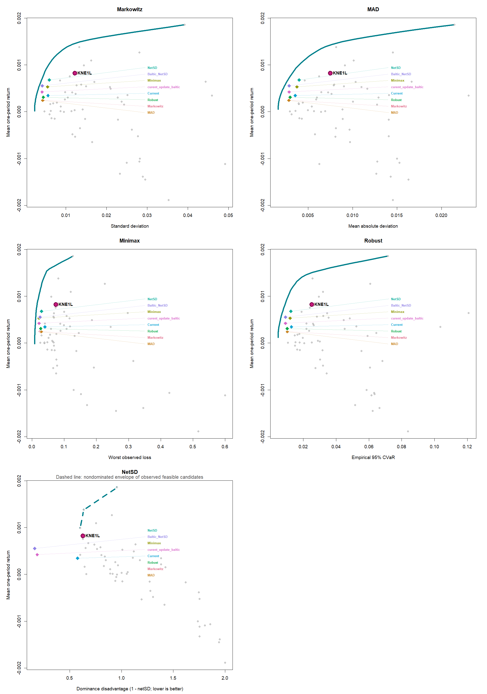

The highlighted circle is the selected share and pale filled circles are the remaining shares. The five panels show Markowitz, MAD, Minimax, regime-aware Robust mean-CVaR and netSD frontiers. In the Robust panel, the individual-share point uses empirical 95% CVaR as an approximation, while the portfolio frontier uses worst-regime CVaR. The netSD panel uses the same 527-observation training sample and the same fixed 16-series reference network for its frontier, portfolios and shares. Its horizontal axis is 1 - netSD, so lower is better. netSD is discrete: the line joins only Pareto-nondominated candidates, while hollow grey circles show the rejected numerical candidates; it must not be interpreted as a smooth frontier.

All 72 PerformanceAnalytics measures: full period and last 126 observations

| Measure | Full period | Last 126 | Measure | Full period | Last 126 |
| --- | --- | --- | --- | --- | --- |
| ActiveReturn | 0.023117 | 0.021446 | M2Sortino | 0.252111 | 0.257359 |
| AdjustedSharpe | 0.864712 | 1.257272 | MSquaredExcess | -0.005995 | -0.026297 |
| AnnualizedReturn_Arithmetic | 0.244434 | 0.248977 | Martin | 2.047422 | 5.885860 |
| AnnualizedReturn_Geometric | 0.251806 | 0.258655 | MaximumDrawdown | 0.262350 | 0.099778 |
| Appraisal | 1.204012 | 1.091815 | Modigliani | 0.000853 | 0.000782 |
| ArithmeticReturn | 0.000970 | 0.000988 | NetSelectivity | -0.008381 | -0.041115 |
| AverageDrawdown | 0.040766 | 0.036560 | Omega | 1.290164 | 1.276219 |
| AverageDrawdownLength | 33.000000 | 16.142857 | OmegaExcessReturn | 0.209287 | 0.224827 |
| AverageRecoveryTime | 18.954545 | 4.857143 | PainIndex | 0.091665 | 0.036003 |
| BernardoLedoit | 1.290164 | 1.276219 | PainRatio | 2.747028 | 7.184345 |
| BetaCoKurtosis | -0.058605 | 0.256004 | Prospect | -0.432052 | -0.498715 |
| BetaCoSkewness | -1.303857 | -8.623774 | Rachev | 1.379867 | 1.451616 |
| Burke | 1.001545 | 2.409198 | Selectivity | 0.240138 | 0.210158 |
| CAPMAlpha | 0.000925 | 0.000806 | Sharpe_Annualized | 1.223506 | 1.271371 |
| CAPMBeta | 0.051020 | 0.204448 | Sharpe_Daily | 0.077074 | 0.080089 |
| CDD | 0.090512 | 0.082577 | Sharpe_ES | 0.039062 | 0.044421 |
| Calmar | 0.959809 | 2.592299 | Sharpe_VaR | 0.062324 | 0.068795 |
| CoKurtosis | -0.000000 | 0.000000 | Skewness | 1.082079 | 1.191092 |
| CoSkewness | -0.000000 | -0.000000 | Sortino | 0.130612 | 0.141463 |
| CumulativeReturn | 0.958110 | 0.121898 | SpecificRisk | 0.199448 | 0.192485 |
| DRatio | 0.740349 | 0.755580 | Sterling | 0.694925 | 1.294711 |
| DownCapture | -0.085429 | 0.099146 | SystematicRisk | 0.008959 | 0.031682 |
| DownNumber | 0.355346 | 0.471698 | TotalRisk | 0.199650 | 0.195075 |
| DownPercent | 0.801887 | 0.830189 | TrackingError_Annualized | 0.260001 | 0.229228 |
| DownsideDeviation | 0.007426 | 0.006984 | TrackingError_Daily | 0.016379 | 0.014440 |
| DrawdownDeviation | 0.011794 | 0.011740 | Treynor_Annualized | 4.935416 | 1.265141 |
| ES_Loss | 0.024832 | 0.022242 | Treynor_Daily | 0.017476 | 0.004467 |
| FamaBeta | 1.137731 | 1.263739 | UlcerIndex | 0.122987 | 0.043945 |
| GeometricReturn | 0.000892 | 0.000913 | UpCapture | 0.160227 | 0.309463 |
| Hurst | 0.383627 | 0.393154 | UpNumber | 0.364679 | 0.465753 |
| Information_Annualized | 0.088911 | 0.093558 | UpPercent | 0.227064 | 0.260274 |
| Information_Daily | 0.004520 | 0.004727 | UpsidePotential | 0.580744 | 0.653606 |
| JensenAlpha | 0.240138 | 0.210158 | UpsideRisk | 0.010196 | 0.010158 |
| Kappa | 0.083316 | 0.101837 | VaR_Loss | 0.015563 | 0.014362 |
| Kelly | 6.124211 | 6.492104 | Volatility | 0.012585 | 0.012336 |
| Kurtosis | 11.239148 | 6.912086 | Volatility_Annualized | 0.199782 | 0.195833 |

Portfolio sensitivity

**Removing this share from curent_update_baltic**

<table class="effect-table"><thead><tr><th>Measure</th><th>Full portfolio</th><th>Portfolio without share</th><th>Change</th></tr></thead><tbody><tr><td>netSD</td><td>0.813559</td><td>0.771186</td><td>-0.042373</td></tr><tr><td>OUT</td><td>96</td><td>91</td><td>-5</td></tr><tr><td>IN</td><td>0</td><td>0</td><td>+0</td></tr><tr><td>Rachev ratio</td><td>1.147773</td><td>1.151322</td><td>0.003548</td></tr><tr><td>Sortino ratio</td><td>0.161492</td><td>0.152410</td><td>-0.009082</td></tr></tbody></table>

The removed weight is distributed proportionally across all remaining holdings, so their weights still sum to 1.

**Adding this new share to the current portfolio**

<table class="effect-table"><thead><tr><th>Measure</th><th>Current portfolio</th><th>After adding share</th><th>Change</th></tr></thead><tbody><tr><td>KNE1L shares</td><td>0</td><td>1581</td><td>+1581</td></tr><tr><td>Portfolio value, EUR</td><td>7956.851983</td><td>8720.475000</td><td>763.623016</td></tr><tr><td>netSD</td><td>0.423729</td><td>0.593220</td><td>0.169492</td></tr><tr><td>OUT</td><td>62</td><td>72</td><td>+10</td></tr><tr><td>IN</td><td>12</td><td>2</td><td>-10</td></tr><tr><td>Rachev ratio</td><td>1.070123</td><td>1.083441</td><td>0.013318</td></tr><tr><td>Sortino ratio</td><td>0.092352</td><td>0.108690</td><td>0.016338</td></tr></tbody></table>

The starting point is the unmodified current portfolio, which already contains 0 KNE1L shares. The scenario adds 1581 shares from Table 3A, resulting in 1581 shares; every other holding remains unchanged.

<strong>VIRSI — VIRŠI-A</strong> | HOLD | target 11 shares | priority 2

<table class="stock-summary-table"><thead><tr><th>Current shares</th><th>Target shares</th><th>Change</th><th>Weight</th><th>Last price</th><th>Individual netSD</th><th>OUT / IN</th><th>RSI(14)</th><th>MACD state</th><th>Bollinger state</th><th>Stochastic RSI</th><th>Technical decision</th><th>HHI contribution</th><th>Median daily turnover</th><th>Trade / median turnover</th><th>Zero-volume days</th><th>Liquidity risk</th></tr></thead><tbody><tr><td>0</td><td>11</td><td>+11</td><td>0.34%</td><td>EUR 4.4200</td><td>0.3729</td><td>44 / 0</td><td>53.63</td><td>Bearish</td><td>Inside bands</td><td>0.000 (Oversold)</td><td>HOLD</td><td>0.000012 (0.014% of portfolio HHI)</td><td>EUR 2,659</td><td>1.8%</td><td>2.4%</td><td>HIGH</td></tr></tbody></table>

Signals combine four indicators: Bollinger bands, RSI, MACD and Stochastic RSI. Vertical lines distinguish 4-of-4, 3-of-4 and 2-of-4 buy/sell agreement.

Complete technical history

Return histogram

FSD, SSD and TSD components versus Baltic portfolios

The lower integrated CDF component is preferred at a given return threshold. Dominance requires the relevant curve to remain no higher over the complete domain, not merely over one interval.

All five model frontiers with this share highlighted

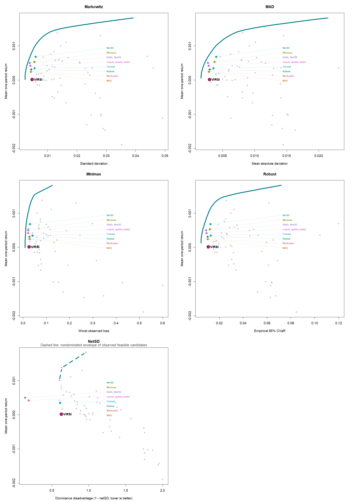

The highlighted circle is the selected share and pale filled circles are the remaining shares. The five panels show Markowitz, MAD, Minimax, regime-aware Robust mean-CVaR and netSD frontiers. In the Robust panel, the individual-share point uses empirical 95% CVaR as an approximation, while the portfolio frontier uses worst-regime CVaR. The netSD panel uses the same 527-observation training sample and the same fixed 16-series reference network for its frontier, portfolios and shares. Its horizontal axis is 1 - netSD, so lower is better. netSD is discrete: the line joins only Pareto-nondominated candidates, while hollow grey circles show the rejected numerical candidates; it must not be interpreted as a smooth frontier.

All 72 PerformanceAnalytics measures: full period and last 126 observations

| Measure | Full period | Last 126 | Measure | Full period | Last 126 |
| --- | --- | --- | --- | --- | --- |
| ActiveReturn | -0.248997 | -0.200331 | M2Sortino | -0.021757 | 0.039084 |
| AdjustedSharpe | -0.228646 | 0.487406 | MSquaredExcess | -0.225190 | -0.132659 |
| AnnualizedReturn_Arithmetic | -0.017763 | 0.039249 | Martin | -0.204125 | 2.586994 |
| AnnualizedReturn_Geometric | -0.020308 | 0.036878 | MaximumDrawdown | 0.173775 | 0.031599 |
| Appraisal | -0.280065 | 0.476953 | Modigliani | -0.000167 | 0.000309 |
| ArithmeticReturn | -0.000070 | 0.000156 | NetSelectivity | -0.117062 | -0.082821 |
| AverageDrawdown | 0.031050 | 0.010552 | Omega | 0.952821 | 1.098862 |
| AverageDrawdownLength | 107.000000 | 15.125000 | OmegaExcessReturn | -0.039201 | 0.020479 |
| AverageRecoveryTime | 35.285714 | 11.000000 | PainIndex | 0.084862 | 0.010946 |
| BernardoLedoit | 0.952821 | 1.098862 | PainRatio | -0.239300 | 3.369202 |
| BetaCoKurtosis | 0.010497 | 0.034514 | Prospect | -0.587322 | -0.535624 |
| BetaCoSkewness | -1.924716 | -11.264759 | Rachev | 0.954479 | 0.977323 |
| Burke | -0.195219 | 0.901220 | Selectivity | -0.020793 | 0.037148 |
| CAPMAlpha | -0.000072 | 0.000157 | Sharpe_Annualized | -0.239101 | 0.501923 |
| CAPMBeta | 0.002121 | -0.001136 | Sharpe_Daily | -0.015062 | 0.031618 |
| CDD | 0.079544 | 0.020799 | Sharpe_ES | -0.006455 | 0.014881 |
| Calmar | -0.116861 | 1.167082 | Sharpe_VaR | -0.009790 | 0.021000 |
| CoKurtosis | 0.000000 | 0.000000 | Skewness | 0.479749 | 0.124337 |
| CoSkewness | -0.000000 | -0.000000 | Sortino | -0.021361 | 0.046000 |
| CumulativeReturn | -0.059541 | 0.018272 | SpecificRisk | 0.074242 | 0.077886 |
| DRatio | 1.070846 | 0.755133 | Sterling | -0.074176 | 0.280234 |
| DownCapture | -0.011262 | -0.039889 | SystematicRisk | 0.000372 | -0.000176 |
| DownNumber | 0.308176 | 0.301887 | TotalRisk | 0.074243 | 0.077886 |
| DownPercent | 0.886792 | 0.924528 | TrackingError_Annualized | 0.190323 | 0.173733 |
| DownsideDeviation | 0.003300 | 0.003386 | TrackingError_Daily | 0.011989 | 0.010944 |
| DrawdownDeviation | 0.006378 | 0.003585 | Treynor_Annualized | -9.575251 | -32.456639 |
| ES_Loss | 0.010920 | 0.010467 | Treynor_Daily | -0.038387 | -0.126487 |
| FamaBeta | 0.423082 | 0.504616 | UlcerIndex | 0.099486 | 0.014255 |
| GeometricReturn | -0.000081 | 0.000144 | UpCapture | -0.025506 | 0.004847 |
| Hurst | 0.395572 | 0.439377 | UpNumber | 0.316514 | 0.356164 |
| Information_Annualized | -1.308288 | -1.153097 | UpPercent | 0.119266 | 0.136986 |
| Information_Daily | -0.074984 | -0.064081 | UpsidePotential | 0.431408 | 0.511300 |
| JensenAlpha | -0.020793 | 0.037148 | UpsideRisk | 0.003315 | 0.003554 |
| Kappa | -0.014051 | 0.031662 | VaR_Loss | 0.007200 | 0.007417 |
| Kelly | -3.218401 | 6.418696 | Volatility | 0.004680 | 0.004926 |
| Kurtosis | 13.330999 | 6.746270 | Volatility_Annualized | 0.074292 | 0.078197 |

Portfolio sensitivity

**Removing this share from curent_update_baltic**

<table class="effect-table"><thead><tr><th>Measure</th><th>Full portfolio</th><th>Portfolio without share</th><th>Change</th></tr></thead><tbody><tr><td>netSD</td><td>0.813559</td><td>0.813559</td><td>0.000000</td></tr><tr><td>OUT</td><td>96</td><td>96</td><td>+0</td></tr><tr><td>IN</td><td>0</td><td>0</td><td>+0</td></tr><tr><td>Rachev ratio</td><td>1.147773</td><td>1.147864</td><td>0.000091</td></tr><tr><td>Sortino ratio</td><td>0.161492</td><td>0.161557</td><td>0.000065</td></tr></tbody></table>

The removed weight is distributed proportionally across all remaining holdings, so their weights still sum to 1.

**Adding this new share to the current portfolio**

<table class="effect-table"><thead><tr><th>Measure</th><th>Current portfolio</th><th>After adding share</th><th>Change</th></tr></thead><tbody><tr><td>VIRSI shares</td><td>0</td><td>11</td><td>+11</td></tr><tr><td>Portfolio value, EUR</td><td>7956.851983</td><td>8005.471983</td><td>48.620000</td></tr><tr><td>netSD</td><td>0.423729</td><td>0.423729</td><td>0.000000</td></tr><tr><td>OUT</td><td>62</td><td>62</td><td>+0</td></tr><tr><td>IN</td><td>12</td><td>12</td><td>+0</td></tr><tr><td>Rachev ratio</td><td>1.070123</td><td>1.069871</td><td>-0.000252</td></tr><tr><td>Sortino ratio</td><td>0.092352</td><td>0.092326</td><td>-0.000026</td></tr></tbody></table>

The starting point is the unmodified current portfolio, which already contains 0 VIRSI shares. The scenario adds 11 shares from Table 3A, resulting in 11 shares; every other holding remains unchanged.

<strong>VLP1L — Vilkyškių pieninė</strong> | HOLD | target 65 shares | priority 3

<table class="stock-summary-table"><thead><tr><th>Current shares</th><th>Target shares</th><th>Change</th><th>Weight</th><th>Last price</th><th>Individual netSD</th><th>OUT / IN</th><th>RSI(14)</th><th>MACD state</th><th>Bollinger state</th><th>Stochastic RSI</th><th>Technical decision</th><th>HHI contribution</th><th>Median daily turnover</th><th>Trade / median turnover</th><th>Zero-volume days</th><th>Liquidity risk</th></tr></thead><tbody><tr><td>42</td><td>65</td><td>+23</td><td>6.77%</td><td>EUR 15.5000</td><td>0.3644</td><td>43 / 0</td><td>62.15</td><td>Bullish</td><td>Above upper band</td><td>1.000 (Overbought)</td><td>HOLD</td><td>0.004577 (5.339% of portfolio HHI)</td><td>EUR 21,740</td><td>1.6%</td><td>1.2%</td><td>LOW</td></tr></tbody></table>

Signals combine four indicators: Bollinger bands, RSI, MACD and Stochastic RSI. Vertical lines distinguish 4-of-4, 3-of-4 and 2-of-4 buy/sell agreement.

Complete technical history

Return histogram

FSD, SSD and TSD components versus Baltic portfolios

The lower integrated CDF component is preferred at a given return threshold. Dominance requires the relevant curve to remain no higher over the complete domain, not merely over one interval.

All five model frontiers with this share highlighted

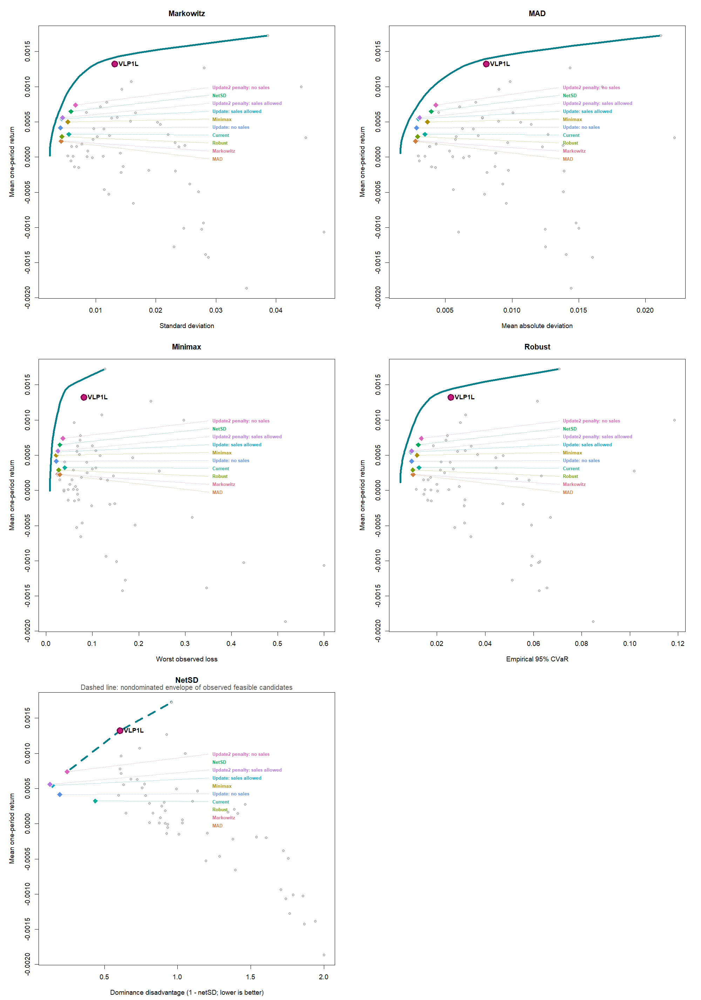

The highlighted circle is the selected share and pale filled circles are the remaining shares. The five panels show Markowitz, MAD, Minimax, regime-aware Robust mean-CVaR and netSD frontiers. In the Robust panel, the individual-share point uses empirical 95% CVaR as an approximation, while the portfolio frontier uses worst-regime CVaR. The netSD panel uses the same 527-observation training sample and the same fixed 16-series reference network for its frontier, portfolios and shares. Its horizontal axis is 1 - netSD, so lower is better. netSD is discrete: the line joins only Pareto-nondominated candidates, while hollow grey circles show the rejected numerical candidates; it must not be interpreted as a smooth frontier.

All 72 PerformanceAnalytics measures: full period and last 126 observations

| Measure | Full period | Last 126 | Measure | Full period | Last 126 |
| --- | --- | --- | --- | --- | --- |
| ActiveReturn | 0.103798 | 0.335868 | M2Sortino | 0.332887 | 0.563470 |
| AdjustedSharpe | -0.792235 | -2.184440 | MSquaredExcess | 0.044566 | 0.125481 |
| AnnualizedReturn_Arithmetic | 0.308070 | 0.479041 | Martin | 5.265313 | 9.792844 |
| AnnualizedReturn_Geometric | 0.332487 | 0.573077 | MaximumDrawdown | 0.157158 | 0.112450 |
| Appraisal | 1.553874 | 2.408683 | Modigliani | 0.001042 | 0.001302 |
| ArithmeticReturn | 0.001223 | 0.001901 | NetSelectivity | 0.064232 | 0.226696 |
| AverageDrawdown | 0.039828 | 0.026784 | Omega | 1.369319 | 1.540203 |
| AverageDrawdownLength | 25.392857 | 12.444444 | OmegaExcessReturn | 0.290002 | 0.527552 |
| AverageRecoveryTime | 14.107143 | 7.222222 | PainIndex | 0.047953 | 0.043557 |
| BernardoLedoit | 1.369319 | 1.540203 | PainRatio | 6.933606 | 13.156916 |
| BetaCoKurtosis | -0.007644 | 0.180060 | Prospect | -0.392858 | -0.265746 |
| BetaCoSkewness | -0.725375 | -8.594713 | Rachev | 1.428309 | 1.339621 |
| Burke | 1.256071 | 4.765844 | Selectivity | 0.319473 | 0.540466 |
| CAPMAlpha | 0.001173 | 0.001778 | Sharpe_Annualized | 1.495653 | 2.116998 |
| CAPMBeta | 0.056906 | 0.137476 | Sharpe_Daily | 0.094217 | 0.133358 |
| CDD | 0.095077 | 0.056340 | Sharpe_ES | 0.050656 | 0.065740 |
| Calmar | 2.115625 | 5.096293 | Sharpe_VaR | 0.084766 | 0.143087 |
| CoKurtosis | -0.000000 | 0.000000 | Skewness | 1.859172 | -0.912603 |
| CoSkewness | -0.000000 | -0.000000 | Sortino | 0.164747 | 0.202250 |
| CumulativeReturn | 1.360478 | 0.254224 | SpecificRisk | 0.205598 | 0.224383 |
| DRatio | 0.658191 | 0.533325 | Sterling | 1.292930 | 2.697470 |
| DownCapture | -0.130313 | -0.061796 | SystematicRisk | 0.009993 | 0.021304 |
| DownNumber | 0.361635 | 0.396226 | TotalRisk | 0.205841 | 0.225392 |
| DownPercent | 0.798742 | 0.811321 | TrackingError_Annualized | 0.264105 | 0.261945 |
| DownsideDeviation | 0.007420 | 0.009399 | TrackingError_Daily | 0.016637 | 0.016501 |
| DrawdownDeviation | 0.010767 | 0.011334 | Treynor_Annualized | 5.842701 | 4.168566 |
| ES_Loss | 0.024133 | 0.028916 | Treynor_Daily | 0.020028 | 0.013089 |
| FamaBeta | 1.173012 | 1.460236 | UlcerIndex | 0.063147 | 0.058520 |
| GeometricReturn | 0.001140 | 0.001799 | UpCapture | 0.183974 | 0.395549 |
| Hurst | 0.426761 | 0.450503 | UpNumber | 0.426606 | 0.493151 |
| Information_Annualized | 0.393018 | 1.282207 | UpPercent | 0.275229 | 0.356164 |
| Information_Daily | 0.019363 | 0.057835 | UpsidePotential | 0.610832 | 0.576647 |
| JensenAlpha | 0.319473 | 0.540466 | UpsideRisk | 0.010704 | 0.010810 |
| Kappa | 0.100544 | 0.111932 | VaR_Loss | 0.014422 | 0.013285 |
| Kelly | 7.261257 | 9.355517 | Volatility | 0.012975 | 0.014255 |
| Kurtosis | 24.383907 | 12.156535 | Volatility_Annualized | 0.205977 | 0.226283 |

Portfolio sensitivity

**Removing this share from curent_update_baltic**

<table class="effect-table"><thead><tr><th>Measure</th><th>Full portfolio</th><th>Portfolio without share</th><th>Change</th></tr></thead><tbody><tr><td>netSD</td><td>0.813559</td><td>0.703390</td><td>-0.110169</td></tr><tr><td>OUT</td><td>96</td><td>83</td><td>-13</td></tr><tr><td>IN</td><td>0</td><td>0</td><td>+0</td></tr><tr><td>Rachev ratio</td><td>1.147773</td><td>1.141760</td><td>-0.006013</td></tr><tr><td>Sortino ratio</td><td>0.161492</td><td>0.132985</td><td>-0.028508</td></tr></tbody></table>

The removed weight is distributed proportionally across all remaining holdings, so their weights still sum to 1.

**Increasing this existing position in the current portfolio**

<table class="effect-table"><thead><tr><th>Measure</th><th>Current portfolio</th><th>After adding share</th><th>Change</th></tr></thead><tbody><tr><td>VLP1L shares</td><td>42</td><td>65</td><td>+23</td></tr><tr><td>Portfolio value, EUR</td><td>7956.851983</td><td>8313.351983</td><td>356.500000</td></tr><tr><td>netSD</td><td>0.423729</td><td>0.550847</td><td>0.127119</td></tr><tr><td>OUT</td><td>62</td><td>69</td><td>+7</td></tr><tr><td>IN</td><td>12</td><td>4</td><td>-8</td></tr><tr><td>Rachev ratio</td><td>1.070123</td><td>1.081760</td><td>0.011637</td></tr><tr><td>Sortino ratio</td><td>0.092352</td><td>0.106162</td><td>0.013810</td></tr></tbody></table>

The starting point is the unmodified current portfolio, which already contains 42 VLP1L shares. The scenario adds 23 shares from Table 3A, resulting in 65 shares; every other holding remains unchanged.

<strong>MRK1T — Merko Ehitus</strong> | HOLD | target 33 shares | priority 4

<table class="stock-summary-table"><thead><tr><th>Current shares</th><th>Target shares</th><th>Change</th><th>Weight</th><th>Last price</th><th>Individual netSD</th><th>OUT / IN</th><th>RSI(14)</th><th>MACD state</th><th>Bollinger state</th><th>Stochastic RSI</th><th>Technical decision</th><th>HHI contribution</th><th>Median daily turnover</th><th>Trade / median turnover</th><th>Zero-volume days</th><th>Liquidity risk</th></tr></thead><tbody><tr><td>20</td><td>33</td><td>+13</td><td>5.97%</td><td>EUR 27.0500</td><td>0.3559</td><td>42 / 0</td><td>47.87</td><td>Bearish</td><td>Inside bands</td><td>0.328 (Neutral)</td><td>HOLD</td><td>0.003562 (4.155% of portfolio HHI)</td><td>EUR 57,645</td><td>0.6%</td><td>1.2%</td><td>LOW</td></tr></tbody></table>

Signals combine four indicators: Bollinger bands, RSI, MACD and Stochastic RSI. Vertical lines distinguish 4-of-4, 3-of-4 and 2-of-4 buy/sell agreement.

Complete technical history

Return histogram

FSD, SSD and TSD components versus Baltic portfolios

The lower integrated CDF component is preferred at a given return threshold. Dominance requires the relevant curve to remain no higher over the complete domain, not merely over one interval.

All five model frontiers with this share highlighted

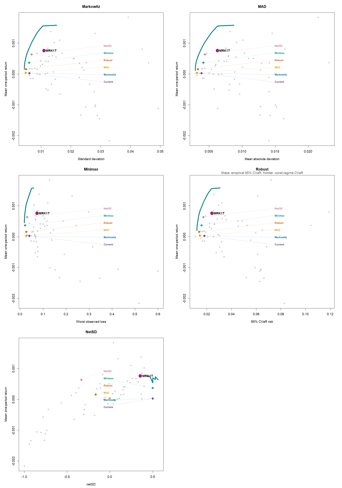

The highlighted circle is the selected share and pale filled circles are the remaining shares. The five panels show Markowitz, MAD, Minimax, regime-aware Robust mean-CVaR and netSD frontiers. In the Robust panel, the individual-share point uses empirical 95% CVaR as an approximation, while the portfolio frontier uses worst-regime CVaR. The netSD panel uses the same 527-observation training sample and the same fixed 16-series reference network for its frontier, portfolios and shares. Its horizontal axis is 1 - netSD, so lower is better. netSD is discrete: the line joins only Pareto-nondominated candidates, while hollow grey circles show the rejected numerical candidates; it must not be interpreted as a smooth frontier.

All 72 PerformanceAnalytics measures: full period and last 126 observations

| Measure | Full period | Last 126 | Measure | Full period | Last 126 |
| --- | --- | --- | --- | --- | --- |
| ActiveReturn | -0.000176 | -0.574166 | M2Sortino | 0.231256 | -0.329511 |
| AdjustedSharpe | 0.276910 | 3.557501 | MSquaredExcess | 0.007987 | -0.445416 |
| AnnualizedReturn_Arithmetic | 0.219897 | -0.396606 | Martin | 2.953061 | -2.072142 |
| AnnualizedReturn_Geometric | 0.228513 | -0.336957 | MaximumDrawdown | 0.213246 | 0.213246 |
| Appraisal | 1.240587 | -2.337786 | Modigliani | 0.000911 | -0.001466 |
| ArithmeticReturn | 0.000873 | -0.001574 | NetSelectivity | 0.009402 | -0.591620 |
| AverageDrawdown | 0.030621 | 0.055630 | Omega | 1.329059 | 0.580787 |
| AverageDrawdownLength | 22.258065 | 30.750000 | OmegaExcessReturn | 0.192319 | -0.381164 |
| AverageRecoveryTime | 11.064516 | 6.750000 | PainIndex | 0.049366 | 0.148000 |
| BernardoLedoit | 1.329059 | 0.580787 | PainRatio | 4.628938 | -2.276735 |
| BetaCoKurtosis | -0.013832 | 0.214573 | Prospect | -0.386314 | -0.686616 |
| BetaCoSkewness | -0.108044 | 12.836893 | Rachev | 1.344492 | 0.616486 |
| Burke | 0.901691 | -2.371925 | Selectivity | 0.207631 | -0.381428 |
| CAPMAlpha | 0.000792 | -0.001741 | Sharpe_Annualized | 1.307029 | -2.383941 |
| CAPMBeta | 0.091312 | 0.187476 | Sharpe_Daily | 0.082335 | -0.150174 |
| CDD | 0.054320 | 0.140231 | Sharpe_ES | 0.040486 | -0.051550 |
| Calmar | 1.071592 | -1.580130 | Sharpe_VaR | 0.072461 | -0.104490 |
| CoKurtosis | -0.000000 | 0.000000 | Skewness | 1.268852 | -2.208140 |
| CoSkewness | -0.000000 | 0.000000 | Sortino | 0.138032 | -0.172439 |
| CumulativeReturn | 0.851101 | -0.185726 | SpecificRisk | 0.167365 | 0.163158 |
| DRatio | 0.694712 | 2.459716 | Sterling | 0.729500 | -1.075693 |
| DownCapture | 0.035101 | 0.407574 | SystematicRisk | 0.016034 | 0.029052 |
| DownNumber | 0.430818 | 0.490566 | TotalRisk | 0.168131 | 0.165724 |
| DownPercent | 0.808176 | 0.792453 | TrackingError_Annualized | 0.231319 | 0.206609 |
| DownsideDeviation | 0.006322 | 0.009127 | TrackingError_Daily | 0.014572 | 0.013015 |
| DrawdownDeviation | 0.010945 | 0.019004 | Treynor_Annualized | 2.502555 | -1.797332 |
| ES_Loss | 0.021553 | 0.030530 | Treynor_Daily | 0.008948 | -0.008691 |
| FamaBeta | 0.958116 | 1.073578 | UlcerIndex | 0.077382 | 0.162613 |
| GeometricReturn | 0.000817 | -0.001629 | UpCapture | 0.232974 | -0.045421 |
| Hurst | 0.405900 | 0.474740 | UpNumber | 0.470183 | 0.342466 |
| Information_Annualized | -0.000761 | -2.779003 | UpPercent | 0.243119 | 0.164384 |
| Information_Daily | -0.000039 | -0.190111 | UpsidePotential | 0.557509 | 0.238902 |
| JensenAlpha | 0.207631 | -0.381428 | UpsideRisk | 0.008542 | 0.005304 |
| Kappa | 0.082490 | -0.102340 | VaR_Loss | 0.012042 | 0.015062 |
| Kelly | 7.768742 | -14.329540 | Volatility | 0.010598 | 0.010480 |
| Kurtosis | 17.955590 | 17.229892 | Volatility_Annualized | 0.168242 | 0.166365 |

Portfolio sensitivity

**Removing this share from curent_update_baltic**

<table class="effect-table"><thead><tr><th>Measure</th><th>Full portfolio</th><th>Portfolio without share</th><th>Change</th></tr></thead><tbody><tr><td>netSD</td><td>0.813559</td><td>0.779661</td><td>-0.033898</td></tr><tr><td>OUT</td><td>96</td><td>92</td><td>-4</td></tr><tr><td>IN</td><td>0</td><td>0</td><td>+0</td></tr><tr><td>Rachev ratio</td><td>1.147773</td><td>1.128075</td><td>-0.019698</td></tr><tr><td>Sortino ratio</td><td>0.161492</td><td>0.150343</td><td>-0.011150</td></tr></tbody></table>

The removed weight is distributed proportionally across all remaining holdings, so their weights still sum to 1.

**Increasing this existing position in the current portfolio**

<table class="effect-table"><thead><tr><th>Measure</th><th>Current portfolio</th><th>After adding share</th><th>Change</th></tr></thead><tbody><tr><td>MRK1T shares</td><td>20</td><td>33</td><td>+13</td></tr><tr><td>Portfolio value, EUR</td><td>7956.851983</td><td>8308.501973</td><td>351.649990</td></tr><tr><td>netSD</td><td>0.423729</td><td>0.559322</td><td>0.135593</td></tr><tr><td>OUT</td><td>62</td><td>70</td><td>+8</td></tr><tr><td>IN</td><td>12</td><td>4</td><td>-8</td></tr><tr><td>Rachev ratio</td><td>1.070123</td><td>1.083709</td><td>0.013586</td></tr><tr><td>Sortino ratio</td><td>0.092352</td><td>0.099495</td><td>0.007143</td></tr></tbody></table>

The starting point is the unmodified current portfolio, which already contains 20 MRK1T shares. The scenario adds 13 shares from Table 3A, resulting in 33 shares; every other holding remains unchanged.

<strong>MOLNR — J. Molner</strong> | HOLD | target 30 shares | priority 5

<table class="stock-summary-table"><thead><tr><th>Current shares</th><th>Target shares</th><th>Change</th><th>Weight</th><th>Last price</th><th>Individual netSD</th><th>OUT / IN</th><th>RSI(14)</th><th>MACD state</th><th>Bollinger state</th><th>Stochastic RSI</th><th>Technical decision</th><th>HHI contribution</th><th>Median daily turnover</th><th>Trade / median turnover</th><th>Zero-volume days</th><th>Liquidity risk</th></tr></thead><tbody><tr><td>0</td><td>30</td><td>+30</td><td>4.21%</td><td>EUR 20.6000</td><td>0.0424</td><td>5 / 0</td><td>56.42</td><td>Bullish</td><td>Inside bands</td><td>0.466 (Neutral)</td><td>HOLD</td><td>0.001772 (2.067% of portfolio HHI)</td><td>EUR 98</td><td>630.6%</td><td>29.4%</td><td>HIGH</td></tr></tbody></table>

Signals combine four indicators: Bollinger bands, RSI, MACD and Stochastic RSI. Vertical lines distinguish 4-of-4, 3-of-4 and 2-of-4 buy/sell agreement.

Complete technical history

Return histogram

FSD, SSD and TSD components versus Baltic portfolios

The lower integrated CDF component is preferred at a given return threshold. Dominance requires the relevant curve to remain no higher over the complete domain, not merely over one interval.

All five model frontiers with this share highlighted

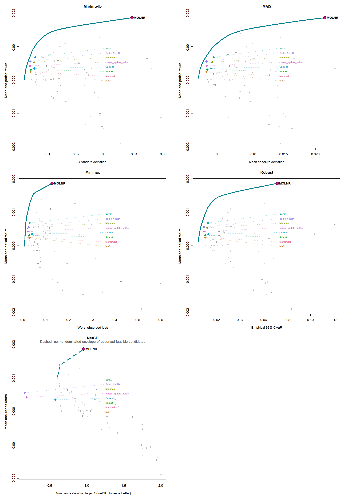

The highlighted circle is the selected share and pale filled circles are the remaining shares. The five panels show Markowitz, MAD, Minimax, regime-aware Robust mean-CVaR and netSD frontiers. In the Robust panel, the individual-share point uses empirical 95% CVaR as an approximation, while the portfolio frontier uses worst-regime CVaR. The netSD panel uses the same 527-observation training sample and the same fixed 16-series reference network for its frontier, portfolios and shares. Its horizontal axis is 1 - netSD, so lower is better. netSD is discrete: the line joins only Pareto-nondominated candidates, while hollow grey circles show the rejected numerical candidates; it must not be interpreted as a smooth frontier.

All 72 PerformanceAnalytics measures: full period and last 126 observations

| Measure | Full period | Last 126 | Measure | Full period | Last 126 |
| --- | --- | --- | --- | --- | --- |
| ActiveReturn | -0.035370 | -0.632155 | M2Sortino | 0.179156 | -0.378585 |
| AdjustedSharpe | 0.523043 | -0.568889 | MSquaredExcess | -0.140797 | -0.283330 |
| AnnualizedReturn_Arithmetic | 0.350903 | -0.358634 | Martin | 1.010558 | -2.729625 |
| AnnualizedReturn_Geometric | 0.193319 | -0.394946 | MaximumDrawdown | 0.445720 | 0.263088 |
| Appraisal | 0.351338 | -0.844364 | Modigliani | 0.000401 | -0.000408 |
| ArithmeticReturn | 0.001392 | -0.001423 | NetSelectivity | -0.600491 | -1.221611 |
| AverageDrawdown | 0.120579 | 0.263088 | Omega | 1.148553 | 0.863195 |
| AverageDrawdownLength | 43.529412 | 125.000000 | OmegaExcessReturn | 0.072625 | -0.507465 |
| AverageRecoveryTime | 11.941176 | 4.000000 | PainIndex | 0.157711 | 0.126142 |
| BernardoLedoit | 1.148553 | 0.863195 | PainRatio | 1.225786 | -3.130973 |
| BetaCoKurtosis | -0.465313 | -0.257264 | Prospect | -0.489765 | -0.621023 |
| BetaCoSkewness | -8.256766 | -37.945591 | Rachev | 1.351381 | 1.000007 |
| Burke | 0.254461 | -1.212596 | Selectivity | 0.213933 | -0.453055 |
| CAPMAlpha | 0.001472 | -0.001642 | Sharpe_Annualized | 0.575704 | -0.664085 |
| CAPMBeta | -0.090138 | 0.244968 | Sharpe_Daily | 0.036266 | -0.041833 |
| CDD | 0.248431 | 0.249933 | Sharpe_ES | 0.019142 | -0.018659 |
| Calmar | 0.433724 | -1.501197 | Sharpe_VaR | 0.027639 | -0.025591 |
| CoKurtosis | -0.000000 | -0.000000 | Skewness | 3.034693 | 0.637172 |
| CoSkewness | -0.000001 | -0.000000 | Sortino | 0.066055 | -0.061262 |
| CumulativeReturn | 0.696918 | -0.222148 | SpecificRisk | 0.608909 | 0.536564 |
| DRatio | 1.067137 | 1.569562 | Sterling | 0.354247 | -1.087744 |
| DownCapture | -0.224965 | 0.869388 | SystematicRisk | -0.015828 | 0.037961 |
| DownNumber | 0.389937 | 0.377358 | TotalRisk | 0.609115 | 0.537905 |
| DownPercent | 0.688679 | 0.660377 | TrackingError_Annualized | 0.638676 | 0.551265 |
| DownsideDeviation | 0.021080 | 0.023230 | TrackingError_Daily | 0.040233 | 0.034726 |
| DrawdownDeviation | 0.024587 | 0.023438 | Treynor_Annualized | -2.144712 | -1.612235 |
| ES_Loss | 0.072744 | 0.076273 | Treynor_Daily | -0.007784 | -0.008131 |
| FamaBeta | 3.471131 | 3.484960 | UlcerIndex | 0.191300 | 0.144689 |
| GeometricReturn | 0.000702 | -0.001992 | UpCapture | 0.148826 | 0.355282 |
| Hurst | 0.407470 | 0.409377 | UpNumber | 0.295872 | 0.260274 |
| Information_Annualized | -0.055380 | -1.146735 | UpPercent | 0.252294 | 0.246575 |
| Information_Daily | -0.002883 | -0.081691 | UpsidePotential | 0.510711 | 0.386546 |
| JensenAlpha | 0.213933 | -0.453055 | UpsideRisk | 0.032091 | 0.024708 |
| Kappa | 0.044823 | -0.042704 | VaR_Loss | 0.050381 | 0.055611 |
| Kelly | 0.944522 | -1.229692 | Volatility | 0.038396 | 0.034019 |
| Kurtosis | 30.708821 | 6.963288 | Volatility_Annualized | 0.609519 | 0.540042 |

Portfolio sensitivity

**Removing this share from curent_update_baltic**

<table class="effect-table"><thead><tr><th>Measure</th><th>Full portfolio</th><th>Portfolio without share</th><th>Change</th></tr></thead><tbody><tr><td>netSD</td><td>0.813559</td><td>0.694915</td><td>-0.118644</td></tr><tr><td>OUT</td><td>96</td><td>82</td><td>-14</td></tr><tr><td>IN</td><td>0</td><td>0</td><td>+0</td></tr><tr><td>Rachev ratio</td><td>1.147773</td><td>1.065071</td><td>-0.082703</td></tr><tr><td>Sortino ratio</td><td>0.161492</td><td>0.140183</td><td>-0.021309</td></tr></tbody></table>

The removed weight is distributed proportionally across all remaining holdings, so their weights still sum to 1.

**Adding this new share to the current portfolio**

<table class="effect-table"><thead><tr><th>Measure</th><th>Current portfolio</th><th>After adding share</th><th>Change</th></tr></thead><tbody><tr><td>MOLNR shares</td><td>0</td><td>30</td><td>+30</td></tr><tr><td>Portfolio value, EUR</td><td>7956.851983</td><td>8574.851995</td><td>618.000011</td></tr><tr><td>netSD</td><td>0.423729</td><td>0.610169</td><td>0.186441</td></tr><tr><td>OUT</td><td>62</td><td>75</td><td>+13</td></tr><tr><td>IN</td><td>12</td><td>3</td><td>-9</td></tr><tr><td>Rachev ratio</td><td>1.070123</td><td>1.217324</td><td>0.147201</td></tr><tr><td>Sortino ratio</td><td>0.092352</td><td>0.122531</td><td>0.030179</td></tr></tbody></table>

The starting point is the unmodified current portfolio, which already contains 0 MOLNR shares. The scenario adds 30 shares from Table 3A, resulting in 30 shares; every other holding remains unchanged.

<strong>HAE1T — Harju Elekter Group</strong> | SELL | target 101 shares | priority 6

<table class="stock-summary-table"><thead><tr><th>Current shares</th><th>Target shares</th><th>Change</th><th>Weight</th><th>Last price</th><th>Individual netSD</th><th>OUT / IN</th><th>RSI(14)</th><th>MACD state</th><th>Bollinger state</th><th>Stochastic RSI</th><th>Technical decision</th><th>HHI contribution</th><th>Median daily turnover</th><th>Trade / median turnover</th><th>Zero-volume days</th><th>Liquidity risk</th></tr></thead><tbody><tr><td>100</td><td>101</td><td>+1</td><td>3.75%</td><td>EUR 5.5400</td><td>0.1271</td><td>39 / 24</td><td>74.94</td><td>Bullish</td><td>Above upper band</td><td>1.000 (Overbought)</td><td>SELL</td><td>0.001407 (1.641% of portfolio HHI)</td><td>EUR 16,472</td><td>0.0%</td><td>1.2%</td><td>MEDIUM</td></tr></tbody></table>

Signals combine four indicators: Bollinger bands, RSI, MACD and Stochastic RSI. Vertical lines distinguish 4-of-4, 3-of-4 and 2-of-4 buy/sell agreement.

Complete technical history

Return histogram

FSD, SSD and TSD components versus Baltic portfolios

The lower integrated CDF component is preferred at a given return threshold. Dominance requires the relevant curve to remain no higher over the complete domain, not merely over one interval.

All five model frontiers with this share highlighted

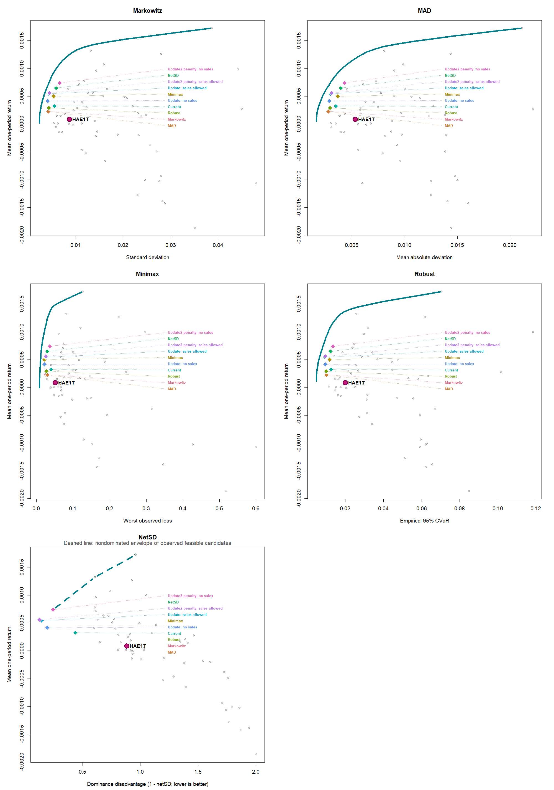

The highlighted circle is the selected share and pale filled circles are the remaining shares. The five panels show Markowitz, MAD, Minimax, regime-aware Robust mean-CVaR and netSD frontiers. In the Robust panel, the individual-share point uses empirical 95% CVaR as an approximation, while the portfolio frontier uses worst-regime CVaR. The netSD panel uses the same 527-observation training sample and the same fixed 16-series reference network for its frontier, portfolios and shares. Its horizontal axis is 1 - netSD, so lower is better. netSD is discrete: the line joins only Pareto-nondominated candidates, while hollow grey circles show the rejected numerical candidates; it must not be interpreted as a smooth frontier.

All 72 PerformanceAnalytics measures: full period and last 126 observations

| Measure | Full period | Last 126 | Measure | Full period | Last 126 |
| --- | --- | --- | --- | --- | --- |
| ActiveReturn | -0.246414 | -0.309903 | M2Sortino | -0.017860 | -0.072074 |
| AdjustedSharpe | -0.057893 | -0.321064 | MSquaredExcess | -0.204243 | -0.242654 |
| AnnualizedReturn_Arithmetic | -0.008146 | -0.059614 | Martin | -0.156945 | -1.117513 |
| AnnualizedReturn_Geometric | -0.017725 | -0.072693 | MaximumDrawdown | 0.209400 | 0.135239 |
| Appraisal | -0.168881 | -0.234070 | Modigliani | -0.000041 | -0.000205 |
| ArithmeticReturn | -0.000032 | -0.000237 | NetSelectivity | -0.199798 | -0.346380 |
| AverageDrawdown | 0.058845 | 0.032257 | Omega | 0.988111 | 0.936887 |
| AverageDrawdownLength | 93.375000 | 15.125000 | OmegaExcessReturn | -0.052011 | -0.109853 |
| AverageRecoveryTime | 15.375000 | 4.000000 | PainIndex | 0.098550 | 0.047630 |
| BernardoLedoit | 0.988111 | 0.936887 | PainRatio | -0.179853 | -1.526195 |
| BetaCoKurtosis | 0.053440 | 0.011496 | Prospect | -0.572958 | -0.641539 |
| BetaCoSkewness | 0.134984 | 15.884029 | Rachev | 1.080200 | 1.141043 |
| Burke | -0.088405 | -0.738308 | Selectivity | -0.023582 | -0.041411 |
| CAPMAlpha | -0.000055 | -0.000119 | Sharpe_Annualized | -0.058271 | -0.333424 |
| CAPMBeta | 0.025615 | -0.131879 | Sharpe_Daily | -0.003671 | -0.021004 |
| CDD | 0.153779 | 0.071630 | Sharpe_ES | -0.001603 | -0.010348 |
| Calmar | -0.084644 | -0.537518 | Sharpe_VaR | -0.002878 | -0.016752 |
| CoKurtosis | 0.000000 | 0.000000 | Skewness | 0.500438 | 0.194003 |
| CoSkewness | 0.000000 | 0.000000 | Sortino | -0.005398 | -0.030835 |
| CumulativeReturn | -0.052102 | -0.037032 | SpecificRisk | 0.139638 | 0.176916 |
| DRatio | 1.154072 | 1.473980 | Sterling | -0.057287 | -0.309019 |
| DownCapture | 0.007906 | -0.130043 | SystematicRisk | 0.004498 | -0.020436 |
| DownNumber | 0.430818 | 0.358491 | TotalRisk | 0.139711 | 0.178092 |
| DownPercent | 0.823899 | 0.792453 | TrackingError_Annualized | 0.220906 | 0.249629 |
| DownsideDeviation | 0.005988 | 0.007672 | TrackingError_Daily | 0.013916 | 0.015725 |
| DrawdownDeviation | 0.009361 | 0.013210 | Treynor_Annualized | -0.691964 | 0.551214 |
| ES_Loss | 0.020168 | 0.022862 | Treynor_Daily | -0.002770 | 0.002271 |
| FamaBeta | 0.796163 | 1.153778 | UlcerIndex | 0.112935 | 0.065049 |
| GeometricReturn | -0.000071 | -0.000299 | UpCapture | -0.001326 | -0.158224 |
| Hurst | 0.386445 | 0.446875 | UpNumber | 0.373853 | 0.260274 |
| Information_Annualized | -1.115467 | -1.241453 | UpPercent | 0.176606 | 0.205479 |
| Information_Daily | -0.063852 | -0.072780 | UpsidePotential | 0.448649 | 0.457729 |
| JensenAlpha | -0.023582 | -0.041411 | UpsideRisk | 0.006450 | 0.008188 |
| Kappa | -0.003342 | -0.019715 | VaR_Loss | 0.011233 | 0.014122 |
| Kelly | -0.416803 | -1.864855 | Volatility | 0.008807 | 0.011263 |
| Kurtosis | 14.435639 | 8.675222 | Volatility_Annualized | 0.139804 | 0.178794 |

Portfolio sensitivity

**Removing this share from curent_update_baltic**

<table class="effect-table"><thead><tr><th>Measure</th><th>Full portfolio</th><th>Portfolio without share</th><th>Change</th></tr></thead><tbody><tr><td>netSD</td><td>0.813559</td><td>0.813559</td><td>0.000000</td></tr><tr><td>OUT</td><td>96</td><td>96</td><td>+0</td></tr><tr><td>IN</td><td>0</td><td>0</td><td>+0</td></tr><tr><td>Rachev ratio</td><td>1.147773</td><td>1.141945</td><td>-0.005829</td></tr><tr><td>Sortino ratio</td><td>0.161492</td><td>0.161638</td><td>0.000145</td></tr></tbody></table>

The removed weight is distributed proportionally across all remaining holdings, so their weights still sum to 1.

**Increasing this existing position in the current portfolio**

<table class="effect-table"><thead><tr><th>Measure</th><th>Current portfolio</th><th>After adding share</th><th>Change</th></tr></thead><tbody><tr><td>HAE1T shares</td><td>100</td><td>101</td><td>+1</td></tr><tr><td>Portfolio value, EUR</td><td>7956.851983</td><td>7962.391983</td><td>5.540000</td></tr><tr><td>netSD</td><td>0.423729</td><td>0.423729</td><td>0.000000</td></tr><tr><td>OUT</td><td>62</td><td>62</td><td>+0</td></tr><tr><td>IN</td><td>12</td><td>12</td><td>+0</td></tr><tr><td>Rachev ratio</td><td>1.070123</td><td>1.070137</td><td>0.000014</td></tr><tr><td>Sortino ratio</td><td>0.092352</td><td>0.092356</td><td>0.000004</td></tr></tbody></table>

The starting point is the unmodified current portfolio, which already contains 100 HAE1T shares. The scenario adds 1 shares from Table 3A, resulting in 101 shares; every other holding remains unchanged.

<strong>APG1L — Apranga</strong> | HOLD | target 327 shares | priority 7

<table class="stock-summary-table"><thead><tr><th>Current shares</th><th>Target shares</th><th>Change</th><th>Weight</th><th>Last price</th><th>Individual netSD</th><th>OUT / IN</th><th>RSI(14)</th><th>MACD state</th><th>Bollinger state</th><th>Stochastic RSI</th><th>Technical decision</th><th>HHI contribution</th><th>Median daily turnover</th><th>Trade / median turnover</th><th>Zero-volume days</th><th>Liquidity risk</th></tr></thead><tbody><tr><td>200</td><td>327</td><td>+127</td><td>8.33%</td><td>EUR 3.8100</td><td>0.3051</td><td>38 / 2</td><td>33.00</td><td>Bearish</td><td>Inside bands</td><td>0.772 (Neutral)</td><td>HOLD</td><td>0.006931 (8.085% of portfolio HHI)</td><td>EUR 24,618</td><td>2.0%</td><td>1.2%</td><td>LOW</td></tr></tbody></table>

Signals combine four indicators: Bollinger bands, RSI, MACD and Stochastic RSI. Vertical lines distinguish 4-of-4, 3-of-4 and 2-of-4 buy/sell agreement.

Complete technical history

Return histogram

FSD, SSD and TSD components versus Baltic portfolios

The lower integrated CDF component is preferred at a given return threshold. Dominance requires the relevant curve to remain no higher over the complete domain, not merely over one interval.

All five model frontiers with this share highlighted

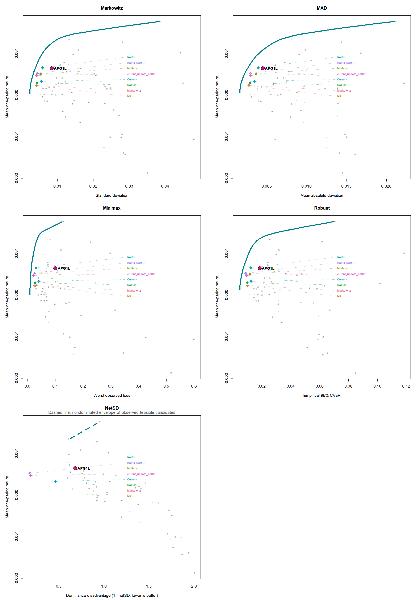

The highlighted circle is the selected share and pale filled circles are the remaining shares. The five panels show Markowitz, MAD, Minimax, regime-aware Robust mean-CVaR and netSD frontiers. In the Robust panel, the individual-share point uses empirical 95% CVaR as an approximation, while the portfolio frontier uses worst-regime CVaR. The netSD panel uses the same 527-observation training sample and the same fixed 16-series reference network for its frontier, portfolios and shares. Its horizontal axis is 1 - netSD, so lower is better. netSD is discrete: the line joins only Pareto-nondominated candidates, while hollow grey circles show the rejected numerical candidates; it must not be interpreted as a smooth frontier.

All 72 PerformanceAnalytics measures: full period and last 126 observations

| Measure | Full period | Last 126 | Measure | Full period | Last 126 |
| --- | --- | --- | --- | --- | --- |
| ActiveReturn | -0.000764 | -0.019905 | M2Sortino | 0.230300 | 0.222769 |
| AdjustedSharpe | -5.572545 | 1.548614 | MSquaredExcess | 0.048060 | 0.045356 |
| AnnualizedReturn_Arithmetic | 0.215236 | 0.203243 | Martin | 4.059646 | 8.452221 |
| AnnualizedReturn_Geometric | 0.227925 | 0.217304 | MaximumDrawdown | 0.122520 | 0.079787 |
| Appraisal | 1.552311 | 1.657018 | Modigliani | 0.001078 | 0.001089 |
| ArithmeticReturn | 0.000854 | 0.000807 | NetSelectivity | 0.046775 | 0.041572 |
| AverageDrawdown | 0.022993 | 0.021918 | Omega | 1.452921 | 1.381514 |
| AverageDrawdownLength | 31.090909 | 16.428571 | OmegaExcessReturn | 0.191027 | 0.195555 |
| AverageRecoveryTime | 22.136364 | 6.285714 | PainIndex | 0.042201 | 0.018731 |
| BernardoLedoit | 1.452921 | 1.381514 | PainRatio | 5.400998 | 11.601133 |
| BetaCoKurtosis | 0.019251 | 0.147694 | Prospect | -0.233234 | -0.408881 |
| BetaCoSkewness | -1.508227 | 1.233590 | Rachev | 1.219309 | 1.259273 |
| Burke | 1.133884 | 2.985924 | Selectivity | 0.215245 | 0.186548 |
| CAPMAlpha | 0.000805 | 0.000691 | Sharpe_Annualized | 1.547413 | 1.770381 |
| CAPMBeta | 0.055447 | 0.129657 | Sharpe_Daily | 0.097478 | 0.111524 |
| CDD | 0.072705 | 0.049098 | Sharpe_ES | 0.045711 | 0.053757 |
| Calmar | 1.860315 | 2.723544 | Sharpe_VaR | 0.105986 | 0.086325 |
| CoKurtosis | 0.000000 | 0.000000 | Skewness | -2.803633 | 0.154834 |
| CoSkewness | -0.000000 | 0.000000 | Sortino | 0.132530 | 0.179616 |
| CumulativeReturn | 0.848452 | 0.103315 | SpecificRisk | 0.138661 | 0.112581 |
| DRatio | 0.504583 | 0.626403 | Sterling | 1.024293 | 1.208673 |
| DownCapture | -0.092921 | 0.009326 | SystematicRisk | 0.009736 | 0.020092 |
| DownNumber | 0.330189 | 0.433962 | TotalRisk | 0.139002 | 0.114360 |
| DownPercent | 0.877358 | 0.867925 | TrackingError_Annualized | 0.216245 | 0.175972 |
| DownsideDeviation | 0.006445 | 0.004490 | TrackingError_Daily | 0.013622 | 0.011085 |
| DrawdownDeviation | 0.007213 | 0.007914 | Treynor_Annualized | 4.110665 | 1.675997 |
| ES_Loss | 0.018685 | 0.015003 | Treynor_Daily | 0.014701 | 0.006021 |
| FamaBeta | 0.792124 | 0.740832 | UlcerIndex | 0.056144 | 0.025710 |
| GeometricReturn | 0.000815 | 0.000781 | UpCapture | 0.127047 | 0.195949 |
| Hurst | 0.441221 | 0.371225 | UpNumber | 0.424312 | 0.465753 |
| Information_Annualized | -0.003533 | -0.113115 | UpPercent | 0.181193 | 0.232877 |
| Information_Daily | -0.000181 | -0.005811 | UpsidePotential | 0.425141 | 0.650414 |
| JensenAlpha | 0.215245 | 0.186548 | UpsideRisk | 0.005989 | 0.005690 |
| Kappa | 0.062549 | 0.123823 | VaR_Loss | 0.008059 | 0.009343 |
| Kelly | 11.124919 | 15.421172 | Volatility | 0.008762 | 0.007232 |
| Kurtosis | 41.870691 | 4.309029 | Volatility_Annualized | 0.139094 | 0.114802 |

Portfolio sensitivity

**Removing this share from curent_update_baltic**

<table class="effect-table"><thead><tr><th>Measure</th><th>Full portfolio</th><th>Portfolio without share</th><th>Change</th></tr></thead><tbody><tr><td>netSD</td><td>0.813559</td><td>0.745763</td><td>-0.067797</td></tr><tr><td>OUT</td><td>96</td><td>88</td><td>-8</td></tr><tr><td>IN</td><td>0</td><td>0</td><td>+0</td></tr><tr><td>Rachev ratio</td><td>1.147773</td><td>1.171927</td><td>0.024153</td></tr><tr><td>Sortino ratio</td><td>0.161492</td><td>0.150793</td><td>-0.010699</td></tr></tbody></table>

The removed weight is distributed proportionally across all remaining holdings, so their weights still sum to 1.

**Increasing this existing position in the current portfolio**

<table class="effect-table"><thead><tr><th>Measure</th><th>Current portfolio</th><th>After adding share</th><th>Change</th></tr></thead><tbody><tr><td>APG1L shares</td><td>200</td><td>327</td><td>+127</td></tr><tr><td>Portfolio value, EUR</td><td>7956.851983</td><td>8440.721976</td><td>483.869993</td></tr><tr><td>netSD</td><td>0.423729</td><td>0.525424</td><td>0.101695</td></tr><tr><td>OUT</td><td>62</td><td>66</td><td>+4</td></tr><tr><td>IN</td><td>12</td><td>4</td><td>-8</td></tr><tr><td>Rachev ratio</td><td>1.070123</td><td>1.056771</td><td>-0.013352</td></tr><tr><td>Sortino ratio</td><td>0.092352</td><td>0.099346</td><td>0.006995</td></tr></tbody></table>

The starting point is the unmodified current portfolio, which already contains 200 APG1L shares. The scenario adds 127 shares from Table 3A, resulting in 327 shares; every other holding remains unchanged.

<strong>GRG1L — Grigeo Group</strong> | HOLD | target 722 shares | priority 8

<table class="stock-summary-table"><thead><tr><th>Current shares</th><th>Target shares</th><th>Change</th><th>Weight</th><th>Last price</th><th>Individual netSD</th><th>OUT / IN</th><th>RSI(14)</th><th>MACD state</th><th>Bollinger state</th><th>Stochastic RSI</th><th>Technical decision</th><th>HHI contribution</th><th>Median daily turnover</th><th>Trade / median turnover</th><th>Zero-volume days</th><th>Liquidity risk</th></tr></thead><tbody><tr><td>0</td><td>722</td><td>+722</td><td>4.86%</td><td>EUR 1.0100</td><td>0.3983</td><td>53 / 6</td><td>47.42</td><td>Bullish</td><td>Inside bands</td><td>0.336 (Neutral)</td><td>HOLD</td><td>0.002367 (2.761% of portfolio HHI)</td><td>EUR 12,104</td><td>6.0%</td><td>1.2%</td><td>MEDIUM</td></tr></tbody></table>

Signals combine four indicators: Bollinger bands, RSI, MACD and Stochastic RSI. Vertical lines distinguish 4-of-4, 3-of-4 and 2-of-4 buy/sell agreement.

Complete technical history

Return histogram

FSD, SSD and TSD components versus Baltic portfolios

The lower integrated CDF component is preferred at a given return threshold. Dominance requires the relevant curve to remain no higher over the complete domain, not merely over one interval.

All five model frontiers with this share highlighted

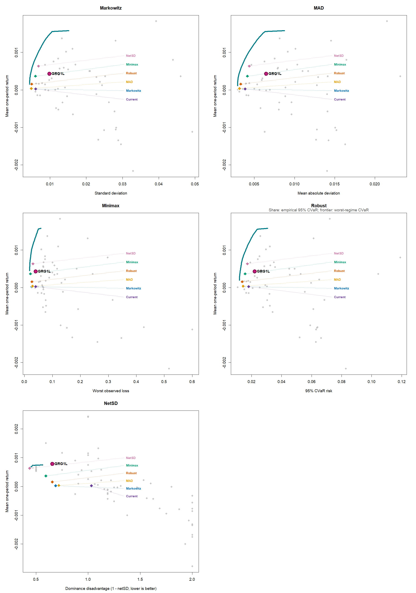

The highlighted circle is the selected share and pale filled circles are the remaining shares. The five panels show Markowitz, MAD, Minimax, regime-aware Robust mean-CVaR and netSD frontiers. In the Robust panel, the individual-share point uses empirical 95% CVaR as an approximation, while the portfolio frontier uses worst-regime CVaR. The netSD panel uses the same 527-observation training sample and the same fixed 16-series reference network for its frontier, portfolios and shares. Its horizontal axis is 1 - netSD, so lower is better. netSD is discrete: the line joins only Pareto-nondominated candidates, while hollow grey circles show the rejected numerical candidates; it must not be interpreted as a smooth frontier.

All 72 PerformanceAnalytics measures: full period and last 126 observations

| Measure | Full period | Last 126 | Measure | Full period | Last 126 |
| --- | --- | --- | --- | --- | --- |
| ActiveReturn | -0.106013 | -0.415512 | M2Sortino | 0.124429 | -0.178341 |
| AdjustedSharpe | 0.718078 | -1.255464 | MSquaredExcess | -0.073755 | -0.369052 |
| AnnualizedReturn_Arithmetic | 0.127810 | -0.188392 | Martin | 2.053835 | -2.605196 |
| AnnualizedReturn_Geometric | 0.122677 | -0.178303 | MaximumDrawdown | 0.163104 | 0.101407 |
| Appraisal | 0.762303 | -1.356976 | Modigliani | 0.000571 | -0.000920 |
| ArithmeticReturn | 0.000507 | -0.000748 | NetSelectivity | -0.080521 | -0.371092 |
| AverageDrawdown | 0.025521 | 0.055090 | Omega | 1.173751 | 0.751564 |
| AverageDrawdownLength | 19.694444 | 61.500000 | OmegaExcessReturn | 0.087066 | -0.209237 |
| AverageRecoveryTime | 12.250000 | 1.000000 | PainIndex | 0.043336 | 0.061682 |
| BernardoLedoit | 1.173751 | 0.751564 | PainRatio | 2.830823 | -2.890675 |
| BetaCoKurtosis | 0.013070 | 0.024385 | Prospect | -0.505101 | -0.706014 |
| BetaCoSkewness | -1.870061 | 9.436686 | Rachev | 1.114414 | 0.738794 |
| Burke | 0.565621 | -1.979162 | Selectivity | 0.118837 | -0.170069 |
| CAPMAlpha | 0.000492 | -0.000717 | Sharpe_Annualized | 0.819174 | -1.495827 |
| CAPMBeta | 0.016790 | -0.034712 | Sharpe_Daily | 0.051603 | -0.094228 |
| CDD | 0.057321 | 0.087512 | Sharpe_ES | 0.023893 | -0.036820 |
| Calmar | 0.752135 | -1.758285 | Sharpe_VaR | 0.035105 | -0.052697 |
| CoKurtosis | 0.000000 | 0.000000 | Skewness | 1.110901 | -0.960328 |
| CoSkewness | -0.000000 | 0.000000 | Sortino | 0.081544 | -0.117055 |
| CumulativeReturn | 0.413726 | -0.093525 | SpecificRisk | 0.155892 | 0.125330 |
| DRatio | 0.806165 | 1.618247 | Sterling | 0.466265 | -0.885286 |
| DownCapture | -0.118101 | 0.001480 | SystematicRisk | 0.002948 | -0.005379 |
| DownNumber | 0.355346 | 0.283019 | TotalRisk | 0.155920 | 0.125445 |
| DownPercent | 0.823899 | 0.867925 | TrackingError_Annualized | 0.232684 | 0.203821 |
| DownsideDeviation | 0.006220 | 0.006387 | TrackingError_Daily | 0.014658 | 0.012839 |
| DrawdownDeviation | 0.008942 | 0.009068 | Treynor_Annualized | 7.306573 | 5.136691 |
| ES_Loss | 0.021228 | 0.020304 | Treynor_Daily | 0.027355 | 0.022442 |
| FamaBeta | 0.888531 | 0.812738 | UlcerIndex | 0.059730 | 0.068441 |
| GeometricReturn | 0.000459 | -0.000779 | UpCapture | 0.025515 | -0.173618 |
| Hurst | 0.382523 | 0.415342 | UpNumber | 0.348624 | 0.232877 |
| Information_Annualized | -0.455607 | -2.038616 | UpPercent | 0.206422 | 0.136986 |
| Information_Daily | -0.024444 | -0.126487 | UpsidePotential | 0.550860 | 0.354112 |
| JensenAlpha | 0.118837 | -0.170069 | UpsideRisk | 0.007619 | 0.004713 |
| Kappa | 0.056030 | -0.077901 | VaR_Loss | 0.014447 | 0.014186 |
| Kelly | 5.250336 | -11.876852 | Volatility | 0.009829 | 0.007934 |
| Kurtosis | 12.838329 | 7.291615 | Volatility_Annualized | 0.156023 | 0.125945 |

Portfolio sensitivity

**Removing this share from curent_update_baltic**

<table class="effect-table"><thead><tr><th>Measure</th><th>Full portfolio</th><th>Portfolio without share</th><th>Change</th></tr></thead><tbody><tr><td>netSD</td><td>0.813559</td><td>0.788136</td><td>-0.025424</td></tr><tr><td>OUT</td><td>96</td><td>93</td><td>-3</td></tr><tr><td>IN</td><td>0</td><td>0</td><td>+0</td></tr><tr><td>Rachev ratio</td><td>1.147773</td><td>1.148627</td><td>0.000853</td></tr><tr><td>Sortino ratio</td><td>0.161492</td><td>0.157428</td><td>-0.004064</td></tr></tbody></table>

The removed weight is distributed proportionally across all remaining holdings, so their weights still sum to 1.

**Adding this new share to the current portfolio**

<table class="effect-table"><thead><tr><th>Measure</th><th>Current portfolio</th><th>After adding share</th><th>Change</th></tr></thead><tbody><tr><td>GRG1L shares</td><td>0</td><td>722</td><td>+722</td></tr><tr><td>Portfolio value, EUR</td><td>7956.851983</td><td>8686.071976</td><td>729.219993</td></tr><tr><td>netSD</td><td>0.423729</td><td>0.567797</td><td>0.144068</td></tr><tr><td>OUT</td><td>62</td><td>68</td><td>+6</td></tr><tr><td>IN</td><td>12</td><td>1</td><td>-11</td></tr><tr><td>Rachev ratio</td><td>1.070123</td><td>1.072681</td><td>0.002558</td></tr><tr><td>Sortino ratio</td><td>0.092352</td><td>0.100373</td><td>0.008021</td></tr></tbody></table>

The starting point is the unmodified current portfolio, which already contains 0 GRG1L shares. The scenario adds 722 shares from Table 3A, resulting in 722 shares; every other holding remains unchanged.

<strong>RSU1L — Rokiškio sūris</strong> | HOLD | target 116 shares | priority 9

<table class="stock-summary-table"><thead><tr><th>Current shares</th><th>Target shares</th><th>Change</th><th>Weight</th><th>Last price</th><th>Individual netSD</th><th>OUT / IN</th><th>RSI(14)</th><th>MACD state</th><th>Bollinger state</th><th>Stochastic RSI</th><th>Technical decision</th><th>HHI contribution</th><th>Median daily turnover</th><th>Trade / median turnover</th><th>Zero-volume days</th><th>Liquidity risk</th></tr></thead><tbody><tr><td>0</td><td>116</td><td>+116</td><td>3.47%</td><td>EUR 4.4800</td><td>0.2373</td><td>35 / 7</td><td>47.35</td><td>Bearish</td><td>Inside bands</td><td>0.331 (Neutral)</td><td>HOLD</td><td>0.001207 (1.408% of portfolio HHI)</td><td>EUR 1,260</td><td>41.2%</td><td>4.8%</td><td>HIGH</td></tr></tbody></table>

Signals combine four indicators: Bollinger bands, RSI, MACD and Stochastic RSI. Vertical lines distinguish 4-of-4, 3-of-4 and 2-of-4 buy/sell agreement.

Complete technical history

Return histogram

FSD, SSD and TSD components versus Baltic portfolios

The lower integrated CDF component is preferred at a given return threshold. Dominance requires the relevant curve to remain no higher over the complete domain, not merely over one interval.

All five model frontiers with this share highlighted

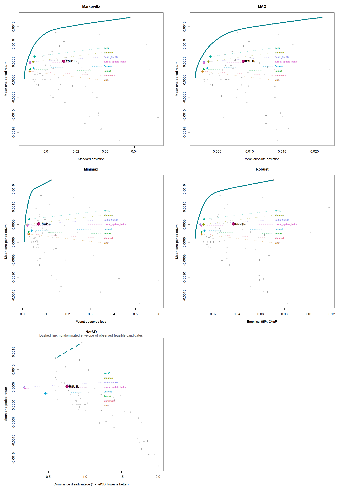

The highlighted circle is the selected share and pale filled circles are the remaining shares. The five panels show Markowitz, MAD, Minimax, regime-aware Robust mean-CVaR and netSD frontiers. In the Robust panel, the individual-share point uses empirical 95% CVaR as an approximation, while the portfolio frontier uses worst-regime CVaR. The netSD panel uses the same 527-observation training sample and the same fixed 16-series reference network for its frontier, portfolios and shares. Its horizontal axis is 1 - netSD, so lower is better. netSD is discrete: the line joins only Pareto-nondominated candidates, while hollow grey circles show the rejected numerical candidates; it must not be interpreted as a smooth frontier.

All 72 PerformanceAnalytics measures: full period and last 126 observations

| Measure | Full period | Last 126 | Measure | Full period | Last 126 |
| --- | --- | --- | --- | --- | --- |
| ActiveReturn | -0.198909 | -0.271256 | M2Sortino | 0.028780 | -0.033802 |
| AdjustedSharpe | 0.242870 | -0.054593 | MSquaredExcess | -0.168690 | -0.211581 |
| AnnualizedReturn_Arithmetic | 0.058990 | -0.011723 | Martin | 0.461094 | -0.685036 |
| AnnualizedReturn_Geometric | 0.029780 | -0.034046 | MaximumDrawdown | 0.159089 | 0.084418 |
| Appraisal | 0.024580 | -0.171085 | Modigliani | 0.000168 | -0.000034 |
| ArithmeticReturn | 0.000234 | -0.000047 | NetSelectivity | -0.288144 | -0.362871 |
| AverageDrawdown | 0.073389 | 0.029882 | Omega | 1.052456 | 0.989803 |
| AverageDrawdownLength | 67.454545 | 14.375000 | OmegaExcessReturn | -0.029551 | -0.080453 |
| AverageRecoveryTime | 35.272727 | 7.875000 | PainIndex | 0.053798 | 0.040949 |
| BernardoLedoit | 1.052456 | 0.989803 | PainRatio | 0.553557 | -0.831432 |
| BetaCoKurtosis | 0.121557 | 0.086355 | Prospect | -0.515701 | -0.600022 |
| BetaCoSkewness | -3.452885 | 5.219791 | Rachev | 1.071028 | 0.965198 |
| Burke | 0.095021 | -0.264351 | Selectivity | 0.005979 | -0.036604 |
| CAPMAlpha | 0.000143 | -0.000056 | Sharpe_Annualized | 0.241649 | -0.054572 |
| CAPMBeta | 0.104075 | 0.010782 | Sharpe_Daily | 0.015222 | -0.003438 |
| CDD | 0.125774 | 0.059566 | Sharpe_ES | 0.006528 | -0.001506 |
| Calmar | 0.187193 | -0.403308 | Sharpe_VaR | 0.009229 | -0.001859 |
| CoKurtosis | 0.000000 | 0.000000 | Skewness | 0.436525 | -0.070458 |
| CoSkewness | -0.000000 | 0.000000 | Sortino | 0.022589 | -0.004855 |
| CumulativeReturn | 0.091774 | -0.017171 | SpecificRisk | 0.243268 | 0.213953 |
| DRatio | 0.967126 | 1.033264 | Sterling | 0.114943 | -0.184616 |
| DownCapture | 0.110948 | 0.057736 | SystematicRisk | 0.018275 | 0.001671 |
| DownNumber | 0.339623 | 0.377358 | TotalRisk | 0.243954 | 0.213959 |
| DownPercent | 0.761006 | 0.735849 | TrackingError_Annualized | 0.289842 | 0.263895 |
| DownsideDeviation | 0.010363 | 0.009581 | TrackingError_Daily | 0.018258 | 0.016624 |
| DrawdownDeviation | 0.010488 | 0.009781 | Treynor_Annualized | 0.286143 | -3.157595 |
| ES_Loss | 0.035860 | 0.030899 | Treynor_Daily | 0.001119 | -0.012748 |
| FamaBeta | 1.390202 | 1.386220 | UlcerIndex | 0.064586 | 0.049700 |
| GeometricReturn | 0.000116 | -0.000137 | UpCapture | 0.143059 | 0.034815 |
| Hurst | 0.351713 | 0.405827 | UpNumber | 0.309633 | 0.328767 |
| Information_Annualized | -0.686268 | -1.027891 | UpPercent | 0.236239 | 0.205479 |
| Information_Daily | -0.038401 | -0.059101 | UpsidePotential | 0.453221 | 0.471278 |
| JensenAlpha | 0.005979 | -0.036604 | UpsideRisk | 0.011350 | 0.009480 |
| Kappa | 0.015195 | -0.003389 | VaR_Loss | 0.025365 | 0.025021 |
| Kelly | 0.989899 | -0.254042 | Volatility | 0.015378 | 0.013532 |
| Kurtosis | 8.148953 | 5.071019 | Volatility_Annualized | 0.244115 | 0.214814 |

Portfolio sensitivity

**Removing this share from curent_update_baltic**

<table class="effect-table"><thead><tr><th>Measure</th><th>Full portfolio</th><th>Portfolio without share</th><th>Change</th></tr></thead><tbody><tr><td>netSD</td><td>0.813559</td><td>0.796610</td><td>-0.016949</td></tr><tr><td>OUT</td><td>96</td><td>94</td><td>-2</td></tr><tr><td>IN</td><td>0</td><td>0</td><td>+0</td></tr><tr><td>Rachev ratio</td><td>1.147773</td><td>1.162612</td><td>0.014839</td></tr><tr><td>Sortino ratio</td><td>0.161492</td><td>0.158856</td><td>-0.002636</td></tr></tbody></table>

The removed weight is distributed proportionally across all remaining holdings, so their weights still sum to 1.

**Adding this new share to the current portfolio**

<table class="effect-table"><thead><tr><th>Measure</th><th>Current portfolio</th><th>After adding share</th><th>Change</th></tr></thead><tbody><tr><td>RSU1L shares</td><td>0</td><td>116</td><td>+116</td></tr><tr><td>Portfolio value, EUR</td><td>7956.851983</td><td>8476.531986</td><td>519.680002</td></tr><tr><td>netSD</td><td>0.423729</td><td>0.525424</td><td>0.101695</td></tr><tr><td>OUT</td><td>62</td><td>66</td><td>+4</td></tr><tr><td>IN</td><td>12</td><td>4</td><td>-8</td></tr><tr><td>Rachev ratio</td><td>1.070123</td><td>1.070077</td><td>-0.000046</td></tr><tr><td>Sortino ratio</td><td>0.092352</td><td>0.099239</td><td>0.006888</td></tr></tbody></table>

The starting point is the unmodified current portfolio, which already contains 0 RSU1L shares. The scenario adds 116 shares from Table 3A, resulting in 116 shares; every other holding remains unchanged.

<strong>IGN1L — Ignitis grupė</strong> | HOLD | target 14 shares | priority 10

<table class="stock-summary-table"><thead><tr><th>Current shares</th><th>Target shares</th><th>Change</th><th>Weight</th><th>Last price</th><th>Individual netSD</th><th>OUT / IN</th><th>RSI(14)</th><th>MACD state</th><th>Bollinger state</th><th>Stochastic RSI</th><th>Technical decision</th><th>HHI contribution</th><th>Median daily turnover</th><th>Trade / median turnover</th><th>Zero-volume days</th><th>Liquidity risk</th></tr></thead><tbody><tr><td>0</td><td>14</td><td>+14</td><td>2.07%</td><td>EUR 21.8000</td><td>0.3644</td><td>53 / 10</td><td>43.89</td><td>Bullish</td><td>Inside bands</td><td>1.000 (Overbought)</td><td>HOLD</td><td>0.000427 (0.498% of portfolio HHI)</td><td>EUR 290,959</td><td>0.1%</td><td>1.2%</td><td>LOW</td></tr></tbody></table>

Signals combine four indicators: Bollinger bands, RSI, MACD and Stochastic RSI. Vertical lines distinguish 4-of-4, 3-of-4 and 2-of-4 buy/sell agreement.

Complete technical history

Return histogram

FSD, SSD and TSD components versus Baltic portfolios

The lower integrated CDF component is preferred at a given return threshold. Dominance requires the relevant curve to remain no higher over the complete domain, not merely over one interval.

All five model frontiers with this share highlighted

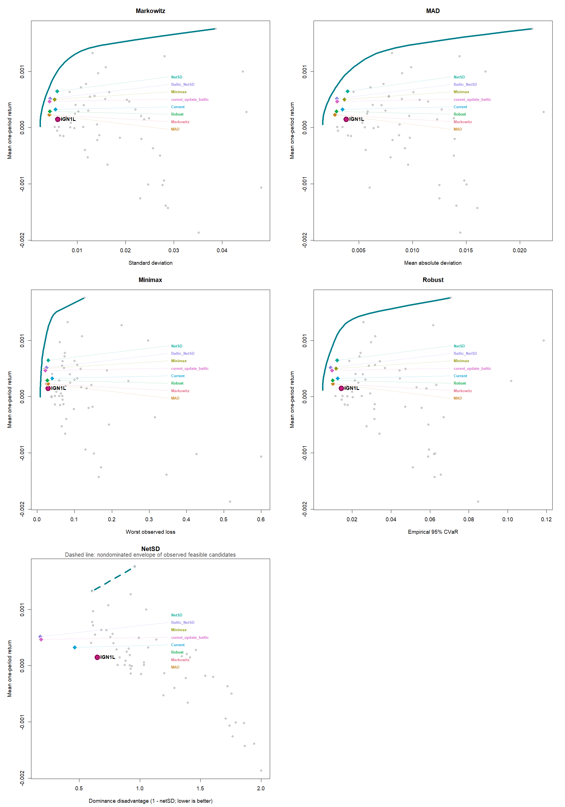

The highlighted circle is the selected share and pale filled circles are the remaining shares. The five panels show Markowitz, MAD, Minimax, regime-aware Robust mean-CVaR and netSD frontiers. In the Robust panel, the individual-share point uses empirical 95% CVaR as an approximation, while the portfolio frontier uses worst-regime CVaR. The netSD panel uses the same 527-observation training sample and the same fixed 16-series reference network for its frontier, portfolios and shares. Its horizontal axis is 1 - netSD, so lower is better. netSD is discrete: the line joins only Pareto-nondominated candidates, while hollow grey circles show the rejected numerical candidates; it must not be interpreted as a smooth frontier.

All 72 PerformanceAnalytics measures: full period and last 126 observations

| Measure | Full period | Last 126 | Measure | Full period | Last 126 |
| --- | --- | --- | --- | --- | --- |
| ActiveReturn | -0.206414 | -0.329730 | M2Sortino | 0.023483 | -0.097384 |
| AdjustedSharpe | 0.263485 | -1.154161 | MSquaredExcess | -0.154606 | -0.345176 |
| AnnualizedReturn_Arithmetic | 0.027126 | -0.094236 | Martin | 0.259626 | -1.700111 |
| AnnualizedReturn_Geometric | 0.022275 | -0.092520 | MaximumDrawdown | 0.165620 | 0.083436 |
| Appraisal | 0.161912 | -1.387410 | Modigliani | 0.000187 | -0.000767 |
| ArithmeticReturn | 0.000108 | -0.000374 | NetSelectivity | -0.109264 | -0.208123 |
| AverageDrawdown | 0.044485 | 0.048326 | Omega | 1.054449 | 0.805154 |
| AverageDrawdownLength | 74.400000 | 63.000000 | OmegaExcessReturn | -0.003127 | -0.109577 |
| AverageRecoveryTime | 38.900000 | 19.500000 | PainIndex | 0.070307 | 0.050002 |
| BernardoLedoit | 1.054449 | 0.805154 | PainRatio | 0.316822 | -1.850328 |
| BetaCoKurtosis | -0.082161 | 0.030921 | Prospect | -0.532723 | -0.787432 |
| BetaCoSkewness | -3.787258 | -21.478044 | Rachev | 1.039140 | 0.922872 |
| Burke | 0.127683 | -1.892262 | Selectivity | 0.016326 | -0.103858 |
| CAPMAlpha | 0.000085 | -0.000417 | Sharpe_Annualized | 0.268574 | -1.247812 |
| CAPMBeta | 0.026014 | 0.047798 | Sharpe_Daily | 0.016919 | -0.078605 |
| CDD | 0.109179 | 0.072903 | Sharpe_ES | 0.006979 | -0.035029 |
| Calmar | 0.134494 | -1.108877 | Sharpe_VaR | 0.011676 | -0.053100 |
| CoKurtosis | -0.000000 | 0.000000 | Skewness | -0.033254 | 0.049286 |
| CoSkewness | -0.000001 | -0.000000 | Sortino | 0.024262 | -0.106190 |
| CumulativeReturn | 0.068138 | -0.047383 | SpecificRisk | 0.100831 | 0.074858 |
| DRatio | 0.968757 | 1.567283 | Sterling | 0.083860 | -0.504374 |
| DownCapture | 0.019678 | 0.138513 | SystematicRisk | 0.004568 | 0.007407 |
| DownNumber | 0.399371 | 0.490566 | TotalRisk | 0.100934 | 0.075223 |
| DownPercent | 0.874214 | 0.886792 | TrackingError_Annualized | 0.198573 | 0.165594 |
| DownsideDeviation | 0.004437 | 0.003522 | TrackingError_Daily | 0.012509 | 0.010431 |
| DrawdownDeviation | 0.007873 | 0.007526 | Treynor_Annualized | 0.856261 | -1.935667 |
| ES_Loss | 0.015423 | 0.010675 | Treynor_Daily | 0.003361 | -0.008059 |
| FamaBeta | 0.575188 | 0.487345 | UlcerIndex | 0.085796 | 0.054420 |
| GeometricReturn | 0.000087 | -0.000385 | UpCapture | 0.040918 | 0.022186 |
| Hurst | 0.358896 | 0.362031 | UpNumber | 0.383028 | 0.342466 |
| Information_Annualized | -1.039489 | -1.991189 | UpPercent | 0.162844 | 0.150685 |
| Information_Daily | -0.058371 | -0.117933 | UpsidePotential | 0.469849 | 0.438804 |
| JensenAlpha | 0.016326 | -0.103858 | UpsideRisk | 0.004556 | 0.003192 |
| Kappa | 0.015679 | -0.078562 | VaR_Loss | 0.009219 | 0.007042 |
| Kelly | 2.659124 | -16.522785 | Volatility | 0.006362 | 0.004757 |
| Kurtosis | 8.810035 | 3.998859 | Volatility_Annualized | 0.101001 | 0.075521 |

Portfolio sensitivity

**Removing this share from curent_update_baltic**

<table class="effect-table"><thead><tr><th>Measure</th><th>Full portfolio</th><th>Portfolio without share</th><th>Change</th></tr></thead><tbody><tr><td>netSD</td><td>0.813559</td><td>0.813559</td><td>0.000000</td></tr><tr><td>OUT</td><td>96</td><td>96</td><td>+0</td></tr><tr><td>IN</td><td>0</td><td>0</td><td>+0</td></tr><tr><td>Rachev ratio</td><td>1.147773</td><td>1.146862</td><td>-0.000911</td></tr><tr><td>Sortino ratio</td><td>0.161492</td><td>0.161498</td><td>0.000006</td></tr></tbody></table>

The removed weight is distributed proportionally across all remaining holdings, so their weights still sum to 1.

**Adding this new share to the current portfolio**

<table class="effect-table"><thead><tr><th>Measure</th><th>Current portfolio</th><th>After adding share</th><th>Change</th></tr></thead><tbody><tr><td>IGN1L shares</td><td>0</td><td>14</td><td>+14</td></tr><tr><td>Portfolio value, EUR</td><td>7956.851983</td><td>8262.051973</td><td>305.199989</td></tr><tr><td>netSD</td><td>0.423729</td><td>0.440678</td><td>0.016949</td></tr><tr><td>OUT</td><td>62</td><td>62</td><td>+0</td></tr><tr><td>IN</td><td>12</td><td>10</td><td>-2</td></tr><tr><td>Rachev ratio</td><td>1.070123</td><td>1.071911</td><td>0.001788</td></tr><tr><td>Sortino ratio</td><td>0.092352</td><td>0.093427</td><td>0.001075</td></tr></tbody></table>

The starting point is the unmodified current portfolio, which already contains 0 IGN1L shares. The scenario adds 14 shares from Table 3A, resulting in 14 shares; every other holding remains unchanged.

<strong>PZV1L — Pieno žvaigždės</strong> | HOLD | target 171 shares | priority 11

<table class="stock-summary-table"><thead><tr><th>Current shares</th><th>Target shares</th><th>Change</th><th>Weight</th><th>Last price</th><th>Individual netSD</th><th>OUT / IN</th><th>RSI(14)</th><th>MACD state</th><th>Bollinger state</th><th>Stochastic RSI</th><th>Technical decision</th><th>HHI contribution</th><th>Median daily turnover</th><th>Trade / median turnover</th><th>Zero-volume days</th><th>Liquidity risk</th></tr></thead><tbody><tr><td>0</td><td>171</td><td>+171</td><td>2.04%</td><td>EUR 1.7850</td><td>0.2034</td><td>35 / 11</td><td>57.98</td><td>Bearish</td><td>Inside bands</td><td>0.145 (Oversold)</td><td>HOLD</td><td>0.000418 (0.487% of portfolio HHI)</td><td>EUR 4,749</td><td>6.4%</td><td>1.2%</td><td>HIGH</td></tr></tbody></table>

Signals combine four indicators: Bollinger bands, RSI, MACD and Stochastic RSI. Vertical lines distinguish 4-of-4, 3-of-4 and 2-of-4 buy/sell agreement.

Complete technical history

Return histogram

FSD, SSD and TSD components versus Baltic portfolios

The lower integrated CDF component is preferred at a given return threshold. Dominance requires the relevant curve to remain no higher over the complete domain, not merely over one interval.

All five model frontiers with this share highlighted

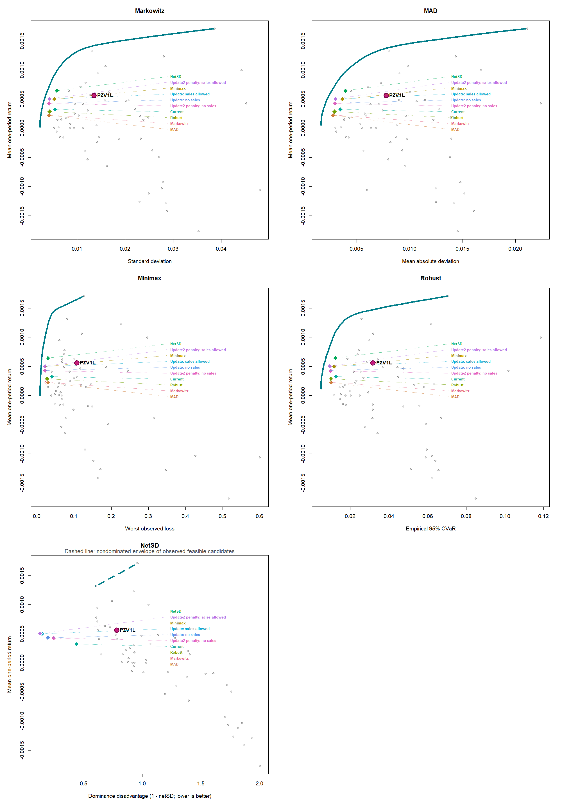

The highlighted circle is the selected share and pale filled circles are the remaining shares. The five panels show Markowitz, MAD, Minimax, regime-aware Robust mean-CVaR and netSD frontiers. In the Robust panel, the individual-share point uses empirical 95% CVaR as an approximation, while the portfolio frontier uses worst-regime CVaR. The netSD panel uses the same 527-observation training sample and the same fixed 16-series reference network for its frontier, portfolios and shares. Its horizontal axis is 1 - netSD, so lower is better. netSD is discrete: the line joins only Pareto-nondominated candidates, while hollow grey circles show the rejected numerical candidates; it must not be interpreted as a smooth frontier.

All 72 PerformanceAnalytics measures: full period and last 126 observations

| Measure | Full period | Last 126 | Measure | Full period | Last 126 |
| --- | --- | --- | --- | --- | --- |
| ActiveReturn | -0.020233 | -0.226031 | M2Sortino | 0.206232 | 0.010702 |
| AdjustedSharpe | 0.494959 | 0.156930 | MSquaredExcess | -0.052380 | -0.184990 |
| AnnualizedReturn_Arithmetic | 0.214083 | 0.032358 | Martin | 2.575798 | 0.233270 |
| AnnualizedReturn_Geometric | 0.208457 | 0.011178 | MaximumDrawdown | 0.212625 | 0.120349 |
| Appraisal | 0.893618 | 0.175202 | Modigliani | 0.000670 | 0.000096 |
| ArithmeticReturn | 0.000850 | 0.000128 | NetSelectivity | -0.081640 | -0.306835 |
| AverageDrawdown | 0.037616 | 0.038908 | Omega | 1.241052 | 1.037313 |
| AverageDrawdownLength | 18.810811 | 17.714286 | OmegaExcessReturn | 0.156533 | -0.029300 |
| AverageRecoveryTime | 9.054054 | 7.142857 | PainIndex | 0.055102 | 0.035411 |
| BernardoLedoit | 1.241052 | 1.037313 | PainRatio | 3.783116 | 0.315666 |
| BetaCoKurtosis | 0.055288 | -0.060055 | Prospect | -0.392082 | -0.499354 |
| BetaCoSkewness | -0.465367 | -8.424866 | Rachev | 1.173382 | 1.208888 |
| Burke | 0.701161 | 0.096201 | Selectivity | 0.198809 | 0.036142 |
| CAPMAlpha | 0.000812 | 0.000222 | Sharpe_Annualized | 0.961100 | 0.155753 |
| CAPMBeta | 0.042185 | -0.105240 | Sharpe_Daily | 0.060544 | 0.009812 |
| CDD | 0.096713 | 0.088394 | Sharpe_ES | 0.027378 | 0.005290 |
| Calmar | 0.980395 | 0.092880 | Sharpe_VaR | 0.050639 | 0.010280 |
| CoKurtosis | 0.000000 | -0.000000 | Skewness | 0.556555 | 1.109540 |
| CoSkewness | -0.000000 | -0.000000 | Sortino | 0.093674 | 0.015365 |
| CumulativeReturn | 0.762141 | 0.005573 | SpecificRisk | 0.222477 | 0.206287 |
| DRatio | 0.722207 | 1.293210 | Sterling | 0.666794 | 0.050729 |
| DownCapture | -0.086529 | -0.269291 | SystematicRisk | 0.007408 | -0.016308 |
| DownNumber | 0.314465 | 0.358491 | TotalRisk | 0.222600 | 0.206930 |
| DownPercent | 0.817610 | 0.943396 | TrackingError_Annualized | 0.279015 | 0.268754 |
| DownsideDeviation | 0.009069 | 0.008357 | TrackingError_Daily | 0.017576 | 0.016930 |
| DrawdownDeviation | 0.014074 | 0.013245 | Treynor_Annualized | 4.941486 | -0.106215 |
| ES_Loss | 0.031030 | 0.024274 | Treynor_Daily | 0.017818 | -0.000419 |
| FamaBeta | 1.268520 | 1.340646 | UlcerIndex | 0.080929 | 0.047919 |
| GeometricReturn | 0.000752 | 0.000044 | UpCapture | 0.131042 | -0.183091 |
| Hurst | 0.406966 | 0.517001 | UpNumber | 0.362385 | 0.315068 |
| Information_Annualized | -0.072514 | -0.841034 | UpPercent | 0.233945 | 0.219178 |
| Information_Daily | -0.003752 | -0.047308 | UpsidePotential | 0.482278 | 0.427140 |
| JensenAlpha | 0.198809 | 0.036142 | UpsideRisk | 0.010729 | 0.010004 |
| Kappa | 0.054267 | 0.008526 | VaR_Loss | 0.016776 | 0.012491 |
| Kelly | 4.314746 | 0.749711 | Volatility | 0.014032 | 0.013087 |
| Kurtosis | 17.917831 | 24.019710 | Volatility_Annualized | 0.222748 | 0.207751 |

Portfolio sensitivity

**Removing this share from curent_update_baltic**

<table class="effect-table"><thead><tr><th>Measure</th><th>Full portfolio</th><th>Portfolio without share</th><th>Change</th></tr></thead><tbody><tr><td>netSD</td><td>0.813559</td><td>0.813559</td><td>0.000000</td></tr><tr><td>OUT</td><td>96</td><td>96</td><td>+0</td></tr><tr><td>IN</td><td>0</td><td>0</td><td>+0</td></tr><tr><td>Rachev ratio</td><td>1.147773</td><td>1.155041</td><td>0.007267</td></tr><tr><td>Sortino ratio</td><td>0.161492</td><td>0.158891</td><td>-0.002601</td></tr></tbody></table>

The removed weight is distributed proportionally across all remaining holdings, so their weights still sum to 1.

**Adding this new share to the current portfolio**

<table class="effect-table"><thead><tr><th>Measure</th><th>Current portfolio</th><th>After adding share</th><th>Change</th></tr></thead><tbody><tr><td>PZV1L shares</td><td>0</td><td>171</td><td>+171</td></tr><tr><td>Portfolio value, EUR</td><td>7956.851983</td><td>8262.086978</td><td>305.234994</td></tr><tr><td>netSD</td><td>0.423729</td><td>0.525424</td><td>0.101695</td></tr><tr><td>OUT</td><td>62</td><td>66</td><td>+4</td></tr><tr><td>IN</td><td>12</td><td>4</td><td>-8</td></tr><tr><td>Rachev ratio</td><td>1.070123</td><td>1.077902</td><td>0.007779</td></tr><tr><td>Sortino ratio</td><td>0.092352</td><td>0.097193</td><td>0.004841</td></tr></tbody></table>

The starting point is the unmodified current portfolio, which already contains 0 PZV1L shares. The scenario adds 171 shares from Table 3A, resulting in 171 shares; every other holding remains unchanged.

<strong>AKO1L — Akola Group</strong> | HOLD | target 348 shares | priority 12

<table class="stock-summary-table"><thead><tr><th>Current shares</th><th>Target shares</th><th>Change</th><th>Weight</th><th>Last price</th><th>Individual netSD</th><th>OUT / IN</th><th>RSI(14)</th><th>MACD state</th><th>Bollinger state</th><th>Stochastic RSI</th><th>Technical decision</th><th>HHI contribution</th><th>Median daily turnover</th><th>Trade / median turnover</th><th>Zero-volume days</th><th>Liquidity risk</th></tr></thead><tbody><tr><td>0</td><td>348</td><td>+348</td><td>4.26%</td><td>EUR 1.8350</td><td>0.1780</td><td>32 / 11</td><td>80.20</td><td>Bullish</td><td>Inside bands</td><td>1.000 (Overbought)</td><td>HOLD</td><td>0.001816 (2.119% of portfolio HHI)</td><td>EUR 22,875</td><td>2.8%</td><td>1.2%</td><td>LOW</td></tr></tbody></table>

Signals combine four indicators: Bollinger bands, RSI, MACD and Stochastic RSI. Vertical lines distinguish 4-of-4, 3-of-4 and 2-of-4 buy/sell agreement.

Complete technical history

Return histogram

FSD, SSD and TSD components versus Baltic portfolios

The lower integrated CDF component is preferred at a given return threshold. Dominance requires the relevant curve to remain no higher over the complete domain, not merely over one interval.

All five model frontiers with this share highlighted

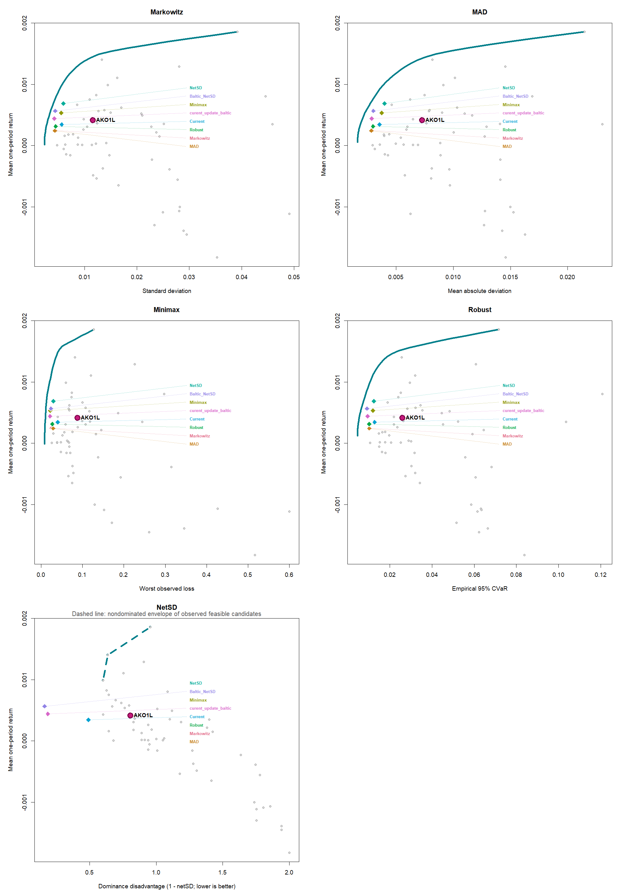

The highlighted circle is the selected share and pale filled circles are the remaining shares. The five panels show Markowitz, MAD, Minimax, regime-aware Robust mean-CVaR and netSD frontiers. In the Robust panel, the individual-share point uses empirical 95% CVaR as an approximation, while the portfolio frontier uses worst-regime CVaR. The netSD panel uses the same 527-observation training sample and the same fixed 16-series reference network for its frontier, portfolios and shares. Its horizontal axis is 1 - netSD, so lower is better. netSD is discrete: the line joins only Pareto-nondominated candidates, while hollow grey circles show the rejected numerical candidates; it must not be interpreted as a smooth frontier.

All 72 PerformanceAnalytics measures: full period and last 126 observations

| Measure | Full period | Last 126 | Measure | Full period | Last 126 |
| --- | --- | --- | --- | --- | --- |
| ActiveReturn | -0.190670 | -0.435112 | M2Sortino | 0.037933 | -0.195375 |
| AdjustedSharpe | 0.288067 | -1.013817 | MSquaredExcess | -0.156572 | -0.343643 |
| AnnualizedReturn_Arithmetic | 0.054158 | -0.207161 | Martin | 0.149407 | -1.937896 |
| AnnualizedReturn_Geometric | 0.038019 | -0.197903 | MaximumDrawdown | 0.406184 | 0.167568 |
| Appraisal | 0.134428 | -1.359501 | Modigliani | 0.000205 | -0.000781 |
| ArithmeticReturn | 0.000215 | -0.000822 | NetSelectivity | -0.201428 | -0.447675 |
| AverageDrawdown | 0.070383 | 0.167568 | Omega | 1.061023 | 0.777152 |
| AverageDrawdownLength | 81.888889 | 126.000000 | OmegaExcessReturn | -0.006462 | -0.236392 |
| AverageRecoveryTime | 48.222222 | 79.000000 | PainIndex | 0.211197 | 0.088969 |
| BernardoLedoit | 1.061023 | 0.777152 | PainRatio | 0.180016 | -2.224408 |
| BetaCoKurtosis | -0.085834 | 0.099825 | Prospect | -0.538978 | -0.683735 |
| BetaCoSkewness | -4.591177 | -4.726973 | Rachev | 1.112303 | 0.809991 |
| Burke | 0.127391 | -1.295181 | Selectivity | 0.024661 | -0.220076 |
| CAPMAlpha | 0.000164 | -0.000905 | Sharpe_Annualized | 0.294564 | -1.269597 |
| CAPMBeta | 0.058412 | 0.093475 | Sharpe_Daily | 0.018556 | -0.079977 |
| CDD | 0.203360 | 0.159189 | Sharpe_ES | 0.008461 | -0.030084 |
| Calmar | 0.093600 | -1.181033 | Sharpe_VaR | 0.012857 | -0.049292 |
| CoKurtosis | -0.000000 | 0.000000 | Skewness | 0.385739 | -0.509137 |
| CoSkewness | -0.000001 | -0.000000 | Sortino | 0.027662 | -0.103452 |
| CumulativeReturn | 0.118116 | -0.104401 | SpecificRisk | 0.183449 | 0.161880 |
| DRatio | 0.959257 | 1.454587 | Sterling | 0.075109 | -0.739637 |
| DownCapture | 0.059814 | 0.224273 | SystematicRisk | 0.010257 | 0.014485 |
| DownNumber | 0.415094 | 0.396226 | TotalRisk | 0.183735 | 0.162527 |
| DownPercent | 0.789308 | 0.773585 | TrackingError_Annualized | 0.247053 | 0.214823 |
| DownsideDeviation | 0.007769 | 0.007946 | TrackingError_Daily | 0.015563 | 0.013533 |
| DrawdownDeviation | 0.016029 | 0.014928 | Treynor_Annualized | 0.650874 | -2.117175 |
| ES_Loss | 0.025400 | 0.027326 | Treynor_Daily | 0.002535 | -0.009358 |
| FamaBeta | 1.047039 | 1.052960 | UlcerIndex | 0.254464 | 0.102123 |
| GeometricReturn | 0.000148 | -0.000875 | UpCapture | 0.097979 | -0.014717 |
| Hurst | 0.408968 | 0.430814 | UpNumber | 0.389908 | 0.397260 |
| Information_Annualized | -0.771779 | -2.025444 | UpPercent | 0.238532 | 0.205479 |
| Information_Daily | -0.043019 | -0.127082 | UpsidePotential | 0.480974 | 0.360774 |
| JensenAlpha | 0.024661 | -0.220076 | UpsideRisk | 0.008582 | 0.006507 |
| Kappa | 0.017077 | -0.068466 | VaR_Loss | 0.016716 | 0.016677 |
| Kelly | 1.602141 | -7.780800 | Volatility | 0.011582 | 0.010279 |
| Kurtosis | 14.339191 | 7.603804 | Volatility_Annualized | 0.183857 | 0.163170 |

Portfolio sensitivity

**Removing this share from curent_update_baltic**

<table class="effect-table"><thead><tr><th>Measure</th><th>Full portfolio</th><th>Portfolio without share</th><th>Change</th></tr></thead><tbody><tr><td>netSD</td><td>0.813559</td><td>0.813559</td><td>0.000000</td></tr><tr><td>OUT</td><td>96</td><td>96</td><td>+0</td></tr><tr><td>IN</td><td>0</td><td>0</td><td>+0</td></tr><tr><td>Rachev ratio</td><td>1.147773</td><td>1.154683</td><td>0.006910</td></tr><tr><td>Sortino ratio</td><td>0.161492</td><td>0.160163</td><td>-0.001329</td></tr></tbody></table>

The removed weight is distributed proportionally across all remaining holdings, so their weights still sum to 1.

**Adding this new share to the current portfolio**

<table class="effect-table"><thead><tr><th>Measure</th><th>Current portfolio</th><th>After adding share</th><th>Change</th></tr></thead><tbody><tr><td>AKO1L shares</td><td>0</td><td>348</td><td>+348</td></tr><tr><td>Portfolio value, EUR</td><td>7956.851983</td><td>8595.431997</td><td>638.580013</td></tr><tr><td>netSD</td><td>0.423729</td><td>0.508475</td><td>0.084746</td></tr><tr><td>OUT</td><td>62</td><td>66</td><td>+4</td></tr><tr><td>IN</td><td>12</td><td>6</td><td>-6</td></tr><tr><td>Rachev ratio</td><td>1.070123</td><td>1.052024</td><td>-0.018099</td></tr><tr><td>Sortino ratio</td><td>0.092352</td><td>0.097704</td><td>0.005352</td></tr></tbody></table>

The starting point is the unmodified current portfolio, which already contains 0 AKO1L shares. The scenario adds 348 shares from Table 3A, resulting in 348 shares; every other holding remains unchanged.

<strong>ROE1L — Artea Bankas</strong> | HOLD | target 422 shares | priority 13

<table class="stock-summary-table"><thead><tr><th>Current shares</th><th>Target shares</th><th>Change</th><th>Weight</th><th>Last price</th><th>Individual netSD</th><th>OUT / IN</th><th>RSI(14)</th><th>MACD state</th><th>Bollinger state</th><th>Stochastic RSI</th><th>Technical decision</th><th>HHI contribution</th><th>Median daily turnover</th><th>Trade / median turnover</th><th>Zero-volume days</th><th>Liquidity risk</th></tr></thead><tbody><tr><td>416</td><td>422</td><td>+6</td><td>2.48%</td><td>EUR 0.8820</td><td>0.1525</td><td>37 / 19</td><td>43.60</td><td>Bearish</td><td>Inside bands</td><td>0.127 (Oversold)</td><td>HOLD</td><td>0.000616 (0.719% of portfolio HHI)</td><td>EUR 193,178</td><td>0.0%</td><td>1.2%</td><td>LOW</td></tr></tbody></table>

Signals combine four indicators: Bollinger bands, RSI, MACD and Stochastic RSI. Vertical lines distinguish 4-of-4, 3-of-4 and 2-of-4 buy/sell agreement.

Complete technical history

Return histogram

FSD, SSD and TSD components versus Baltic portfolios

The lower integrated CDF component is preferred at a given return threshold. Dominance requires the relevant curve to remain no higher over the complete domain, not merely over one interval.

All five model frontiers with this share highlighted

The highlighted circle is the selected share and pale filled circles are the remaining shares. The five panels show Markowitz, MAD, Minimax, regime-aware Robust mean-CVaR and netSD frontiers. In the Robust panel, the individual-share point uses empirical 95% CVaR as an approximation, while the portfolio frontier uses worst-regime CVaR. The netSD panel uses the same 527-observation training sample and the same fixed 16-series reference network for its frontier, portfolios and shares. Its horizontal axis is 1 - netSD, so lower is better. netSD is discrete: the line joins only Pareto-nondominated candidates, while hollow grey circles show the rejected numerical candidates; it must not be interpreted as a smooth frontier.

All 72 PerformanceAnalytics measures: full period and last 126 observations

| Measure | Full period | Last 126 | Measure | Full period | Last 126 |
| --- | --- | --- | --- | --- | --- |
| ActiveReturn | -0.115722 | -0.378050 | M2Sortino | 0.114315 | -0.139778 |
| AdjustedSharpe | 0.560868 | 0.111426 | MSquaredExcess | -0.092393 | -0.277010 |
| AnnualizedReturn_Arithmetic | 0.121675 | -0.131225 | Martin | 1.405464 | -2.227181 |
| AnnualizedReturn_Geometric | 0.112967 | -0.140841 | MaximumDrawdown | 0.195697 | 0.111458 |
| Appraisal | 0.574790 | -0.623341 | Modigliani | 0.000492 | -0.000390 |
| ArithmeticReturn | 0.000483 | -0.000521 | NetSelectivity | -0.111354 | -0.457484 |
| AverageDrawdown | 0.026332 | 0.060998 | Omega | 1.170781 | 0.837003 |
| AverageDrawdownLength | 30.000000 | 60.500000 | OmegaExcessReturn | 0.076092 | -0.176454 |
| AverageRecoveryTime | 16.541667 | 47.500000 | PainIndex | 0.060631 | 0.053575 |
| BernardoLedoit | 1.170781 | 0.837003 | PainRatio | 1.863187 | -2.628856 |
| BetaCoKurtosis | -0.115281 | -0.025470 | Prospect | -0.473745 | -0.613965 |
| BetaCoSkewness | -3.665609 | -9.333290 | Rachev | 1.372678 | 1.101771 |
| Burke | 0.446368 | -1.194529 | Selectivity | 0.098738 | -0.128329 |
| CAPMAlpha | 0.000428 | -0.000474 | Sharpe_Annualized | 0.706419 | -0.634381 |
| CAPMBeta | 0.062219 | -0.052750 | Sharpe_Daily | 0.044500 | -0.039962 |
| CDD | 0.088512 | 0.096320 | Sharpe_ES | 0.022170 | -0.022920 |
| Calmar | 0.577255 | -1.263623 | Sharpe_VaR | 0.041965 | -0.056317 |
| CoKurtosis | -0.000000 | -0.000000 | Skewness | 1.895772 | 4.249864 |
| CoSkewness | -0.000000 | -0.000000 | Sortino | 0.074968 | -0.070824 |
| CumulativeReturn | 0.377457 | -0.073092 | SpecificRisk | 0.171781 | 0.205872 |
| DRatio | 0.967636 | 1.703139 | Sterling | 0.382037 | -0.666047 |
| DownCapture | 0.019880 | 0.008580 | SystematicRisk | 0.010925 | -0.008174 |
| DownNumber | 0.487421 | 0.566038 | TotalRisk | 0.172128 | 0.206034 |
| DownPercent | 0.779874 | 0.830189 | TrackingError_Annualized | 0.238043 | 0.263318 |
| DownsideDeviation | 0.006441 | 0.007352 | TrackingError_Daily | 0.014995 | 0.016587 |
| DrawdownDeviation | 0.009503 | 0.009974 | Treynor_Annualized | 1.815646 | 2.670002 |
| ES_Loss | 0.021779 | 0.022720 | Treynor_Daily | 0.006828 | 0.011416 |
| FamaBeta | 0.980897 | 1.334866 | UlcerIndex | 0.080377 | 0.063237 |
| GeometricReturn | 0.000425 | -0.000602 | UpCapture | 0.129274 | -0.114960 |
| Hurst | 0.412721 | 0.527537 | UpNumber | 0.428899 | 0.424658 |
| Information_Annualized | -0.486139 | -1.435718 | UpPercent | 0.208716 | 0.191781 |
| Information_Daily | -0.026193 | -0.087249 | UpsidePotential | 0.513939 | 0.363688 |
| JensenAlpha | 0.098738 | -0.128329 | UpsideRisk | 0.008736 | 0.010708 |
| Kappa | 0.045908 | -0.041295 | VaR_Loss | 0.011506 | 0.009247 |
| Kelly | 4.101313 | -3.066781 | Volatility | 0.010850 | 0.013031 |
| Kurtosis | 23.643745 | 46.314315 | Volatility_Annualized | 0.172242 | 0.206856 |

Portfolio sensitivity

**Removing this share from curent_update_baltic**

<table class="effect-table"><thead><tr><th>Measure</th><th>Full portfolio</th><th>Portfolio without share</th><th>Change</th></tr></thead><tbody><tr><td>netSD</td><td>0.813559</td><td>0.813559</td><td>0.000000</td></tr><tr><td>OUT</td><td>96</td><td>96</td><td>+0</td></tr><tr><td>IN</td><td>0</td><td>0</td><td>+0</td></tr><tr><td>Rachev ratio</td><td>1.147773</td><td>1.152716</td><td>0.004942</td></tr><tr><td>Sortino ratio</td><td>0.161492</td><td>0.162213</td><td>0.000721</td></tr></tbody></table>

The removed weight is distributed proportionally across all remaining holdings, so their weights still sum to 1.

**Increasing this existing position in the current portfolio**

<table class="effect-table"><thead><tr><th>Measure</th><th>Current portfolio</th><th>After adding share</th><th>Change</th></tr></thead><tbody><tr><td>ROE1L shares</td><td>416</td><td>422</td><td>+6</td></tr><tr><td>Portfolio value, EUR</td><td>7956.851983</td><td>7962.143983</td><td>5.292000</td></tr><tr><td>netSD</td><td>0.423729</td><td>0.423729</td><td>0.000000</td></tr><tr><td>OUT</td><td>62</td><td>62</td><td>+0</td></tr><tr><td>IN</td><td>12</td><td>12</td><td>+0</td></tr><tr><td>Rachev ratio</td><td>1.070123</td><td>1.070192</td><td>0.000069</td></tr><tr><td>Sortino ratio</td><td>0.092352</td><td>0.092378</td><td>0.000026</td></tr></tbody></table>

The starting point is the unmodified current portfolio, which already contains 416 ROE1L shares. The scenario adds 6 shares from Table 3A, resulting in 422 shares; every other holding remains unchanged.

<strong>TAL1T — Tallink Grupp</strong> | HOLD | target 879 shares | priority 14

<table class="stock-summary-table"><thead><tr><th>Current shares</th><th>Target shares</th><th>Change</th><th>Weight</th><th>Last price</th><th>Individual netSD</th><th>OUT / IN</th><th>RSI(14)</th><th>MACD state</th><th>Bollinger state</th><th>Stochastic RSI</th><th>Technical decision</th><th>HHI contribution</th><th>Median daily turnover</th><th>Trade / median turnover</th><th>Zero-volume days</th><th>Liquidity risk</th></tr></thead><tbody><tr><td>700</td><td>879</td><td>+179</td><td>3.78%</td><td>EUR 0.6450</td><td>0.0593</td><td>26 / 19</td><td>60.34</td><td>Bearish</td><td>Inside bands</td><td>0.000 (Oversold)</td><td>HOLD</td><td>0.001432 (1.670% of portfolio HHI)</td><td>EUR 77,229</td><td>0.1%</td><td>1.2%</td><td>LOW</td></tr></tbody></table>

Signals combine four indicators: Bollinger bands, RSI, MACD and Stochastic RSI. Vertical lines distinguish 4-of-4, 3-of-4 and 2-of-4 buy/sell agreement.

Complete technical history

Return histogram

FSD, SSD and TSD components versus Baltic portfolios

The lower integrated CDF component is preferred at a given return threshold. Dominance requires the relevant curve to remain no higher over the complete domain, not merely over one interval.

All five model frontiers with this share highlighted

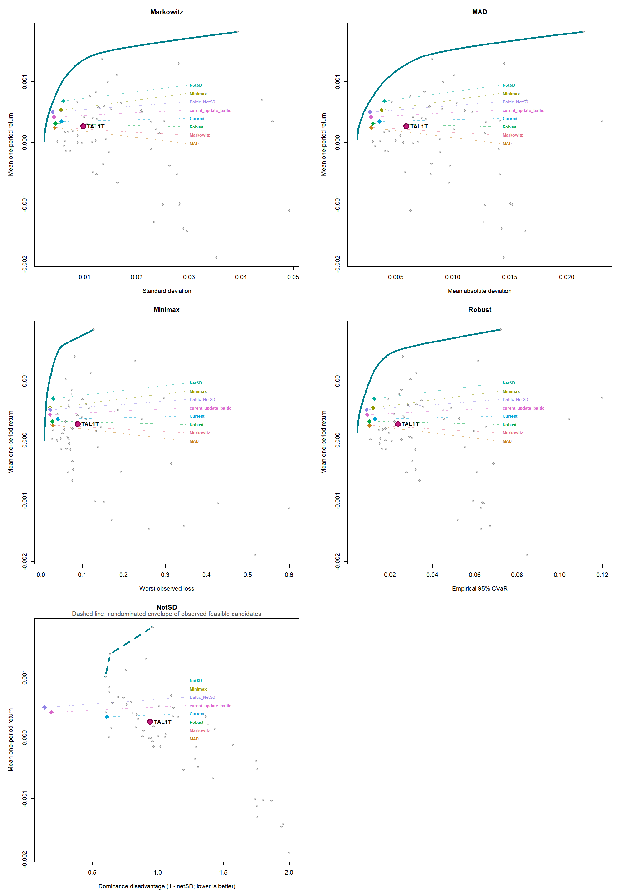

The highlighted circle is the selected share and pale filled circles are the remaining shares. The five panels show Markowitz, MAD, Minimax, regime-aware Robust mean-CVaR and netSD frontiers. In the Robust panel, the individual-share point uses empirical 95% CVaR as an approximation, while the portfolio frontier uses worst-regime CVaR. The netSD panel uses the same 527-observation training sample and the same fixed 16-series reference network for its frontier, portfolios and shares. Its horizontal axis is 1 - netSD, so lower is better. netSD is discrete: the line joins only Pareto-nondominated candidates, while hollow grey circles show the rejected numerical candidates; it must not be interpreted as a smooth frontier.

All 72 PerformanceAnalytics measures: full period and last 126 observations

| Measure | Full period | Last 126 | Measure | Full period | Last 126 |
| --- | --- | --- | --- | --- | --- |
| ActiveReturn | -0.192892 | -0.145603 | M2Sortino | 0.036221 | 0.092022 |
| AdjustedSharpe | 0.299051 | 0.205110 | MSquaredExcess | -0.152656 | -0.101893 |
| AnnualizedReturn_Arithmetic | 0.046837 | 0.095830 | Martin | 0.410319 | 2.554879 |
| AnnualizedReturn_Geometric | 0.035797 | 0.091606 | MaximumDrawdown | 0.173554 | 0.065270 |
| Appraisal | 0.176972 | 0.634766 | Modigliani | 0.000214 | 0.000461 |
| ArithmeticReturn | 0.000186 | 0.000380 | NetSelectivity | -0.163278 | -0.103900 |
| AverageDrawdown | 0.029449 | 0.018221 | Omega | 1.064954 | 1.200198 |
| AverageDrawdownLength | 41.166667 | 16.285714 | OmegaExcessReturn | -0.002123 | 0.062576 |
| AverageRecoveryTime | 21.277778 | 6.000000 | PainIndex | 0.074668 | 0.028290 |
| BernardoLedoit | 1.064954 | 1.200198 | PainRatio | 0.479418 | 3.238094 |
| BetaCoKurtosis | -0.065405 | 0.055012 | Prospect | -0.511984 | -0.332707 |
| BetaCoSkewness | -3.680137 | -4.847655 | Rachev | 1.053652 | 0.995431 |
| Burke | 0.147077 | 1.205395 | Selectivity | 0.027007 | 0.080622 |
| CAPMAlpha | 0.000152 | 0.000339 | Sharpe_Annualized | 0.306412 | 0.750312 |
| CAPMBeta | 0.038436 | 0.046304 | Sharpe_Daily | 0.019302 | 0.047265 |
| CDD | 0.071457 | 0.050439 | Sharpe_ES | 0.007791 | 0.021033 |
| Calmar | 0.206261 | 1.403486 | Sharpe_VaR | 0.013499 | 0.051588 |
| CoKurtosis | -0.000000 | 0.000000 | Skewness | 0.092191 | -1.605265 |
| CoSkewness | -0.000001 | -0.000000 | Sortino | 0.028063 | 0.063448 |
| CumulativeReturn | 0.110972 | 0.044800 | SpecificRisk | 0.152608 | 0.127011 |
| DRatio | 1.020660 | 0.721035 | Sterling | 0.130860 | 0.554280 |
| DownCapture | 0.020975 | 0.042594 | SystematicRisk | 0.006749 | 0.007175 |
| DownNumber | 0.418239 | 0.320755 | TotalRisk | 0.152757 | 0.127214 |
| DownPercent | 0.820755 | 0.905660 | TrackingError_Annualized | 0.227661 | 0.195198 |
| DownsideDeviation | 0.006623 | 0.005994 | TrackingError_Daily | 0.014341 | 0.012296 |
| DrawdownDeviation | 0.008608 | 0.006983 | Treynor_Annualized | 0.931339 | 1.978358 |
| ES_Loss | 0.023856 | 0.018080 | Treynor_Daily | 0.003631 | 0.007513 |
| FamaBeta | 0.870506 | 0.824194 | UlcerIndex | 0.087243 | 0.035855 |
| GeometricReturn | 0.000140 | 0.000348 | UpCapture | 0.060333 | 0.122619 |
| Hurst | 0.365714 | 0.516015 | UpNumber | 0.383028 | 0.369863 |
| Information_Annualized | -0.847278 | -0.745925 | UpPercent | 0.176606 | 0.150685 |
| Information_Daily | -0.047277 | -0.040431 | UpsidePotential | 0.460100 | 0.380371 |
| JensenAlpha | 0.027007 | 0.080622 | UpsideRisk | 0.006983 | 0.005333 |
| Kappa | 0.017653 | 0.033252 | VaR_Loss | 0.013769 | 0.007371 |
| Kelly | 2.004552 | 5.874664 | Volatility | 0.009629 | 0.008046 |
| Kurtosis | 10.344557 | 25.419416 | Volatility_Annualized | 0.152858 | 0.127720 |

Portfolio sensitivity

**Removing this share from curent_update_baltic**

<table class="effect-table"><thead><tr><th>Measure</th><th>Full portfolio</th><th>Portfolio without share</th><th>Change</th></tr></thead><tbody><tr><td>netSD</td><td>0.813559</td><td>0.805085</td><td>-0.008475</td></tr><tr><td>OUT</td><td>96</td><td>95</td><td>-1</td></tr><tr><td>IN</td><td>0</td><td>0</td><td>+0</td></tr><tr><td>Rachev ratio</td><td>1.147773</td><td>1.157178</td><td>0.009405</td></tr><tr><td>Sortino ratio</td><td>0.161492</td><td>0.161875</td><td>0.000383</td></tr></tbody></table>

The removed weight is distributed proportionally across all remaining holdings, so their weights still sum to 1.

**Increasing this existing position in the current portfolio**

<table class="effect-table"><thead><tr><th>Measure</th><th>Current portfolio</th><th>After adding share</th><th>Change</th></tr></thead><tbody><tr><td>TAL1T shares</td><td>700</td><td>879</td><td>+179</td></tr><tr><td>Portfolio value, EUR</td><td>7956.851983</td><td>8072.306980</td><td>115.454997</td></tr><tr><td>netSD</td><td>0.423729</td><td>0.423729</td><td>0.000000</td></tr><tr><td>OUT</td><td>62</td><td>62</td><td>+0</td></tr><tr><td>IN</td><td>12</td><td>12</td><td>+0</td></tr><tr><td>Rachev ratio</td><td>1.070123</td><td>1.067318</td><td>-0.002805</td></tr><tr><td>Sortino ratio</td><td>0.092352</td><td>0.092669</td><td>0.000318</td></tr></tbody></table>

The starting point is the unmodified current portfolio, which already contains 700 TAL1T shares. The scenario adds 179 shares from Table 3A, resulting in 879 shares; every other holding remains unchanged.

<strong>DGR1R — DelfinGroup</strong> | HOLD | target 160 shares | priority 15

<table class="stock-summary-table"><thead><tr><th>Current shares</th><th>Target shares</th><th>Change</th><th>Weight</th><th>Last price</th><th>Individual netSD</th><th>OUT / IN</th><th>RSI(14)</th><th>MACD state</th><th>Bollinger state</th><th>Stochastic RSI</th><th>Technical decision</th><th>HHI contribution</th><th>Median daily turnover</th><th>Trade / median turnover</th><th>Zero-volume days</th><th>Liquidity risk</th></tr></thead><tbody><tr><td>0</td><td>160</td><td>+160</td><td>1.82%</td><td>EUR 1.7050</td><td>0.0339</td><td>26 / 22</td><td>67.67</td><td>Bullish</td><td>Inside bands</td><td>0.536 (Neutral)</td><td>HOLD</td><td>0.000332 (0.387% of portfolio HHI)</td><td>EUR 12,310</td><td>2.2%</td><td>2.4%</td><td>MEDIUM</td></tr></tbody></table>

Signals combine four indicators: Bollinger bands, RSI, MACD and Stochastic RSI. Vertical lines distinguish 4-of-4, 3-of-4 and 2-of-4 buy/sell agreement.

Complete technical history

Return histogram

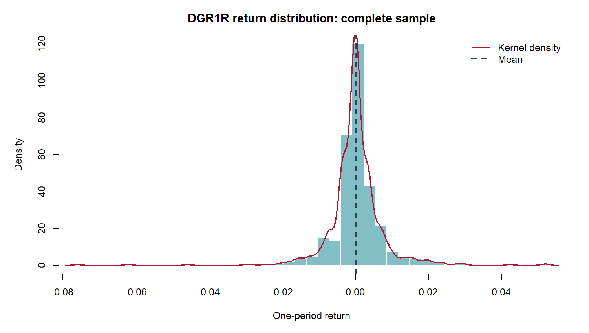

FSD, SSD and TSD components versus Baltic portfolios

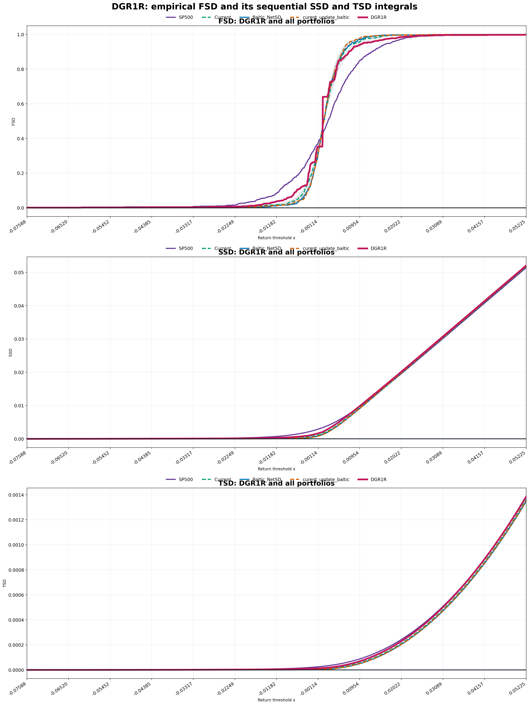

The lower integrated CDF component is preferred at a given return threshold. Dominance requires the relevant curve to remain no higher over the complete domain, not merely over one interval.

All five model frontiers with this share highlighted

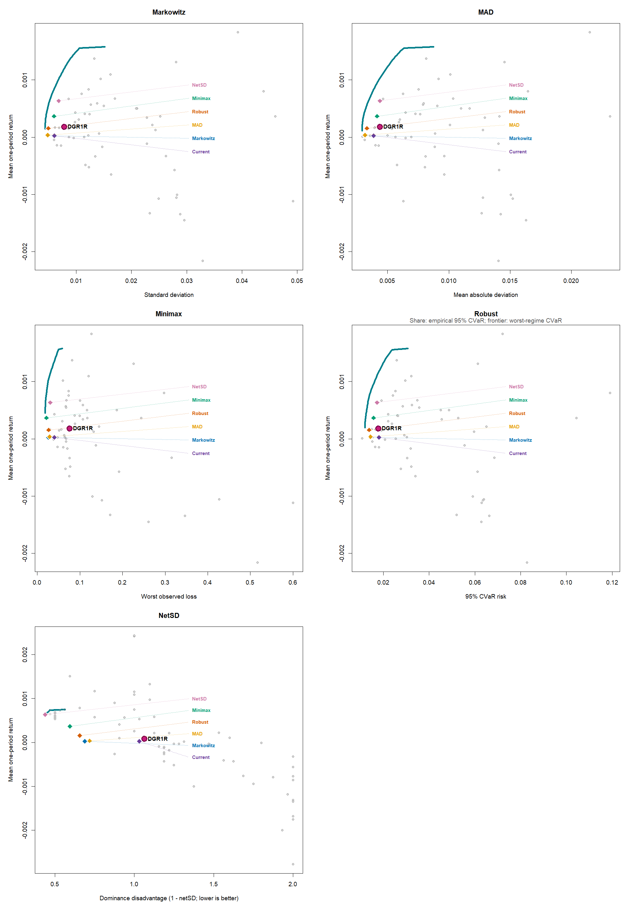

The highlighted circle is the selected share and pale filled circles are the remaining shares. The five panels show Markowitz, MAD, Minimax, regime-aware Robust mean-CVaR and netSD frontiers. In the Robust panel, the individual-share point uses empirical 95% CVaR as an approximation, while the portfolio frontier uses worst-regime CVaR. The netSD panel uses the same 527-observation training sample and the same fixed 16-series reference network for its frontier, portfolios and shares. Its horizontal axis is 1 - netSD, so lower is better. netSD is discrete: the line joins only Pareto-nondominated candidates, while hollow grey circles show the rejected numerical candidates; it must not be interpreted as a smooth frontier.

All 72 PerformanceAnalytics measures: full period and last 126 observations

| Measure | Full period | Last 126 | Measure | Full period | Last 126 |
| --- | --- | --- | --- | --- | --- |
| ActiveReturn | -0.133680 | 0.209969 | M2Sortino | 0.098890 | 0.465339 |
| AdjustedSharpe | 0.505423 | -3.361744 | MSquaredExcess | -0.068846 | 0.223420 |
| AnnualizedReturn_Arithmetic | 0.097455 | 0.378790 | Martin | 1.136901 | 40.755773 |
| AnnualizedReturn_Geometric | 0.095009 | 0.447178 | MaximumDrawdown | 0.218446 | 0.027235 |
| Appraisal | 0.747984 | 3.199462 | Modigliani | 0.000587 | 0.001726 |
| ArithmeticReturn | 0.000387 | 0.001503 | NetSelectivity | -0.055773 | 0.240657 |
| AverageDrawdown | 0.021368 | 0.012967 | Omega | 1.203861 | 1.823660 |
| AverageDrawdownLength | 35.950000 | 9.500000 | OmegaExcessReturn | 0.068445 | 0.429557 |
| AverageRecoveryTime | 15.350000 | 3.666667 | PainIndex | 0.058687 | 0.008199 |
| BernardoLedoit | 1.203861 | 1.823660 | PainRatio | 1.618916 | 54.540371 |
| BetaCoKurtosis | -0.001280 | 0.177843 | Prospect | -0.427724 | -0.213865 |
| BetaCoSkewness | -1.489626 | 9.268103 | Rachev | 1.239206 | 2.135722 |
| Burke | 0.618415 | 8.338946 | Selectivity | 0.086400 | 0.428103 |
| CAPMAlpha | 0.000354 | 0.001431 | Sharpe_Annualized | 0.841749 | 2.807605 |
| CAPMBeta | 0.037644 | 0.080414 | Sharpe_Daily | 0.053025 | 0.176863 |
| CDD | 0.026227 | 0.025283 | Sharpe_ES | 0.025243 | 0.133253 |
| Calmar | 0.434932 | 16.419513 | Sharpe_VaR | 0.043434 | 0.219080 |
| CoKurtosis | -0.000000 | 0.000000 | Skewness | 0.563733 | 2.286271 |
| CoSkewness | -0.000000 | 0.000000 | Sortino | 0.083350 | 0.413173 |
| CumulativeReturn | 0.312019 | 0.202987 | SpecificRisk | 0.115511 | 0.133805 |
| DRatio | 0.785516 | 0.505340 | Sterling | 0.298352 | 3.514597 |
| DownCapture | 0.039651 | -0.141486 | SystematicRisk | 0.006610 | 0.012461 |
| DownNumber | 0.383648 | 0.377358 | TotalRisk | 0.115700 | 0.134384 |
| DownPercent | 0.852201 | 0.849057 | TrackingError_Annualized | 0.204736 | 0.195841 |
| DownsideDeviation | 0.004640 | 0.003638 | TrackingError_Daily | 0.012897 | 0.012337 |
| DrawdownDeviation | 0.008279 | 0.004860 | Treynor_Annualized | 2.523863 | 5.560968 |
| ES_Loss | 0.015320 | 0.011280 | Treynor_Daily | 0.009569 | 0.018253 |
| FamaBeta | 0.659330 | 0.870628 | UlcerIndex | 0.083568 | 0.010972 |
| GeometricReturn | 0.000360 | 0.001468 | UpCapture | 0.122368 | 0.239470 |
| Hurst | 0.415257 | 0.431505 | UpNumber | 0.376147 | 0.383562 |
| Information_Annualized | -0.652939 | 1.072138 | UpPercent | 0.174312 | 0.205479 |
| Information_Daily | -0.035462 | 0.050481 | UpsidePotential | 0.492210 | 0.914804 |
| JensenAlpha | 0.086400 | 0.428103 | UpsideRisk | 0.005634 | 0.007790 |
| Kappa | 0.047265 | 0.295612 | VaR_Loss | 0.008904 | 0.006861 |
| Kelly | 7.270480 | 20.810081 | Volatility | 0.007293 | 0.008499 |
| Kurtosis | 19.212807 | 12.947505 | Volatility_Annualized | 0.115776 | 0.134916 |

Portfolio sensitivity

**Removing this share from curent_update_baltic**

<table class="effect-table"><thead><tr><th>Measure</th><th>Full portfolio</th><th>Portfolio without share</th><th>Change</th></tr></thead><tbody><tr><td>netSD</td><td>0.813559</td><td>0.813559</td><td>0.000000</td></tr><tr><td>OUT</td><td>96</td><td>96</td><td>+0</td></tr><tr><td>IN</td><td>0</td><td>0</td><td>+0</td></tr><tr><td>Rachev ratio</td><td>1.147773</td><td>1.148472</td><td>0.000698</td></tr><tr><td>Sortino ratio</td><td>0.161492</td><td>0.161309</td><td>-0.000183</td></tr></tbody></table>

The removed weight is distributed proportionally across all remaining holdings, so their weights still sum to 1.

**Adding this new share to the current portfolio**

<table class="effect-table"><thead><tr><th>Measure</th><th>Current portfolio</th><th>After adding share</th><th>Change</th></tr></thead><tbody><tr><td>DGR1R shares</td><td>0</td><td>160</td><td>+160</td></tr><tr><td>Portfolio value, EUR</td><td>7956.851983</td><td>8229.651990</td><td>272.800007</td></tr><tr><td>netSD</td><td>0.423729</td><td>0.440678</td><td>0.016949</td></tr><tr><td>OUT</td><td>62</td><td>62</td><td>+0</td></tr><tr><td>IN</td><td>12</td><td>10</td><td>-2</td></tr><tr><td>Rachev ratio</td><td>1.070123</td><td>1.066584</td><td>-0.003539</td></tr><tr><td>Sortino ratio</td><td>0.092352</td><td>0.093313</td><td>0.000961</td></tr></tbody></table>

The starting point is the unmodified current portfolio, which already contains 0 DGR1R shares. The scenario adds 160 shares from Table 3A, resulting in 160 shares; every other holding remains unchanged.

<strong>TEL1L — Telia Lietuva</strong> | HOLD | target 11 shares | priority 16

<table class="stock-summary-table"><thead><tr><th>Current shares</th><th>Target shares</th><th>Change</th><th>Weight</th><th>Last price</th><th>Individual netSD</th><th>OUT / IN</th><th>RSI(14)</th><th>MACD state</th><th>Bollinger state</th><th>Stochastic RSI</th><th>Technical decision</th><th>HHI contribution</th><th>Median daily turnover</th><th>Trade / median turnover</th><th>Zero-volume days</th><th>Liquidity risk</th></tr></thead><tbody><tr><td>0</td><td>11</td><td>+11</td><td>0.17%</td><td>EUR 2.2600</td><td>0.1610</td><td>42 / 23</td><td>77.86</td><td>Bullish</td><td>Inside bands</td><td>1.000 (Overbought)</td><td>HOLD</td><td>0.000003 (0.003% of portfolio HHI)</td><td>EUR 56,053</td><td>0.0%</td><td>1.2%</td><td>LOW</td></tr></tbody></table>

Signals combine four indicators: Bollinger bands, RSI, MACD and Stochastic RSI. Vertical lines distinguish 4-of-4, 3-of-4 and 2-of-4 buy/sell agreement.

Complete technical history

Return histogram

FSD, SSD and TSD components versus Baltic portfolios

The lower integrated CDF component is preferred at a given return threshold. Dominance requires the relevant curve to remain no higher over the complete domain, not merely over one interval.

All five model frontiers with this share highlighted

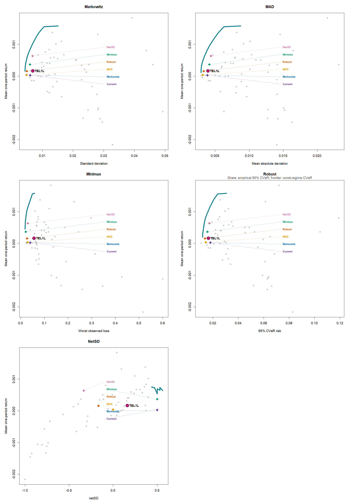

The highlighted circle is the selected share and pale filled circles are the remaining shares. The five panels show Markowitz, MAD, Minimax, regime-aware Robust mean-CVaR and netSD frontiers. In the Robust panel, the individual-share point uses empirical 95% CVaR as an approximation, while the portfolio frontier uses worst-regime CVaR. The netSD panel uses the same 527-observation training sample and the same fixed 16-series reference network for its frontier, portfolios and shares. Its horizontal axis is 1 - netSD, so lower is better. netSD is discrete: the line joins only Pareto-nondominated candidates, while hollow grey circles show the rejected numerical candidates; it must not be interpreted as a smooth frontier.

All 72 PerformanceAnalytics measures: full period and last 126 observations

| Measure | Full period | Last 126 | Measure | Full period | Last 126 |
| --- | --- | --- | --- | --- | --- |
| ActiveReturn | -0.196066 | -0.066828 | M2Sortino | 0.034150 | 0.177795 |
| AdjustedSharpe | 0.333757 | 1.660770 | MSquaredExcess | -0.141614 | 0.023635 |
| AnnualizedReturn_Arithmetic | 0.037591 | 0.162236 | Martin | 0.221097 | 7.912122 |
| AnnualizedReturn_Geometric | 0.032623 | 0.170381 | MaximumDrawdown | 0.225761 | 0.049932 |
| Appraisal | 0.267278 | 1.722501 | Modigliani | 0.000250 | 0.001007 |
| ArithmeticReturn | 0.000149 | 0.000644 | NetSelectivity | -0.103792 | 0.018699 |
| AverageDrawdown | 0.036650 | 0.019687 | Omega | 1.080062 | 1.352935 |
| AverageDrawdownLength | 66.545455 | 14.500000 | OmegaExcessReturn | 0.006262 | 0.152396 |
| AverageRecoveryTime | 34.727273 | 7.375000 | PainIndex | 0.125364 | 0.017126 |
| BernardoLedoit | 1.080062 | 1.352935 | PainRatio | 0.260227 | 9.948620 |
| BetaCoKurtosis | -0.028307 | 0.076703 | Prospect | -0.473444 | -0.440691 |
| BetaCoSkewness | -2.565127 | 1.493734 | Rachev | 1.075976 | 1.439696 |
| Burke | 0.204657 | 3.046626 | Selectivity | 0.027961 | 0.170005 |
| CAPMAlpha | 0.000131 | 0.000642 | Sharpe_Annualized | 0.358884 | 1.637248 |
| CAPMBeta | 0.020385 | 0.001586 | Sharpe_Daily | 0.022608 | 0.103137 |
| CDD | 0.049102 | 0.037483 | Sharpe_ES | 0.009737 | 0.059247 |
| Calmar | 0.144503 | 3.412236 | Sharpe_VaR | 0.015944 | 0.068966 |
| CoKurtosis | -0.000000 | 0.000000 | Skewness | -0.329646 | 0.490767 |
| CoSkewness | -0.000000 | 0.000000 | Sortino | 0.032399 | 0.173382 |
| CumulativeReturn | 0.100817 | 0.081841 | SpecificRisk | 0.104615 | 0.098696 |
| DRatio | 0.934140 | 0.701230 | Sterling | 0.100144 | 1.136385 |
| DownCapture | 0.020832 | -0.120621 | SystematicRisk | 0.003580 | 0.000246 |
| DownNumber | 0.301887 | 0.283019 | TotalRisk | 0.104676 | 0.098697 |
| DownPercent | 0.861635 | 0.849057 | TrackingError_Annualized | 0.201367 | 0.183729 |
| DownsideDeviation | 0.004604 | 0.003713 | TrackingError_Daily | 0.012685 | 0.011574 |
| DrawdownDeviation | 0.008616 | 0.006146 | Treynor_Annualized | 1.600315 | 107.436660 |
| ES_Loss | 0.015321 | 0.010866 | Treynor_Daily | 0.006249 | 0.393800 |
| FamaBeta | 0.596511 | 0.639446 | UlcerIndex | 0.147551 | 0.021534 |
| GeometricReturn | 0.000127 | 0.000625 | UpCapture | 0.051596 | 0.055064 |
| Hurst | 0.379338 | 0.373845 | UpNumber | 0.302752 | 0.287671 |
| Information_Annualized | -0.973675 | -0.363732 | UpPercent | 0.178899 | 0.205479 |
| Information_Daily | -0.054410 | -0.019053 | UpsidePotential | 0.437074 | 0.664641 |
| JensenAlpha | 0.027961 | 0.170005 | UpsideRisk | 0.004723 | 0.005028 |
| Kappa | 0.019352 | 0.126490 | VaR_Loss | 0.009356 | 0.009335 |
| Kelly | 3.426255 | 16.522720 | Volatility | 0.006598 | 0.006242 |
| Kurtosis | 12.372385 | 4.070376 | Volatility_Annualized | 0.104745 | 0.099091 |

Portfolio sensitivity

**Removing this share from curent_update_baltic**

<table class="effect-table"><thead><tr><th>Measure</th><th>Full portfolio</th><th>Portfolio without share</th><th>Change</th></tr></thead><tbody><tr><td>netSD</td><td>0.813559</td><td>0.813559</td><td>0.000000</td></tr><tr><td>OUT</td><td>96</td><td>96</td><td>+0</td></tr><tr><td>IN</td><td>0</td><td>0</td><td>+0</td></tr><tr><td>Rachev ratio</td><td>1.147773</td><td>1.147918</td><td>0.000144</td></tr><tr><td>Sortino ratio</td><td>0.161492</td><td>0.161502</td><td>0.000010</td></tr></tbody></table>

The removed weight is distributed proportionally across all remaining holdings, so their weights still sum to 1.

**Adding this new share to the current portfolio**

<table class="effect-table"><thead><tr><th>Measure</th><th>Current portfolio</th><th>After adding share</th><th>Change</th></tr></thead><tbody><tr><td>TEL1L shares</td><td>0</td><td>11</td><td>+11</td></tr><tr><td>Portfolio value, EUR</td><td>7956.851983</td><td>7981.711983</td><td>24.860000</td></tr><tr><td>netSD</td><td>0.423729</td><td>0.423729</td><td>0.000000</td></tr><tr><td>OUT</td><td>62</td><td>62</td><td>+0</td></tr><tr><td>IN</td><td>12</td><td>12</td><td>+0</td></tr><tr><td>Rachev ratio</td><td>1.070123</td><td>1.070044</td><td>-0.000079</td></tr><tr><td>Sortino ratio</td><td>0.092352</td><td>0.092422</td><td>0.000070</td></tr></tbody></table>

The starting point is the unmodified current portfolio, which already contains 0 TEL1L shares. The scenario adds 11 shares from Table 3A, resulting in 11 shares; every other holding remains unchanged.

<strong>EFT1T — EfTEN Real Estate Fund</strong> | HOLD | target 15 shares | priority 17

<table class="stock-summary-table"><thead><tr><th>Current shares</th><th>Target shares</th><th>Change</th><th>Weight</th><th>Last price</th><th>Individual netSD</th><th>OUT / IN</th><th>RSI(14)</th><th>MACD state</th><th>Bollinger state</th><th>Stochastic RSI</th><th>Technical decision</th><th>HHI contribution</th><th>Median daily turnover</th><th>Trade / median turnover</th><th>Zero-volume days</th><th>Liquidity risk</th></tr></thead><tbody><tr><td>0</td><td>15</td><td>+15</td><td>2.05%</td><td>EUR 19.5500</td><td>0.1102</td><td>36 / 23</td><td>51.02</td><td>Bullish</td><td>Inside bands</td><td>0.577 (Neutral)</td><td>HOLD</td><td>0.000420 (0.489% of portfolio HHI)</td><td>EUR 20,013</td><td>1.5%</td><td>1.2%</td><td>LOW</td></tr></tbody></table>

Signals combine four indicators: Bollinger bands, RSI, MACD and Stochastic RSI. Vertical lines distinguish 4-of-4, 3-of-4 and 2-of-4 buy/sell agreement.

Complete technical history

Return histogram

FSD, SSD and TSD components versus Baltic portfolios

The lower integrated CDF component is preferred at a given return threshold. Dominance requires the relevant curve to remain no higher over the complete domain, not merely over one interval.

All five model frontiers with this share highlighted

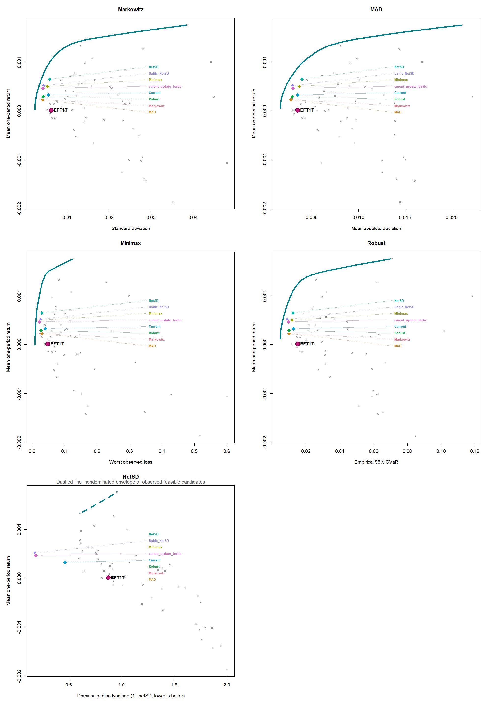

The highlighted circle is the selected share and pale filled circles are the remaining shares. The five panels show Markowitz, MAD, Minimax, regime-aware Robust mean-CVaR and netSD frontiers. In the Robust panel, the individual-share point uses empirical 95% CVaR as an approximation, while the portfolio frontier uses worst-regime CVaR. The netSD panel uses the same 527-observation training sample and the same fixed 16-series reference network for its frontier, portfolios and shares. Its horizontal axis is 1 - netSD, so lower is better. netSD is discrete: the line joins only Pareto-nondominated candidates, while hollow grey circles show the rejected numerical candidates; it must not be interpreted as a smooth frontier.

All 72 PerformanceAnalytics measures: full period and last 126 observations

| Measure | Full period | Last 126 | Measure | Full period | Last 126 |
| --- | --- | --- | --- | --- | --- |
| ActiveReturn | -0.249120 | -0.315798 | M2Sortino | -0.021051 | -0.080231 |
| AdjustedSharpe | -0.167524 | -0.502205 | MSquaredExcess | -0.216200 | -0.303506 |
| AnnualizedReturn_Arithmetic | -0.015907 | -0.077929 | Martin | -0.126159 | -2.234009 |
| AnnualizedReturn_Geometric | -0.020430 | -0.078589 | MaximumDrawdown | 0.201964 | 0.062130 |
| Appraisal | -0.225699 | -1.038739 | Modigliani | -0.000114 | -0.000544 |
| ArithmeticReturn | -0.000063 | -0.000309 | NetSelectivity | -0.146866 | -0.213391 |
| AverageDrawdown | 0.045633 | 0.020570 | Omega | 0.965259 | 0.800466 |
| AverageDrawdownLength | 147.000000 | 24.750000 | OmegaExcessReturn | -0.047208 | -0.101840 |
| AverageRecoveryTime | 80.800000 | 12.750000 | PainIndex | 0.153465 | 0.026023 |
| BernardoLedoit | 0.965259 | 0.800466 | PainRatio | -0.133128 | -3.019974 |
| BetaCoKurtosis | -0.031388 | 0.057061 | Prospect | -0.499101 | -0.467986 |
| BetaCoSkewness | -1.120956 | 7.217372 | Rachev | 0.875056 | 0.721047 |
| Burke | -0.129214 | -1.246756 | Selectivity | -0.021895 | -0.090740 |
| CAPMAlpha | -0.000069 | -0.000355 | Sharpe_Annualized | -0.163847 | -0.884916 |
| CAPMBeta | 0.006406 | 0.051227 | Sharpe_Daily | -0.010321 | -0.055744 |
| CDD | 0.115536 | 0.044782 | Sharpe_ES | -0.004086 | -0.022066 |
| Calmar | -0.101159 | -1.264896 | Sharpe_VaR | -0.006635 | -0.040949 |
| CoKurtosis | -0.000000 | 0.000000 | Skewness | -1.382197 | -4.004161 |
| CoSkewness | -0.000000 | 0.000000 | Sortino | -0.013496 | -0.064420 |
| CumulativeReturn | -0.059894 | -0.040098 | SpecificRisk | 0.097011 | 0.087356 |
| DRatio | 0.996650 | 1.177885 | Sterling | -0.067658 | -0.484724 |
| DownCapture | 0.011748 | 0.097296 | SystematicRisk | 0.001125 | 0.007938 |
| DownNumber | 0.301887 | 0.283019 | TotalRisk | 0.097018 | 0.087716 |
| DownPercent | 0.874214 | 0.905660 | TrackingError_Annualized | 0.199660 | 0.171197 |
| DownsideDeviation | 0.004677 | 0.004800 | TrackingError_Daily | 0.012577 | 0.010784 |
| DrawdownDeviation | 0.007374 | 0.005669 | Treynor_Annualized | -3.189276 | -1.534130 |
| ES_Loss | 0.015448 | 0.014014 | Treynor_Daily | -0.012786 | -0.006339 |
| FamaBeta | 0.552871 | 0.568283 | UlcerIndex | 0.161942 | 0.035178 |
| GeometricReturn | -0.000082 | -0.000325 | UpCapture | -0.005516 | 0.004697 |
| Hurst | 0.388273 | 0.483868 | UpNumber | 0.332569 | 0.273973 |
| Information_Annualized | -1.247719 | -1.844641 | UpPercent | 0.137615 | 0.095890 |
| Information_Daily | -0.071517 | -0.108469 | UpsidePotential | 0.374987 | 0.258433 |
| JensenAlpha | -0.021895 | -0.090740 | UpsideRisk | 0.003935 | 0.002754 |
| Kappa | -0.007768 | -0.033831 | VaR_Loss | 0.009514 | 0.007552 |
| Kelly | -1.687710 | -10.048644 | Volatility | 0.006116 | 0.005547 |
| Kurtosis | 16.679067 | 34.354529 | Volatility_Annualized | 0.097082 | 0.088063 |

Portfolio sensitivity

**Removing this share from curent_update_baltic**

<table class="effect-table"><thead><tr><th>Measure</th><th>Full portfolio</th><th>Portfolio without share</th><th>Change</th></tr></thead><tbody><tr><td>netSD</td><td>0.813559</td><td>0.805085</td><td>-0.008475</td></tr><tr><td>OUT</td><td>96</td><td>95</td><td>-1</td></tr><tr><td>IN</td><td>0</td><td>0</td><td>+0</td></tr><tr><td>Rachev ratio</td><td>1.147773</td><td>1.149893</td><td>0.002119</td></tr><tr><td>Sortino ratio</td><td>0.161492</td><td>0.161921</td><td>0.000428</td></tr></tbody></table>

The removed weight is distributed proportionally across all remaining holdings, so their weights still sum to 1.

**Adding this new share to the current portfolio**

<table class="effect-table"><thead><tr><th>Measure</th><th>Current portfolio</th><th>After adding share</th><th>Change</th></tr></thead><tbody><tr><td>EFT1T shares</td><td>0</td><td>15</td><td>+15</td></tr><tr><td>Portfolio value, EUR</td><td>7956.851983</td><td>8250.101972</td><td>293.249989</td></tr><tr><td>netSD</td><td>0.423729</td><td>0.432203</td><td>0.008475</td></tr><tr><td>OUT</td><td>62</td><td>61</td><td>-1</td></tr><tr><td>IN</td><td>12</td><td>10</td><td>-2</td></tr><tr><td>Rachev ratio</td><td>1.070123</td><td>1.069410</td><td>-0.000713</td></tr><tr><td>Sortino ratio</td><td>0.092352</td><td>0.092267</td><td>-0.000085</td></tr></tbody></table>

The starting point is the unmodified current portfolio, which already contains 0 EFT1T shares. The scenario adds 15 shares from Table 3A, resulting in 15 shares; every other holding remains unchanged.

<strong>TKM1T — TKM Grupp</strong> | HOLD | target 343 shares | priority 18

<table class="stock-summary-table"><thead><tr><th>Current shares</th><th>Target shares</th><th>Change</th><th>Weight</th><th>Last price</th><th>Individual netSD</th><th>OUT / IN</th><th>RSI(14)</th><th>MACD state</th><th>Bollinger state</th><th>Stochastic RSI</th><th>Technical decision</th><th>HHI contribution</th><th>Median daily turnover</th><th>Trade / median turnover</th><th>Zero-volume days</th><th>Liquidity risk</th></tr></thead><tbody><tr><td>288</td><td>343</td><td>+55</td><td>20.51%</td><td>EUR 8.9600</td><td>0.0508</td><td>29 / 23</td><td>31.65</td><td>Bearish</td><td>Below lower band</td><td>0.000 (Oversold)</td><td>HOLD</td><td>0.042083 (49.092% of portfolio HHI)</td><td>EUR 39,903</td><td>1.2%</td><td>1.2%</td><td>LOW</td></tr></tbody></table>

Signals combine four indicators: Bollinger bands, RSI, MACD and Stochastic RSI. Vertical lines distinguish 4-of-4, 3-of-4 and 2-of-4 buy/sell agreement.

Complete technical history

Return histogram

FSD, SSD and TSD components versus Baltic portfolios

The lower integrated CDF component is preferred at a given return threshold. Dominance requires the relevant curve to remain no higher over the complete domain, not merely over one interval.

All five model frontiers with this share highlighted

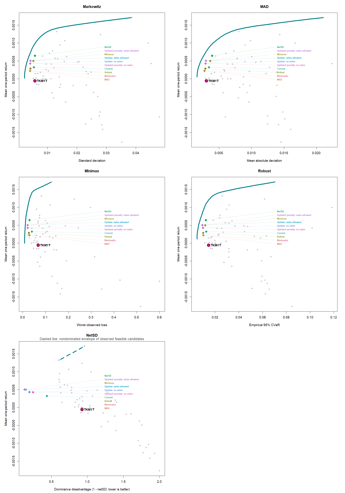

The highlighted circle is the selected share and pale filled circles are the remaining shares. The five panels show Markowitz, MAD, Minimax, regime-aware Robust mean-CVaR and netSD frontiers. In the Robust panel, the individual-share point uses empirical 95% CVaR as an approximation, while the portfolio frontier uses worst-regime CVaR. The netSD panel uses the same 527-observation training sample and the same fixed 16-series reference network for its frontier, portfolios and shares. Its horizontal axis is 1 - netSD, so lower is better. netSD is discrete: the line joins only Pareto-nondominated candidates, while hollow grey circles show the rejected numerical candidates; it must not be interpreted as a smooth frontier.

All 72 PerformanceAnalytics measures: full period and last 126 observations

| Measure | Full period | Last 126 | Measure | Full period | Last 126 |
| --- | --- | --- | --- | --- | --- |
| ActiveReturn | -0.245633 | -0.320675 | M2Sortino | -0.017314 | -0.083390 |
| AdjustedSharpe | -0.130610 | -0.343215 | MSquaredExcess | -0.210725 | -0.284093 |
| AnnualizedReturn_Arithmetic | -0.012162 | -0.080571 | Martin | -0.147483 | -1.725960 |
| AnnualizedReturn_Geometric | -0.016943 | -0.083466 | MaximumDrawdown | 0.170070 | 0.075107 |
| Appraisal | -0.255460 | -0.524923 | Modigliani | -0.000086 | -0.000438 |
| ArithmeticReturn | -0.000048 | -0.000320 | NetSelectivity | -0.145137 | -0.256724 |
| AverageDrawdown | 0.021201 | 0.018467 | Omega | 0.970092 | 0.790245 |
| AverageDrawdownLength | 74.300000 | 19.500000 | OmegaExcessReturn | -0.046166 | -0.114968 |
| AverageRecoveryTime | 40.000000 | 4.500000 | PainIndex | 0.105668 | 0.039159 |
| BernardoLedoit | 0.970092 | 0.790245 | PainRatio | -0.160345 | -2.131479 |
| BetaCoKurtosis | 0.036864 | -0.084826 | Prospect | -0.404644 | -0.342116 |
| BetaCoSkewness | -1.671872 | -4.816994 | Rachev | 0.888236 | 0.702365 |
| Burke | -0.104562 | -1.139562 | Selectivity | -0.025078 | -0.058563 |
| CAPMAlpha | -0.000080 | -0.000226 | Sharpe_Annualized | -0.123558 | -0.711850 |
| CAPMBeta | 0.035572 | -0.104983 | Sharpe_Daily | -0.007783 | -0.044842 |
| CDD | 0.021416 | 0.047726 | Sharpe_ES | -0.003093 | -0.019428 |
| Calmar | -0.099626 | -1.111300 | Sharpe_VaR | -0.006871 | -0.073416 |
| CoKurtosis | 0.000000 | -0.000000 | Skewness | -4.151940 | -6.712294 |
| CoSkewness | -0.000000 | -0.000000 | Sortino | -0.009456 | -0.049159 |
| CumulativeReturn | -0.049845 | -0.042642 | SpecificRisk | 0.098168 | 0.111565 |
| DRatio | 1.003342 | 1.375468 | Sterling | -0.062737 | -0.476658 |
| DownCapture | 0.043554 | -0.048834 | SystematicRisk | 0.006246 | -0.016269 |
| DownNumber | 0.411950 | 0.358491 | TotalRisk | 0.098367 | 0.112745 |
| DownPercent | 0.874214 | 0.981132 | TrackingError_Annualized | 0.195779 | 0.204614 |
| DownsideDeviation | 0.005104 | 0.006504 | TrackingError_Daily | 0.012333 | 0.012889 |
| DrawdownDeviation | 0.006232 | 0.006974 | Treynor_Annualized | -0.476317 | 0.795044 |
| ES_Loss | 0.015606 | 0.016457 | Treynor_Daily | -0.001906 | 0.003294 |
| FamaBeta | 0.560557 | 0.730403 | UlcerIndex | 0.114883 | 0.048359 |
| GeometricReturn | -0.000068 | -0.000346 | UpCapture | 0.023213 | -0.113401 |
| Hurst | 0.417088 | 0.513426 | UpNumber | 0.396789 | 0.315068 |
| Information_Annualized | -1.254642 | -1.567222 | UpPercent | 0.139908 | 0.136986 |
| Information_Daily | -0.071791 | -0.092388 | UpsidePotential | 0.306695 | 0.185206 |
| JensenAlpha | -0.025078 | -0.058563 | UpsideRisk | 0.003514 | 0.002870 |
| Kappa | -0.004604 | -0.023436 | VaR_Loss | 0.007024 | 0.004355 |
| Kelly | -1.255266 | -6.289215 | Volatility | 0.006201 | 0.007130 |
| Kurtosis | 47.689790 | 65.244397 | Volatility_Annualized | 0.098432 | 0.113186 |

Portfolio sensitivity

**Removing this share from curent_update_baltic**

<table class="effect-table"><thead><tr><th>Measure</th><th>Full portfolio</th><th>Portfolio without share</th><th>Change</th></tr></thead><tbody><tr><td>netSD</td><td>0.813559</td><td>0.762712</td><td>-0.050847</td></tr><tr><td>OUT</td><td>96</td><td>90</td><td>-6</td></tr><tr><td>IN</td><td>0</td><td>0</td><td>+0</td></tr><tr><td>Rachev ratio</td><td>1.147773</td><td>1.207303</td><td>0.059529</td></tr><tr><td>Sortino ratio</td><td>0.161492</td><td>0.181595</td><td>0.020102</td></tr></tbody></table>

The removed weight is distributed proportionally across all remaining holdings, so their weights still sum to 1.

**Increasing this existing position in the current portfolio**

<table class="effect-table"><thead><tr><th>Measure</th><th>Current portfolio</th><th>After adding share</th><th>Change</th></tr></thead><tbody><tr><td>TKM1T shares</td><td>288</td><td>343</td><td>+55</td></tr><tr><td>Portfolio value, EUR</td><td>7956.851983</td><td>8449.651985</td><td>492.800002</td></tr><tr><td>netSD</td><td>0.423729</td><td>0.440678</td><td>0.016949</td></tr><tr><td>OUT</td><td>62</td><td>62</td><td>+0</td></tr><tr><td>IN</td><td>12</td><td>10</td><td>-2</td></tr><tr><td>Rachev ratio</td><td>1.070123</td><td>1.058090</td><td>-0.012033</td></tr><tr><td>Sortino ratio</td><td>0.092352</td><td>0.088184</td><td>-0.004168</td></tr></tbody></table>

The starting point is the unmodified current portfolio, which already contains 288 TKM1T shares. The scenario adds 55 shares from Table 3A, resulting in 343 shares; every other holding remains unchanged.

<strong>LHV1T — LHV Group</strong> | HOLD | target 34 shares | priority 19

<table class="stock-summary-table"><thead><tr><th>Current shares</th><th>Target shares</th><th>Change</th><th>Weight</th><th>Last price</th><th>Individual netSD</th><th>OUT / IN</th><th>RSI(14)</th><th>MACD state</th><th>Bollinger state</th><th>Stochastic RSI</th><th>Technical decision</th><th>HHI contribution</th><th>Median daily turnover</th><th>Trade / median turnover</th><th>Zero-volume days</th><th>Liquidity risk</th></tr></thead><tbody><tr><td>0</td><td>34</td><td>+34</td><td>0.75%</td><td>EUR 3.2550</td><td>0.0847</td><td>34 / 24</td><td>34.21</td><td>Bearish</td><td>Inside bands</td><td>0.409 (Neutral)</td><td>HOLD</td><td>0.000056 (0.065% of portfolio HHI)</td><td>EUR 265,034</td><td>0.0%</td><td>1.2%</td><td>LOW</td></tr></tbody></table>

Signals combine four indicators: Bollinger bands, RSI, MACD and Stochastic RSI. Vertical lines distinguish 4-of-4, 3-of-4 and 2-of-4 buy/sell agreement.

Complete technical history

Return histogram

FSD, SSD and TSD components versus Baltic portfolios

The lower integrated CDF component is preferred at a given return threshold. Dominance requires the relevant curve to remain no higher over the complete domain, not merely over one interval.

All five model frontiers with this share highlighted

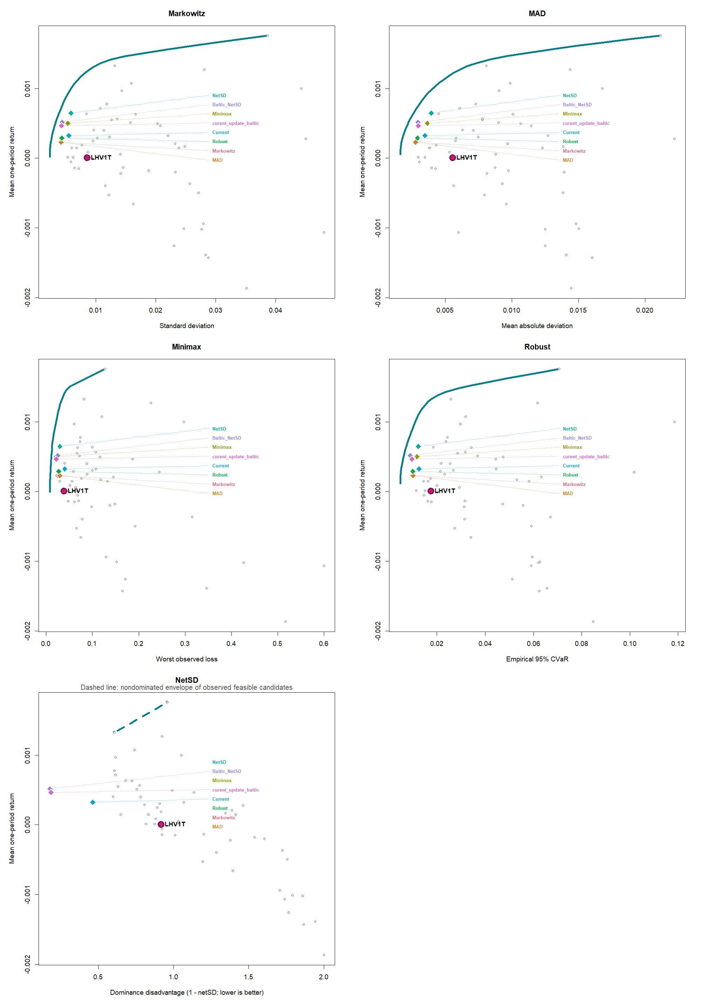

The highlighted circle is the selected share and pale filled circles are the remaining shares. The five panels show Markowitz, MAD, Minimax, regime-aware Robust mean-CVaR and netSD frontiers. In the Robust panel, the individual-share point uses empirical 95% CVaR as an approximation, while the portfolio frontier uses worst-regime CVaR. The netSD panel uses the same 527-observation training sample and the same fixed 16-series reference network for its frontier, portfolios and shares. Its horizontal axis is 1 - netSD, so lower is better. netSD is discrete: the line joins only Pareto-nondominated candidates, while hollow grey circles show the rejected numerical candidates; it must not be interpreted as a smooth frontier.

All 72 PerformanceAnalytics measures: full period and last 126 observations

| Measure | Full period | Last 126 | Measure | Full period | Last 126 |
| --- | --- | --- | --- | --- | --- |
| ActiveReturn | -0.310261 | -0.406248 | M2Sortino | -0.083045 | -0.172547 |
| AdjustedSharpe | -0.479708 | 0.387719 | MSquaredExcess | -0.269998 | -0.397120 |
| AnnualizedReturn_Arithmetic | -0.075467 | -0.179830 | Martin | -0.370437 | -2.714696 |
| AnnualizedReturn_Geometric | -0.081572 | -0.169039 | MaximumDrawdown | 0.317810 | 0.109872 |
| Appraisal | -0.573439 | -1.576011 | Modigliani | -0.000378 | -0.001073 |
| ArithmeticReturn | -0.000299 | -0.000714 | NetSelectivity | -0.262590 | -0.326834 |
| AverageDrawdown | 0.069906 | 0.040304 | Omega | 0.901766 | 0.690329 |
| AverageDrawdownLength | 149.600000 | 30.750000 | OmegaExcessReturn | -0.114675 | -0.192733 |
| AverageRecoveryTime | 2.600000 | 3.500000 | PainIndex | 0.206536 | 0.050031 |
| BernardoLedoit | 0.901766 | 0.690329 | PainRatio | -0.394952 | -3.378700 |
| BetaCoKurtosis | -0.113239 | -0.010657 | Prospect | -0.710868 | -0.734706 |
| BetaCoSkewness | -3.835436 | 3.481287 | Rachev | 1.213892 | 0.865016 |
| Burke | -0.373845 | -2.494648 | Selectivity | -0.079647 | -0.161638 |
| CAPMAlpha | -0.000292 | -0.000686 | Sharpe_Annualized | -0.542953 | -1.744500 |
| CAPMBeta | -0.008419 | -0.031200 | Sharpe_Daily | -0.034203 | -0.109893 |
| CDD | 0.180859 | 0.084506 | Sharpe_ES | -0.016078 | -0.044190 |
| Calmar | -0.256669 | -1.538500 | Sharpe_VaR | -0.023678 | -0.069558 |
| CoKurtosis | -0.000000 | -0.000000 | Skewness | 0.734623 | 0.103992 |
| CoSkewness | -0.000001 | 0.000000 | Sortino | -0.051795 | -0.145875 |
| CumulativeReturn | -0.224773 | -0.088429 | SpecificRisk | 0.138893 | 0.102561 |
| DRatio | 1.524267 | 2.064235 | Sterling | -0.195237 | -0.805435 |
| DownCapture | -0.008574 | 0.037884 | SystematicRisk | -0.001478 | -0.004835 |
| DownNumber | 0.471698 | 0.509434 | TotalRisk | 0.138901 | 0.102675 |
| DownPercent | 0.789308 | 0.867925 | TrackingError_Annualized | 0.225105 | 0.190101 |
| DownsideDeviation | 0.005782 | 0.004892 | TrackingError_Daily | 0.014180 | 0.011975 |
| DrawdownDeviation | 0.011592 | 0.010383 | Treynor_Annualized | 9.689265 | 5.417857 |
| ES_Loss | 0.018626 | 0.016149 | Treynor_Daily | 0.040102 | 0.023543 |
| FamaBeta | 0.791547 | 0.665215 | UlcerIndex | 0.220205 | 0.062268 |
| GeometricReturn | -0.000338 | -0.000735 | UpCapture | -0.077199 | -0.136865 |
| Hurst | 0.340010 | 0.476136 | UpNumber | 0.339450 | 0.287671 |
| Information_Annualized | -1.378293 | -2.137007 | UpPercent | 0.149083 | 0.068493 |
| Information_Daily | -0.081465 | -0.131903 | UpsidePotential | 0.475464 | 0.325189 |
| JensenAlpha | -0.079647 | -0.161638 | UpsideRisk | 0.006574 | 0.004291 |
| Kappa | -0.036120 | -0.093454 | VaR_Loss | 0.012648 | 0.010259 |
| Kelly | -3.906329 | -16.923073 | Volatility | 0.008756 | 0.006494 |
| Kurtosis | 7.071013 | 12.400512 | Volatility_Annualized | 0.138993 | 0.103084 |

Portfolio sensitivity

**Removing this share from curent_update_baltic**

<table class="effect-table"><thead><tr><th>Measure</th><th>Full portfolio</th><th>Portfolio without share</th><th>Change</th></tr></thead><tbody><tr><td>netSD</td><td>0.813559</td><td>0.813559</td><td>0.000000</td></tr><tr><td>OUT</td><td>96</td><td>96</td><td>+0</td></tr><tr><td>IN</td><td>0</td><td>0</td><td>+0</td></tr><tr><td>Rachev ratio</td><td>1.147773</td><td>1.148276</td><td>0.000503</td></tr><tr><td>Sortino ratio</td><td>0.161492</td><td>0.162228</td><td>0.000736</td></tr></tbody></table>

The removed weight is distributed proportionally across all remaining holdings, so their weights still sum to 1.

**Adding this new share to the current portfolio**

<table class="effect-table"><thead><tr><th>Measure</th><th>Current portfolio</th><th>After adding share</th><th>Change</th></tr></thead><tbody><tr><td>LHV1T shares</td><td>0</td><td>34</td><td>+34</td></tr><tr><td>Portfolio value, EUR</td><td>7956.851983</td><td>8067.521987</td><td>110.670004</td></tr><tr><td>netSD</td><td>0.423729</td><td>0.423729</td><td>0.000000</td></tr><tr><td>OUT</td><td>62</td><td>62</td><td>+0</td></tr><tr><td>IN</td><td>12</td><td>12</td><td>+0</td></tr><tr><td>Rachev ratio</td><td>1.070123</td><td>1.068991</td><td>-0.001132</td></tr><tr><td>Sortino ratio</td><td>0.092352</td><td>0.091928</td><td>-0.000424</td></tr></tbody></table>

The starting point is the unmodified current portfolio, which already contains 0 LHV1T shares. The scenario adds 34 shares from Table 3A, resulting in 34 shares; every other holding remains unchanged.

<strong>CPA1T — Coop Pank</strong> | HOLD | target 46 shares | priority 20

<table class="stock-summary-table"><thead><tr><th>Current shares</th><th>Target shares</th><th>Change</th><th>Weight</th><th>Last price</th><th>Individual netSD</th><th>OUT / IN</th><th>RSI(14)</th><th>MACD state</th><th>Bollinger state</th><th>Stochastic RSI</th><th>Technical decision</th><th>HHI contribution</th><th>Median daily turnover</th><th>Trade / median turnover</th><th>Zero-volume days</th><th>Liquidity risk</th></tr></thead><tbody><tr><td>0</td><td>46</td><td>+46</td><td>0.72%</td><td>EUR 2.3400</td><td>0.0508</td><td>30 / 24</td><td>51.24</td><td>Bullish</td><td>Inside bands</td><td>0.692 (Neutral)</td><td>HOLD</td><td>0.000052 (0.061% of portfolio HHI)</td><td>EUR 80,229</td><td>0.1%</td><td>1.2%</td><td>LOW</td></tr></tbody></table>

Signals combine four indicators: Bollinger bands, RSI, MACD and Stochastic RSI. Vertical lines distinguish 4-of-4, 3-of-4 and 2-of-4 buy/sell agreement.

Complete technical history

Return histogram

FSD, SSD and TSD components versus Baltic portfolios

The lower integrated CDF component is preferred at a given return threshold. Dominance requires the relevant curve to remain no higher over the complete domain, not merely over one interval.

All five model frontiers with this share highlighted

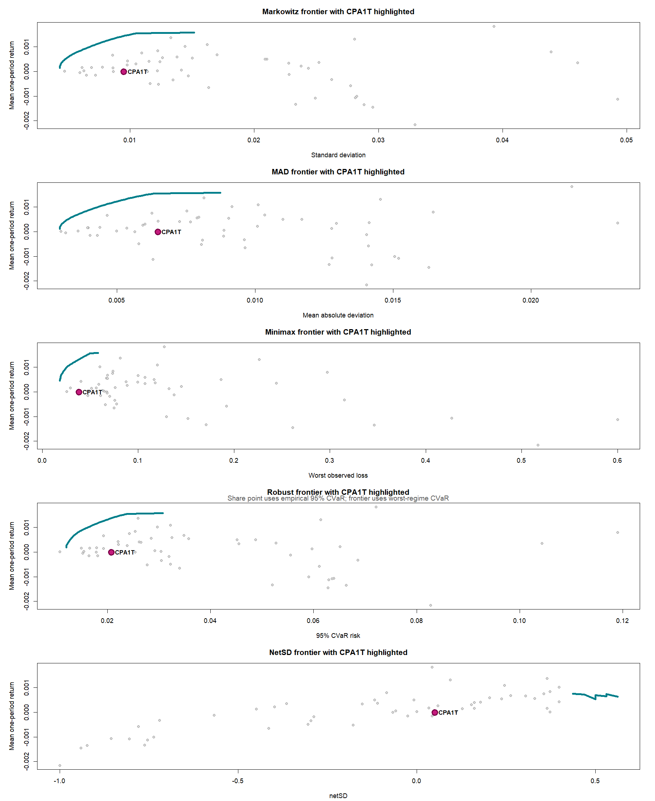

The highlighted circle is the selected share and pale filled circles are the remaining shares. The five panels show Markowitz, MAD, Minimax, regime-aware Robust mean-CVaR and netSD frontiers. In the Robust panel, the individual-share point uses empirical 95% CVaR as an approximation, while the portfolio frontier uses worst-regime CVaR. The netSD panel uses the same 527-observation training sample and the same fixed 16-series reference network for its frontier, portfolios and shares. Its horizontal axis is 1 - netSD, so lower is better. netSD is discrete: the line joins only Pareto-nondominated candidates, while hollow grey circles show the rejected numerical candidates; it must not be interpreted as a smooth frontier.

All 72 PerformanceAnalytics measures: full period and last 126 observations

| Measure | Full period | Last 126 | Measure | Full period | Last 126 |
| --- | --- | --- | --- | --- | --- |
| ActiveReturn | -0.272948 | -0.064245 | M2Sortino | -0.044567 | 0.173922 |
| AdjustedSharpe | -0.204274 | 1.095203 | MSquaredExcess | -0.226318 | -0.055438 |
| AnnualizedReturn_Arithmetic | -0.032938 | 0.172020 | Martin | -0.144765 | 3.082093 |
| AnnualizedReturn_Geometric | -0.044259 | 0.172964 | MaximumDrawdown | 0.385217 | 0.095833 |
| Appraisal | -0.364144 | 0.933702 | Modigliani | -0.000146 | 0.000665 |
| ArithmeticReturn | -0.000131 | 0.000683 | NetSelectivity | -0.249209 | -0.070356 |
| AverageDrawdown | 0.106368 | 0.031531 | Omega | 0.961795 | 1.218730 |
| AverageDrawdownLength | 187.000000 | 19.833333 | OmegaExcessReturn | -0.082018 | 0.144452 |
| AverageRecoveryTime | 45.000000 | 7.833333 | PainIndex | 0.281857 | 0.046338 |
| BernardoLedoit | 0.961795 | 1.218730 | PainRatio | -0.157027 | 3.732649 |
| BetaCoKurtosis | 0.012465 | 0.044152 | Prospect | -0.668262 | -0.546743 |
| BetaCoSkewness | -2.462721 | -3.788299 | Rachev | 1.161109 | 1.324196 |
| Burke | -0.164865 | 1.899189 | Selectivity | -0.057154 | 0.146982 |
| CAPMAlpha | -0.000180 | 0.000585 | Sharpe_Annualized | -0.209303 | 1.082193 |
| CAPMBeta | 0.056384 | 0.109533 | Sharpe_Daily | -0.013185 | 0.068172 |
| CDD | 0.275115 | 0.073944 | Sharpe_ES | -0.006038 | 0.038802 |
| Calmar | -0.114894 | 1.804845 | Sharpe_VaR | -0.008197 | 0.046516 |
| CoKurtosis | 0.000000 | 0.000000 | Skewness | 0.543429 | 1.109058 |
| CoSkewness | -0.000000 | -0.000000 | Sortino | -0.019819 | 0.115963 |
| CumulativeReturn | -0.126674 | 0.083035 | SpecificRisk | 0.156953 | 0.157418 |
| DRatio | 1.342664 | 0.790136 | Sterling | -0.091215 | 0.883221 |
| DownCapture | 0.079258 | 0.122386 | SystematicRisk | 0.009901 | 0.016974 |
| DownNumber | 0.474843 | 0.490566 | TotalRisk | 0.157265 | 0.158330 |
| DownPercent | 0.764151 | 0.773585 | TrackingError_Annualized | 0.228303 | 0.209809 |
| DownsideDeviation | 0.006595 | 0.005887 | TrackingError_Daily | 0.014382 | 0.013217 |
| DrawdownDeviation | 0.014058 | 0.010072 | Treynor_Annualized | -0.784953 | 1.579098 |
| ES_Loss | 0.021647 | 0.017593 | Treynor_Daily | -0.003186 | 0.005782 |
| FamaBeta | 0.896196 | 1.025760 | UlcerIndex | 0.305731 | 0.056119 |
| GeometricReturn | -0.000180 | 0.000633 | UpCapture | 0.032163 | 0.256454 |
| Hurst | 0.327174 | 0.402710 | UpNumber | 0.373853 | 0.465753 |
| Information_Annualized | -1.195555 | -0.306208 | UpPercent | 0.213303 | 0.260274 |
| Information_Daily | -0.069339 | -0.016022 | UpsidePotential | 0.498935 | 0.646128 |
| JensenAlpha | -0.057154 | 0.146982 | UpsideRisk | 0.007394 | 0.008080 |
| Kappa | -0.014072 | 0.087119 | VaR_Loss | 0.015946 | 0.014675 |
| Kelly | -1.330014 | 6.808161 | Volatility | 0.009913 | 0.010013 |
| Kurtosis | 5.777861 | 6.852935 | Volatility_Annualized | 0.157369 | 0.158955 |

Portfolio sensitivity

**Removing this share from curent_update_baltic**

<table class="effect-table"><thead><tr><th>Measure</th><th>Full portfolio</th><th>Portfolio without share</th><th>Change</th></tr></thead><tbody><tr><td>netSD</td><td>0.813559</td><td>0.813559</td><td>0.000000</td></tr><tr><td>OUT</td><td>96</td><td>96</td><td>+0</td></tr><tr><td>IN</td><td>0</td><td>0</td><td>+0</td></tr><tr><td>Rachev ratio</td><td>1.147773</td><td>1.148909</td><td>0.001135</td></tr><tr><td>Sortino ratio</td><td>0.161492</td><td>0.162574</td><td>0.001082</td></tr></tbody></table>

The removed weight is distributed proportionally across all remaining holdings, so their weights still sum to 1.

**Adding this new share to the current portfolio**

<table class="effect-table"><thead><tr><th>Measure</th><th>Current portfolio</th><th>After adding share</th><th>Change</th></tr></thead><tbody><tr><td>CPA1T shares</td><td>0</td><td>46</td><td>+46</td></tr><tr><td>Portfolio value, EUR</td><td>7956.851983</td><td>8064.491979</td><td>107.639996</td></tr><tr><td>netSD</td><td>0.423729</td><td>0.423729</td><td>0.000000</td></tr><tr><td>OUT</td><td>62</td><td>62</td><td>+0</td></tr><tr><td>IN</td><td>12</td><td>12</td><td>+0</td></tr><tr><td>Rachev ratio</td><td>1.070123</td><td>1.072595</td><td>0.002472</td></tr><tr><td>Sortino ratio</td><td>0.092352</td><td>0.091795</td><td>-0.000557</td></tr></tbody></table>

The starting point is the unmodified current portfolio, which already contains 0 CPA1T shares. The scenario adds 46 shares from Table 3A, resulting in 46 shares; every other holding remains unchanged.

<strong>TVE1T — Tallinna Vesi</strong> | HOLD | target 39 shares | priority 21

<table class="stock-summary-table"><thead><tr><th>Current shares</th><th>Target shares</th><th>Change</th><th>Weight</th><th>Last price</th><th>Individual netSD</th><th>OUT / IN</th><th>RSI(14)</th><th>MACD state</th><th>Bollinger state</th><th>Stochastic RSI</th><th>Technical decision</th><th>HHI contribution</th><th>Median daily turnover</th><th>Trade / median turnover</th><th>Zero-volume days</th><th>Liquidity risk</th></tr></thead><tbody><tr><td>0</td><td>39</td><td>+39</td><td>2.88%</td><td>EUR 10.9000</td><td>0.0424</td><td>31 / 26</td><td>52.49</td><td>Bullish</td><td>Inside bands</td><td>1.000 (Overbought)</td><td>HOLD</td><td>0.000829 (0.967% of portfolio HHI)</td><td>EUR 14,562</td><td>2.9%</td><td>1.2%</td><td>MEDIUM</td></tr></tbody></table>

Signals combine four indicators: Bollinger bands, RSI, MACD and Stochastic RSI. Vertical lines distinguish 4-of-4, 3-of-4 and 2-of-4 buy/sell agreement.

Complete technical history

Return histogram

FSD, SSD and TSD components versus Baltic portfolios

The lower integrated CDF component is preferred at a given return threshold. Dominance requires the relevant curve to remain no higher over the complete domain, not merely over one interval.

All five model frontiers with this share highlighted

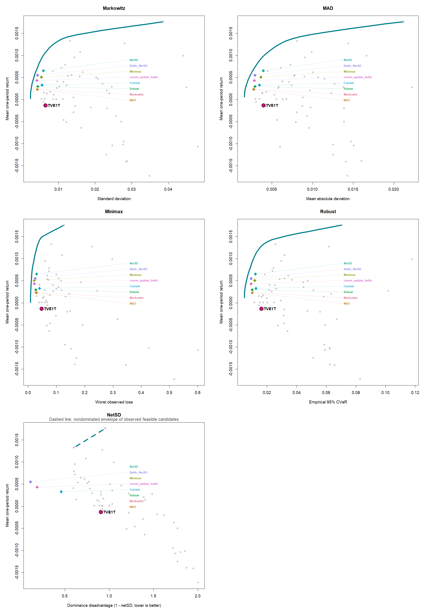

The highlighted circle is the selected share and pale filled circles are the remaining shares. The five panels show Markowitz, MAD, Minimax, regime-aware Robust mean-CVaR and netSD frontiers. In the Robust panel, the individual-share point uses empirical 95% CVaR as an approximation, while the portfolio frontier uses worst-regime CVaR. The netSD panel uses the same 527-observation training sample and the same fixed 16-series reference network for its frontier, portfolios and shares. Its horizontal axis is 1 - netSD, so lower is better. netSD is discrete: the line joins only Pareto-nondominated candidates, while hollow grey circles show the rejected numerical candidates; it must not be interpreted as a smooth frontier.

All 72 PerformanceAnalytics measures: full period and last 126 observations

| Measure | Full period | Last 126 | Measure | Full period | Last 126 |
| --- | --- | --- | --- | --- | --- |
| ActiveReturn | -0.308852 | -0.281897 | M2Sortino | -0.082400 | -0.045321 |
| AdjustedSharpe | -0.702177 | -0.447337 | MSquaredExcess | -0.296295 | -0.249680 |
| AnnualizedReturn_Arithmetic | -0.078108 | -0.041014 | Martin | -0.317624 | -1.452294 |
| AnnualizedReturn_Geometric | -0.080163 | -0.044688 | MaximumDrawdown | 0.297838 | 0.064569 |
| Appraisal | -0.830607 | -0.532081 | Modigliani | -0.000523 | -0.000261 |
| ArithmeticReturn | -0.000310 | -0.000163 | NetSelectivity | -0.215591 | -0.192535 |
| AverageDrawdown | 0.077168 | 0.013045 | Omega | 0.853972 | 0.903435 |
| AverageDrawdownLength | 187.000000 | 11.444444 | OmegaExcessReturn | -0.109970 | -0.069612 |
| AverageRecoveryTime | 102.500000 | 3.777778 | PainIndex | 0.235070 | 0.022343 |
| BernardoLedoit | 0.853972 | 0.903435 | PainRatio | -0.341015 | -2.000040 |
| BetaCoKurtosis | 0.024684 | 0.026251 | Prospect | -0.569150 | -0.441041 |
| BetaCoSkewness | 0.061649 | 11.547958 | Rachev | 0.767831 | 0.729913 |
| Burke | -0.412768 | -0.751080 | Selectivity | -0.086229 | -0.051138 |
| CAPMAlpha | -0.000333 | -0.000187 | Sharpe_Annualized | -0.751125 | -0.424635 |
| CAPMBeta | 0.026526 | 0.027194 | Sharpe_Daily | -0.047316 | -0.026750 |
| CDD | 0.195220 | 0.020919 | Sharpe_ES | -0.017767 | -0.010812 |
| Calmar | -0.269148 | -0.692092 | Sharpe_VaR | -0.032181 | -0.018572 |
| CoKurtosis | 0.000000 | 0.000000 | Skewness | -1.446544 | -3.657486 |
| CoSkewness | 0.000000 | 0.000000 | Sortino | -0.059534 | -0.031628 |
| CumulativeReturn | -0.221208 | -0.022599 | SpecificRisk | 0.103814 | 0.096110 |
| DRatio | 1.203830 | 1.006260 | Sterling | -0.201495 | -0.271543 |
| DownCapture | 0.049120 | 0.019848 | SystematicRisk | 0.004658 | 0.004214 |
| DownNumber | 0.320755 | 0.283019 | TotalRisk | 0.103919 | 0.096202 |
| DownPercent | 0.823899 | 0.811321 | TrackingError_Annualized | 0.200029 | 0.178987 |
| DownsideDeviation | 0.005206 | 0.005146 | TrackingError_Daily | 0.012601 | 0.011275 |
| DrawdownDeviation | 0.010849 | 0.006039 | Treynor_Annualized | -3.022038 | -1.643297 |
| ES_Loss | 0.017445 | 0.015053 | Treynor_Daily | -0.012498 | -0.006671 |
| FamaBeta | 0.592195 | 0.623278 | UlcerIndex | 0.252382 | 0.030770 |
| GeometricReturn | -0.000332 | -0.000181 | UpCapture | -0.033885 | -0.022344 |
| Hurst | 0.366349 | 0.476392 | UpNumber | 0.284404 | 0.273973 |
| Information_Annualized | -1.544032 | -1.574955 | UpPercent | 0.121560 | 0.082192 |
| Information_Daily | -0.091195 | -0.091035 | UpsidePotential | 0.348158 | 0.295903 |
| JensenAlpha | -0.086229 | -0.051138 | UpsideRisk | 0.003981 | 0.003205 |
| Kappa | -0.035953 | -0.016776 | VaR_Loss | 0.009632 | 0.008763 |
| Kelly | -7.223233 | -4.396474 | Volatility | 0.006551 | 0.006084 |
| Kurtosis | 13.475446 | 30.337179 | Volatility_Annualized | 0.103987 | 0.096585 |

Portfolio sensitivity

**Removing this share from curent_update_baltic**

<table class="effect-table"><thead><tr><th>Measure</th><th>Full portfolio</th><th>Portfolio without share</th><th>Change</th></tr></thead><tbody><tr><td>netSD</td><td>0.813559</td><td>0.796610</td><td>-0.016949</td></tr><tr><td>OUT</td><td>96</td><td>94</td><td>-2</td></tr><tr><td>IN</td><td>0</td><td>0</td><td>+0</td></tr><tr><td>Rachev ratio</td><td>1.147773</td><td>1.140537</td><td>-0.007236</td></tr><tr><td>Sortino ratio</td><td>0.161492</td><td>0.163699</td><td>0.002207</td></tr></tbody></table>

The removed weight is distributed proportionally across all remaining holdings, so their weights still sum to 1.

**Adding this new share to the current portfolio**

<table class="effect-table"><thead><tr><th>Measure</th><th>Current portfolio</th><th>After adding share</th><th>Change</th></tr></thead><tbody><tr><td>TVE1T shares</td><td>0</td><td>39</td><td>+39</td></tr><tr><td>Portfolio value, EUR</td><td>7956.851983</td><td>8381.951968</td><td>425.099985</td></tr><tr><td>netSD</td><td>0.423729</td><td>0.440678</td><td>0.016949</td></tr><tr><td>OUT</td><td>62</td><td>62</td><td>+0</td></tr><tr><td>IN</td><td>12</td><td>10</td><td>-2</td></tr><tr><td>Rachev ratio</td><td>1.070123</td><td>1.072688</td><td>0.002565</td></tr><tr><td>Sortino ratio</td><td>0.092352</td><td>0.089927</td><td>-0.002425</td></tr></tbody></table>

The starting point is the unmodified current portfolio, which already contains 0 TVE1T shares. The scenario adds 39 shares from Table 3A, resulting in 39 shares; every other holding remains unchanged.

<strong>SAF1R — SAF Tehnika</strong> | HOLD | target 100 shares | priority 22

<table class="stock-summary-table"><thead><tr><th>Current shares</th><th>Target shares</th><th>Change</th><th>Weight</th><th>Last price</th><th>Individual netSD</th><th>OUT / IN</th><th>RSI(14)</th><th>MACD state</th><th>Bollinger state</th><th>Stochastic RSI</th><th>Technical decision</th><th>HHI contribution</th><th>Median daily turnover</th><th>Trade / median turnover</th><th>Zero-volume days</th><th>Liquidity risk</th></tr></thead><tbody><tr><td>100</td><td>100</td><td>+0</td><td>11.00%</td><td>EUR 16.5000</td><td>-0.1186</td><td>12 / 26</td><td>48.45</td><td>Bearish</td><td>Inside bands</td><td>0.331 (Neutral)</td><td>HOLD</td><td>0.012100 (14.115% of portfolio HHI)</td><td>EUR 7,130</td><td>0.0%</td><td>2.4%</td><td>MEDIUM</td></tr></tbody></table>

Signals combine four indicators: Bollinger bands, RSI, MACD and Stochastic RSI. Vertical lines distinguish 4-of-4, 3-of-4 and 2-of-4 buy/sell agreement.

Complete technical history

Return histogram

FSD, SSD and TSD components versus Baltic portfolios

The lower integrated CDF component is preferred at a given return threshold. Dominance requires the relevant curve to remain no higher over the complete domain, not merely over one interval.

All five model frontiers with this share highlighted

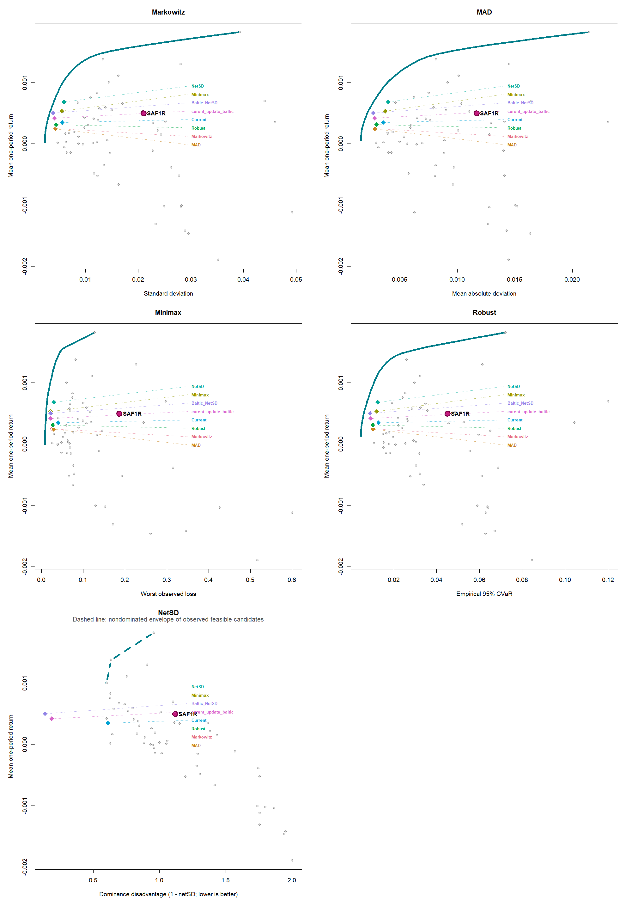

The highlighted circle is the selected share and pale filled circles are the remaining shares. The five panels show Markowitz, MAD, Minimax, regime-aware Robust mean-CVaR and netSD frontiers. In the Robust panel, the individual-share point uses empirical 95% CVaR as an approximation, while the portfolio frontier uses worst-regime CVaR. The netSD panel uses the same 527-observation training sample and the same fixed 16-series reference network for its frontier, portfolios and shares. Its horizontal axis is 1 - netSD, so lower is better. netSD is discrete: the line joins only Pareto-nondominated candidates, while hollow grey circles show the rejected numerical candidates; it must not be interpreted as a smooth frontier.

All 72 PerformanceAnalytics measures: full period and last 126 observations

| Measure | Full period | Last 126 | Measure | Full period | Last 126 |
| --- | --- | --- | --- | --- | --- |
| ActiveReturn | -0.094113 | 1.521448 | M2Sortino | 0.129024 | 1.731606 |
| AdjustedSharpe | 0.386716 | -16.270535 | MSquaredExcess | -0.130561 | 0.346363 |
| AnnualizedReturn_Arithmetic | 0.185846 | 1.094606 | Martin | 0.263460 | 34.505124 |
| AnnualizedReturn_Geometric | 0.134576 | 1.758657 | MaximumDrawdown | 0.613343 | 0.119021 |
| Appraisal | 0.303522 | 4.524113 | Modigliani | 0.000374 | 0.001644 |
| ArithmeticReturn | 0.000737 | 0.004344 | NetSelectivity | -0.316223 | 1.132025 |
| AverageDrawdown | 0.074566 | 0.044658 | Omega | 1.133831 | 1.913900 |
| AverageDrawdownLength | 81.666667 | 19.333333 | OmegaExcessReturn | 0.052099 | 1.707592 |
| AverageRecoveryTime | 45.666667 | 9.500000 | PainIndex | 0.424909 | 0.039515 |
| BernardoLedoit | 1.133831 | 1.913900 | PainRatio | 0.316718 | 44.505740 |
| BetaCoKurtosis | 0.368556 | -0.373590 | Prospect | -0.426971 | -0.151517 |
| BetaCoSkewness | 0.819835 | -28.623651 | Rachev | 1.157893 | 1.812138 |
| Burke | 0.254843 | 11.985399 | Selectivity | 0.104762 | 1.831979 |
| CAPMAlpha | 0.000623 | 0.004619 | Sharpe_Annualized | 0.536906 | 2.673910 |
| CAPMBeta | 0.130372 | -0.309101 | Sharpe_Daily | 0.033822 | 0.168441 |
| CDD | 0.077069 | 0.098897 | Sharpe_ES | 0.015861 | 0.121655 |
| Calmar | 0.219415 | 14.776008 | Sharpe_VaR | 0.028405 | 0.165659 |
| CoKurtosis | 0.000000 | -0.000000 | Skewness | 0.763854 | 4.044583 |
| CoSkewness | 0.000000 | -0.000000 | Sortino | 0.051195 | 0.411995 |
| CumulativeReturn | 0.459036 | 0.660921 | SpecificRisk | 0.345154 | 0.404937 |
| DRatio | 0.888069 | 0.429191 | Sterling | 0.188656 | 8.029624 |
| DownCapture | 0.065218 | -0.639514 | SystematicRisk | 0.022893 | -0.047899 |
| DownNumber | 0.408805 | 0.396226 | TotalRisk | 0.345913 | 0.407760 |
| DownPercent | 0.735849 | 0.773585 | TrackingError_Annualized | 0.377635 | 0.454355 |
| DownsideDeviation | 0.014405 | 0.010543 | TrackingError_Daily | 0.023789 | 0.028622 |
| DrawdownDeviation | 0.022354 | 0.013635 | Treynor_Annualized | 1.032252 | -5.689590 |
| ES_Loss | 0.046496 | 0.035705 | Treynor_Daily | 0.003844 | -0.013054 |
| FamaBeta | 1.971230 | 2.641687 | UlcerIndex | 0.510804 | 0.050968 |
| GeometricReturn | 0.000501 | 0.004035 | UpCapture | 0.225107 | 0.509469 |
| Hurst | 0.437121 | 0.482807 | UpNumber | 0.389908 | 0.383562 |
| Information_Annualized | -0.249216 | 3.348586 | UpPercent | 0.275229 | 0.301370 |
| Information_Daily | -0.013302 | 0.111449 | UpsidePotential | 0.433727 | 0.862806 |
| JensenAlpha | 0.104762 | 1.831979 | UpsideRisk | 0.016366 | 0.023821 |
| Kappa | 0.027611 | 0.280089 | VaR_Loss | 0.025963 | 0.026221 |
| Kelly | 1.551119 | 6.531847 | Volatility | 0.021805 | 0.025788 |
| Kurtosis | 31.980202 | 32.832668 | Volatility_Annualized | 0.346141 | 0.409365 |

Portfolio sensitivity

**Removing this share from curent_update_baltic**

<table class="effect-table"><thead><tr><th>Measure</th><th>Full portfolio</th><th>Portfolio without share</th><th>Change</th></tr></thead><tbody><tr><td>netSD</td><td>0.813559</td><td>0.796610</td><td>-0.016949</td></tr><tr><td>OUT</td><td>96</td><td>94</td><td>-2</td></tr><tr><td>IN</td><td>0</td><td>0</td><td>+0</td></tr><tr><td>Rachev ratio</td><td>1.147773</td><td>1.190075</td><td>0.042301</td></tr><tr><td>Sortino ratio</td><td>0.161492</td><td>0.168744</td><td>0.007252</td></tr></tbody></table>

The removed weight is distributed proportionally across all remaining holdings, so their weights still sum to 1.

**Increasing this existing position in the current portfolio**

<table class="effect-table"><thead><tr><th>Measure</th><th>Current portfolio</th><th>After adding share</th><th>Change</th></tr></thead><tbody><tr><td>SAF1R shares</td><td>100</td><td>100</td><td>+0</td></tr><tr><td>Portfolio value, EUR</td><td>7956.851983</td><td>7956.851983</td><td>0.000000</td></tr><tr><td>netSD</td><td>0.423729</td><td>0.423729</td><td>0.000000</td></tr><tr><td>OUT</td><td>62</td><td>62</td><td>+0</td></tr><tr><td>IN</td><td>12</td><td>12</td><td>+0</td></tr><tr><td>Rachev ratio</td><td>1.070123</td><td>1.070123</td><td>0.000000</td></tr><tr><td>Sortino ratio</td><td>0.092352</td><td>0.092352</td><td>0.000000</td></tr></tbody></table>

The starting point is the unmodified current portfolio, which already contains 100 SAF1R shares. The scenario adds 0 shares from Table 3A, resulting in 100 shares; every other holding remains unchanged.

<strong>TSM1T — Tallinna Sadam</strong> | HOLD | target 330 shares | priority 23

<table class="stock-summary-table"><thead><tr><th>Current shares</th><th>Target shares</th><th>Change</th><th>Weight</th><th>Last price</th><th>Individual netSD</th><th>OUT / IN</th><th>RSI(14)</th><th>MACD state</th><th>Bollinger state</th><th>Stochastic RSI</th><th>Technical decision</th><th>HHI contribution</th><th>Median daily turnover</th><th>Trade / median turnover</th><th>Zero-volume days</th><th>Liquidity risk</th></tr></thead><tbody><tr><td>330</td><td>330</td><td>+0</td><td>2.67%</td><td>EUR 1.2120</td><td>-0.0254</td><td>28 / 31</td><td>46.89</td><td>Bullish</td><td>Inside bands</td><td>1.000 (Overbought)</td><td>HOLD</td><td>0.000711 (0.829% of portfolio HHI)</td><td>EUR 45,487</td><td>0.0%</td><td>1.2%</td><td>LOW</td></tr></tbody></table>

Signals combine four indicators: Bollinger bands, RSI, MACD and Stochastic RSI. Vertical lines distinguish 4-of-4, 3-of-4 and 2-of-4 buy/sell agreement.

Complete technical history

Return histogram

FSD, SSD and TSD components versus Baltic portfolios

The lower integrated CDF component is preferred at a given return threshold. Dominance requires the relevant curve to remain no higher over the complete domain, not merely over one interval.

All five model frontiers with this share highlighted

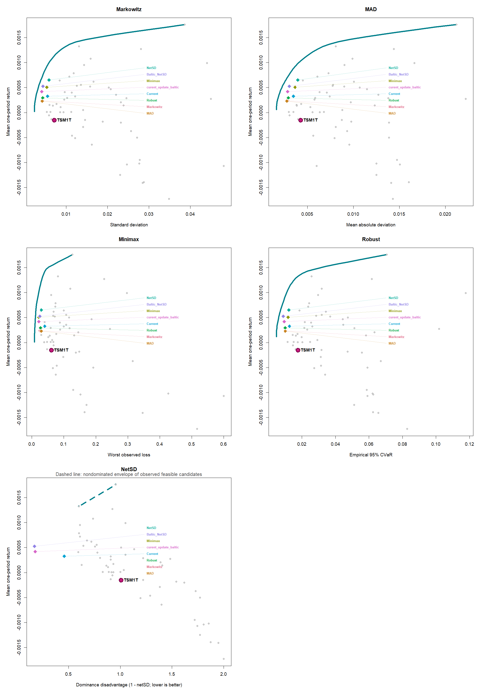

The highlighted circle is the selected share and pale filled circles are the remaining shares. The five panels show Markowitz, MAD, Minimax, regime-aware Robust mean-CVaR and netSD frontiers. In the Robust panel, the individual-share point uses empirical 95% CVaR as an approximation, while the portfolio frontier uses worst-regime CVaR. The netSD panel uses the same 527-observation training sample and the same fixed 16-series reference network for its frontier, portfolios and shares. Its horizontal axis is 1 - netSD, so lower is better. netSD is discrete: the line joins only Pareto-nondominated candidates, while hollow grey circles show the rejected numerical candidates; it must not be interpreted as a smooth frontier.

All 72 PerformanceAnalytics measures: full period and last 126 observations

| Measure | Full period | Last 126 | Measure | Full period | Last 126 |
| --- | --- | --- | --- | --- | --- |
| ActiveReturn | -0.268269 | -0.410984 | M2Sortino | -0.040305 | -0.172626 |
| AdjustedSharpe | -0.294847 | -0.426253 | MSquaredExcess | -0.234675 | -0.346799 |
| AnnualizedReturn_Arithmetic | -0.033543 | -0.180919 | Martin | -0.193218 | -1.669377 |
| AnnualizedReturn_Geometric | -0.039580 | -0.173775 | MaximumDrawdown | 0.278227 | 0.164731 |
| Appraisal | -0.312136 | -1.201787 | Modigliani | -0.000201 | -0.000793 |
| ArithmeticReturn | -0.000133 | -0.000718 | NetSelectivity | -0.191314 | -0.388631 |
| AverageDrawdown | 0.065627 | 0.058335 | Omega | 0.941679 | 0.752323 |
| AverageDrawdownLength | 106.285714 | 41.000000 | OmegaExcessReturn | -0.071857 | -0.208285 |
| AverageRecoveryTime | 35.857143 | 2.000000 | PainIndex | 0.179389 | 0.084215 |
| BernardoLedoit | 0.941679 | 0.752323 | PainRatio | -0.220636 | -2.063476 |
| BetaCoKurtosis | -0.045930 | -0.012177 | Prospect | -0.529670 | -0.609303 |
| BetaCoSkewness | -1.257074 | -0.433006 | Rachev | 0.948434 | 0.788970 |
| Burke | -0.187476 | -1.432956 | Selectivity | -0.036334 | -0.167951 |
| CAPMAlpha | -0.000121 | -0.000696 | Sharpe_Annualized | -0.287906 | -1.288953 |
| CAPMBeta | -0.014194 | -0.024550 | Sharpe_Daily | -0.018136 | -0.081196 |
| CDD | 0.204455 | 0.125019 | Sharpe_ES | -0.007336 | -0.033476 |
| Calmar | -0.142257 | -1.054902 | Sharpe_VaR | -0.013894 | -0.057693 |
| CoKurtosis | -0.000000 | -0.000000 | Skewness | -1.672096 | -1.925976 |
| CoSkewness | -0.000000 | -0.000000 | Sortino | -0.023611 | -0.100763 |
| CumulativeReturn | -0.113818 | -0.091031 | SpecificRisk | 0.116404 | 0.139751 |
| DRatio | 1.094005 | 1.595059 | Sterling | -0.104646 | -0.656421 |
| DownCapture | -0.000623 | 0.018696 | SystematicRisk | -0.002492 | -0.003804 |
| DownNumber | 0.421384 | 0.509434 | TotalRisk | 0.116430 | 0.139803 |
| DownPercent | 0.839623 | 0.830189 | TrackingError_Annualized | 0.212799 | 0.211882 |
| DownsideDeviation | 0.005637 | 0.007125 | TrackingError_Daily | 0.013405 | 0.013347 |
| DrawdownDeviation | 0.011779 | 0.014690 | Treynor_Annualized | 2.788504 | 7.078323 |
| ES_Loss | 0.018145 | 0.021446 | Treynor_Daily | 0.011290 | 0.030843 |
| FamaBeta | 0.663495 | 0.905767 | UlcerIndex | 0.204845 | 0.104096 |
| GeometricReturn | -0.000160 | -0.000757 | UpCapture | -0.031784 | -0.153060 |
| Hurst | 0.376007 | 0.473674 | UpNumber | 0.399083 | 0.383562 |
| Information_Annualized | -1.260667 | -1.939685 | UpPercent | 0.178899 | 0.150685 |
| Information_Daily | -0.072945 | -0.120042 | UpsidePotential | 0.381236 | 0.306069 |
| JensenAlpha | -0.036334 | -0.167951 | UpsideRisk | 0.004694 | 0.005226 |
| Kappa | -0.013175 | -0.057224 | VaR_Loss | 0.009580 | 0.012444 |
| Kelly | -2.471135 | -9.183136 | Volatility | 0.007339 | 0.008842 |
| Kurtosis | 19.250328 | 18.645385 | Volatility_Annualized | 0.116508 | 0.140361 |

Portfolio sensitivity

**Removing this share from curent_update_baltic**

<table class="effect-table"><thead><tr><th>Measure</th><th>Full portfolio</th><th>Portfolio without share</th><th>Change</th></tr></thead><tbody><tr><td>netSD</td><td>0.813559</td><td>0.813559</td><td>0.000000</td></tr><tr><td>OUT</td><td>96</td><td>96</td><td>+0</td></tr><tr><td>IN</td><td>0</td><td>0</td><td>+0</td></tr><tr><td>Rachev ratio</td><td>1.147773</td><td>1.155889</td><td>0.008116</td></tr><tr><td>Sortino ratio</td><td>0.161492</td><td>0.165547</td><td>0.004054</td></tr></tbody></table>

The removed weight is distributed proportionally across all remaining holdings, so their weights still sum to 1.

**Increasing this existing position in the current portfolio**

<table class="effect-table"><thead><tr><th>Measure</th><th>Current portfolio</th><th>After adding share</th><th>Change</th></tr></thead><tbody><tr><td>TSM1T shares</td><td>330</td><td>330</td><td>+0</td></tr><tr><td>Portfolio value, EUR</td><td>7956.851983</td><td>7956.851983</td><td>0.000000</td></tr><tr><td>netSD</td><td>0.423729</td><td>0.423729</td><td>0.000000</td></tr><tr><td>OUT</td><td>62</td><td>62</td><td>+0</td></tr><tr><td>IN</td><td>12</td><td>12</td><td>+0</td></tr><tr><td>Rachev ratio</td><td>1.070123</td><td>1.070123</td><td>0.000000</td></tr><tr><td>Sortino ratio</td><td>0.092352</td><td>0.092352</td><td>0.000000</td></tr></tbody></table>

The starting point is the unmodified current portfolio, which already contains 330 TSM1T shares. The scenario adds 0 shares from Table 3A, resulting in 330 shares; every other holding remains unchanged.

## Single-share additions to the current portfolio

Each row starts from the same unmodified current portfolio and adds only the stated share quantity from Table 3A. Rows are ranked by the change in netSD; larger is better. OUT is the number of dominance relations won, while IN is the number lost; more OUT and fewer IN are preferable.

<strong>Open ranked comparison of all individual additions</strong>

| Rank | Share | Added shares | Updated value EUR | Current OUT / IN | Updated OUT / IN | Delta OUT / IN | Current netSD | Updated netSD | Delta netSD | Delta Rachev | Delta Sortino |
| --- | --- | --- | --- | --- | --- | --- | --- | --- | --- | --- | --- |
| 1 | MOLNR | 30 | 8574.851995 | 62 / 12 | 75 / 3 | +13 / -9 | 0.423729 | 0.610169 | 0.186441 | 0.147201 | 0.030179 |
| 2 | KNE1L | 1581 | 8720.475000 | 62 / 12 | 72 / 2 | +10 / -10 | 0.423729 | 0.593220 | 0.169492 | 0.013318 | 0.016338 |
| 3 | GRG1L | 722 | 8686.071976 | 62 / 12 | 68 / 1 | +6 / -11 | 0.423729 | 0.567797 | 0.144068 | 0.002558 | 0.008021 |
| 4 | MRK1T | 13 | 8308.501973 | 62 / 12 | 70 / 4 | +8 / -8 | 0.423729 | 0.559322 | 0.135593 | 0.013586 | 0.007143 |
| 5 | VLP1L | 23 | 8313.351983 | 62 / 12 | 69 / 4 | +7 / -8 | 0.423729 | 0.550847 | 0.127119 | 0.011637 | 0.013810 |
| 6 | PZV1L | 171 | 8262.086978 | 62 / 12 | 66 / 4 | +4 / -8 | 0.423729 | 0.525424 | 0.101695 | 0.007779 | 0.004841 |
| 7 | RSU1L | 116 | 8476.531986 | 62 / 12 | 66 / 4 | +4 / -8 | 0.423729 | 0.525424 | 0.101695 | -0.000046 | 0.006888 |
| 8 | APG1L | 127 | 8440.721976 | 62 / 12 | 66 / 4 | +4 / -8 | 0.423729 | 0.525424 | 0.101695 | -0.013352 | 0.006995 |
| 9 | AKO1L | 348 | 8595.431997 | 62 / 12 | 66 / 6 | +4 / -6 | 0.423729 | 0.508475 | 0.084746 | -0.018099 | 0.005352 |
| 10 | TVE1T | 39 | 8381.951968 | 62 / 12 | 62 / 10 | +0 / -2 | 0.423729 | 0.440678 | 0.016949 | 0.002565 | -0.002425 |
| 11 | IGN1L | 14 | 8262.051973 | 62 / 12 | 62 / 10 | +0 / -2 | 0.423729 | 0.440678 | 0.016949 | 0.001788 | 0.001075 |
| 12 | DGR1R | 160 | 8229.651990 | 62 / 12 | 62 / 10 | +0 / -2 | 0.423729 | 0.440678 | 0.016949 | -0.003539 | 0.000961 |
| 13 | TKM1T | 55 | 8449.651985 | 62 / 12 | 62 / 10 | +0 / -2 | 0.423729 | 0.440678 | 0.016949 | -0.012033 | -0.004168 |
| 14 | EFT1T | 15 | 8250.101972 | 62 / 12 | 61 / 10 | -1 / -2 | 0.423729 | 0.432203 | 0.008475 | -0.000713 | -0.000085 |
| 15 | CPA1T | 46 | 8064.491979 | 62 / 12 | 62 / 12 | +0 / +0 | 0.423729 | 0.423729 | 0.000000 | 0.002472 | -0.000557 |
| 16 | ROE1L | 6 | 7962.143983 | 62 / 12 | 62 / 12 | +0 / +0 | 0.423729 | 0.423729 | 0.000000 | 0.000069 | 0.000026 |
| 17 | HAE1T | 1 | 7962.391983 | 62 / 12 | 62 / 12 | +0 / +0 | 0.423729 | 0.423729 | 0.000000 | 0.000014 | 0.000004 |
| 18 | SAF1R | 0 | 7956.851983 | 62 / 12 | 62 / 12 | +0 / +0 | 0.423729 | 0.423729 | 0.000000 | 0.000000 | 0.000000 |
| 19 | TSM1T | 0 | 7956.851983 | 62 / 12 | 62 / 12 | +0 / +0 | 0.423729 | 0.423729 | 0.000000 | 0.000000 | 0.000000 |
| 20 | TEL1L | 11 | 7981.711983 | 62 / 12 | 62 / 12 | +0 / +0 | 0.423729 | 0.423729 | 0.000000 | -0.000079 | 0.000070 |
| 21 | VIRSI | 11 | 8005.471983 | 62 / 12 | 62 / 12 | +0 / +0 | 0.423729 | 0.423729 | 0.000000 | -0.000252 | -0.000026 |
| 22 | LHV1T | 34 | 8067.521987 | 62 / 12 | 62 / 12 | +0 / +0 | 0.423729 | 0.423729 | 0.000000 | -0.001132 | -0.000424 |
| 23 | TAL1T | 179 | 8072.306980 | 62 / 12 | 62 / 12 | +0 / +0 | 0.423729 | 0.423729 | 0.000000 | -0.002805 | 0.000318 |

## Leave-one-out portfolio sensitivity

Each scenario removes one share from curent_update_baltic and proportionally rescales the remaining weights. Positive delta means that the ratio improves after removal; negative delta means that the removed share was beneficial for that criterion.

**Main result.** Removing **AKO1L** produces the largest netSD change (+0.000000); removing **TKM1T** gives the largest Rachev improvement (+0.059529); removing **TKM1T** gives the largest Sortino improvement (+0.020102). These are sensitivity results, not automatically new trade recommendations, because the three criteria can move in opposite directions.

<strong>Open complete netSD, Rachev and Sortino sensitivity table</strong>

| Removed share | netSD | Δ netSD | Rachev | Δ Rachev | Sortino | Δ Sortino |
| --- | --- | --- | --- | --- | --- | --- |
| None (baseline) | 0.813559 | 0.000000 | 1.147773 | 0.000000 | 0.161492 | 0.000000 |
| AKO1L | 0.813559 | 0.000000 | 1.154683 | 0.006910 | 0.160163 | -0.001329 |
| APG1L | 0.745763 | -0.067797 | 1.171927 | 0.024153 | 0.150793 | -0.010699 |
| CPA1T | 0.813559 | 0.000000 | 1.148909 | 0.001135 | 0.162574 | 0.001082 |
| DGR1R | 0.813559 | 0.000000 | 1.148472 | 0.000698 | 0.161309 | -0.000183 |
| EFT1T | 0.805085 | -0.008475 | 1.149893 | 0.002119 | 0.161921 | 0.000428 |
| GRG1L | 0.788136 | -0.025424 | 1.148627 | 0.000853 | 0.157428 | -0.004064 |
| HAE1T | 0.813559 | 0.000000 | 1.141945 | -0.005829 | 0.161638 | 0.000145 |
| IGN1L | 0.813559 | 0.000000 | 1.146862 | -0.000911 | 0.161498 | 0.000006 |
| KNE1L | 0.771186 | -0.042373 | 1.151322 | 0.003548 | 0.152410 | -0.009082 |
| LHV1T | 0.813559 | 0.000000 | 1.148276 | 0.000503 | 0.162228 | 0.000736 |
| MOLNR | 0.694915 | -0.118644 | 1.065071 | -0.082703 | 0.140183 | -0.021309 |
| MRK1T | 0.779661 | -0.033898 | 1.128075 | -0.019698 | 0.150343 | -0.011150 |
| PZV1L | 0.813559 | 0.000000 | 1.155041 | 0.007267 | 0.158891 | -0.002601 |
| ROE1L | 0.813559 | 0.000000 | 1.152716 | 0.004942 | 0.162213 | 0.000721 |
| RSU1L | 0.796610 | -0.016949 | 1.162612 | 0.014839 | 0.158856 | -0.002636 |
| SAF1R | 0.796610 | -0.016949 | 1.190075 | 0.042301 | 0.168744 | 0.007252 |
| TAL1T | 0.805085 | -0.008475 | 1.157178 | 0.009405 | 0.161875 | 0.000383 |
| TEL1L | 0.813559 | 0.000000 | 1.147918 | 0.000144 | 0.161502 | 0.000010 |
| TKM1T | 0.762712 | -0.050847 | 1.207303 | 0.059529 | 0.181595 | 0.020102 |
| TSM1T | 0.813559 | 0.000000 | 1.155889 | 0.008116 | 0.165547 | 0.004054 |
| TVE1T | 0.796610 | -0.016949 | 1.140537 | -0.007236 | 0.163699 | 0.002207 |
| VIRSI | 0.813559 | 0.000000 | 1.147864 | 0.000091 | 0.161557 | 0.000065 |
| VLP1L | 0.703390 | -0.110169 | 1.141760 | -0.006013 | 0.132985 | -0.028508 |

Priority 1 denotes the largest individual-share netSD ratio. Dividend columns use only official payments dated in 2025 and 2026. Annual dividend cash equals dividend per share multiplied by the target number of shares.

curent_update_baltic keeps every currently held share, permits purchases only, and uses the EUR 15,000 ceiling. Its calculated netSD is 0.823009, with OUT=93 and IN=0; the remaining cash is EUR 76.64.

<strong>Table 4. Current and optimised portfolios</strong>

| Portfolio | netSD | OUT | IN | denominator | mean | SD | Historical dividends EUR | Portfolio value EUR |
| --- | --- | --- | --- | --- | --- | --- | --- | --- |
| Current | 0.423729 | 62 | 12 | 118 | 0.000349 | 0.005498 | 1394.136000 | 7956.851983 |
| Optimised | 0.864407 | 102 | 0 | 118 | 0.000576 | 0.004512 | 2222.386006 | 15000.000000 |
| curent_update_baltic | 0.813559 | 96 | 0 | 118 | 0.000451 | 0.004252 | 2430.492621 | 14930.436965 |

<strong>Figure 1. Recommended changes relative to current holdings: two adjacent portfolio bars for every share</strong>

Each share has two adjacent bars. The blue bar is the change required for Baltic_NetSD, where negative values are sales. The orange bar is the additional purchase required for curent_update_baltic; it cannot be negative because every current position is retained. Both use the EUR 15,000 ceiling.

<strong>Figure 2. Capital allocation and historical gross dividend contribution</strong>

## Statistical and performance analysis

<strong>Table 5. Empirical statistics of portfolio and S&P 500 daily returns</strong>

| entity | observations | mean | median | SD | minimum | maximum | skewness | kurtosis | VaR_95 | ES_95 |
| --- | --- | --- | --- | --- | --- | --- | --- | --- | --- | --- |
| Current | 754 | 0.000407 | 0.000379 | 0.005773 | -0.040123 | 0.046525 | -0.054536 | 18.599062 | 0.006437 | 0.013055 |
| Markowitz_training | 754 | 0.000281 | 0.000273 | 0.004476 | -0.025519 | 0.027713 | -0.397936 | 10.657233 | 0.005893 | 0.010467 |
| MAD_training | 754 | 0.000289 | 0.000321 | 0.004477 | -0.028989 | 0.026779 | -0.720441 | 12.464893 | 0.005549 | 0.010563 |
| Minimax_training | 754 | 0.000619 | 0.000276 | 0.005683 | -0.021554 | 0.029115 | 0.377474 | 6.881817 | 0.007326 | 0.012242 |
| Robust_training | 754 | 0.000354 | 0.000242 | 0.004587 | -0.026819 | 0.026893 | -0.284450 | 10.181225 | 0.005753 | 0.010453 |
| NetSD_training | 754 | 0.000680 | 0.000268 | 0.005876 | -0.027866 | 0.047554 | 0.625424 | 11.688924 | 0.007314 | 0.012062 |
| Markowitz_full | 754 | 0.000392 | 0.000323 | 0.004475 | -0.030086 | 0.026550 | -0.517818 | 10.814045 | 0.005900 | 0.010369 |
| MAD_full | 754 | 0.000398 | 0.000380 | 0.004540 | -0.034511 | 0.026269 | -0.804959 | 12.865225 | 0.005631 | 0.010606 |
| Minimax_full | 754 | 0.000480 | 0.000111 | 0.005340 | -0.021604 | 0.029071 | 0.181686 | 7.266982 | 0.007042 | 0.011974 |
| Robust_full | 754 | 0.000395 | 0.000351 | 0.004596 | -0.034840 | 0.026102 | -0.927740 | 13.552122 | 0.005530 | 0.010819 |
| NetSD_full | 754 | 0.000624 | 0.000368 | 0.005256 | -0.036431 | 0.032351 | -0.270819 | 11.048650 | 0.006622 | 0.011672 |
| Baltic_NetSD | 754 | 0.000552 | 0.000350 | 0.004489 | -0.025982 | 0.036076 | 0.232602 | 12.421674 | 0.005263 | 0.009590 |
| curent_update_baltic | 754 | 0.000457 | 0.000262 | 0.004399 | -0.021857 | 0.027976 | 0.052546 | 9.903697 | 0.004892 | 0.009816 |
| SP500 | 754 | 0.000879 | 0.001368 | 0.011062 | -0.062006 | 0.097992 | 0.100965 | 14.865600 | 0.016061 | 0.025050 |

Baltic_NetSD has mean daily return 0.000552, median 0.000350 and daily standard deviation 0.004489. Its historical 95% VaR is 0.005263 and ES (CVaR) is 0.009590. VaR is the loss threshold exceeded on approximately 5% of days; ES is the average return in that adverse tail.

<strong>Figure 3. Histograms and kernel densities; every panel uses the same return-axis limits</strong>

The recalculated Baltic_NetSD maximum daily return is 0.036076. The earlier value 0.168092 on 2025-06-25 was traced to RKB1R, whose unadjusted close moved from EUR 0.107 to EUR 0.476 between common Baltic trading dates. RKB1R belongs to the Baltic Secondary List. After excluding every Secondary List share from the investable set, this observation no longer enters the portfolio return; RKB1R is now excluded from both the investable set and every netSD reference network, so the suspect observation cannot affect the objective or its denominator.

<strong>Figure 4a. Portfolio and S&P 500 complete empirical CDF; right side truncated at return 0.05</strong>

<strong>Figure 4b. Portfolio and S&P 500 empirical CDF: enlarged left tail</strong>

<strong>Figure 4c. Portfolio and S&P 500 empirical CDF: enlarged centre</strong>

<strong>Figure 4d. Portfolio and S&P 500 empirical CDF: enlarged right tail</strong>

<strong>Figure 5a. Individual-share complete empirical CDF restricted to returns from -0.30 to 0.30</strong>

<strong>Figure 5b. Individual-share empirical CDF: enlarged left tail</strong>

<strong>Figure 5c. Individual-share empirical CDF: enlarged centre</strong>

<strong>Figure 5d. Individual-share empirical CDF: enlarged right tail</strong>

<strong>Figure 5e. Separate colour and line-pattern key for Figures 5 and 7</strong>

<strong>Figure 6a. Portfolio and benchmark FSD component H1(x)</strong>

<strong>Figure 6b. Portfolio and benchmark SSD component H2(x): enlarged right side with curve-end labels</strong>

<strong>Figure 6c. Portfolio and benchmark TSD component H3(x): enlarged right side with curve-end labels</strong>

<strong>Figure 7a. Individual-share FSD component H1(x)</strong>

<strong>Figure 7b. Individual-share SSD component H2(x): enlarged right side with curve-end labels</strong>

<strong>Figure 7c. Individual-share TSD component H3(x): enlarged right side with curve-end labels</strong>

For every entity, H1(x)=F(x) is the empirical CDF used for FSD. H2(x)=∫H1(u)du is the cumulative FSD component used for SSD, and H3(x)=∫H2(u)du is the cumulative SSD component used for TSD. The CSV files accompanying the report contain every displayed entity as a separate column on the same return-threshold grid.

<strong>Figure 7d. Baltic_NetSD minus every other portfolio: FSD-component differences</strong>

<strong>Figure 7e. Baltic_NetSD minus every other portfolio: SSD-component differences</strong>

<strong>Figure 7f. Baltic_NetSD minus every other portfolio: TSD-component differences</strong>

<strong>Figure 7g. Baltic_NetSD minus every individual share: FSD-component differences</strong>

<strong>Figure 7h. Baltic_NetSD minus every individual share: SSD-component differences</strong>

<strong>Figure 7i. Baltic_NetSD minus every individual share: TSD-component differences</strong>

Each difference is calculated pointwise as Hq_Baltic_NetSD(x) - Hq_comparator(x). A negative value means that the Baltic_NetSD integrated-distribution component is smaller at that threshold; dominance requires the relevant difference to remain nonpositive over the complete support, with at least one strict inequality.

### Local SSD advantages at large return thresholds

<strong>Table 7A. Local right-side SSD-component advantages over Baltic_NetSD</strong>

| comparator | type | local_advantage_from_x | display_upper_x | end_difference | maximum_difference |
| --- | --- | --- | --- | --- | --- |
| NetSD_training | portfolio | 0.012527 | 0.026714 | 0.000097 | 0.000097 |
| NetSD_full | portfolio | 0.020425 | 0.026714 | 0.000009 | 0.000009 |
| VLP1L | share | 0.021776 | 0.155865 | 0.000826 | 0.000826 |
| KNR1L | share | 0.079384 | 0.155865 | 0.000609 | 0.000609 |
| MOLNR | share | 0.114148 | 0.155865 | 0.000590 | 0.000590 |
| IVL1L | share | 0.031708 | 0.155865 | 0.000525 | 0.000525 |
| INC1L | share | 0.033695 | 0.155865 | 0.000462 | 0.000462 |
| KNE1L | share | 0.035681 | 0.155865 | 0.000292 | 0.000292 |
| MRK1T | share | 0.036674 | 0.155865 | 0.000181 | 0.000181 |
| APG1L | share | 0.018796 | 0.155865 | 0.000149 | 0.000149 |

These are local, right-side comparisons and must not be interpreted as SSD over the complete return domain. A positive difference H2_Baltic_NetSD(x)-H2_comparator(x) means that the comparator has the smaller, hence locally preferable, SSD component at that threshold. Among portfolios this occurs for NetSD_training, NetSD_full. The five strongest share cases at the displayed endpoint are VLP1L, KNR1L, MOLNR, IVL1L, INC1L. Smaller positive endpoint differences also occur for KNE1L, MRK1T, APG1L. The table reports the threshold from which the advantage remains positive to the displayed upper endpoint. The listed shares are therefore candidates for further investment analysis, while the absence of full-support dominance means this chart alone is insufficient for an investment decision.

The result that may appear surprising in the difference figures is therefore real but local. NetSD_training has a smaller H2 component than Baltic_NetSD from x=0.012089 to the displayed right endpoint, and NetSD_full does so from x=0.016037. Neither portfolio SSD-dominates Baltic_NetSD over the complete support because the required inequality fails at smaller x values. The listed shares deserve separate investment analysis because their upper-threshold SSD components are favourable. RKB1R is absent from these recalculated comparisons because its suspect unadjusted prices fail the data-quality screen. A local right-side advantage is evidence about one part of the distribution and is not full-domain SSD dominance.

<strong>Table 6. Weight concentration and diversification</strong>

| portfolio | HHI_weights | effective_number | maximum_weight | number_positive | diversification_ratio |
| --- | --- | --- | --- | --- | --- |
| Current | 0.184053 | 5.433206 | 0.325793 | 9 | 1.967318 |
| Markowitz_training | 0.173946 | 5.748903 | 0.325443 | 10 | 2.215022 |
| MAD_training | 0.202077 | 4.948602 | 0.379940 | 10 | 2.162493 |
| Minimax_training | 0.169523 | 5.898915 | 0.279680 | 10 | 2.044411 |
| Robust_training | 0.180150 | 5.550933 | 0.349431 | 10 | 2.223341 |
| NetSD_training | 0.188413 | 5.307499 | 0.337844 | 10 | 1.955892 |
| Markowitz_full | 0.152149 | 6.572488 | 0.295792 | 10 | 2.288552 |
| MAD_full | 0.182270 | 5.486352 | 0.338655 | 10 | 2.216582 |
| Minimax_full | 0.157248 | 6.359400 | 0.258417 | 10 | 2.077220 |
| Robust_full | 0.215235 | 4.646077 | 0.386466 | 10 | 2.157801 |
| NetSD_full | 0.132893 | 7.524846 | 0.188213 | 10 | 2.210873 |
| Baltic_NetSD | 0.070139 | 14.257415 | 0.120143 | 21 | 2.644089 |
| curent_update_baltic | 0.083115 | 12.031504 | 0.191487 | 23 | 2.808721 |

For Baltic_NetSD, HHI=0.070139; lower is better because less capital is concentrated in a few shares. Its effective number of equally weighted positions is 14.26, the largest weight is 12.01%, and the diversification ratio is 2.644; a value above 1 means portfolio volatility is below the weighted average volatility of its components.

<strong>Figure 8. HHI concentration comparison</strong>

<strong>Table 7. Canonical comparable netSD results</strong>

| entity | OUT | IN | denominator | netSD | mean | SD |
| --- | --- | --- | --- | --- | --- | --- |
| Current | 59 | 8 | 113 | 0.451327 | 0.000375 | 0.005654 |
| Markowitz_training | 64 | 0 | 113 | 0.566372 | 0.000269 | 0.004359 |
| MAD_training | 64 | 0 | 113 | 0.566372 | 0.000270 | 0.004367 |
| Minimax_training | 84 | 0 | 113 | 0.743363 | 0.000568 | 0.005566 |
| Robust_training | 64 | 0 | 113 | 0.566372 | 0.000334 | 0.004491 |
| NetSD_training | 88 | 0 | 113 | 0.778761 | 0.000712 | 0.005997 |
| Markowitz_full | 64 | 0 | 113 | 0.566372 | 0.000375 | 0.004383 |
| MAD_full | 64 | 0 | 113 | 0.566372 | 0.000375 | 0.004432 |
| Minimax_full | 72 | 0 | 113 | 0.637168 | 0.000439 | 0.005205 |
| Robust_full | 66 | 0 | 113 | 0.584071 | 0.000375 | 0.004498 |
| NetSD_full | 90 | 0 | 113 | 0.796460 | 0.000602 | 0.005197 |
| Baltic_NetSD | 102 | 0 | 113 | 0.902655 | 0.000597 | 0.004457 |
| curent_update_baltic | 93 | 0 | 113 | 0.823009 | 0.000467 | 0.004316 |

Baltic_NetSD has OUT=102 and IN=0. Dividing OUT-IN by the common network fixed denominator 113 gives netSD=0.902655. A larger netSD is better within this exact fixed reference system.

For curent_update_baltic, IN=0 because Baltic_NetSD dominates it by third-order stochastic dominance over the complete empirical support. There are no incoming FSD or SSD relations. Thus IN=1 is one directed TSD relation from Baltic_NetSD, rather than one adverse observation or one share.

<strong>Table 8. Systematic risk relative to S&P 500</strong>

| entity | CAPMBeta | CAPMAlpha | JensenAlpha | SpecificRisk | SystematicRisk | TotalRisk | TrackingError_Annualized | Information_Annualized |
| --- | --- | --- | --- | --- | --- | --- | --- | --- |
| Current | 0.061460 | 0.000353 | 0.089279 | 0.090944 | 0.010792 | 0.091582 | 0.188261 | -0.665855 |
| Markowitz_training | 0.044911 | 0.000242 | 0.060407 | 0.070568 | 0.007886 | 0.071007 | 0.181970 | -0.868339 |
| MAD_training | 0.046369 | 0.000248 | 0.062126 | 0.070563 | 0.008142 | 0.071031 | 0.181733 | -0.858181 |
| Minimax_training | 0.061845 | 0.000564 | 0.149827 | 0.089503 | 0.010860 | 0.090160 | 0.187509 | -0.345150 |
| Robust_training | 0.052772 | 0.000307 | 0.078254 | 0.072184 | 0.009267 | 0.072777 | 0.181337 | -0.763035 |
| NetSD_training | 0.061383 | 0.000626 | 0.167719 | 0.092596 | 0.010779 | 0.093221 | 0.189078 | -0.248219 |
| Markowitz_full | 0.050216 | 0.000348 | 0.089470 | 0.070443 | 0.008818 | 0.070992 | 0.181063 | -0.705471 |
| MAD_full | 0.052032 | 0.000352 | 0.090709 | 0.071438 | 0.009137 | 0.072020 | 0.181160 | -0.695964 |
| Minimax_full | 0.048315 | 0.000438 | 0.113489 | 0.084287 | 0.008484 | 0.084713 | 0.187191 | -0.556390 |
| Robust_full | 0.054150 | 0.000348 | 0.089344 | 0.072284 | 0.009509 | 0.072906 | 0.181155 | -0.700843 |
| NetSD_full | 0.062943 | 0.000569 | 0.151827 | 0.082639 | 0.011053 | 0.083375 | 0.184155 | -0.339213 |
| Baltic_NetSD | 0.032170 | 0.000524 | 0.139061 | 0.070993 | 0.005649 | 0.071217 | 0.184198 | -0.446646 |
| curent_update_baltic | 0.044353 | 0.000418 | 0.109114 | 0.069344 | 0.007788 | 0.069780 | 0.181589 | -0.602634 |
| SP500 | 1.000000 | 0.000000 | 0.000000 | 0.000000 | 0.175597 | 0.175597 | 0.000000 | nan |

CAPM beta measures sensitivity to S&P 500: beta below 1 means a smaller average response to market movements, while beta above 1 means greater sensitivity. SpecificRisk is the residual component not explained by the benchmark; SystematicRisk is the benchmark-related component; TotalRisk combines both.

<strong>Table 8A. Individual-share netSD and admissibility for the new optimisation</strong>

| asset | OUT | IN | denominator | netSD | segment | positive_netSD | secondary_list | admissible |
| --- | --- | --- | --- | --- | --- | --- | --- | --- |
| AIR | 6 | 100 | 113 | -0.831858 | First North Baltic Share List | False | False | False |
| AKO1L | 25 | 11 | 113 | 0.123894 | Baltic Main List | True | False | True |
| AMG1L | 28 | 34 | 113 | -0.053097 | Baltic Secondary List | False | True | False |
| APG1L | 38 | 0 | 113 | 0.336283 | Baltic Main List | True | False | True |
| ARC1T | 22 | 40 | 113 | -0.159292 | Baltic Main List | False | False | False |
| AUG1L | 2 | 105 | 113 | -0.911504 | Baltic Secondary List | False | True | False |
| BAL1R | 0 | 112 | 113 | -0.991150 | Baltic Secondary List | False | True | False |
| BERCM | 6 | 92 | 113 | -0.761062 | First North Baltic Share List | False | False | False |
| CPA1T | 30 | 24 | 113 | 0.053097 | Baltic Main List | True | False | True |
| CTS1L | 0 | 89 | 113 | -0.787611 | Baltic First North Foreign Shares trading list | False | False | False |
| DGR1R | 24 | 25 | 113 | -0.008850 | Baltic Main List | False | False | False |
| EFT1T | 36 | 23 | 113 | 0.115044 | Baltic Main List | True | False | True |
| EWA1L | 29 | 29 | 113 | 0.000000 | First North Baltic Share List | False | False | False |
| GRG1L | 49 | 6 | 113 | 0.380531 | Baltic Main List | True | False | True |
| HAE1T | 37 | 24 | 113 | 0.115044 | Baltic Main List | True | False | True |
| HPR1T | 17 | 64 | 113 | -0.415929 | Baltic Main List | False | False | False |
| IDX1R | 17 | 54 | 113 | -0.327434 | Baltic Main List | False | False | False |
| IGN1L | 56 | 10 | 113 | 0.407080 | Baltic Main List | True | False | True |
| INC1L | 31 | 4 | 113 | 0.238938 | Baltic Secondary List | True | True | False |
| INL1L | 11 | 61 | 113 | -0.442478 | Baltic Secondary List | False | True | False |
| INR1L | 29 | 7 | 113 | 0.194690 | Baltic Secondary List | True | True | False |
| IVL1L | 50 | 0 | 113 | 0.442478 | Baltic Secondary List | True | True | False |
| KNE1L | 42 | 0 | 113 | 0.371681 | Baltic Main List | True | False | True |
| KNR1L | 12 | 2 | 113 | 0.088496 | Baltic Secondary List | True | True | False |
| LGD1L | 45 | 4 | 113 | 0.362832 | Baltic Secondary List | True | True | False |
| LHV1T | 34 | 22 | 113 | 0.106195 | Baltic Main List | True | False | True |
| LINDA | 5 | 89 | 113 | -0.743363 | First North Baltic Share List | False | False | False |
| MAGIC | 0 | 105 | 113 | -0.929204 | First North Baltic Share List | False | False | False |
| MDARA | 18 | 55 | 113 | -0.327434 | First North Baltic Share List | False | False | False |
| MODE | 27 | 24 | 113 | 0.026549 | First North Baltic Share List | True | False | True |
| MOLNR | 4 | 0 | 113 | 0.035398 | First North Baltic Share List | True | False | True |
| MRK1T | 42 | 0 | 113 | 0.371681 | Baltic Main List | True | False | True |
| NCN1T | 23 | 50 | 113 | -0.238938 | Baltic Main List | False | False | False |
| NEOFI | 7 | 55 | 113 | -0.424779 | First North Baltic Share List | False | False | False |
| PKG1T | 15 | 32 | 113 | -0.150442 | Baltic Main List | False | False | False |
| PRF1T | 1 | 112 | 113 | -0.982301 | Baltic Secondary List | False | True | False |
| PZV1L | 35 | 14 | 113 | 0.185841 | Baltic Main List | True | False | True |
| ROE1L | 38 | 17 | 113 | 0.185841 | Baltic Main List | True | False | True |
| RSU1L | 35 | 6 | 113 | 0.256637 | Baltic Main List | True | False | True |
| SAF1R | 12 | 24 | 113 | -0.106195 | Baltic Main List | False | False | False |
| SAUNA | 3 | 95 | 113 | -0.814159 | First North Baltic Share List | False | False | False |
| SCM1R | 1 | 9 | 113 | -0.070796 | Baltic Secondary List | False | True | False |
| SFG1T | 24 | 33 | 113 | -0.079646 | Baltic Main List | False | False | False |
| SKN1T | 5 | 99 | 113 | -0.831858 | Baltic Secondary List | False | True | False |
| TAL1T | 26 | 24 | 113 | 0.017699 | Baltic Main List | True | False | True |
| TEL1L | 43 | 24 | 113 | 0.168142 | Baltic Main List | True | False | True |
| TKM1T | 29 | 22 | 113 | 0.061947 | Baltic Main List | True | False | True |
| TPD1T | 11 | 85 | 113 | -0.654867 | Baltic Secondary List | False | True | False |
| TSM1T | 28 | 30 | 113 | -0.017699 | Baltic Main List | False | False | False |
| TVE1T | 28 | 26 | 113 | 0.017699 | Baltic Main List | True | False | True |
| UTR1L | 1 | 40 | 113 | -0.345133 | Baltic Secondary List | False | True | False |
| VBL1L | 23 | 23 | 113 | 0.000000 | Baltic Secondary List | False | True | False |
| VIRSI | 40 | 0 | 113 | 0.353982 | First North Baltic Share List | True | False | True |
| VLP1L | 43 | 0 | 113 | 0.380531 | Baltic Main List | True | False | True |
| ZMP1L | 31 | 10 | 113 | 0.185841 | Baltic Secondary List | True | True | False |

A share is investment-admissible only when its individual netSD is strictly positive and it does not belong to the Baltic Secondary List. Secondary List shares remain in the dominance reference network used to calculate netSD, but their portfolio weights are fixed at zero.

<strong>Figure 9. Classical mean-SD efficient frontier and observed portfolios</strong>

The curve is the single long-only Markowitz efficient frontier calculated from all 55 quality-approved shares. Shares and previously formed portfolios are points. Baltic_NetSD is highlighted in red because it maximises the stochastic-dominance objective rather than variance, so it need not lie on the Markowitz curve.

<strong>Figure 10. Cumulative returns, daily returns and drawdowns</strong>

<strong>Table 9. Complete PerformanceAnalytics comparison</strong>

| Measure | Current | Markowitz_training | MAD_training | Minimax_training | Robust_training | NetSD_training | Markowitz_full | MAD_full | Minimax_full | Robust_full | NetSD_full | Baltic_NetSD | curent_update_baltic |
| --- | --- | --- | --- | --- | --- | --- | --- | --- | --- | --- | --- | --- | --- |
| ArithmeticReturn | 0.000407 | 0.000281 | 0.000289 | 0.000619 | 0.000354 | 0.000680 | 0.000392 | 0.000398 | 0.000480 | 0.000395 | 0.000624 | 0.000552 | 0.000457 |
| GeometricReturn | 0.000390 | 0.000271 | 0.000279 | 0.000603 | 0.000343 | 0.000663 | 0.000382 | 0.000388 | 0.000466 | 0.000385 | 0.000610 | 0.000542 | 0.000447 |
| AnnualizedReturn_Arithmetic | 0.102550 | 0.070824 | 0.072744 | 0.155939 | 0.089138 | 0.171390 | 0.098719 | 0.100296 | 0.120984 | 0.099563 | 0.157293 | 0.139212 | 0.115124 |
| AnnualizedReturn_Geometric | 0.103335 | 0.070677 | 0.072730 | 0.163971 | 0.090323 | 0.181757 | 0.100954 | 0.102608 | 0.124538 | 0.101728 | 0.166221 | 0.146418 | 0.119257 |
| CumulativeReturn | 0.342094 | 0.226705 | 0.233756 | 0.575080 | 0.295290 | 0.648194 | 0.333449 | 0.339451 | 0.420751 | 0.336254 | 0.584211 | 0.505074 | 0.400882 |
| Volatility | 0.005773 | 0.004476 | 0.004477 | 0.005683 | 0.004587 | 0.005876 | 0.004475 | 0.004540 | 0.005340 | 0.004596 | 0.005256 | 0.004489 | 0.004399 |
| Volatility_Annualized | 0.091642 | 0.071054 | 0.071078 | 0.090219 | 0.072824 | 0.093282 | 0.071039 | 0.072067 | 0.084769 | 0.072954 | 0.083429 | 0.071264 | 0.069826 |
| MaximumDrawdown | 0.202906 | 0.170192 | 0.166449 | 0.157736 | 0.151701 | 0.114377 | 0.143065 | 0.138179 | 0.186881 | 0.132771 | 0.131017 | 0.066539 | 0.118739 |
| AverageDrawdown | 0.025469 | 0.019669 | 0.024326 | 0.014763 | 0.017239 | 0.018675 | 0.017643 | 0.018183 | 0.014914 | 0.017957 | 0.015602 | 0.010042 | 0.010944 |
| AverageDrawdownLength | 55.461538 | 51.857143 | 65.727273 | 20.911765 | 34.380952 | 26.576923 | 37.210526 | 39.000000 | 27.692308 | 44.312500 | 24.821429 | 15.409091 | 22.548387 |
| AverageRecoveryTime | 29.692308 | 28.357143 | 36.181818 | 11.558824 | 13.809524 | 15.500000 | 14.526316 | 15.111111 | 17.153846 | 21.437500 | 14.750000 | 6.431818 | 13.032258 |
| Sharpe_Daily | 0.070492 | 0.062791 | 0.064471 | 0.108883 | 0.077106 | 0.115741 | 0.087540 | 0.087670 | 0.089906 | 0.085970 | 0.118766 | 0.123056 | 0.103860 |
| Sharpe_Annualized | 1.119033 | 0.996770 | 1.023446 | 1.728460 | 1.224019 | 1.837330 | 1.389649 | 1.391712 | 1.427221 | 1.364738 | 1.885345 | 1.953461 | 1.648726 |
| Sharpe_VaR | 0.063218 | 0.047693 | 0.052024 | 0.084465 | 0.061485 | 0.092984 | 0.066397 | 0.070684 | 0.068176 | 0.071441 | 0.094257 | 0.104963 | 0.093380 |
| Sharpe_ES | 0.031171 | 0.026852 | 0.027327 | 0.050547 | 0.033840 | 0.056387 | 0.037780 | 0.037525 | 0.040094 | 0.036520 | 0.053478 | 0.057606 | 0.046540 |
| Sortino | 0.103322 | 0.089978 | 0.090696 | 0.175636 | 0.113343 | 0.188039 | 0.126822 | 0.124911 | 0.138998 | 0.121638 | 0.180686 | 0.194047 | 0.159106 |
| Calmar | 0.509274 | 0.415279 | 0.436951 | 1.039527 | 0.595400 | 1.589095 | 0.705654 | 0.742575 | 0.666402 | 0.766189 | 1.268702 | 2.200475 | 1.004363 |
| Omega | 1.253802 | 1.207409 | 1.218241 | 1.377407 | 1.260146 | 1.408378 | 1.298163 | 1.305293 | 1.300715 | 1.301546 | 1.420607 | 1.443722 | 1.354910 |
| Sterling | 0.341144 | 0.261581 | 0.272960 | 0.636196 | 0.358849 | 0.847835 | 0.415339 | 0.430803 | 0.434110 | 0.437030 | 0.719520 | 0.879180 | 0.545203 |
| Burke | 0.711394 | 0.626776 | 0.642660 | 1.265723 | 0.799609 | 1.363583 | 0.914138 | 0.926048 | 0.960507 | 0.903216 | 1.321467 | 1.386651 | 1.066623 |
| Martin | 0.985147 | 0.743619 | 0.807360 | 2.110690 | 1.121867 | 3.631643 | 1.386084 | 1.525674 | 1.222933 | 1.655375 | 2.635455 | 6.207138 | 2.089109 |
| UlcerIndex | 0.104893 | 0.095045 | 0.090084 | 0.077686 | 0.080511 | 0.050048 | 0.072834 | 0.067254 | 0.101835 | 0.061453 | 0.063071 | 0.023589 | 0.057085 |
| PainIndex | 0.080184 | 0.077883 | 0.073764 | 0.058068 | 0.061619 | 0.038792 | 0.055230 | 0.050917 | 0.075457 | 0.046825 | 0.047385 | 0.016485 | 0.042848 |
| PainRatio | 1.288719 | 0.907476 | 0.985987 | 2.823785 | 1.465833 | 4.685408 | 1.827879 | 2.015216 | 1.650440 | 2.172525 | 3.507857 | 8.881997 | 2.783287 |
| VaR_Loss | 0.006437 | 0.005893 | 0.005549 | 0.007326 | 0.005753 | 0.007314 | 0.005900 | 0.005631 | 0.007042 | 0.005530 | 0.006622 | 0.005263 | 0.004892 |
| ES_Loss | 0.013055 | 0.010467 | 0.010563 | 0.012242 | 0.010453 | 0.012062 | 0.010369 | 0.010606 | 0.011974 | 0.010819 | 0.011672 | 0.009590 | 0.009816 |
| DownsideDeviation | 0.003939 | 0.003124 | 0.003183 | 0.003523 | 0.003121 | 0.003617 | 0.003089 | 0.003186 | 0.003454 | 0.003248 | 0.003454 | 0.002847 | 0.002871 |
| DrawdownDeviation | 0.007691 | 0.006487 | 0.006360 | 0.006733 | 0.006269 | 0.005894 | 0.005906 | 0.005779 | 0.007319 | 0.005503 | 0.005868 | 0.004193 | 0.005151 |
| Rachev | 1.101132 | 1.043589 | 1.025876 | 1.271580 | 1.114071 | 1.279184 | 1.067344 | 1.049732 | 1.175661 | 1.049030 | 1.167225 | 1.254899 | 1.171576 |
| AdjustedSharpe | 0.196866 | 0.614905 | 0.474911 | 1.081194 | 0.604269 | -0.056304 | 0.349252 | 0.023852 | 0.972030 | -0.040823 | -0.522513 | -0.824987 | 0.383345 |
| Skewness | -0.054536 | -0.397936 | -0.720441 | 0.377474 | -0.284450 | 0.625424 | -0.517818 | -0.804959 | 0.181686 | -0.927740 | -0.270819 | 0.232602 | 0.052546 |
| Kurtosis | 18.599062 | 10.657233 | 12.464893 | 6.881817 | 10.181225 | 11.688924 | 10.814045 | 12.865225 | 7.266982 | 13.552122 | 11.048650 | 12.421674 | 9.903697 |
| UpsidePotential | 0.510416 | 0.523794 | 0.506272 | 0.641010 | 0.549035 | 0.648494 | 0.552168 | 0.534062 | 0.601222 | 0.525020 | 0.610269 | 0.631362 | 0.607405 |
| UpsideRisk | 0.004235 | 0.003214 | 0.003158 | 0.004497 | 0.003377 | 0.004676 | 0.003258 | 0.003254 | 0.004096 | 0.003271 | 0.004005 | 0.003511 | 0.003360 |
| BernardoLedoit | 1.253802 | 1.207409 | 1.218241 | 1.377407 | 1.260146 | 1.408378 | 1.298163 | 1.305293 | 1.300715 | 1.301546 | 1.420607 | 1.443722 | 1.354910 |
| DRatio | 0.680517 | 0.725996 | 0.678011 | 0.636395 | 0.680759 | 0.619052 | 0.622612 | 0.619211 | 0.718885 | 0.624374 | 0.603865 | 0.581154 | 0.639406 |
| Hurst | 0.408833 | 0.373706 | 0.380678 | 0.330215 | 0.371346 | 0.385210 | 0.383093 | 0.391582 | 0.339636 | 0.390138 | 0.388151 | 0.396413 | 0.366375 |
| Kappa | 0.059623 | 0.055300 | 0.053849 | 0.116238 | 0.069496 | 0.120127 | 0.076783 | 0.073136 | 0.091296 | 0.070360 | 0.108401 | 0.118488 | 0.099663 |
| Kelly | 12.210935 | 14.028417 | 14.398990 | 19.158592 | 16.807867 | 19.696548 | 19.561870 | 19.311415 | 16.836604 | 18.706853 | 22.598090 | 27.411431 | 23.611933 |
| Prospect | -0.405547 | -0.452293 | -0.428775 | -0.406083 | -0.431271 | -0.387529 | -0.404860 | -0.386527 | -0.438782 | -0.382589 | -0.356293 | -0.352598 | -0.401268 |
| Information_Daily | -0.036029 | -0.047680 | -0.047078 | -0.018192 | -0.041528 | -0.012985 | -0.038213 | -0.037671 | -0.029827 | -0.037950 | -0.017862 | -0.023718 | -0.032381 |
| Information_Annualized | -0.665855 | -0.868339 | -0.858181 | -0.345150 | -0.763035 | -0.248219 | -0.705471 | -0.695964 | -0.556390 | -0.700843 | -0.339213 | -0.446646 | -0.602634 |
| CAPMAlpha | 0.000353 | 0.000242 | 0.000248 | 0.000564 | 0.000307 | 0.000626 | 0.000348 | 0.000352 | 0.000438 | 0.000348 | 0.000569 | 0.000524 | 0.000418 |
| JensenAlpha | 0.089279 | 0.060407 | 0.062126 | 0.149827 | 0.078254 | 0.167719 | 0.089470 | 0.090709 | 0.113489 | 0.089344 | 0.151827 | 0.139061 | 0.109114 |
| Treynor_Daily | 0.006350 | 0.006035 | 0.006009 | 0.009745 | 0.006504 | 0.010800 | 0.007602 | 0.007451 | 0.009642 | 0.007101 | 0.009697 | 0.016860 | 0.010082 |
| Treynor_Annualized | 1.681322 | 1.573709 | 1.568491 | 2.651296 | 1.711562 | 2.961042 | 2.010408 | 1.972026 | 2.577618 | 1.878642 | 2.640818 | 4.551443 | 2.688800 |
| Modigliani | 0.000780 | 0.000695 | 0.000713 | 0.001204 | 0.000853 | 0.001280 | 0.000968 | 0.000970 | 0.000995 | 0.000951 | 0.001314 | 0.001361 | 0.001149 |
| TrackingError_Daily | 0.011859 | 0.011463 | 0.011448 | 0.011812 | 0.011423 | 0.011911 | 0.011406 | 0.011412 | 0.011792 | 0.011412 | 0.011601 | 0.011603 | 0.011439 |
| TrackingError_Annualized | 0.188261 | 0.181970 | 0.181733 | 0.187509 | 0.181337 | 0.189078 | 0.181063 | 0.181160 | 0.187191 | 0.181155 | 0.184155 | 0.184198 | 0.181589 |
| M2Sortino | 0.109296 | 0.077033 | 0.079051 | 0.175263 | 0.098334 | 0.193567 | 0.109982 | 0.111307 | 0.133627 | 0.110080 | 0.178035 | 0.160977 | 0.131133 |
| Appraisal | 0.981698 | 0.856007 | 0.880431 | 1.673988 | 1.084088 | 1.811307 | 1.270121 | 1.269760 | 1.346451 | 1.236027 | 1.837228 | 1.958797 | 1.573515 |
| CAPMBeta | 0.061460 | 0.044911 | 0.046369 | 0.061845 | 0.052772 | 0.061383 | 0.050216 | 0.052032 | 0.048315 | 0.054150 | 0.062943 | 0.032170 | 0.044353 |
| ActiveReturn | -0.125355 | -0.158012 | -0.155959 | -0.064719 | -0.138367 | -0.046933 | -0.127735 | -0.126081 | -0.104151 | -0.126961 | -0.062468 | -0.082271 | -0.109432 |
| OmegaExcessReturn | 0.080784 | 0.052794 | 0.054507 | 0.143799 | 0.072455 | 0.161048 | 0.083269 | 0.084365 | 0.104763 | 0.083131 | 0.146443 | 0.130118 | 0.102818 |
| BetaCoSkewness | -1.007663 | -1.030977 | -1.139233 | -0.930234 | -1.006532 | -0.908119 | -1.100709 | -1.118876 | -1.079607 | -1.123072 | -0.954915 | -2.102459 | -1.592190 |
| BetaCoKurtosis | 0.083192 | 0.049011 | 0.051037 | 0.027872 | 0.047768 | 0.040181 | 0.045809 | 0.051584 | 0.023902 | 0.056251 | 0.050910 | -0.025360 | 0.027992 |
| CDD | 0.040293 | 0.035628 | 0.046112 | 0.027983 | 0.041533 | 0.044066 | 0.038434 | 0.043415 | 0.025972 | 0.047864 | 0.035587 | 0.024500 | 0.022822 |
| CoSkewness | -0.000000 | -0.000000 | -0.000000 | -0.000000 | -0.000000 | -0.000000 | -0.000000 | -0.000000 | -0.000000 | -0.000000 | -0.000000 | -0.000000 | -0.000000 |
| CoKurtosis | 0.000000 | 0.000000 | 0.000000 | 0.000000 | 0.000000 | 0.000000 | 0.000000 | 0.000000 | 0.000000 | 0.000000 | 0.000000 | -0.000000 | 0.000000 |
| FamaBeta | 0.521888 | 0.404641 | 0.404778 | 0.513783 | 0.414724 | 0.531228 | 0.404556 | 0.410411 | 0.482748 | 0.415463 | 0.475119 | 0.405842 | 0.397650 |
| MSquaredExcess | -0.024976 | -0.043968 | -0.039889 | 0.073619 | -0.008871 | 0.092338 | 0.016973 | 0.017355 | 0.023837 | 0.013157 | 0.098611 | 0.107502 | 0.057961 |
| NetSelectivity | -0.016016 | -0.021860 | -0.019838 | 0.046474 | -0.004520 | 0.060270 | 0.008437 | 0.008752 | 0.014139 | 0.006716 | 0.057567 | 0.053606 | 0.028319 |
| Selectivity | 0.089279 | 0.060407 | 0.062126 | 0.149827 | 0.078254 | 0.167719 | 0.089470 | 0.090709 | 0.113489 | 0.089344 | 0.151827 | 0.139061 | 0.109114 |
| SpecificRisk | 0.090944 | 0.070568 | 0.070563 | 0.089503 | 0.072184 | 0.092596 | 0.070443 | 0.071438 | 0.084287 | 0.072284 | 0.082639 | 0.070993 | 0.069344 |
| SystematicRisk | 0.010792 | 0.007886 | 0.008142 | 0.010860 | 0.009267 | 0.010779 | 0.008818 | 0.009137 | 0.008484 | 0.009509 | 0.011053 | 0.005649 | 0.007788 |
| TotalRisk | 0.091582 | 0.071007 | 0.071031 | 0.090160 | 0.072777 | 0.093221 | 0.070992 | 0.072020 | 0.084713 | 0.072906 | 0.083375 | 0.071217 | 0.069780 |
| UpCapture | 0.106155 | 0.071291 | 0.073323 | 0.136728 | 0.092194 | 0.138263 | 0.090263 | 0.091277 | 0.102491 | 0.093247 | 0.133385 | 0.091783 | 0.094525 |
| UpNumber | 0.566514 | 0.555046 | 0.573394 | 0.550459 | 0.575688 | 0.555046 | 0.575688 | 0.580275 | 0.543578 | 0.584862 | 0.564220 | 0.550459 | 0.564220 |
| UpPercent | 0.174312 | 0.146789 | 0.144495 | 0.178899 | 0.158257 | 0.204128 | 0.153670 | 0.146789 | 0.183486 | 0.149083 | 0.178899 | 0.167431 | 0.178899 |
| DownCapture | 0.013226 | 0.006585 | 0.006889 | -0.011008 | 0.011399 | -0.027237 | -0.002297 | -0.002875 | -0.013063 | 0.000470 | -0.016812 | -0.047988 | -0.016212 |
| DownNumber | 0.503145 | 0.503145 | 0.493711 | 0.496855 | 0.518868 | 0.500000 | 0.484277 | 0.490566 | 0.525157 | 0.500000 | 0.503145 | 0.465409 | 0.503145 |
| DownPercent | 0.874214 | 0.893082 | 0.893082 | 0.861635 | 0.883648 | 0.877358 | 0.893082 | 0.889937 | 0.880503 | 0.883648 | 0.877358 | 0.899371 | 0.893082 |

Table 9 contains all 72 measures calculated directly with PerformanceAnalytics: measures are rows and portfolios are columns. S&P 500 is the benchmark for CAPM, information, tracking-error, capture and systematic-risk measures. It remains in Table 5 and the figures; it is omitted from Table 9 because its information ratio relative to itself has a zero tracking-error denominator.

## Decision risks and implementability

### Liquidity and turnover

<strong>Table 10. Proposed trades and observed one-year market liquidity</strong>

| asset | trade_shares | trade_value_EUR | median_daily_turnover_EUR | zero_volume_fraction | trade_to_median_turnover | liquidity_flag |
| --- | --- | --- | --- | --- | --- | --- |
| KNE1L | 3662 | 1801.7040 | 14744.2945 | 0.0119 | 0.1222 | MEDIUM |
| GRG1L | 759 | 766.5900 | 14030.0100 | 0.0119 | 0.0546 | MEDIUM |
| EFT1T | 30 | 582.0000 | 18097.9500 | 0.0119 | 0.0322 | MEDIUM |
| TVE1T | 11 | 119.3500 | 14487.2500 | 0.0119 | 0.0082 | MEDIUM |
| HAE1T | -8 | 41.1200 | 16335.3900 | 0.0119 | 0.0025 | MEDIUM |
| TKM1T | -219 | 1992.9001 | 39903.1900 | 0.0119 | 0.0499 | LOW |
| VLP1L | 62 | 961.0000 | 24886.8000 | 0.0119 | 0.0386 | LOW |
| APG1L | 154 | 612.9200 | 21467.7200 | 0.0119 | 0.0286 | LOW |
| TEL1L | 629 | 1396.3800 | 51206.1300 | 0.0119 | 0.0273 | LOW |
| AKO1L | 123 | 217.7100 | 24553.0000 | 0.0119 | 0.0089 | LOW |
| TSM1T | -330 | 403.2600 | 48681.1890 | 0.0119 | 0.0083 | LOW |
| MRK1T | 9 | 242.1000 | 61536.9500 | 0.0119 | 0.0039 | LOW |
| TAL1T | 329 | 203.9800 | 76196.4300 | 0.0119 | 0.0027 | LOW |
| IGN1L | 23 | 508.3000 | 289289.6750 | 0.0119 | 0.0018 | LOW |
| ROE1L | -217 | 194.2150 | 200231.7685 | 0.0119 | 0.0010 | LOW |
| LHV1T | 34 | 113.3900 | 263779.8850 | 0.0119 | 0.0004 | LOW |
| CPA1T | 10 | 23.3000 | 75536.4150 | 0.0119 | 0.0003 | LOW |
| MOLNR | 37 | 699.3000 | 132.0000 | 0.2659 | 5.2977 | HIGH |
| MODE | 81 | 477.9000 | 476.6200 | 0.1151 | 1.0027 | HIGH |
| RSU1L | 236 | 1076.1600 | 1371.7000 | 0.0317 | 0.7845 | HIGH |
| SAF1R | -100 | 1715.0000 | 4065.6250 | 0.0278 | 0.4218 | HIGH |
| VIRSI | 206 | 902.2800 | 2494.2600 | 0.0238 | 0.3617 | HIGH |
| PZV1L | 298 | 515.5400 | 4342.1750 | 0.0119 | 0.1187 | HIGH |

Median daily turnover and zero-volume frequency use official Nasdaq Baltic price-volume observations from the last 365 calendar days of the sample. Trade-to-turnover is the proposed absolute order value divided by median daily turnover. HIGH flags median turnover below EUR 5,000 or an order above 20% of median turnover; MEDIUM flags below EUR 20,000 or above 10%. These are transparent screening thresholds, not a guarantee of execution. HIGH trades should be split, limited or omitted after checking the live order book.

<strong>Table 11. Illustrative transaction-cost and turnover scenario</strong>

| portfolio | turnover_EUR | number_of_trades | estimated_cost_EUR | high_liquidity_risk_trades | cost_percent_of_15000 |
| --- | --- | --- | --- | --- | --- |
| Baltic_NetSD | 15566.3991 | 23 | 223.9929 | 6 | 1.4933 |
| curent_update_baltic | 6878.9760 | 20 | 122.9841 | 5 | 0.8199 |

The cost scenario uses max(EUR 3, 0.25% of trade value) commission plus an assumed spread/impact of 0.25%, 0.75% or 2.00% for LOW, MEDIUM or HIGH liquidity risk. These are sensitivity assumptions rather than broker quotes. Reported historical returns and dividends are gross; subtract the displayed cost before interpreting an implementation result.

### Capital concentration

<strong>Table 12. Top-position and effective-position concentration</strong>

| portfolio | positions | top5_share | top10_share | HHI | effective_positions |
| --- | --- | --- | --- | --- | --- |
| Baltic_NetSD | 21 | 0.4890 | 0.7428 | 0.0704 | 14.2108 |
| curent_update_baltic | 22 | 0.5221 | 0.7578 | 0.0834 | 11.9913 |

<strong>Table 12A. Baltic_NetSD: country, list and industry concentration</strong>

| dimension | category | capital_percent |
| --- | --- | --- |
| country_market | RIG | 6.05 |
| country_market | TLN | 30.39 |
| country_market | VLN | 63.56 |
| segment | Baltic Main List | 86.06 |
| segment | First North Baltic Share List | 13.94 |
| Industry | Basic Materials | 5.14 |
| Industry | Consumer Discretionary | 23.98 |
| Industry | Consumer Staples | 22.94 |
| Industry | Financials | 4.82 |
| Industry | Health Care | 4.69 |
| Industry | Industrials | 20.48 |
| Industry | Technology | 3.20 |
| Industry | Telecommunications | 9.36 |
| Industry | Utilities | 4.21 |
| Industry | nan | 1.19 |
| Supersector | Banks | 0.92 |
| Supersector | Basic Resources | 5.14 |
| Supersector | Construction and Materials | 5.23 |
| Supersector | Financial Services | 3.90 |
| Supersector | Food, Beverage and Tobacco | 22.94 |
| Supersector | Health Care | 4.69 |
| Supersector | Industrial Goods and Services | 15.25 |
| Supersector | Retail | 19.70 |
| Supersector | Technology | 3.20 |
| Supersector | Telecommunications | 9.36 |
| Supersector | Travel and Leisure | 4.28 |
| Supersector | Utilities | 4.21 |
| Supersector | nan | 1.19 |

<strong>Table 12B. curent_update_baltic: country, list and industry concentration</strong>

| dimension | category | capital_percent |
| --- | --- | --- |
| country_market | RIG | 12.78 |
| country_market | TLN | 50.98 |
| country_market | VLN | 36.24 |
| segment | Baltic Main List | 91.77 |
| segment | First North Baltic Share List | 8.23 |
| Industry | Basic Materials | 3.51 |
| Industry | Consumer Discretionary | 31.05 |
| Industry | Consumer Staples | 13.38 |
| Industry | Financials | 3.18 |
| Industry | Health Care | 3.42 |
| Industry | Industrials | 20.08 |
| Industry | Technology | 3.52 |
| Industry | Telecommunications | 12.99 |
| Industry | Utilities | 3.43 |
| Industry | nan | 5.43 |
| Supersector | Banks | 0.19 |
| Supersector | Basic Resources | 3.51 |
| Supersector | Construction and Materials | 7.57 |
| Supersector | Financial Services | 2.99 |
| Supersector | Food, Beverage and Tobacco | 13.38 |
| Supersector | Health Care | 3.42 |
| Supersector | Industrial Goods and Services | 12.51 |
| Supersector | Retail | 27.27 |
| Supersector | Technology | 3.52 |
| Supersector | Telecommunications | 12.99 |
| Supersector | Travel and Leisure | 3.78 |
| Supersector | Utilities | 3.43 |
| Supersector | nan | 5.43 |

The number of holdings is not a diversification measure. Top-five and top-ten shares show how much capital is concentrated in the largest positions; HHI and the effective number of positions measure weight concentration. Country, list, industry and supersector totals expose common economic exposures that a position count conceals. Very small positions add trading complexity while making little difference to risk.

### Validation and interpretation limits

<strong>Table 13. Existing 70/30 holdout experiment: portfolio-only netSD on unseen test data</strong>

| entity | out | in | network_denominator | netSD |
| --- | --- | --- | --- | --- |
| Markowitz | 3 | 0 | 6 | 0.500000 |
| MAD | 0 | 0 | 6 | 0.000000 |
| Minimax | 3 | 0 | 6 | 0.500000 |
| Robust | 0 | 1 | 6 | -0.166667 |
| NetSD | 0 | 2 | 6 | -0.333333 |
| Current | 3 | 0 | 6 | 0.500000 |
| SP500 | 0 | 6 | 6 | -1.000000 |

The final Baltic_NetSD weights were selected on the complete 2023–2026 sample. Their 14.64% annualised geometric return and 1.95 annualised Sharpe ratio are therefore in-sample descriptions, not forecasts. The earlier 70/30 experiment is the available independent check: weights were fixed from the first 70% and assessed on the last 30%. Its NetSD portfolio has a negative test-network netSD, which is direct evidence of model-selection instability. No trade should rely on the full-sample figures without a new walk-forward or future-paper-trading test.

netSD counts outgoing minus incoming FSD, SSD and TSD relations relative to a fixed comparison network. It has no monetary unit and does not state expected profit, maximum loss or suitability for an investor. Use it as a distribution-ranking signal together with return, volatility, drawdown, VaR/ES, liquidity, concentration and cost results.

The S&P 500 series is a USD price-index benchmark. It excludes dividends and has not been converted into EUR investor returns, so it is retained only as a broad market sensitivity reference. Direct performance claims require a total-return benchmark converted to EUR over identical dates.

Dividend values are historical gross cash distributions. They are excluded from optimisation and are neither a forecast nor an assessment of dividend sustainability. Company valuation, earnings quality, debt, free cash flow and payout coverage have not been modelled; each proposed purchase therefore requires a separate fundamental review.

## Model

### Exact mathematical formulation of the netSD portfolio

Let R_tj be the return of share j on date t, w_j its final portfolio weight, and r_p,t = Σ_j w_j R_tj the candidate portfolio return. Let K denote the fixed reference set consisting of 55 quality-approved shares, the current portfolio, and ten earlier portfolios.

For entity i, define H_i^(1)(x)=F_i(x) and H_i^(q)(x)=∫_{-∞}^x H_i^(q-1)(u)du for q=2,3. Entity i dominates entity k at order q when H_i^(q)(x) ≤ H_k^(q)(x) for every observed support point x, with a strict inequality for at least one x. The third-order comparison additionally requires E[R_i] ≥ E[R_k]. Let a_ik^(q)=1 when this condition holds and 0 otherwise.

OUT(p)=Σ_{k∈K}Σ_{q=1}^3 a_pk^(q),   IN(p)=Σ_{k∈K}Σ_{q=1}^3 a_kp^(q),   D=max_i{OUT(i)+IN(i)},   netSD(p)=[OUT(p)-IN(p)]/D.

Primary optimisation problem: max_w netSD(w), subject to Σ_j w_j=1; w_j≥0; μᵀw≥μ_current; and w_j=0 for every share j whose individual netSD_j≤0 or which belongs to the Baltic Secondary List. Selling existing holdings is allowed, so current positions do not impose lower bounds. Historical dividends are reported separately and do not enter the objective.

The individual-share screening score is calculated before the new candidate enters the network: netSD_j=(OUT_j-IN_j)/D_ref in the fixed 67-entity reference system. This prevents the candidate from changing its own admissible investment universe.

The unchanged reference set contains 55 quality-approved shares, the current portfolio, and ten earlier portfolios: Markowitz, MAD, Minimax, Robust and NetSD estimated from the training sample and from the complete sample. The larger pairwise matrices are diagnostics only; their expanded-network ratios are not presented as the optimisation score.

The objective is discrete and non-convex. ISRES evaluates candidate portfolios numerically. The report therefore states the best solution found; it does not claim a mathematical certificate of global optimality.

## Data coverage

The official Nasdaq Baltic list contained 67 shares. 55 shares had Yahoo closing-price history covering the complete study window and entered the common-date return matrix. Shares with incomplete or unavailable histories are excluded from both the optimisation and Table 2. No price interpolation or zero-return replacement was used.

Sources: official Nasdaq Baltic share-list XLSX and dividend/event XLSX downloaded on 2026-10-13; Yahoo Finance unadjusted closing prices downloaded through quantmod; official Nasdaq Baltic corrections for MODE and MOLNR in 2025 and the complete VIRSI history (2023-01-01 to 2026-08-29).
</main>

</body></html>
